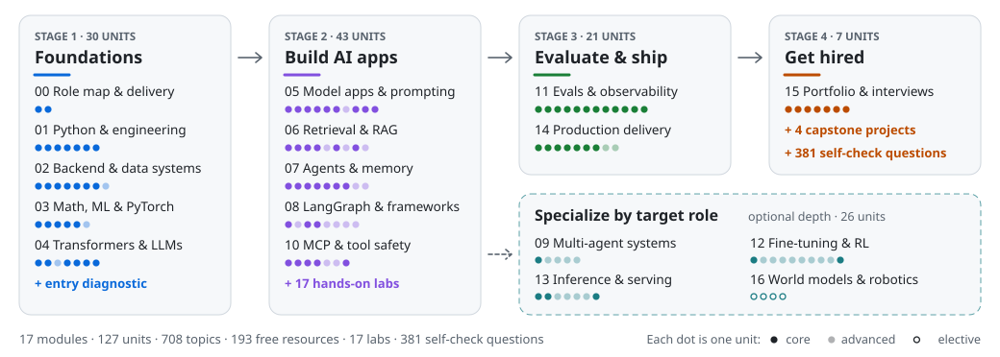

# AI Engineering Roadmap

[中文](README.zh-CN.md) · English

[](https://github.com/Yanyi-He/ai-engineer-roadmap/actions/workflows/validate.yml) [](LICENSE)

**What to learn to become an AI Engineer, in what order, and how to show you can do the job. Built from 367 real job descriptions in China and North America.**

<picture>
  <source media="(prefers-color-scheme: dark)" srcset="assets/overview/roadmap-en-dark.svg">
  
</picture>

Each of the 127 units lists what to know, how deep to go (explain, implement, diagnose or design), one free primary reading with the sections to read, a build task and three self-check questions.

## Start here

| If you are… | Start with | Then |
|---|---|---|
| A software engineer moving into AI | [Entry diagnostic](docs/en/entry-diagnostic.md): skip what you already know | Follow the [core route](docs/en/dependency-order.md#core-route-ai-application-engineering) and build the [labs](docs/en/labs.md) as you go |
| Preparing for AI Engineer interviews | [Self-check question bank](docs/en/self-check.md): answer without notes | Fill gaps from the unit pages, then work through [module 15](docs/en/modules/15.md) |
| Deciding whether the role fits you | [Role overview](docs/en/role-overview.md): what employers hire for | Compare the [China](docs/en/jd-china.md) and [North America](docs/en/jd-north-america.md) analyses |
| Going deeper into training or inference | [Learning path](docs/en/learning-path.md): choose a specialization | Modules [12](docs/en/modules/12.md) and [13](docs/en/modules/13.md), then capstone [P4](docs/en/capstones.md#p4-small-model-serving-and-adaptation) |

## What makes it different

- **Priorities come from hiring data.** Across 51 Chinese and 316 North American AI-engineering job descriptions, 86% and 90% ask for shipping to production and 53% and 67% ask for evaluation; only 31% and 18% mention fine-tuning. The markets differ too: 47% of Chinese descriptions want Java/Spring, against 10% in North America. See the [charts, intervals and enterprise cases](docs/en/role-overview.md).
- **Prerequisites at the unit level.** You can ship a model API service and an agent without a framework before studying transformer internals. Each route pulls in only the prerequisites it needs.
- **Free readings, with the sections to read.** All 193 resources are link-checked, and each unit says which chapters to read and why that source was picked.
- **Work you can show an interviewer.** 17 labs, 4 capstone projects (P1 and P2 come with [runnable starter code](starters/)), an assessment rubric and 381 self-check questions.

## All pages

1. [Roles and hiring](docs/en/role-overview.md): software and AI hiring trends in the US, Canada and China (official BLS, Statistics Canada and COPS data), 367 job descriptions analyzed by market (80 from Canada), and breakdowns of large-employer postings.
2. [Diagnostic](docs/en/entry-diagnostic.md) → [learning path](docs/en/learning-path.md) → [dependencies](docs/en/dependency-order.md).
3. [Knowledge tree](docs/en/knowledge-tree.md): 17 modules, 127 units, 708 topics.
4. [Self-check questions](docs/en/self-check.md): 381 interview-style questions, three per unit, for finding gaps before interviews.
5. [Labs](docs/en/labs.md) → [capstones](docs/en/capstones.md) → [assessment](docs/en/assessment.md).
6. [Stack decisions](docs/en/stack-decisions.md), [repositories](docs/en/open-source.md), [resource policy](docs/en/resource-policy.md).

[CS329Z / CS336 course mapping](docs/en/course-audit.md): where each course’s material fits in the units, and how deep to go.

## Modules

Start with a small model application, then add retrieval, tool calling, state and operations. Pick up math and model internals as you go, and choose a specialization for the roles you target.

```mermaid
mindmap
  root((AI Engineering))
    00 Careers and end-to-end AI delivery
      00.1 Role map and market interpretation
      00.2 From a business problem to an AI system
    01 Python and software engineering
      01.1 Python language and data model
      01.2 Types, schemas and configuration
      01.3 Async, concurrency and cancellation
      01.4 Practical algorithms and data structures
      01.5 Testing, debugging and profiling
      01.6 Environment, Linux and collaboration
      01.7 AI-assisted programming and coding-agent workflows
    02 Backend, data and distributed systems
      02.1 HTTP APIs and streaming
      02.2 SQL, modeling and indexes
      02.3 Transactions, idempotency and consistency
      02.4 Caches, queues and workers
      02.5 Identity, authorization and tenancy
      02.6 Cloud, containers and delivery
      02.7 TypeScript and AI frontend interaction
      02.8 Java/Spring AI and enterprise system integration
    03 Math, ML, deep learning and PyTorch
      03.1 Linear algebra and numerical basics
      03.2 Probability, statistics and experiments
      03.3 ML tasks and generalization
      03.4 Neural networks and optimization
      03.5 PyTorch training engineering
      03.6 Taking classical ML to production （MLOps）
    04 Transformers and language-model internals
      04.1 Tokenization, corpora and objectives
      04.2 Transformer computation
      04.3 Positions, attention variants and architectures
      04.4 Decoding and constrained generation
      04.5 Pretraining, post-training and capabilities
      04.6 From internals to a small model
      04.7 Vision encoders and contrastive learning
    05 Model applications, prompting and multimodal I/O
      05.1 Model APIs and provider adapters
      05.2 Prompting and task decomposition
      05.3 Structured output and tool execution
      05.4 Context engineering and compaction
      05.5 Routing, caching and cost
      05.6 Vision, documents and multimodal input
      05.7 Voice and realtime agents
      05.8 Test-time compute and verification
      05.9 Model selection and upgrade decisions
      05.10 Model platforms, gateways and cloud AI services
    06 Data engineering, retrieval and RAG
      06.1 Ingestion and data quality
      06.2 Embeddings and similarity
      06.3 Lexical, vector and ANN indexes
      06.4 Hybrid retrieval and reranking
      06.5 Query understanding and advanced RAG
      06.6 Grounded answers and citations
      06.7 GraphRAG, SQL and structured knowledge
      06.8 Operating and maintaining RAG
      06.9 Visual document retrieval and long-context tradeoffs
    07 Agent architecture, harnesses and memory
      07.1 Choosing workflows and agents
      07.2 Reasoning/action loops and planning
      07.3 Harnesses and agent/environment interfaces
      07.4 State, persistence and recovery
      07.5 Working memory and context runtime
      07.6 Long-term memory and fact lifecycle
      07.7 Skills, reusable capabilities and long tasks
      07.8 Tiered memory, consolidation and skill learning
      07.9 Coding agents and the agent–computer interface
    08 LangGraph and common framework choices
      08.1 LangGraph state graphs
      08.2 Parallelism, subgraphs and control
      08.3 Checkpointers, stores and interrupts
      08.4 Runtime, deployment and framework traces
      08.5 Peer frameworks and enterprise ecosystems
      08.6 Temporal and durable business workflows
      08.7 DSPy and program optimization
      08.8 Low-code agent platforms and platform-versus-code decisions
    09 Multi-agent collaboration
      09.1 Decomposition and organization
      09.2 Communication, handoffs and ledgers
      09.3 Isolation and shared state
      09.4 A2A and cross-service collaboration
      09.5 Collaboration evaluation and failure diagnosis
    10 MCP, tool platforms and safe execution
      10.1 Tool and connector design
      10.2 MCP protocol and lifecycle
      10.3 SDK development, auth and remote deployment
      10.4 Untrusted data and tool safety
      10.5 Code, browser tools and sandboxes
      10.6 Tool catalogs and capability retrieval
      10.7 Guardrails, content safety and injection-defense patterns
    11 Evaluation, optimization and observability
      11.1 Tasks, labels and benchmark design
      11.2 Layered metrics and trajectory evaluation
      11.3 Rules, humans and model judges
      11.4 Experiments, A/B tests and uncertainty
      11.5 Tracing, logs and production diagnosis
      11.6 Regression, versions and releases
      11.7 Optimization layers and data flywheels
      11.8 Environment benchmarks and verifier validation
      11.9 Model evaluation, contamination and task transfer
      11.10 Evaluation frameworks and run contracts
      11.11 Ragas metrics and practical evaluation
      11.12 Quality regression with pytest and promptfoo
    12 Data curation, fine-tuning, RL and distillation
      12.1 Training goals and data engineering
      12.2 SFT and training correctness
      12.3 LoRA, QLoRA and PEFT
      12.4 Training configuration and basic infrastructure
      12.5 Preferences, reward models and DPO
      12.6 RLHF, PPO, GRPO and verifiable rewards
      12.7 Agentic RL and tool trajectories
      12.8 Distillation and small-model adaptation
      12.9 Bandits, feedback and OPE
      12.10 Data curation, synthesis and trace pipelines
    13 Local models, inference optimization and deployment
      13.1 Local small-model deployment
      13.2 Prefill, decode and KV cache
      13.3 Batching, scheduling and serving frameworks
      13.4 Quantization, compression and quality
      13.5 Inference benchmarking and capacity
      13.6 GPU and distributed inference
      13.7 Resource accounting, roofline and optimization choices
    14 End-to-end products and production delivery
      14.1 Discovery, business metrics and design
      14.2 Architecture and multi-tenant products
      14.3 Human interaction and usability
      14.4 Reliability, SLOs and incidents
      14.5 Security, privacy and domain governance
      14.6 Release, cost and ongoing operation
      14.7 Risk tiers, privacy boundaries and safety evaluation
      14.8 Event-driven and proactive interaction
      14.9 AI regulation, filing and compliance
    15 Portfolio, applications and interviews
      15.1 JD mapping and portfolio planning
      15.2 Complete project bundle and open-source presentation
      15.3 Coding and AI-application interviews
      15.4 Project defense and workplace delivery
      15.5 LLM fundamentals interviews and hand-written implementations
      15.6 Generative-AI system design interviews
      15.7 Résumé, application timing and behavioral interviews
    16 World models, robotics and embodied-AI electives
      16.1 RL and dynamic environments
      16.2 World models and planning
      16.3 Robotics software and simulation
      16.4 Imitation, VLA and robot data
```

<!-- FULL-KNOWLEDGE-TREE:START -->
<details>
<summary>Expand the full tree: 17 modules, 127 units</summary>



</details>
<!-- FULL-KNOWLEDGE-TREE:END -->

| Module | Capability |
|---|---|
| [00 · Careers and end-to-end AI delivery](docs/en/modules/00.md) | Translate a business need into product, data, model, system and acceptance work. |
| [01 · Python and software engineering](docs/en/modules/01.md) | Independently write, test, debug and maintain deliverable Python code. |
| [02 · Backend, data and distributed systems](docs/en/modules/02.md) | Integrate model features into business services with identity, data and operational boundaries. |
| [03 · Math, ML, deep learning and PyTorch](docs/en/modules/03.md) | Understand learning/experiments/optimization and run/debug small training jobs. |
| [04 · Transformers and language-model internals](docs/en/modules/04.md) | Explain token-to-logit dataflow and implement a small decoder. |
| [05 · Model applications, prompting and multimodal I/O](docs/en/modules/05.md) | Deliver model applications with explicit contracts, budgets and interaction boundaries. |
| [06 · Data engineering, retrieval and RAG](docs/en/modules/06.md) | Build a measurable, maintainable and authorized knowledge application. |
| [07 · Agent architecture, harnesses and memory](docs/en/modules/07.md) | Build an execution system that plans, uses tools, verifies outcomes and recovers. |
| [08 · LangGraph and common framework choices](docs/en/modules/08.md) | Master one stateful framework and explain alternatives and cross-layer composition. |
| [09 · Multi-agent collaboration](docs/en/modules/09.md) | Design collaboration for decomposable tasks and measure gains/costs against one agent. |
| [10 · MCP, tool platforms and safe execution](docs/en/modules/10.md) | Develop interoperable tools with explicit permissions and bounded execution. |
| [11 · Evaluation, optimization and observability](docs/en/modules/11.md) | Drive iteration with credible evaluation and attribute failures to components. |
| [12 · Data curation, fine-tuning, RL and distillation](docs/en/modules/12.md) | Understand training choices and complete small adaptation with independent evaluation. |
| [13 · Local models, inference optimization and deployment](docs/en/modules/13.md) | Run models locally, diagnose inference bottlenecks and deploy for a workload. |
| [14 · End-to-end products and production delivery](docs/en/modules/14.md) | Own delivery from discovery to operation of an AI product. |
| [15 · Portfolio, applications and interviews](docs/en/modules/15.md) | Turn learning into reproducible work that can sustain technical interviews. |
| [16 · World models, robotics and embodied-AI electives](docs/en/modules/16.md) | Understand links to physical intelligence and choose a robotics specialization. |

## Evaluation in practice

The [evaluation playbook](docs/en/evaluation-playbook.md) shows how to evaluate RAG and agents with Ragas, pytest and promptfoo and wire them into CI. It includes six synthetic cases and runnable configs, one of them deliberately broken so you can confirm the tests catch it; LLM judges are optional.

## Using the resources

Published [Stanford CS329Z](https://cs329z.stanford.edu/) lectures and assignments are the backbone for agents; the rest are official docs, open textbooks and free courses. Each of the 193 resources says which part to read and why it was picked. Finish one primary reading and its exercise before looking elsewhere. A separate list of 61 GitHub repositories supplies source-reading examples.

All readings are free; commercial APIs, cloud services and GPUs cost money to run. Access status and snapshot dates are in the [resource policy](docs/en/resource-policy.md).

## Running the code

Three labs ship reference implementations that need only Python 3.10+ and the standard library: retrieval metrics, memory with valid-time facts, and crash recovery after an external commit. The other labs are exercises for you to build. [Instructions](labs/README.md)

P1 (permission-aware knowledge service) and P2 (approval agent) have [starter code](starters/) that needs Python 3.12 and FastAPI, runs offline and has its tests and evaluation in CI:

```sh
cd starters/p1-knowledge-service
pip install -r requirements.txt
python -m pytest -q && python evals/run_eval.py
```

## Research methods and contributing

[Hiring research methods](docs/en/market-research.md): 51 Chinese and 316 North American job descriptions, 104 reviewed by hand and 263 screened with the same rules from public job-board APIs and employer career pages.

Contributions are welcome: new cases, route improvements, labs or resource updates. See [CONTRIBUTING](CONTRIBUTING.md). Original content is MIT-licensed; external material keeps its own license.
