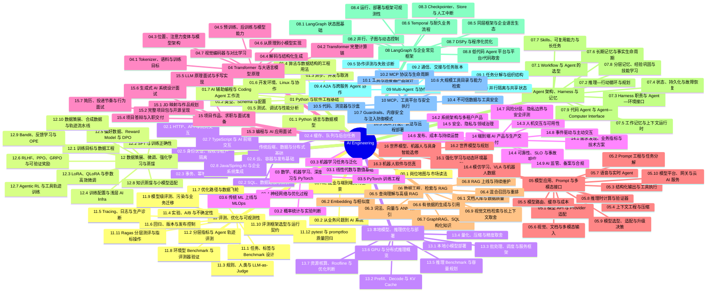

# AI Engineering 学习路线

中文 · [English](README.md)

[](https://github.com/Yanyi-He/ai-engineer-roadmap/actions/workflows/validate.yml) [](LICENSE)

**想做 AI Engineer：学什么、按什么顺序学、怎么证明自己会。内容依据中国和北美 367 份真实 JD 整理。**

<picture>
  <source media="(prefers-color-scheme: dark)" srcset="assets/overview/roadmap-zh-dark.svg">
  
</picture>

127 个单元，每个都写明要掌握的知识点、要学到多深（能解释、能实现、能诊断还是能设计）、一份免费主读资料和阅读范围、一个动手任务和 3 道自测题。

## 从哪里开始

| 你的情况 | 先看 | 然后 |
|---|---|---|
| 有软件开发基础，想转做 AI 应用 | [入门诊断](docs/zh/entry-diagnostic.md)：跳过已经掌握的内容 | 沿[主线](docs/zh/dependency-order.md#主线ai-应用工程)学习，边学边做[实验](docs/zh/labs.md) |
| 正在准备 AIE 面试 | [自测题](docs/zh/self-check.md)：不看资料作答 | 回到对应单元补缺，再完成[模块 15](docs/zh/modules/15.md) |
| 还在判断这个岗位是否适合自己 | [岗位总述](docs/zh/role-overview.md)：企业招 AIE 做什么 | 对比[中国](docs/zh/jd-china.md)和[北美](docs/zh/jd-north-america.md) JD 分析 |
| 想往训练或推理方向深入 | [学习路径](docs/zh/learning-path.md)：选择专项方向 | 模块 [12](docs/zh/modules/12.md)、[13](docs/zh/modules/13.md)，再做[完整项目 P4](docs/zh/capstones.md#p4-小模型服务与行为优化) |

## 这份路线有什么不同

- **按招聘数据定重点。** 51 份中国 JD 和 316 份北美 JD 里，要求生产上线的分别占 86% 和 90%，要求评测的占 53% 和 67%，要求微调的只有 31% 和 18%。两地也不一样：47% 的中国 JD 要 Java/Spring，北美只有 10%。图表、置信区间和企业 JD 拆解见[岗位总述](docs/zh/role-overview.md)。
- **先修精确到单元。** 不用先学完 Transformer 原理，也能先做出模型 API 服务和不依赖框架的 Agent；每条路线只展开它需要的先修。
- **免费资料，写明读哪部分。** 193 项资源都检查过链接，每个单元写明读哪几章、为什么选它。
- **做出来的东西能给面试官看。** 17 个实验、4 个综合项目（P1、P2 附[可运行的起步代码](starters/)）、能力评审标准和 381 道自测题。

## 全部页面

1. [岗位与招聘市场](docs/zh/role-overview.md)：367 份 JD 按市场分析（其中加拿大 80 份）、大厂中厂 JD 拆解、加拿大官方季度职位空缺。
2. [入门诊断](docs/zh/entry-diagnostic.md) → [学习路径](docs/zh/learning-path.md) → [依赖顺序](docs/zh/dependency-order.md)。
3. [知识树](docs/zh/knowledge-tree.md)：17 个模块、127 个单元、708 条主题分支。
4. [自测题](docs/zh/self-check.md)：每个单元 3 道面试式问题，共 381 道，面试前查漏补缺。
5. [实验](docs/zh/labs.md) → [综合项目](docs/zh/capstones.md) → [能力评审](docs/zh/assessment.md)。
6. [技术选择](docs/zh/stack-decisions.md)、[开源项目研究](docs/zh/open-source.md)、[资源筛选](docs/zh/resource-policy.md)。

[CS329Z / CS336 课程对照](docs/zh/course-audit.md)：两门课的内容分别落在哪些单元、学到多深。

## 模块

先做出一个小的模型应用，再逐步加上检索、工具调用、状态管理和上线运维。数学和模型原理边做边补，专项按目标岗位选。

<!-- FULL-KNOWLEDGE-TREE:START -->
<details>
<summary>展开完整知识树：17 个模块、127 个单元</summary>



</details>
<!-- FULL-KNOWLEDGE-TREE:END -->

| 模块 | 主要产出能力 |
|---|---|
| [00 · AIE 就业与端到端交付全景](docs/zh/modules/00.md) | 把一个业务需求拆成产品、数据、模型、系统和验收工作。 |
| [01 · Python 与软件工程基础](docs/zh/modules/01.md) | 独立编写、测试、调试和维护可交付的 Python 服务代码。 |
| [02 · 传统后端、数据与分布式基础](docs/zh/modules/02.md) | 把模型功能接入有身份、数据与运行边界的业务服务。 |
| [03 · 数学、机器学习、深度学习与 PyTorch](docs/zh/modules/03.md) | 理解模型学习、实验与优化，能运行和诊断小规模训练。 |
| [04 · Transformer 与大语言模型原理](docs/zh/modules/04.md) | 沿 token 到 logits 讲清模型数据流，并实现一个小型 decoder。 |
| [05 · 模型应用、Prompt 与多模态接口](docs/zh/modules/05.md) | 交付具有严格接口、预算和交互边界的模型应用。 |
| [06 · 数据工程、检索与 RAG](docs/zh/modules/06.md) | 构建可评测、可更新、有权限边界的企业知识应用。 |
| [07 · Agent 架构、Harness 与记忆](docs/zh/modules/07.md) | 构建能规划、调用工具、验证结果并从故障中恢复的执行系统。 |
| [08 · LangGraph 与企业常见框架](docs/zh/modules/08.md) | 深入掌握一套有状态编排框架，并能解释同层替代与跨层组合。 |
| [09 · Multi-Agent 与协作系统](docs/zh/modules/09.md) | 按可分解任务设计协作，并测量相对单 Agent 的收益和成本。 |
| [10 · MCP、工具平台与安全执行](docs/zh/modules/10.md) | 开发能被不同客户端调用、权限清晰、执行受控的工具服务。 |
| [11 · 评测、优化与可观测性](docs/zh/modules/11.md) | 用可信评测驱动迭代，并把线上失败定位到具体组件。 |
| [12 · 数据策展、微调、强化学习与蒸馏](docs/zh/modules/12.md) | 理解主要训练路线，并完成小规模领域适配与独立评测。 |
| [13 · 本地模型、推理优化与部署](docs/zh/modules/13.md) | 本地运行模型，定位推理瓶颈，并选择适合负载的部署方式。 |
| [14 · 端到端 AI 产品与生产交付](docs/zh/modules/14.md) | 从需求发现到上线运营，承担完整 AI 产品的交付责任。 |
| [15 · 项目作品、求职与面试准备](docs/zh/modules/15.md) | 把学习产物整理成可复现、可面试深挖的工程证据。 |
| [16 · 世界模型、机器人与具身智能选修](docs/zh/modules/16.md) | 理解应用 AIE 与物理智能的连接，按兴趣进入机器人专项。 |

## 评测实操

[评测实操指南](docs/zh/evaluation-playbook.md)：用 Ragas、pytest 和 promptfoo 评测 RAG 和 Agent，并接进 CI。附 6 个合成案例和可运行的配置，其中一份配置故意改坏，用来确认测试真能抓到问题；LLM 评审按需开启。

## 资料怎么用

[Stanford CS329Z](https://cs329z.stanford.edu/) 公开的讲义和作业是 Agent 部分的主干，其余是官方文档、开放教材和免费课程。193 项资源都写了读哪部分、为什么选它。先完成一份主读资料和它的练习，遇到问题再查别的。另外整理了 61 个 GitHub 项目，用来挑选源码阅读的例子。

阅读材料都免费；调用商业 API、云服务和 GPU 会产生费用。资源的访问状态和快照日期见[资源说明](docs/zh/resource-policy.md)。

## 运行代码

三个实验附参考实现，只需要 Python 3.10+ 标准库：检索指标、带有效时间的记忆、外部操作之后的崩溃恢复。其余实验是留给你做的题目。[运行说明](labs/README.md)

P1（带权限的知识服务）和 P2（审批 Agent）有[起步代码](starters/)，需要 Python 3.12 和 FastAPI，离线就能跑，测试和评测都接进了 CI：

```sh
cd starters/p1-knowledge-service
pip install -r requirements.txt
python -m pytest -q && python evals/run_eval.py
```

## 研究方法与贡献

[招聘研究方法](docs/zh/market-research.md)：中国 51 份、北美 316 份 JD，其中 104 份人工逐条复核，263 份从公开职位接口和雇主招聘页按同一套规则筛选。

欢迎补充案例、改进路线、贡献实验或更新资源，见[贡献指南](CONTRIBUTING.md)。原创内容采用 MIT 许可，外部材料保留各自的许可证。
