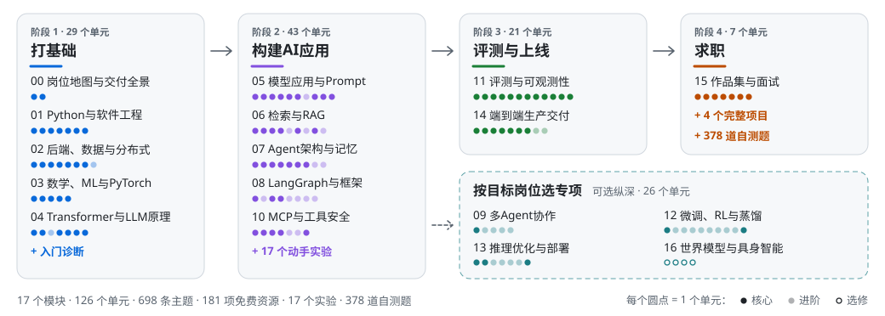
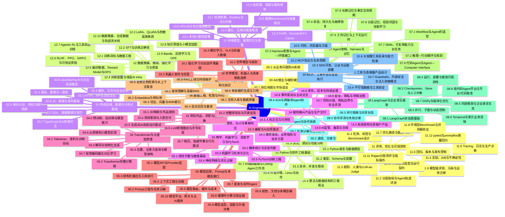

# AI Engineering 学习路线

中文 · [English](README.md)

**成为 AI Engineer：学什么、按什么顺序学、怎样证明自己会。基于中国与北美 320 份 JD 整理。**

<picture>
  <source media="(prefers-color-scheme: dark)" srcset="assets/overview/roadmap-zh-dark.svg">
  
</picture>

全部 126 个单元，每个都有知识框架、目标深度（解释、实现、诊断或设计）、一份标明阅读范围的免费主读资源、一个动手任务和 3 道自测题。

## 从哪里开始

| 你的情况 | 先看 | 然后 |
|---|---|---|
| 有软件开发基础，想转做 AI 应用 | [入门诊断](docs/zh/entry-diagnostic.md)：跳过已经掌握的内容 | 沿[应用交付主线](docs/zh/dependency-order.md#应用交付主线)学习，完成[实验](docs/zh/labs.md) |
| 正在准备 AIE 面试 | [自测题清单](docs/zh/self-check.md)：不看资料作答 | 回到对应单元补缺，再完成[模块 15](docs/zh/modules/15.md) |
| 还在判断这个岗位是否适合自己 | [岗位总述](docs/zh/role-overview.md)：企业招 AIE 做什么 | 对比[中国](docs/zh/jd-china.md)和[北美](docs/zh/jd-north-america.md) JD 分析 |
| 想往训练或推理方向深入 | [学习路径](docs/zh/learning-path.md)：选择专项方向 | 模块 [12](docs/zh/modules/12.md)、[13](docs/zh/modules/13.md)，再做[完整项目 P4](docs/zh/capstones.md#p4-小模型服务与行为优化) |

## 这份路线有什么不同

- **从招聘证据出发，而不是罗列工具。** 在 51 份中国和 269 份北美 AI 工程岗位描述中，生产上线与交付分别出现在 86% 和 90% 的 JD 里，评测与实验为 53% 和 67%，微调只有 31% 和 18%。两地也有差异：Java/Spring 出现在 47% 的中国 JD 中，北美只有 10%。详见[图表、置信区间与企业 JD 拆解](docs/zh/role-overview.md)。
- **先修精确到单元。** 不必先学完 Transformer 原理，也能先做出模型 API 服务和无框架 Agent；每条路线只展开项目需要的先修。
- **免费资源，并标明阅读范围。** 181 项资源全部检查过链接，每个单元写明读哪些章节、为什么选这份资料。
- **能拿给面试官看的证据。** 17 个实验、4 个完整项目、毕业评审标准和 378 道自测题，把阅读变成可以检查的作品。

## 全部页面

1. [岗位与招聘市场](docs/zh/role-overview.md)：320 份 JD 分市场分析、企业 JD 拆解，以及可核验的公开趋势。
2. [入门诊断](docs/zh/entry-diagnostic.md) → [学习路径](docs/zh/learning-path.md) → [依赖顺序](docs/zh/dependency-order.md)。
3. [完整知识树](docs/zh/knowledge-tree.md)：17 个模块、126 个单元、698 条主题分支。
4. [自测题清单](docs/zh/self-check.md)：每个单元 3 道面试式自测题，共 378 道，用于面试前查漏补缺。
5. [实验](docs/zh/labs.md) → [完整项目](docs/zh/capstones.md) → [能力评审](docs/zh/assessment.md)。
6. [技术选择](docs/zh/stack-decisions.md)、[开源项目研究](docs/zh/open-source.md)、[资源筛选](docs/zh/resource-policy.md)。

[CS329Z / CS336 课程对照](docs/zh/course-audit.md)说明两门课怎样落到单元、学习深度、先修与实作取舍。

## 模块

学习时先完成小型模型应用，再逐步加入检索、工具、状态和运行能力。数学与模型原理可以并行补充，专业分支按目标岗位选择。

<!-- FULL-KNOWLEDGE-TREE:START -->
<details>
<summary>展开完整知识树：17模块、126单元</summary>



</details>
<!-- FULL-KNOWLEDGE-TREE:END -->

| 模块 | 主要产出能力 |
|---|---|
| [00 · AIE就业与端到端交付全景](docs/zh/modules/00.md) | 把一个业务需求拆成产品、数据、模型、系统和验收工作。 |
| [01 · Python与软件工程基础](docs/zh/modules/01.md) | 独立编写、测试、调试和维护可交付的Python服务代码。 |
| [02 · 传统后端、数据与分布式基础](docs/zh/modules/02.md) | 把模型功能接入有身份、数据与运行边界的业务服务。 |
| [03 · 数学、机器学习、深度学习与PyTorch](docs/zh/modules/03.md) | 理解模型学习、实验与优化，能运行和诊断小规模训练。 |
| [04 · Transformer与大语言模型原理](docs/zh/modules/04.md) | 沿token到logits讲清模型数据流，并实现一个小型decoder。 |
| [05 · 模型应用、Prompt与多模态接口](docs/zh/modules/05.md) | 交付具有严格接口、预算和交互边界的模型应用。 |
| [06 · 数据工程、检索与RAG](docs/zh/modules/06.md) | 构建可评测、可更新、有权限边界的企业知识应用。 |
| [07 · Agent架构、Harness与记忆](docs/zh/modules/07.md) | 构建能规划、调用工具、验证结果并从故障中恢复的执行系统。 |
| [08 · LangGraph与企业常见框架](docs/zh/modules/08.md) | 深入掌握一套有状态编排框架，并能解释同层替代与跨层组合。 |
| [09 · Multi-Agent与协作系统](docs/zh/modules/09.md) | 按可分解任务设计协作，并测量相对单Agent的收益和成本。 |
| [10 · MCP、工具平台与安全执行](docs/zh/modules/10.md) | 开发能被不同客户端调用、权限清晰、执行受控的工具服务。 |
| [11 · 评测、优化与可观测性](docs/zh/modules/11.md) | 用可信评测驱动迭代，并把线上失败定位到具体组件。 |
| [12 · 数据策展、微调、强化学习与蒸馏](docs/zh/modules/12.md) | 理解主要训练路线，并完成小规模领域适配与独立评测。 |
| [13 · 本地模型、推理优化与部署](docs/zh/modules/13.md) | 本地运行模型，定位推理瓶颈，并选择适合负载的部署方式。 |
| [14 · 端到端AI产品与生产交付](docs/zh/modules/14.md) | 从需求发现到上线运营，承担完整AI产品的交付责任。 |
| [15 · 项目作品、求职与面试准备](docs/zh/modules/15.md) | 把学习产物整理成可复现、可面试深挖的工程证据。 |
| [16 · 世界模型、机器人与具身智能选修](docs/zh/modules/16.md) | 理解应用AIE与物理智能的连接，按兴趣进入机器人专项。 |

## 评测操作

[Ragas、测试与回归实操](docs/zh/evaluation-playbook.md)串联指标/标签、框架选择、运行、失败诊断和CI。提供6个合成案例、真实Ragas ID评分、pytest和promptfoo正常/破坏配置；LLM judge按需启用。

## 资源如何使用

[Stanford CS329Z](https://cs329z.stanford.edu/)的已公开材料承担 Agent 系统主线，辅以官方文档、开放教材和免费课程。181 项资源记录了对应范围与选用理由；优先完成一个主读资源和对应实现，再按问题查阅其他资料。61 个 GitHub 项目的元数据用于筛选源码参考。

核心阅读材料可以免费获取；商业 API、云和 GPU 的实际使用可能产生费用。资源访问状态、课程发布进度与快照日期见[资源说明](docs/zh/resource-policy.md)。

## 运行仓库中的参考实现

Python 3.10+，标准库即可运行三个离线机制参考：检索指标、有效时间记忆、外部操作后的崩溃恢复。其余实验是需要学习者完成的构建任务。[运行说明](labs/README.md)

```sh
python3 -B -m unittest discover -s tests -v
python3 -B scripts/summarize_jds.py
python3 -B scripts/summarize_market.py
python3 -B scripts/render_docs.py
python3 -B scripts/validate.py
```

## 研究与贡献

[招聘研究](docs/zh/market-research.md)分别分析中国 51 份、北美 269 份 JD：其中 104 份人工复核，216 份从公开职位接口按规则筛选。市场图表只保留按职业定义的指标，未获得的全国历史空缺总量留空。数据与图表的范围在[岗位总述](docs/zh/role-overview.md)中说明。

欢迎补充可复现案例、改进学习脉络、贡献实验或更新资源，见[贡献指南](CONTRIBUTING.md)。学习成果通过作品与独立评审验证；本路线尚无学习者就业结果研究。仓库原创内容采用 MIT，外部材料保留各自许可证。
