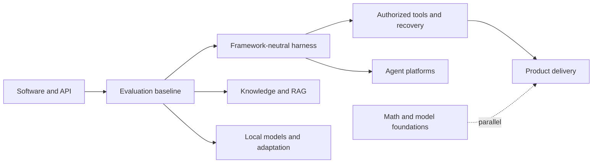

# Unit prerequisites, parallel study and project routes

Prerequisites name individual units; module numbers classify topics. Build an API and framework-neutral agent early, then add RAG or LangGraph as needed. Hosted models support application delivery; SFT, GPU serving and multi-agent engineering belong to selected branches.

## Application delivery

Deliver a business-agent product with hosted models; strengthen model foundations in parallel.

| Stage | Expanded prerequisites and targets | Labs |
|---|---|---|
| Task, Python and model interface | [00.1](modules/00.md#unit-00-1), [00.2](modules/00.md#unit-00-2), [01.1](modules/01.md#unit-01-1), [01.2](modules/01.md#unit-01-2), [01.5](modules/01.md#unit-01-5), [01.6](modules/01.md#unit-01-6), [01.3](modules/01.md#unit-01-3), [02.1](modules/02.md#unit-02-1), [05.1](modules/05.md#unit-05-1), [05.3](modules/05.md#unit-05-3), [01.7](modules/01.md#unit-01-7), [05.10](modules/05.md#unit-05-10) | [L01](labs.md#l01) |
| Evaluation baseline and measurable targets | [03.1](modules/03.md#unit-03-1), [03.2](modules/03.md#unit-03-2), [11.1](modules/11.md#unit-11-1), [11.2](modules/11.md#unit-11-2), [11.3](modules/11.md#unit-11-3), [11.4](modules/11.md#unit-11-4), [05.9](modules/05.md#unit-05-9) | — |
| Framework-neutral harness | [05.4](modules/05.md#unit-05-4), [07.1](modules/07.md#unit-07-1), [07.2](modules/07.md#unit-07-2), [07.3](modules/07.md#unit-07-3), [07.5](modules/07.md#unit-07-5) | [L13](labs.md#l13) |
| Data, tools, persistence and authorization | [05.2](modules/05.md#unit-05-2), [12.1](modules/12.md#unit-12-1), [02.2](modules/02.md#unit-02-2), [06.1](modules/06.md#unit-06-1), [12.10](modules/12.md#unit-12-10), [02.3](modules/02.md#unit-02-3), [02.4](modules/02.md#unit-02-4), [07.4](modules/07.md#unit-07-4), [10.2](modules/10.md#unit-10-2), [02.5](modules/02.md#unit-02-5), [10.3](modules/10.md#unit-10-3), [10.1](modules/10.md#unit-10-1), [10.4](modules/10.md#unit-10-4), [08.1](modules/08.md#unit-08-1), [08.3](modules/08.md#unit-08-3), [10.7](modules/10.md#unit-10-7) | [L03](labs.md#l03), [L05](labs.md#l05) |
| Verifier, operation and acceptance | [02.6](modules/02.md#unit-02-6), [11.8](modules/11.md#unit-11-8), [11.5](modules/11.md#unit-11-5), [11.6](modules/11.md#unit-11-6), [14.1](modules/14.md#unit-14-1), [14.2](modules/14.md#unit-14-2), [02.7](modules/02.md#unit-02-7), [14.3](modules/14.md#unit-14-3), [14.4](modules/14.md#unit-14-4), [05.5](modules/05.md#unit-05-5), [14.6](modules/14.md#unit-14-6), [14.5](modules/14.md#unit-14-5), [14.7](modules/14.md#unit-14-7), [11.10](modules/11.md#unit-11-10), [11.12](modules/11.md#unit-11-12) | [L14](labs.md#l14), [L06](labs.md#l06), [L17](labs.md#l17) |
| Model foundations, selection review and portfolio | [03.3](modules/03.md#unit-03-3), [03.4](modules/03.md#unit-03-4), [03.5](modules/03.md#unit-03-5), [04.1](modules/04.md#unit-04-1), [04.2](modules/04.md#unit-04-2), [04.5](modules/04.md#unit-04-5), [11.9](modules/11.md#unit-11-9), [05.8](modules/05.md#unit-05-8), [15.2](modules/15.md#unit-15-2), [01.4](modules/01.md#unit-01-4), [15.3](modules/15.md#unit-15-3), [15.4](modules/15.md#unit-15-4), [04.4](modules/04.md#unit-04-4), [15.5](modules/15.md#unit-15-5), [15.6](modules/15.md#unit-15-6), [15.1](modules/15.md#unit-15-1), [15.7](modules/15.md#unit-15-7) | [L09](labs.md#l09) |

## Enterprise knowledge and RAG

Add authorized data/knowledge services to application foundations.

| Stage | Expanded prerequisites and targets | Labs |
|---|---|---|
| Task, Python and model interface | [00.1](modules/00.md#unit-00-1), [00.2](modules/00.md#unit-00-2), [01.1](modules/01.md#unit-01-1), [01.2](modules/01.md#unit-01-2), [01.5](modules/01.md#unit-01-5), [01.6](modules/01.md#unit-01-6), [01.3](modules/01.md#unit-01-3), [02.1](modules/02.md#unit-02-1), [05.1](modules/05.md#unit-05-1), [05.3](modules/05.md#unit-05-3), [01.7](modules/01.md#unit-01-7), [05.10](modules/05.md#unit-05-10) | [L01](labs.md#l01) |
| Evaluation baseline and measurable targets | [03.1](modules/03.md#unit-03-1), [03.2](modules/03.md#unit-03-2), [11.1](modules/11.md#unit-11-1), [11.2](modules/11.md#unit-11-2), [11.3](modules/11.md#unit-11-3), [11.4](modules/11.md#unit-11-4), [05.9](modules/05.md#unit-05-9) | — |
| Framework-neutral harness | [05.4](modules/05.md#unit-05-4), [07.1](modules/07.md#unit-07-1), [07.2](modules/07.md#unit-07-2), [07.3](modules/07.md#unit-07-3), [07.5](modules/07.md#unit-07-5) | [L13](labs.md#l13) |
| Data, retrieval, citations and maintenance | [02.2](modules/02.md#unit-02-2), [06.1](modules/06.md#unit-06-1), [04.1](modules/04.md#unit-04-1), [06.2](modules/06.md#unit-06-2), [01.4](modules/01.md#unit-01-4), [06.3](modules/06.md#unit-06-3), [06.4](modules/06.md#unit-06-4), [06.6](modules/06.md#unit-06-6), [02.5](modules/02.md#unit-02-5), [06.8](modules/06.md#unit-06-8), [05.2](modules/05.md#unit-05-2), [12.1](modules/12.md#unit-12-1), [12.10](modules/12.md#unit-12-10), [11.10](modules/11.md#unit-11-10), [11.11](modules/11.md#unit-11-11) | [L02](labs.md#l02), [L15](labs.md#l15), [L16](labs.md#l16) |
| Data, tools, persistence and authorization | [02.3](modules/02.md#unit-02-3), [02.4](modules/02.md#unit-02-4), [07.4](modules/07.md#unit-07-4), [10.2](modules/10.md#unit-10-2), [10.3](modules/10.md#unit-10-3), [10.1](modules/10.md#unit-10-1), [10.4](modules/10.md#unit-10-4), [08.1](modules/08.md#unit-08-1), [08.3](modules/08.md#unit-08-3), [10.7](modules/10.md#unit-10-7) | [L03](labs.md#l03), [L05](labs.md#l05) |
| Verifier, operation and acceptance | [02.6](modules/02.md#unit-02-6), [11.8](modules/11.md#unit-11-8), [11.5](modules/11.md#unit-11-5), [11.6](modules/11.md#unit-11-6), [14.1](modules/14.md#unit-14-1), [14.2](modules/14.md#unit-14-2), [02.7](modules/02.md#unit-02-7), [14.3](modules/14.md#unit-14-3), [14.4](modules/14.md#unit-14-4), [05.5](modules/05.md#unit-05-5), [14.6](modules/14.md#unit-14-6), [14.5](modules/14.md#unit-14-5), [14.7](modules/14.md#unit-14-7), [11.12](modules/11.md#unit-11-12) | [L14](labs.md#l14), [L06](labs.md#l06), [L17](labs.md#l17) |
| Model foundations, selection review and portfolio | [03.3](modules/03.md#unit-03-3), [03.4](modules/03.md#unit-03-4), [03.5](modules/03.md#unit-03-5), [04.2](modules/04.md#unit-04-2), [04.5](modules/04.md#unit-04-5), [11.9](modules/11.md#unit-11-9), [05.8](modules/05.md#unit-05-8), [15.2](modules/15.md#unit-15-2), [15.3](modules/15.md#unit-15-3), [15.4](modules/15.md#unit-15-4), [04.4](modules/04.md#unit-04-4), [15.5](modules/15.md#unit-15-5), [15.6](modules/15.md#unit-15-6), [15.1](modules/15.md#unit-15-1), [15.7](modules/15.md#unit-15-7) | [L09](labs.md#l09) |

## Local inference and model adaptation

Build small-model fundamentals, inference, LoRA and a reversible model service.

| Stage | Expanded prerequisites and targets | Labs |
|---|---|---|
| Software, data and model computation | [00.1](modules/00.md#unit-00-1), [00.2](modules/00.md#unit-00-2), [01.1](modules/01.md#unit-01-1), [01.2](modules/01.md#unit-01-2), [01.3](modules/01.md#unit-01-3), [02.1](modules/02.md#unit-02-1), [01.6](modules/01.md#unit-01-6), [02.6](modules/02.md#unit-02-6), [03.1](modules/03.md#unit-03-1), [03.2](modules/03.md#unit-03-2), [03.3](modules/03.md#unit-03-3), [03.4](modules/03.md#unit-03-4), [01.5](modules/01.md#unit-01-5), [03.5](modules/03.md#unit-03-5), [04.1](modules/04.md#unit-04-1), [04.2](modules/04.md#unit-04-2), [04.6](modules/04.md#unit-04-6), [11.1](modules/11.md#unit-11-1), [11.4](modules/11.md#unit-11-4) | [L01](labs.md#l01), [L09](labs.md#l09) |
| Resource accounting and local serving | [13.7](modules/13.md#unit-13-7), [13.1](modules/13.md#unit-13-1), [13.2](modules/13.md#unit-13-2), [02.2](modules/02.md#unit-02-2), [02.3](modules/02.md#unit-02-3), [02.4](modules/02.md#unit-02-4), [13.3](modules/13.md#unit-13-3), [13.4](modules/13.md#unit-13-4), [13.5](modules/13.md#unit-13-5) | [L07](labs.md#l07) |
| Curation and SFT/LoRA | [05.1](modules/05.md#unit-05-1), [05.2](modules/05.md#unit-05-2), [12.1](modules/12.md#unit-12-1), [06.1](modules/06.md#unit-06-1), [12.10](modules/12.md#unit-12-10), [12.2](modules/12.md#unit-12-2), [12.3](modules/12.md#unit-12-3), [12.4](modules/12.md#unit-12-4) | [L15](labs.md#l15), [L08](labs.md#l08) |
| Model evaluation and service delivery | [04.5](modules/04.md#unit-04-5), [11.9](modules/11.md#unit-11-9), [05.3](modules/05.md#unit-05-3), [11.2](modules/11.md#unit-11-2), [11.3](modules/11.md#unit-11-3), [11.5](modules/11.md#unit-11-5), [11.6](modules/11.md#unit-11-6), [05.9](modules/05.md#unit-05-9), [14.1](modules/14.md#unit-14-1), [02.5](modules/02.md#unit-02-5), [14.2](modules/14.md#unit-14-2), [14.4](modules/14.md#unit-14-4), [05.5](modules/05.md#unit-05-5), [14.6](modules/14.md#unit-14-6), [15.2](modules/15.md#unit-15-2), [11.10](modules/11.md#unit-11-10), [11.12](modules/11.md#unit-11-12), [04.4](modules/04.md#unit-04-4), [01.4](modules/01.md#unit-01-4), [15.5](modules/15.md#unit-15-5), [15.1](modules/15.md#unit-15-1), [15.7](modules/15.md#unit-15-7) | [L06](labs.md#l06), [L17](labs.md#l17) |

## Agent platforms and system optimization

Extend applications with execution, orchestration, coordination and data-driven optimization; select RL separately.

| Stage | Expanded prerequisites and targets | Labs |
|---|---|---|
| Task, Python and model interface | [00.1](modules/00.md#unit-00-1), [00.2](modules/00.md#unit-00-2), [01.1](modules/01.md#unit-01-1), [01.2](modules/01.md#unit-01-2), [01.5](modules/01.md#unit-01-5), [01.6](modules/01.md#unit-01-6), [01.3](modules/01.md#unit-01-3), [02.1](modules/02.md#unit-02-1), [05.1](modules/05.md#unit-05-1), [05.3](modules/05.md#unit-05-3), [01.7](modules/01.md#unit-01-7), [05.10](modules/05.md#unit-05-10) | [L01](labs.md#l01) |
| Evaluation baseline and measurable targets | [03.1](modules/03.md#unit-03-1), [03.2](modules/03.md#unit-03-2), [11.1](modules/11.md#unit-11-1), [11.2](modules/11.md#unit-11-2), [11.3](modules/11.md#unit-11-3), [11.4](modules/11.md#unit-11-4), [05.9](modules/05.md#unit-05-9) | — |
| Framework-neutral harness | [05.4](modules/05.md#unit-05-4), [07.1](modules/07.md#unit-07-1), [07.2](modules/07.md#unit-07-2), [07.3](modules/07.md#unit-07-3), [07.5](modules/07.md#unit-07-5) | [L13](labs.md#l13) |
| Data, tools, persistence and authorization | [05.2](modules/05.md#unit-05-2), [12.1](modules/12.md#unit-12-1), [02.2](modules/02.md#unit-02-2), [06.1](modules/06.md#unit-06-1), [12.10](modules/12.md#unit-12-10), [02.3](modules/02.md#unit-02-3), [02.4](modules/02.md#unit-02-4), [07.4](modules/07.md#unit-07-4), [10.2](modules/10.md#unit-10-2), [02.5](modules/02.md#unit-02-5), [10.3](modules/10.md#unit-10-3), [10.1](modules/10.md#unit-10-1), [10.4](modules/10.md#unit-10-4), [08.1](modules/08.md#unit-08-1), [08.3](modules/08.md#unit-08-3), [10.7](modules/10.md#unit-10-7) | [L03](labs.md#l03), [L05](labs.md#l05) |
| Verifier, operation and acceptance | [02.6](modules/02.md#unit-02-6), [11.8](modules/11.md#unit-11-8), [11.5](modules/11.md#unit-11-5), [11.6](modules/11.md#unit-11-6), [14.1](modules/14.md#unit-14-1), [14.2](modules/14.md#unit-14-2), [02.7](modules/02.md#unit-02-7), [14.3](modules/14.md#unit-14-3), [14.4](modules/14.md#unit-14-4), [05.5](modules/05.md#unit-05-5), [14.6](modules/14.md#unit-14-6), [14.5](modules/14.md#unit-14-5), [14.7](modules/14.md#unit-14-7), [11.10](modules/11.md#unit-11-10), [11.12](modules/11.md#unit-11-12) | [L14](labs.md#l14), [L06](labs.md#l06), [L17](labs.md#l17) |
| Model foundations, selection review and portfolio | [03.3](modules/03.md#unit-03-3), [03.4](modules/03.md#unit-03-4), [03.5](modules/03.md#unit-03-5), [04.1](modules/04.md#unit-04-1), [04.2](modules/04.md#unit-04-2), [04.5](modules/04.md#unit-04-5), [11.9](modules/11.md#unit-11-9), [05.8](modules/05.md#unit-05-8), [15.2](modules/15.md#unit-15-2), [01.4](modules/01.md#unit-01-4), [15.3](modules/15.md#unit-15-3), [15.4](modules/15.md#unit-15-4), [04.4](modules/04.md#unit-04-4), [15.5](modules/15.md#unit-15-5), [15.6](modules/15.md#unit-15-6), [15.1](modules/15.md#unit-15-1), [15.7](modules/15.md#unit-15-7) | [L09](labs.md#l09) |
| Framework semantics, catalogs and isolation | [08.2](modules/08.md#unit-08-2), [08.5](modules/08.md#unit-08-5), [08.6](modules/08.md#unit-08-6), [10.5](modules/10.md#unit-10-5), [06.2](modules/06.md#unit-06-2), [06.3](modules/06.md#unit-06-3), [10.6](modules/10.md#unit-10-6), [07.9](modules/07.md#unit-07-9), [08.8](modules/08.md#unit-08-8) | — |
| Memory, collaboration and program optimization | [07.6](modules/07.md#unit-07-6), [07.8](modules/07.md#unit-07-8), [09.1](modules/09.md#unit-09-1), [09.2](modules/09.md#unit-09-2), [09.3](modules/09.md#unit-09-3), [09.5](modules/09.md#unit-09-5), [08.7](modules/08.md#unit-08-7) | [L04](labs.md#l04), [L10](labs.md#l10) |
| Optional policy optimization (optional; inspect unit prerequisites) | [12.6](modules/12.md#unit-12-6), [12.7](modules/12.md#unit-12-7) | [L12](labs.md#l12) |

## All unit prerequisites

The table is one valid topological order. Independent units can run in parallel. Demonstrate prior learning through the [diagnostic](entry-diagnostic.md). Expand optional prerequisites when selecting that branch.

| Unit | Track | Prerequisites |
|---|---|---|
| [00.1 Role map and market interpretation](modules/00.md#unit-00-1) | core | — |
| [00.2 From a business problem to an AI system](modules/00.md#unit-00-2) | core | [00.1 Role map and market interpretation](modules/00.md#unit-00-1) |
| [01.1 Python language and data model](modules/01.md#unit-01-1) | core | [00.2 From a business problem to an AI system](modules/00.md#unit-00-2) |
| [15.1 JD mapping and portfolio planning](modules/15.md#unit-15-1) | core | [00.1 Role map and market interpretation](modules/00.md#unit-00-1), [00.2 From a business problem to an AI system](modules/00.md#unit-00-2) |
| [01.2 Types, schemas and configuration](modules/01.md#unit-01-2) | core | [01.1 Python language and data model](modules/01.md#unit-01-1) |
| [01.3 Async, concurrency and cancellation](modules/01.md#unit-01-3) | core | [01.1 Python language and data model](modules/01.md#unit-01-1) |
| [01.4 Practical algorithms and data structures](modules/01.md#unit-01-4) | core | [01.1 Python language and data model](modules/01.md#unit-01-1) |
| [01.6 Environment, Linux and collaboration](modules/01.md#unit-01-6) | core | [01.1 Python language and data model](modules/01.md#unit-01-1) |
| [02.2 SQL, modeling and indexes](modules/02.md#unit-02-2) | core | [01.1 Python language and data model](modules/01.md#unit-01-1) |
| [03.1 Linear algebra and numerical basics](modules/03.md#unit-03-1) | core | [01.1 Python language and data model](modules/01.md#unit-01-1) |
| [15.7 Résumé, application timing and behavioral interviews](modules/15.md#unit-15-7) | core | [15.1 JD mapping and portfolio planning](modules/15.md#unit-15-1) |
| [01.5 Testing, debugging and profiling](modules/01.md#unit-01-5) | core | [01.1 Python language and data model](modules/01.md#unit-01-1), [01.2 Types, schemas and configuration](modules/01.md#unit-01-2) |
| [02.1 HTTP APIs and streaming](modules/02.md#unit-02-1) | core | [01.2 Types, schemas and configuration](modules/01.md#unit-01-2), [01.3 Async, concurrency and cancellation](modules/01.md#unit-01-3) |
| [02.3 Transactions, idempotency and consistency](modules/02.md#unit-02-3) | core | [02.2 SQL, modeling and indexes](modules/02.md#unit-02-2) |
| [03.2 Probability, statistics and experiments](modules/03.md#unit-03-2) | core | [03.1 Linear algebra and numerical basics](modules/03.md#unit-03-1) |
| [06.1 Ingestion and data quality](modules/06.md#unit-06-1) | core | [02.2 SQL, modeling and indexes](modules/02.md#unit-02-2) |
| [16.3 Robotics software and simulation](modules/16.md#unit-16-3) | elective | [01.6 Environment, Linux and collaboration](modules/01.md#unit-01-6), [03.1 Linear algebra and numerical basics](modules/03.md#unit-03-1) |
| [01.7 AI-assisted programming and coding-agent workflows](modules/01.md#unit-01-7) | core | [01.5 Testing, debugging and profiling](modules/01.md#unit-01-5), [01.6 Environment, Linux and collaboration](modules/01.md#unit-01-6) |
| [02.4 Caches, queues and workers](modules/02.md#unit-02-4) | core | [01.3 Async, concurrency and cancellation](modules/01.md#unit-01-3), [02.3 Transactions, idempotency and consistency](modules/02.md#unit-02-3) |
| [02.5 Identity, authorization and tenancy](modules/02.md#unit-02-5) | core | [02.1 HTTP APIs and streaming](modules/02.md#unit-02-1), [02.2 SQL, modeling and indexes](modules/02.md#unit-02-2) |
| [02.6 Cloud, containers and delivery](modules/02.md#unit-02-6) | core | [01.6 Environment, Linux and collaboration](modules/01.md#unit-01-6), [02.1 HTTP APIs and streaming](modules/02.md#unit-02-1) |
| [02.7 TypeScript and AI frontend interaction](modules/02.md#unit-02-7) | core | [02.1 HTTP APIs and streaming](modules/02.md#unit-02-1) |
| [03.3 ML tasks and generalization](modules/03.md#unit-03-3) | core | [03.2 Probability, statistics and experiments](modules/03.md#unit-03-2) |
| [04.1 Tokenization, corpora and objectives](modules/04.md#unit-04-1) | core | [01.1 Python language and data model](modules/01.md#unit-01-1), [03.2 Probability, statistics and experiments](modules/03.md#unit-03-2) |
| [05.1 Model APIs and provider adapters](modules/05.md#unit-05-1) | core | [02.1 HTTP APIs and streaming](modules/02.md#unit-02-1), [01.5 Testing, debugging and profiling](modules/01.md#unit-01-5) |
| [10.2 MCP protocol and lifecycle](modules/10.md#unit-10-2) | core | [02.1 HTTP APIs and streaming](modules/02.md#unit-02-1), [01.2 Types, schemas and configuration](modules/01.md#unit-01-2) |
| [11.1 Tasks, labels and benchmark design](modules/11.md#unit-11-1) | core | [00.2 From a business problem to an AI system](modules/00.md#unit-00-2), [03.2 Probability, statistics and experiments](modules/03.md#unit-03-2) |
| [02.8 Java/Spring AI and enterprise system integration](modules/02.md#unit-02-8) | advanced | [02.1 HTTP APIs and streaming](modules/02.md#unit-02-1), [02.5 Identity, authorization and tenancy](modules/02.md#unit-02-5) |
| [03.4 Neural networks and optimization](modules/03.md#unit-03-4) | core | [03.1 Linear algebra and numerical basics](modules/03.md#unit-03-1), [03.3 ML tasks and generalization](modules/03.md#unit-03-3) |
| [04.4 Decoding and constrained generation](modules/04.md#unit-04-4) | core | [04.1 Tokenization, corpora and objectives](modules/04.md#unit-04-1), [03.2 Probability, statistics and experiments](modules/03.md#unit-03-2) |
| [04.5 Pretraining, post-training and capabilities](modules/04.md#unit-04-5) | core | [03.3 ML tasks and generalization](modules/03.md#unit-03-3), [04.1 Tokenization, corpora and objectives](modules/04.md#unit-04-1) |
| [05.2 Prompting and task decomposition](modules/05.md#unit-05-2) | core | [05.1 Model APIs and provider adapters](modules/05.md#unit-05-1) |
| [05.3 Structured output and tool execution](modules/05.md#unit-05-3) | core | [05.1 Model APIs and provider adapters](modules/05.md#unit-05-1), [01.2 Types, schemas and configuration](modules/01.md#unit-01-2) |
| [05.4 Context engineering and compaction](modules/05.md#unit-05-4) | core | [05.1 Model APIs and provider adapters](modules/05.md#unit-05-1) |
| [05.10 Model platforms, gateways and cloud AI services](modules/05.md#unit-05-10) | core | [05.1 Model APIs and provider adapters](modules/05.md#unit-05-1) |
| [06.2 Embeddings and similarity](modules/06.md#unit-06-2) | core | [03.1 Linear algebra and numerical basics](modules/03.md#unit-03-1), [04.1 Tokenization, corpora and objectives](modules/04.md#unit-04-1) |
| [10.3 SDK development, auth and remote deployment](modules/10.md#unit-10-3) | core | [10.2 MCP protocol and lifecycle](modules/10.md#unit-10-2), [02.5 Identity, authorization and tenancy](modules/02.md#unit-02-5) |
| [11.3 Rules, humans and model judges](modules/11.md#unit-11-3) | core | [11.1 Tasks, labels and benchmark design](modules/11.md#unit-11-1), [05.1 Model APIs and provider adapters](modules/05.md#unit-05-1) |
| [11.4 Experiments, A/B tests and uncertainty](modules/11.md#unit-11-4) | core | [11.1 Tasks, labels and benchmark design](modules/11.md#unit-11-1), [03.2 Probability, statistics and experiments](modules/03.md#unit-03-2) |
| [11.5 Tracing, logs and production diagnosis](modules/11.md#unit-11-5) | core | [02.1 HTTP APIs and streaming](modules/02.md#unit-02-1), [05.1 Model APIs and provider adapters](modules/05.md#unit-05-1) |
| [13.1 Local small-model deployment](modules/13.md#unit-13-1) | core | [02.1 HTTP APIs and streaming](modules/02.md#unit-02-1), [04.1 Tokenization, corpora and objectives](modules/04.md#unit-04-1) |
| [14.1 Discovery, business metrics and design](modules/14.md#unit-14-1) | core | [00.2 From a business problem to an AI system](modules/00.md#unit-00-2), [11.1 Tasks, labels and benchmark design](modules/11.md#unit-11-1) |
| [14.3 Human interaction and usability](modules/14.md#unit-14-3) | core | [02.7 TypeScript and AI frontend interaction](modules/02.md#unit-02-7), [05.1 Model APIs and provider adapters](modules/05.md#unit-05-1) |
| [03.5 PyTorch training engineering](modules/03.md#unit-03-5) | core | [03.4 Neural networks and optimization](modules/03.md#unit-03-4), [01.5 Testing, debugging and profiling](modules/01.md#unit-01-5) |
| [05.5 Routing, caching and cost](modules/05.md#unit-05-5) | core | [05.1 Model APIs and provider adapters](modules/05.md#unit-05-1), [11.4 Experiments, A/B tests and uncertainty](modules/11.md#unit-11-4) |
| [05.6 Vision, documents and multimodal input](modules/05.md#unit-05-6) | core | [05.3 Structured output and tool execution](modules/05.md#unit-05-3) |
| [05.7 Voice and realtime agents](modules/05.md#unit-05-7) | advanced | [05.3 Structured output and tool execution](modules/05.md#unit-05-3), [01.3 Async, concurrency and cancellation](modules/01.md#unit-01-3) |
| [05.8 Test-time compute and verification](modules/05.md#unit-05-8) | core | [05.3 Structured output and tool execution](modules/05.md#unit-05-3), [11.4 Experiments, A/B tests and uncertainty](modules/11.md#unit-11-4) |
| [05.9 Model selection and upgrade decisions](modules/05.md#unit-05-9) | core | [05.1 Model APIs and provider adapters](modules/05.md#unit-05-1), [11.1 Tasks, labels and benchmark design](modules/11.md#unit-11-1), [11.4 Experiments, A/B tests and uncertainty](modules/11.md#unit-11-4) |
| [06.3 Lexical, vector and ANN indexes](modules/06.md#unit-06-3) | core | [06.1 Ingestion and data quality](modules/06.md#unit-06-1), [06.2 Embeddings and similarity](modules/06.md#unit-06-2), [01.4 Practical algorithms and data structures](modules/01.md#unit-01-4) |
| [07.1 Choosing workflows and agents](modules/07.md#unit-07-1) | core | [05.3 Structured output and tool execution](modules/05.md#unit-05-3) |
| [10.1 Tool and connector design](modules/10.md#unit-10-1) | core | [02.1 HTTP APIs and streaming](modules/02.md#unit-02-1), [05.3 Structured output and tool execution](modules/05.md#unit-05-3) |
| [11.2 Layered metrics and trajectory evaluation](modules/11.md#unit-11-2) | core | [11.1 Tasks, labels and benchmark design](modules/11.md#unit-11-1), [05.3 Structured output and tool execution](modules/05.md#unit-05-3) |
| [11.7 Optimization layers and data flywheels](modules/11.md#unit-11-7) | core | [11.4 Experiments, A/B tests and uncertainty](modules/11.md#unit-11-4), [11.5 Tracing, logs and production diagnosis](modules/11.md#unit-11-5) |
| [11.9 Model evaluation, contamination and task transfer](modules/11.md#unit-11-9) | core | [04.1 Tokenization, corpora and objectives](modules/04.md#unit-04-1), [04.5 Pretraining, post-training and capabilities](modules/04.md#unit-04-5), [11.4 Experiments, A/B tests and uncertainty](modules/11.md#unit-11-4) |
| [11.10 Evaluation frameworks and run contracts](modules/11.md#unit-11-10) | core | [11.1 Tasks, labels and benchmark design](modules/11.md#unit-11-1), [11.3 Rules, humans and model judges](modules/11.md#unit-11-3), [01.5 Testing, debugging and profiling](modules/01.md#unit-01-5) |
| [12.1 Training goals and data engineering](modules/12.md#unit-12-1) | core | [05.2 Prompting and task decomposition](modules/05.md#unit-05-2), [11.1 Tasks, labels and benchmark design](modules/11.md#unit-11-1) |
| [14.2 Architecture and multi-tenant products](modules/14.md#unit-14-2) | core | [02.5 Identity, authorization and tenancy](modules/02.md#unit-02-5), [05.3 Structured output and tool execution](modules/05.md#unit-05-3), [11.5 Tracing, logs and production diagnosis](modules/11.md#unit-11-5) |
| [14.4 Reliability, SLOs and incidents](modules/14.md#unit-14-4) | core | [02.6 Cloud, containers and delivery](modules/02.md#unit-02-6), [11.5 Tracing, logs and production diagnosis](modules/11.md#unit-11-5) |
| [16.1 RL and dynamic environments](modules/16.md#unit-16-1) | elective | [03.3 ML tasks and generalization](modules/03.md#unit-03-3), [03.4 Neural networks and optimization](modules/03.md#unit-03-4) |
| [04.2 Transformer computation](modules/04.md#unit-04-2) | core | [03.5 PyTorch training engineering](modules/03.md#unit-03-5), [04.1 Tokenization, corpora and objectives](modules/04.md#unit-04-1) |
| [06.4 Hybrid retrieval and reranking](modules/06.md#unit-06-4) | core | [06.3 Lexical, vector and ANN indexes](modules/06.md#unit-06-3) |
| [06.6 Grounded answers and citations](modules/06.md#unit-06-6) | core | [06.3 Lexical, vector and ANN indexes](modules/06.md#unit-06-3), [05.3 Structured output and tool execution](modules/05.md#unit-05-3), [11.1 Tasks, labels and benchmark design](modules/11.md#unit-11-1) |
| [06.7 GraphRAG, SQL and structured knowledge](modules/06.md#unit-06-7) | advanced | [06.3 Lexical, vector and ANN indexes](modules/06.md#unit-06-3), [02.5 Identity, authorization and tenancy](modules/02.md#unit-02-5), [05.3 Structured output and tool execution](modules/05.md#unit-05-3) |
| [07.2 Reasoning/action loops and planning](modules/07.md#unit-07-2) | core | [07.1 Choosing workflows and agents](modules/07.md#unit-07-1) |
| [08.8 Low-code agent platforms and platform-versus-code decisions](modules/08.md#unit-08-8) | advanced | [07.1 Choosing workflows and agents](modules/07.md#unit-07-1), [05.3 Structured output and tool execution](modules/05.md#unit-05-3) |
| [10.4 Untrusted data and tool safety](modules/10.md#unit-10-4) | core | [10.1 Tool and connector design](modules/10.md#unit-10-1), [02.5 Identity, authorization and tenancy](modules/02.md#unit-02-5) |
| [10.6 Tool catalogs and capability retrieval](modules/10.md#unit-10-6) | advanced | [10.1 Tool and connector design](modules/10.md#unit-10-1), [06.3 Lexical, vector and ANN indexes](modules/06.md#unit-06-3) |
| [11.6 Regression, versions and releases](modules/11.md#unit-11-6) | core | [11.2 Layered metrics and trajectory evaluation](modules/11.md#unit-11-2), [11.3 Rules, humans and model judges](modules/11.md#unit-11-3), [11.5 Tracing, logs and production diagnosis](modules/11.md#unit-11-5), [01.5 Testing, debugging and profiling](modules/01.md#unit-01-5) |
| [12.9 Bandits, feedback and OPE](modules/12.md#unit-12-9) | advanced | [03.2 Probability, statistics and experiments](modules/03.md#unit-03-2), [11.4 Experiments, A/B tests and uncertainty](modules/11.md#unit-11-4), [05.5 Routing, caching and cost](modules/05.md#unit-05-5) |
| [12.10 Data curation, synthesis and trace pipelines](modules/12.md#unit-12-10) | core | [12.1 Training goals and data engineering](modules/12.md#unit-12-1), [11.1 Tasks, labels and benchmark design](modules/11.md#unit-11-1), [06.1 Ingestion and data quality](modules/06.md#unit-06-1) |
| [15.3 Coding and AI-application interviews](modules/15.md#unit-15-3) | core | [01.4 Practical algorithms and data structures](modules/01.md#unit-01-4), [11.2 Layered metrics and trajectory evaluation](modules/11.md#unit-11-2), [14.2 Architecture and multi-tenant products](modules/14.md#unit-14-2) |
| [15.6 Generative-AI system design interviews](modules/15.md#unit-15-6) | core | [14.2 Architecture and multi-tenant products](modules/14.md#unit-14-2), [11.2 Layered metrics and trajectory evaluation](modules/11.md#unit-11-2), [05.5 Routing, caching and cost](modules/05.md#unit-05-5) |
| [16.4 Imitation, VLA and robot data](modules/16.md#unit-16-4) | elective | [16.3 Robotics software and simulation](modules/16.md#unit-16-3), [03.5 PyTorch training engineering](modules/03.md#unit-03-5), [05.6 Vision, documents and multimodal input](modules/05.md#unit-05-6) |
| [04.3 Positions, attention variants and architectures](modules/04.md#unit-04-3) | advanced | [04.2 Transformer computation](modules/04.md#unit-04-2) |
| [04.6 From internals to a small model](modules/04.md#unit-04-6) | core | [04.2 Transformer computation](modules/04.md#unit-04-2), [03.5 PyTorch training engineering](modules/03.md#unit-03-5) |
| [04.7 Vision encoders and contrastive learning](modules/04.md#unit-04-7) | core | [04.2 Transformer computation](modules/04.md#unit-04-2) |
| [06.5 Query understanding and advanced RAG](modules/06.md#unit-06-5) | advanced | [06.4 Hybrid retrieval and reranking](modules/06.md#unit-06-4), [05.4 Context engineering and compaction](modules/05.md#unit-05-4) |
| [06.8 Operating and maintaining RAG](modules/06.md#unit-06-8) | core | [06.6 Grounded answers and citations](modules/06.md#unit-06-6), [11.2 Layered metrics and trajectory evaluation](modules/11.md#unit-11-2), [02.5 Identity, authorization and tenancy](modules/02.md#unit-02-5) |
| [06.9 Visual document retrieval and long-context tradeoffs](modules/06.md#unit-06-9) | advanced | [06.4 Hybrid retrieval and reranking](modules/06.md#unit-06-4), [05.6 Vision, documents and multimodal input](modules/05.md#unit-05-6) |
| [07.3 Harnesses and agent/environment interfaces](modules/07.md#unit-07-3) | core | [07.2 Reasoning/action loops and planning](modules/07.md#unit-07-2) |
| [08.1 LangGraph state graphs](modules/08.md#unit-08-1) | core | [07.2 Reasoning/action loops and planning](modules/07.md#unit-07-2), [01.2 Types, schemas and configuration](modules/01.md#unit-01-2) |
| [08.7 DSPy and program optimization](modules/08.md#unit-08-7) | advanced | [05.2 Prompting and task decomposition](modules/05.md#unit-05-2), [11.1 Tasks, labels and benchmark design](modules/11.md#unit-11-1), [11.4 Experiments, A/B tests and uncertainty](modules/11.md#unit-11-4), [12.10 Data curation, synthesis and trace pipelines](modules/12.md#unit-12-10) |
| [10.5 Code, browser tools and sandboxes](modules/10.md#unit-10-5) | advanced | [02.6 Cloud, containers and delivery](modules/02.md#unit-02-6), [10.4 Untrusted data and tool safety](modules/10.md#unit-10-4) |
| [10.7 Guardrails, content safety and injection-defense patterns](modules/10.md#unit-10-7) | core | [10.4 Untrusted data and tool safety](modules/10.md#unit-10-4) |
| [11.11 Ragas metrics and practical evaluation](modules/11.md#unit-11-11) | core | [11.10 Evaluation frameworks and run contracts](modules/11.md#unit-11-10), [06.6 Grounded answers and citations](modules/06.md#unit-06-6) |
| [11.12 Quality regression with pytest and promptfoo](modules/11.md#unit-11-12) | core | [11.10 Evaluation frameworks and run contracts](modules/11.md#unit-11-10), [11.6 Regression, versions and releases](modules/11.md#unit-11-6), [11.4 Experiments, A/B tests and uncertainty](modules/11.md#unit-11-4) |
| [12.2 SFT and training correctness](modules/12.md#unit-12-2) | advanced | [12.1 Training goals and data engineering](modules/12.md#unit-12-1), [03.5 PyTorch training engineering](modules/03.md#unit-03-5), [04.2 Transformer computation](modules/04.md#unit-04-2) |
| [13.2 Prefill, decode and KV cache](modules/13.md#unit-13-2) | core | [04.2 Transformer computation](modules/04.md#unit-04-2), [13.1 Local small-model deployment](modules/13.md#unit-13-1) |
| [13.7 Resource accounting, roofline and optimization choices](modules/13.md#unit-13-7) | core | [03.1 Linear algebra and numerical basics](modules/03.md#unit-03-1), [04.2 Transformer computation](modules/04.md#unit-04-2) |
| [14.5 Security, privacy and domain governance](modules/14.md#unit-14-5) | core | [10.4 Untrusted data and tool safety](modules/10.md#unit-10-4), [02.5 Identity, authorization and tenancy](modules/02.md#unit-02-5) |
| [14.6 Release, cost and ongoing operation](modules/14.md#unit-14-6) | core | [14.4 Reliability, SLOs and incidents](modules/14.md#unit-14-4), [11.6 Regression, versions and releases](modules/11.md#unit-11-6), [05.5 Routing, caching and cost](modules/05.md#unit-05-5) |
| [15.5 LLM fundamentals interviews and hand-written implementations](modules/15.md#unit-15-5) | core | [04.2 Transformer computation](modules/04.md#unit-04-2), [04.4 Decoding and constrained generation](modules/04.md#unit-04-4), [01.4 Practical algorithms and data structures](modules/01.md#unit-01-4) |
| [16.2 World models and planning](modules/16.md#unit-16-2) | elective | [16.1 RL and dynamic environments](modules/16.md#unit-16-1), [04.2 Transformer computation](modules/04.md#unit-04-2) |
| [07.4 State, persistence and recovery](modules/07.md#unit-07-4) | core | [07.3 Harnesses and agent/environment interfaces](modules/07.md#unit-07-3), [02.3 Transactions, idempotency and consistency](modules/02.md#unit-02-3), [02.4 Caches, queues and workers](modules/02.md#unit-02-4) |
| [07.5 Working memory and context runtime](modules/07.md#unit-07-5) | core | [05.4 Context engineering and compaction](modules/05.md#unit-05-4), [07.3 Harnesses and agent/environment interfaces](modules/07.md#unit-07-3) |
| [08.2 Parallelism, subgraphs and control](modules/08.md#unit-08-2) | advanced | [08.1 LangGraph state graphs](modules/08.md#unit-08-1), [01.3 Async, concurrency and cancellation](modules/01.md#unit-01-3) |
| [08.5 Peer frameworks and enterprise ecosystems](modules/08.md#unit-08-5) | advanced | [08.1 LangGraph state graphs](modules/08.md#unit-08-1), [05.3 Structured output and tool execution](modules/05.md#unit-05-3) |
| [09.1 Decomposition and organization](modules/09.md#unit-09-1) | core | [07.3 Harnesses and agent/environment interfaces](modules/07.md#unit-07-3), [11.2 Layered metrics and trajectory evaluation](modules/11.md#unit-11-2) |
| [11.8 Environment benchmarks and verifier validation](modules/11.md#unit-11-8) | core | [07.3 Harnesses and agent/environment interfaces](modules/07.md#unit-07-3), [11.2 Layered metrics and trajectory evaluation](modules/11.md#unit-11-2), [10.4 Untrusted data and tool safety](modules/10.md#unit-10-4), [02.6 Cloud, containers and delivery](modules/02.md#unit-02-6) |
| [12.3 LoRA, QLoRA and PEFT](modules/12.md#unit-12-3) | advanced | [12.2 SFT and training correctness](modules/12.md#unit-12-2) |
| [12.5 Preferences, reward models and DPO](modules/12.md#unit-12-5) | advanced | [12.2 SFT and training correctness](modules/12.md#unit-12-2), [03.2 Probability, statistics and experiments](modules/03.md#unit-03-2) |
| [12.6 RLHF, PPO, GRPO and verifiable rewards](modules/12.md#unit-12-6) | advanced | [12.2 SFT and training correctness](modules/12.md#unit-12-2), [03.2 Probability, statistics and experiments](modules/03.md#unit-03-2), [03.4 Neural networks and optimization](modules/03.md#unit-03-4) |
| [12.8 Distillation and small-model adaptation](modules/12.md#unit-12-8) | advanced | [12.2 SFT and training correctness](modules/12.md#unit-12-2), [13.1 Local small-model deployment](modules/13.md#unit-13-1) |
| [13.3 Batching, scheduling and serving frameworks](modules/13.md#unit-13-3) | advanced | [13.2 Prefill, decode and KV cache](modules/13.md#unit-13-2), [02.4 Caches, queues and workers](modules/02.md#unit-02-4) |
| [13.4 Quantization, compression and quality](modules/13.md#unit-13-4) | advanced | [13.1 Local small-model deployment](modules/13.md#unit-13-1), [13.7 Resource accounting, roofline and optimization choices](modules/13.md#unit-13-7) |
| [13.5 Inference benchmarking and capacity](modules/13.md#unit-13-5) | advanced | [13.2 Prefill, decode and KV cache](modules/13.md#unit-13-2), [11.4 Experiments, A/B tests and uncertainty](modules/11.md#unit-11-4) |
| [13.6 GPU and distributed inference](modules/13.md#unit-13-6) | advanced | [13.2 Prefill, decode and KV cache](modules/13.md#unit-13-2), [13.7 Resource accounting, roofline and optimization choices](modules/13.md#unit-13-7) |
| [14.9 AI regulation, filing and compliance](modules/14.md#unit-14-9) | advanced | [14.5 Security, privacy and domain governance](modules/14.md#unit-14-5) |
| [15.2 Complete project bundle and open-source presentation](modules/15.md#unit-15-2) | core | [14.2 Architecture and multi-tenant products](modules/14.md#unit-14-2), [14.6 Release, cost and ongoing operation](modules/14.md#unit-14-6) |
| [07.6 Long-term memory and fact lifecycle](modules/07.md#unit-07-6) | core | [07.5 Working memory and context runtime](modules/07.md#unit-07-5), [02.2 SQL, modeling and indexes](modules/02.md#unit-02-2) |
| [07.7 Skills, reusable capabilities and long tasks](modules/07.md#unit-07-7) | core | [07.3 Harnesses and agent/environment interfaces](modules/07.md#unit-07-3), [07.4 State, persistence and recovery](modules/07.md#unit-07-4) |
| [07.9 Coding agents and the agent–computer interface](modules/07.md#unit-07-9) | advanced | [07.3 Harnesses and agent/environment interfaces](modules/07.md#unit-07-3), [10.5 Code, browser tools and sandboxes](modules/10.md#unit-10-5), [11.8 Environment benchmarks and verifier validation](modules/11.md#unit-11-8) |
| [08.3 Checkpointers, stores and interrupts](modules/08.md#unit-08-3) | core | [08.1 LangGraph state graphs](modules/08.md#unit-08-1), [07.4 State, persistence and recovery](modules/07.md#unit-07-4) |
| [08.6 Temporal and durable business workflows](modules/08.md#unit-08-6) | advanced | [02.4 Caches, queues and workers](modules/02.md#unit-02-4), [07.4 State, persistence and recovery](modules/07.md#unit-07-4) |
| [09.2 Communication, handoffs and ledgers](modules/09.md#unit-09-2) | advanced | [09.1 Decomposition and organization](modules/09.md#unit-09-1), [01.3 Async, concurrency and cancellation](modules/01.md#unit-01-3) |
| [12.4 Training configuration and basic infrastructure](modules/12.md#unit-12-4) | advanced | [12.3 LoRA, QLoRA and PEFT](modules/12.md#unit-12-3), [13.7 Resource accounting, roofline and optimization choices](modules/13.md#unit-13-7) |
| [12.7 Agentic RL and tool trajectories](modules/12.md#unit-12-7) | advanced | [12.6 RLHF, PPO, GRPO and verifiable rewards](modules/12.md#unit-12-6), [07.3 Harnesses and agent/environment interfaces](modules/07.md#unit-07-3), [11.8 Environment benchmarks and verifier validation](modules/11.md#unit-11-8) |
| [14.7 Risk tiers, privacy boundaries and safety evaluation](modules/14.md#unit-14-7) | core | [14.5 Security, privacy and domain governance](modules/14.md#unit-14-5), [11.3 Rules, humans and model judges](modules/11.md#unit-11-3), [11.8 Environment benchmarks and verifier validation](modules/11.md#unit-11-8) |
| [14.8 Event-driven and proactive interaction](modules/14.md#unit-14-8) | advanced | [14.5 Security, privacy and domain governance](modules/14.md#unit-14-5), [07.4 State, persistence and recovery](modules/07.md#unit-07-4), [02.4 Caches, queues and workers](modules/02.md#unit-02-4) |
| [15.4 Project defense and workplace delivery](modules/15.md#unit-15-4) | core | [15.2 Complete project bundle and open-source presentation](modules/15.md#unit-15-2), [15.3 Coding and AI-application interviews](modules/15.md#unit-15-3) |
| [07.8 Tiered memory, consolidation and skill learning](modules/07.md#unit-07-8) | advanced | [07.6 Long-term memory and fact lifecycle](modules/07.md#unit-07-6), [11.1 Tasks, labels and benchmark design](modules/11.md#unit-11-1) |
| [08.4 Runtime, deployment and framework traces](modules/08.md#unit-08-4) | core | [08.3 Checkpointers, stores and interrupts](modules/08.md#unit-08-3), [11.5 Tracing, logs and production diagnosis](modules/11.md#unit-11-5), [02.6 Cloud, containers and delivery](modules/02.md#unit-02-6) |
| [09.3 Isolation and shared state](modules/09.md#unit-09-3) | advanced | [09.2 Communication, handoffs and ledgers](modules/09.md#unit-09-2), [02.3 Transactions, idempotency and consistency](modules/02.md#unit-02-3), [10.4 Untrusted data and tool safety](modules/10.md#unit-10-4) |
| [09.4 A2A and cross-service collaboration](modules/09.md#unit-09-4) | advanced | [09.2 Communication, handoffs and ledgers](modules/09.md#unit-09-2), [10.3 SDK development, auth and remote deployment](modules/10.md#unit-10-3) |
| [09.5 Collaboration evaluation and failure diagnosis](modules/09.md#unit-09-5) | advanced | [09.3 Isolation and shared state](modules/09.md#unit-09-3), [11.4 Experiments, A/B tests and uncertainty](modules/11.md#unit-11-4) |
