# AI Engineering knowledge tree

Browse modules and units, then mechanisms, failures, readings and evidence. The taxonomy gives an overview; [study order](dependency-order.md) expands unit prerequisites and project routes. The [course audit](course-audit.md) explains CS329Z/CS336 comparisons.

```mermaid
mindmap
  root((AI Engineering))
    00 Careers and end-to-end AI delivery
      00.1 Role map and market interpretation
      00.2 From a business problem to an AI system
    01 Python and software engineering
      01.1 Python language and data model
      01.2 Types, schemas and configuration
      01.3 Async, concurrency and cancellation
      01.4 Practical algorithms and data structures
      01.5 Testing, debugging and profiling
      01.6 Environment, Linux and collaboration
      01.7 AI-assisted programming and coding-agent workflows
    02 Backend, data and distributed systems
      02.1 HTTP APIs and streaming
      02.2 SQL, modeling and indexes
      02.3 Transactions, idempotency and consistency
      02.4 Caches, queues and workers
      02.5 Identity, authorization and tenancy
      02.6 Cloud, containers and delivery
      02.7 TypeScript and AI frontend interaction
      02.8 Java/Spring AI and enterprise system integration
    03 Math, ML, deep learning and PyTorch
      03.1 Linear algebra and numerical basics
      03.2 Probability, statistics and experiments
      03.3 ML tasks and generalization
      03.4 Neural networks and optimization
      03.5 PyTorch training engineering
    04 Transformers and language-model internals
      04.1 Tokenization, corpora and objectives
      04.2 Transformer computation
      04.3 Positions, attention variants and architectures
      04.4 Decoding and constrained generation
      04.5 Pretraining, post-training and capabilities
      04.6 From internals to a small model
      04.7 Vision encoders and contrastive learning
    05 Model applications, prompting and multimodal I/O
      05.1 Model APIs and provider adapters
      05.2 Prompting and task decomposition
      05.3 Structured output and tool execution
      05.4 Context engineering and compaction
      05.5 Routing, caching and cost
      05.6 Vision, documents and multimodal input
      05.7 Voice and realtime agents
      05.8 Test-time compute and verification
      05.9 Model selection and upgrade decisions
      05.10 Model platforms, gateways and cloud AI services
    06 Data engineering, retrieval and RAG
      06.1 Ingestion and data quality
      06.2 Embeddings and similarity
      06.3 Lexical, vector and ANN indexes
      06.4 Hybrid retrieval and reranking
      06.5 Query understanding and advanced RAG
      06.6 Grounded answers and citations
      06.7 GraphRAG, SQL and structured knowledge
      06.8 Operating and maintaining RAG
      06.9 Visual document retrieval and long-context tradeoffs
    07 Agent architecture, harnesses and memory
      07.1 Choosing workflows and agents
      07.2 Reasoning/action loops and planning
      07.3 Harnesses and agent/environment interfaces
      07.4 State, persistence and recovery
      07.5 Working memory and context runtime
      07.6 Long-term memory and fact lifecycle
      07.7 Skills, reusable capabilities and long tasks
      07.8 Tiered memory, consolidation and skill learning
      07.9 Coding agents and the agent–computer interface
    08 LangGraph and common framework choices
      08.1 LangGraph state graphs
      08.2 Parallelism, subgraphs and control
      08.3 Checkpointers, stores and interrupts
      08.4 Runtime, deployment and framework traces
      08.5 Peer frameworks and enterprise ecosystems
      08.6 Temporal and durable business workflows
      08.7 DSPy and program optimization
      08.8 Low-code agent platforms and platform-versus-code decisions
    09 Multi-agent collaboration
      09.1 Decomposition and organization
      09.2 Communication, handoffs and ledgers
      09.3 Isolation and shared state
      09.4 A2A and cross-service collaboration
      09.5 Collaboration evaluation and failure diagnosis
    10 MCP, tool platforms and safe execution
      10.1 Tool and connector design
      10.2 MCP protocol and lifecycle
      10.3 SDK development, auth and remote deployment
      10.4 Untrusted data and tool safety
      10.5 Code, browser tools and sandboxes
      10.6 Tool catalogs and capability retrieval
      10.7 Guardrails, content safety and injection-defense patterns
    11 Evaluation, optimization and observability
      11.1 Tasks, labels and benchmark design
      11.2 Layered metrics and trajectory evaluation
      11.3 Rules, humans and model judges
      11.4 Experiments, A/B tests and uncertainty
      11.5 Tracing, logs and production diagnosis
      11.6 Regression, versions and releases
      11.7 Optimization layers and data flywheels
      11.8 Environment benchmarks and verifier validation
      11.9 Model evaluation, contamination and task transfer
      11.10 Evaluation frameworks and run contracts
      11.11 Ragas metrics and practical evaluation
      11.12 Quality regression with pytest and promptfoo
    12 Data curation, fine-tuning, RL and distillation
      12.1 Training goals and data engineering
      12.2 SFT and training correctness
      12.3 LoRA, QLoRA and PEFT
      12.4 Training configuration and basic infrastructure
      12.5 Preferences, reward models and DPO
      12.6 RLHF, PPO, GRPO and verifiable rewards
      12.7 Agentic RL and tool trajectories
      12.8 Distillation and small-model adaptation
      12.9 Bandits, feedback and OPE
      12.10 Data curation, synthesis and trace pipelines
    13 Local models, inference optimization and deployment
      13.1 Local small-model deployment
      13.2 Prefill, decode and KV cache
      13.3 Batching, scheduling and serving frameworks
      13.4 Quantization, compression and quality
      13.5 Inference benchmarking and capacity
      13.6 GPU and distributed inference
      13.7 Resource accounting, roofline and optimization choices
    14 End-to-end products and production delivery
      14.1 Discovery, business metrics and design
      14.2 Architecture and multi-tenant products
      14.3 Human interaction and usability
      14.4 Reliability, SLOs and incidents
      14.5 Security, privacy and domain governance
      14.6 Release, cost and ongoing operation
      14.7 Risk tiers, privacy boundaries and safety evaluation
      14.8 Event-driven and proactive interaction
      14.9 AI regulation, filing and compliance
    15 Portfolio, applications and interviews
      15.1 JD mapping and portfolio planning
      15.2 Complete project bundle and open-source presentation
      15.3 Coding and AI-application interviews
      15.4 Project defense and workplace delivery
      15.5 LLM fundamentals interviews and hand-written implementations
      15.6 Generative-AI system design interviews
      15.7 Résumé, application timing and behavioral interviews
    16 World models, robotics and embodied-AI electives
      16.1 RL and dynamic environments
      16.2 World models and planning
      16.3 Robotics software and simulation
      16.4 Imitation, VLA and robot data
```

## [00 Careers and end-to-end AI delivery](modules/00.md)

Translate a business need into product, data, model, system and acceptance work.

- **[00.1 Role map and market interpretation](modules/00.md#unit-00-1)** · `core` · [Latent Space: The Rise of the AI Engineer](https://latent.space/p/ai-engineer/)
  - Application/system roles: AI Engineer, LLM/agent engineer, Applied AI and FDE
  - Adjacent SDE, MLE, SRE, research, training and GPU-platform roles
  - Active stock, new postings, hires, indices and skill mentions
  - China/North America titles, sectors, seniority and delivery models
  - JD→capability→learning unit→evidence→interview mapping
- **[00.2 From a business problem to an AI system](modules/00.md#unit-00-2)** · `core` · [Full Stack LLM Bootcamp](https://fullstackdeeplearning.com/llm-bootcamp/)
  - User, task, I/O, constraints and error costs
  - Rules, classical ML, model APIs, RAG and agents
  - Data, control, authorization and feedback flows
  - Quality, latency, cost, reliability and UX
  - Discovery→pilot→baseline→implementation→evaluation→deployment→operation

## [01 Python and software engineering](modules/01.md)

Independently write, test, debug and maintain deliverable Python code.

- **[01.1 Python language and data model](modules/01.md#unit-01-1)** · `core` · [Python Tutorial](https://docs.python.org/3/tutorial/)
  - Objects, mutability, references, copying and collections
  - Parameters, scope, closures, decorators and context managers
  - Classes, dataclasses, protocols, composition and interfaces
  - Exceptions, cleanup, logging and error propagation
  - Iterators, generators, file streams and memory
- **[01.2 Types, schemas and configuration](modules/01.md#unit-01-2)** · `core` · [FastAPI Tutorial](https://fastapi.tiangolo.com/tutorial/)
  - Typing, generics, unions, optionals and protocols
  - Strict Pydantic validation, extra fields and invariants
  - JSON Schema, serialization, compatibility and error responses
  - Configuration validation, secret references and dependency injection
  - Static types, runtime checks and business rules
- **[01.3 Async, concurrency and cancellation](modules/01.md#unit-01-3)** · `core` · [Python asyncio: Coroutines and Tasks](https://docs.python.org/3/library/asyncio-task.html)
  - Event loops, coroutines, tasks, await and blocking I/O
  - Threads/processes/coroutines, GIL and CPU work
  - Concurrency limits, pools, queues and backpressure
  - Deadlines, timeout, cancellation and cleanup
  - Races, shared state, locks and error aggregation
- **[01.4 Practical algorithms and data structures](modules/01.md#unit-01-4)** · `core` · [Problem Solving with Algorithms and Data Structures using Python](https://runestone.academy/ns/books/published/pythonds3/index.html)
  - Time/space complexity, sorting, binary search and hashing
  - Heaps, queues, LRU, deduplication and streaming top-k
  - Trees/graphs, traversal, topological order and cycles
  - Strings, Unicode, regex and boundary tests
  - Result merging, dependency scheduling and bounded caches
- **[01.5 Testing, debugging and profiling](modules/01.md#unit-01-5)** · `core` · [The Missing Semester](https://missing.csail.mit.edu/)
  - Unit/integration/contract/end-to-end tests
  - Fixtures, dependency fakes, seeds and fault injection
  - Breakpoints, stacks, logs and CPU/memory profiles
  - Formatting, typing, static checks and CI
  - AI-assisted review, test validity and upgrade regression
- **[01.6 Environment, Linux and collaboration](modules/01.md#unit-01-6)** · `core` · [The Missing Semester](https://missing.csail.mit.edu/)
  - Environments, lockfiles, pyproject and package layout
  - Files, permissions, processes, signals and network diagnosis
  - Branches, diffs, rebasing, conflicts and review
  - CLI scripts, task runners and reproducible environments
  - README, API docs, ADRs and small deliveries
- **[01.7 AI-assisted programming and coding-agent workflows](modules/01.md#unit-01-7)** · `core` · [Claude Code: Best Practices](https://code.claude.com/docs/en/best-practices)
  - Capability limits, permission modes and cost of tools such as Claude Code, Codex and Cursor
  - Explore and plan before coding: task decomposition, acceptance criteria and small commits
  - AGENTS.md/CLAUDE.md, skills and MCP configuration: turning repository conventions into reusable context
  - Verifying generated code: tests first, diff review, dependency/security checks and hallucinated APIs
  - Sandboxes, secrets and production access; human confirmation for irreversible actions
  - Measuring productivity and AI-allowed interviews: explaining your own judgment rather than the assistant’s output
  - AI-driven testing and code review built into team standards; fluent but not dependent: read code, debug and explain designs without an assistant

## [02 Backend, data and distributed systems](modules/02.md)

Integrate model features into business services with identity, data and operational boundaries.

- **[02.1 HTTP APIs and streaming](modules/02.md#unit-02-1)** · `core` · [FastAPI Tutorial](https://fastapi.tiangolo.com/tutorial/)
  - HTTP semantics, REST, pagination, OpenAPI and versions
  - DNS/TCP/TLS, proxies, reuse and connection deadlines
  - SSE/WebSocket, interruptions, heartbeat and reconnect
  - Request IDs, idempotency, errors and deadlines
  - Uploads/downloads, object references and large-file limits
- **[02.2 SQL, modeling and indexes](modules/02.md#unit-02-2)** · `core` · [PostgreSQL Tutorial](https://www.postgresql.org/docs/current/tutorial.html)
  - Entities, keys, constraints, normalization and JSON fields
  - Joins, windows, aggregates, pagination and bulk writes
  - Indexes, query plans and slow queries
  - Pools, migrations, backups and schema evolution
  - Roles of relational storage, objects and search indexes
- **[02.3 Transactions, idempotency and consistency](modules/02.md#unit-02-3)** · `core` · [AWS Builders Library: Idempotent APIs](https://aws.amazon.com/builders-library/making-retries-safe-with-idempotent-APIs/)
  - Isolation, lost updates and optimistic/pessimistic locking
  - Constraints, CAS and payload-bound idempotency
  - At-least-once delivery, ordering and deduplication
  - Outboxes, compensation and ambiguous external commits
  - Event/processing time, revisions and audit
- **[02.4 Caches, queues and workers](modules/02.md#unit-02-4)** · `core` · [System Design Primer](https://github.com/donnemartin/system-design-primer)
  - Cache patterns, TTL, invalidation and stampedes
  - Acknowledgment, retries, dead letters and delayed tasks
  - Worker pools, leases, heartbeat and fencing
  - Rate limits, circuit breakers, backpressure and fairness
  - Task state, progress, cancellation and replayable events
- **[02.5 Identity, authorization and tenancy](modules/02.md#unit-02-5)** · `core` · [OWASP Cheat Sheet Series](https://cheatsheetseries.owasp.org/)
  - Sessions, JWT, OAuth2/OIDC and service identity
  - Authentication/authorization, RBAC/ABAC and least privilege
  - Tenant/user/project filtering and trusted principals
  - Secret storage, rotation, audit and redaction
  - SSRF, egress, validation and dependency security
- **[02.6 Cloud, containers and delivery](modules/02.md#unit-02-6)** · `core` · [Docker Get Started](https://docs.docker.com/get-started/)
  - Images, networking, volumes, health checks and limits
  - Compute, objects, managed databases, queues and IAM
  - Configuration, secrets, environments and dependency startup
  - CI/CD, migrations, canaries and rollback
  - Discovery, load balancing and Kubernetes objects
- **[02.7 TypeScript and AI frontend interaction](modules/02.md#unit-02-7)** · `core` · [TypeScript Handbook](https://www.typescriptlang.org/docs/handbook/intro.html)
  - TS types, async, packages and API clients
  - React state, forms, streaming, errors and task recovery
  - Uploads, citations, approval and conversation history
  - Streaming protocols and generative UI: SSE token streams, tool-call cards, Vercel AI SDK and AG-UI events
  - Embedded app UIs (MCP Apps, ChatGPT Apps) and shared-schema frontend/backend contracts
- **[02.8 Java/Spring AI and enterprise system integration](modules/02.md#unit-02-8)** · `advanced` · [Spring AI Reference](https://docs.spring.io/spring-ai/reference/)
  - Spring Boot service structure, dependency injection, configuration and observability basics
  - Spring AI ChatClient, structured output, tool calling and advisors
  - RAG, vector stores and MCP client/server support in Spring AI and LangChain4j
  - Boundaries between Python model services and Java business systems: HTTP/gRPC, queues and schema contracts
  - Enterprise integration: SSO/permissions, transactions, auditing and existing microservice governance
  - Equivalent capabilities and selection in C#/.NET and Go

## [03 Math, ML, deep learning and PyTorch](modules/03.md)

Understand learning/experiments/optimization and run/debug small training jobs.

- **[03.1 Linear algebra and numerical basics](modules/03.md#unit-03-1)** · `core` · [Dive into Deep Learning](https://d2l.ai/)
  - NumPy vectors, matrices, tensors, shapes, broadcasting and matrix products
  - Dot products, norms, cosine and similarity
  - Derivatives, chain rule, gradients and Jacobians
  - Floating point, overflow and numerical stability
  - Parameter, activation and compute estimates
- **[03.2 Probability, statistics and experiments](modules/03.md#unit-03-2)** · `core` · [OpenIntro Statistics](https://www.openintro.org/book/os/)
  - Conditional probability, Bayes, moments and distributions
  - Sampling units, dependence, bias/variance and intervals
  - Tests, effect size, power and multiple comparisons
  - Paired comparisons, cluster bootstrap and grouped/time splits
  - Calibration, coverage, selection bias and causality
  - Entropy, cross-entropy, KL divergence and mutual information; how MLE/MAP relate to common losses
- **[03.3 ML tasks and generalization](modules/03.md#unit-03-3)** · `core` · [Dive into Deep Learning](https://d2l.ai/)
  - Classification, regression, ranking and clustering
  - pandas data inspection, features/loss and train/validation/test splits
  - Overfitting, regularization, validation and leakage
  - Precision/recall/F1, ROC/PR and imbalance
  - Distribution shift, baselines and business loss
- **[03.4 Neural networks and optimization](modules/03.md#unit-03-4)** · `core` · [Dive into Deep Learning](https://d2l.ai/)
  - Layers, activations, MLPs, initialization and normalization
  - Backpropagation, autodiff and gradient checking
  - SGD/AdamW, learning rates, schedules and weight decay
  - Batches, accumulation, clipping and seeds
  - Gradient failures, train/eval modes and learning curves
- **[03.5 PyTorch training engineering](modules/03.md#unit-03-5)** · `core` · [PyTorch: Learn the Basics](https://docs.pytorch.org/tutorials/beginner/basics/intro.html)
  - Tensors, devices, dtypes, modules and parameters
  - Datasets/loaders, collate, padding and sampling
  - Forward/backward, masks and loss reduction
  - AMP, checkpoints, resume, logs and configuration
  - Memory profiling, OOM diagnosis and minimal reproductions
  - Strides, views/reshape, contiguous layout, broadcasting and einsum/einops; copies and memory

## [04 Transformers and language-model internals](modules/04.md)

Explain token-to-logit dataflow and implement a small decoder.

- **[04.1 Tokenization, corpora and objectives](modules/04.md#unit-04-1)** · `core` · [Hugging Face LLM Course](https://huggingface.co/learn/llm-course/en/chapter1/1)
  - BPE/WordPiece/Unigram, vocabularies and special tokens
  - Unicode, multilingual text, padding and masks
  - Chat templates, role delimiters and stop tokens
  - Next-token prediction, cross-entropy and perplexity
  - Cleaning, deduplication, contamination and mixtures
  - A small byte/Unicode BPE encode/decode exercise; special tokens and multilingual boundaries
- **[04.2 Transformer computation](modules/04.md#unit-04-2)** · `core` · [Dive into Deep Learning](https://d2l.ai/)
  - Embedding→position→attention→FFN→logits
  - Q/K/V, scaling, softmax and causal masks
  - Multi-head splitting, concatenation and projection
  - Residuals, normalization and pre/post-norm
  - FFNs, activations, SwiGLU and tensor shapes
- **[04.3 Positions, attention variants and architectures](modules/04.md#unit-04-3)** · `advanced` · [Stanford CS336 Spring 2025: Language Modeling from Scratch](https://stanford-cs336.github.io/spring2025/)
  - Absolute/relative positions, RoPE and long context
  - MHA/MQA/GQA and compute/memory tradeoffs
  - Dense/MoE, routing and expert load
  - Linear/hybrid attention and SSM motivation
  - Decoder, encoder and encoder-decoder tasks
  - MLA, sliding-window/sparse attention, multi-token prediction and MoE load balancing (including auxiliary-loss-free schemes)
- **[04.4 Decoding and constrained generation](modules/04.md#unit-04-4)** · `core` · [Hugging Face LLM Course](https://huggingface.co/learn/llm-course/en/chapter1/1)
  - Greedy/sampling, temperature and top-k/top-p
  - Beam search, stop rules, repetition and length bias
  - Logit processing, grammars/schemas and JSON validity
  - Randomness, seeds, determinism and serving differences
  - Factuality, correctness and sampling parameters
- **[04.5 Pretraining, post-training and capabilities](modules/04.md#unit-04-5)** · `core` · [Hugging Face LLM Course](https://huggingface.co/learn/llm-course/en/chapter1/1)
  - Pretraining→SFT→preference/RL→adaptation
  - Base, instruct, reasoning, embedding and reranking models
  - Knowledge, reasoning, tools and long-context abilities
  - Hallucination, cutoffs, OOD, sensitivity and forgetting
  - Open weights, model cards, licenses and evaluation
  - Scaling laws and compute-optimal training (Kaplan/Chinchilla): trading off parameters, data and compute
  - Reasoning models: long chain-of-thought, RLVR training and reasoning budgets
- **[04.6 From internals to a small model](modules/04.md#unit-04-6)** · `core` · [Neural Networks: Zero to Hero](https://github.com/karpathy/nn-zero-to-hero)
  - Token batches and causal-LM labels
  - Minimal decoder, forward and loss
  - Training/validation, checkpoint and sampling
  - Parameter/context/batch/memory estimates
  - Reading real model configurations and weight structure
- **[04.7 Vision encoders and contrastive learning](modules/04.md#unit-04-7)** · `core` · [Hugging Face: Vision Language Models Explained](https://huggingface.co/blog/vlms)
  - ViT: patches, position encoding and image-token counts
  - CLIP/SigLIP contrastive objectives, temperature and zero-shot classification
  - VLM architecture from vision encoder through projector/connector to LLM, and its training stages
  - Dynamic resolution, image tiling, video-frame sampling and memory/latency
  - How contrastive learning underlies text embeddings and multimodal retrieval

## [05 Model applications, prompting and multimodal I/O](modules/05.md)

Deliver model applications with explicit contracts, budgets and interaction boundaries.

- **[05.1 Model APIs and provider adapters](modules/05.md#unit-05-1)** · `core` · [LiteLLM Documentation](https://docs.litellm.ai/docs/)
  - Messages, capabilities, parameters and pinned revisions
  - Sync/async, streaming, usage and typed events
  - Timeout, cancellation, 429s, backoff and total budgets
  - Adapters, injection, fallback and test doubles
  - Cache keys, versions and sensitive-data handling
- **[05.2 Prompting and task decomposition](modules/05.md#unit-05-2)** · `core` · [Anthropic: Interactive Prompt Engineering Tutorial](https://github.com/anthropics/prompt-eng-interactive-tutorial)
  - Goals, constraints, demonstrations, format and context
  - Zero/few-shot, example selection/order and revisions
  - Decomposition, ReAct, planning, validation and bounded repair
  - System/user/tool provenance and injection surfaces
  - Prompt experiments, business metrics, cost and regression
- **[05.3 Structured output and tool execution](modules/05.md#unit-05-3)** · `core` · [OpenAI Structured Outputs](https://developers.openai.com/api/docs/guides/structured-outputs)
  - Schemas, strict fields and business validation
  - Proposal→validation→authorization→execution→observation
  - Tool IDs, arguments, enums, pagination and output limits
  - Parallel calls, partial failures, timeout and effects
  - Schema migration, errors and bounded retries
- **[05.4 Context engineering and compaction](modules/05.md#unit-05-4)** · `core` · [Anthropic: Effective Context Engineering](https://www.anthropic.com/research/effective-context-engineering-for-ai-agents)
  - Windows, token budgets, relevance and position bias
  - Conversation windows, rolling summaries and fact records
  - Retrieval injection, clipping and artifact offload
  - Summary loss, provenance, time and conflicts
  - Isolation, caching and failure replay
- **[05.5 Routing, caching and cost](modules/05.md#unit-05-5)** · `core` · [RouteLLM](https://github.com/lm-sys/RouteLLM)
  - Capability/difficulty routing
  - Prompt/result/semantic caches and invalidation
  - Fast/slow paths, cascades, early exit and fallback
  - Billing, retries, hits and cost per successful task
  - Quality constraints, latency distribution, feedback and rollback
- **[05.6 Vision, documents and multimodal input](modules/05.md#unit-05-6)** · `core` · [Transformers: Image-text-to-text](https://huggingface.co/docs/transformers/tasks/image_text_to_text)
  - VLM input, resolution and visual tokens
  - OCR, layout, tables, charts and documents
  - Image→candidate fields→validation/confirmation→calculation
  - Multiple images/video sampling, throughput and memory
  - Field labels, grouped tests, uncertainty and selective confirmation
- **[05.7 Voice and realtime agents](modules/05.md#unit-05-7)** · `advanced` · [Hugging Face Audio Course](https://huggingface.co/learn/audio-course/en/chapter0/introduction)
  - ASR/TTS, end-to-end speech and cascades
  - VAD, turn detection, barge-in and state
  - Streaming codecs, latency budgets and jitter
  - Tool interruptions, cancellation and repeated speech
  - Transcription/task/interaction metrics, accents and noise
- **[05.8 Test-time compute and verification](modules/05.md#unit-05-8)** · `core` · [Stanford CS329Z: Engineering AI Agents](https://cs329z.stanford.edu/)
  - Allocate compute across one call, decomposition, retries, self-consistency, best-of-N and search
  - Separate proposal and verification; verifier errors, selection bias and amplified failures
  - Reasoning depth, candidates, parallelism, tool calls and total token/time budgets
  - Matched-budget quality/latency/cost frontiers and stopping or escalation
  - Fixed configurations and independent trials; cached replies are not independent samples
  - Validate improvements through observable outputs, actions and environment outcomes
  - Reasoning-model controls: thinking budgets/effort, interleaved thinking with tools, and what reasoning content to keep or show
- **[05.9 Model selection and upgrade decisions](modules/05.md#unit-05-9)** · `core` · [CS336 Lecture 12: Evaluation](https://github.com/stanford-cs336/lectures/blob/main/lecture_12.py)
  - Task capability matrix: knowledge, reasoning, tools, schemas, modalities, language and context
  - Base/instruct/reasoning models and hosted/open-weight deployment choices
  - Transfer from leaderboards to task distributions; model, prompt, harness and budget interact
  - Quality constraints, cost, latency, data terms, deployment requirements and availability
  - Capability probes, prompt/chat-template adaptation, revisions, migration and regression
  - Candidate elimination, canary checks, fallback and reversible upgrade records
- **[05.10 Model platforms, gateways and cloud AI services](modules/05.md#unit-05-10)** · `core` · [OpenAI: Prompt Caching](https://developers.openai.com/api/docs/guides/prompt-caching)
  - Provider-side prompt caching: stable prefixes, hit rates, TTL and billing
  - Batch APIs and asynchronous jobs: discounts, completion windows, retries and result reconciliation
  - Rate-limit tiers, quotas, concurrency and multi-key/multi-region capacity
  - Reasoning/thinking parameters, reasoning-token billing and output-length control
  - OpenAI-compatible APIs and model gateways (LiteLLM, OpenRouter): unified auth, routing, auditing and fallback
  - Cloud platforms (Bedrock, Vertex AI, Azure AI Foundry, Alibaba Cloud Model Studio, Volcano Engine Ark): data residency, VPC, compliance and model catalogs
  - Chinese models (Qwen, DeepSeek, GLM, Kimi and others) versus overseas models: capability, price, license and availability

## [06 Data engineering, retrieval and RAG](modules/06.md)

Build a measurable, maintainable and authorized knowledge application.

- **[06.1 Ingestion and data quality](modules/06.md#unit-06-1)** · `core` · [Docling Documentation](https://docling-project.github.io/docling/)
  - Connectors, incremental sync, provenance and data cards
  - PDF/HTML/Office/OCR, layout, tables and encoding
  - Cleaning, hashes, document/chunk IDs and revisions
  - Structural/semantic chunks, overlap and metadata
  - Batching, replay, idempotent indexes and deletion
  - Choosing parsers (Docling, MinerU, PaddleOCR, Unstructured) or cloud document-intelligence services (Azure Document Intelligence, AWS Textract), and evaluating parse quality by document type
- **[06.2 Embeddings and similarity](modules/06.md#unit-06-2)** · `core` · [Sentence Transformers: Retrieve and Rerank](https://www.sbert.net/examples/sentence_transformer/applications/retrieve_rerank/README.html)
  - Bi-encoders, query/document representations and objectives
  - Cosine/dot/L2, normalization, dimension and distribution
  - Languages, domains, prefixes and maximum length
  - Batching, caches, migration and rebuilding
  - Positives, hard negatives, similarity versus relevance
  - Choosing embedding models (BGE, Qwen3-Embedding and others) with MTEB/C-MTEB and your own data; Matryoshka dimensions and quantization
  - Fine-tuning embedding/reranker models with hard negatives and evaluating them
- **[06.3 Lexical, vector and ANN indexes](modules/06.md#unit-06-3)** · `core` · [Introduction to Information Retrieval](https://nlp.stanford.edu/IR-book/)
  - Inverted indexes, TF-IDF, BM25 and fields
  - Exact search, HNSW, IVF and PQ intuition
  - Recall/latency/memory, build and update costs
  - Metadata, tenancy, partitions and authorization
  - Postgres+pgvector, search engines and dedicated vector stores
  - Milvus, Elasticsearch/OpenSearch and pgvector compared on scale, hybrid search and operations
- **[06.4 Hybrid retrieval and reranking](modules/06.md#unit-06-4)** · `core` · [Sentence Transformers: Retrieve and Rerank](https://www.sbert.net/examples/sentence_transformer/applications/retrieve_rerank/README.html)
  - Sparse/dense fusion, normalization and RRF
  - Candidate budgets, deduplication and ranking
  - Cross-encoders and late interaction/ColBERT
  - Business, temporal, source and diversity constraints
  - Stage losses, reranking gains and cost
  - Choosing rerankers (bge-reranker, Cohere, Jina and others), truncation length and latency budgets
- **[06.5 Query understanding and advanced RAG](modules/06.md#unit-06-5)** · `advanced` · [LangChain: RAG From Scratch](https://github.com/langchain-ai/rag-from-scratch)
  - Rewriting, multi-query, HyDE and decomposition
  - Conversational references, filters and routing
  - Multi-hop, recursive/hierarchical retrieval and RAPTOR
  - Agentic RAG, self-checking and budgets
  - Gains, loops and unanswerable cases
  - Contextual retrieval, parent-child/small-to-big chunking and context enrichment
- **[06.6 Grounded answers and citations](modules/06.md#unit-06-6)** · `core` · [ALCE: Enabling LLMs to Generate Text with Citations](https://arxiv.org/abs/2305.14627)
  - Context assembly, order, duplicates and budgets
  - Claim-level citations, source spans and revisions
  - Support/contradiction/insufficiency and qualifiers
  - Separate answer, evidence and citation correctness
  - Abstention, clarification, stale/conflicting knowledge and UX
- **[06.7 GraphRAG, SQL and structured knowledge](modules/06.md#unit-06-7)** · `advanced` · [Microsoft GraphRAG](https://microsoft.github.io/graphrag/)
  - Entities, relations, schemas, provenance and time
  - Graph traversal, summaries and relational alternatives
  - Text-to-SQL schema linking, validation and read-only execution
  - Permissions, budgets, injection, dialects and explanation
  - Graph/SQL/document routing, joins and evaluation
- **[06.8 Operating and maintaining RAG](modules/06.md#unit-06-8)** · `core` · [Jason Liu: Systematically Improving Your RAG](https://jxnl.co/writing/2024/05/22/systematically-improving-your-rag/)
  - Qrels, Recall/nDCG/MRR and generation metrics
  - Authorization canaries, temporal slices and leakage
  - Refresh, deletion, invalidation and migration
  - Failure feedback and model upgrades
  - Quality, p95, resources and cost per success
- **[06.9 Visual document retrieval and long-context tradeoffs](modules/06.md#unit-06-9)** · `advanced` · [ColPali: Efficient Document Retrieval with Vision Language Models](https://arxiv.org/abs/2407.01449)
  - Retrieving page images directly: ColPali/multi-vector late interaction versus OCR pipelines
  - Retrieval and answering over tables, charts, scans and layout
  - Long-context windows versus RAG: cost, latency, position bias and context rot
  - Hybrid strategies: retrieve-then-read-whole-document, cached long documents and hierarchical summaries
  - Storage/latency costs of multi-vector indexes and how to evaluate them

## [07 Agent architecture, harnesses and memory](modules/07.md)

Build an execution system that plans, uses tools, verifies outcomes and recovers.

- **[07.1 Choosing workflows and agents](modules/07.md#unit-07-1)** · `core` · [Anthropic: Building Effective Agents](https://www.anthropic.com/research/building-effective-agents)
  - Fixed flows, dynamic decisions and hybrids
  - Routing, parallelism, orchestration and evaluator loops
  - Autonomy, control, complexity and verifiability
  - Model/context/tool/runtime boundaries
  - Single calls, long tasks, waiting and cost
  - Map chaining, routing, parallelization, orchestrator-workers and evaluator-optimizer patterns to tasks
- **[07.2 Reasoning/action loops and planning](modules/07.md#unit-07-2)** · `core` · [Hugging Face Agents Course](https://huggingface.co/learn/agents-course/en/unit0/introduction)
  - ReAct, plan-and-execute, ReWOO and CodeAct
  - Goals, replanning, observations and environment state
  - Tool choice, arguments, execution and verification
  - Termination, steps, loop detection and budgets
  - Reflection/repair triggers and overhead
- **[07.3 Harnesses and agent/environment interfaces](modules/07.md#unit-07-3)** · `core` · [LangChain Academy: Introduction to Deep Agents](https://academy.langchain.com/courses/foundation-introduction-to-deepagents)
  - Policy/controller/environment/registry responsibilities
  - Actions/observations, schemas, errors and timeouts
  - Workspaces, artifacts and execution/browser interfaces
  - Budgets, permissions, events and lifecycle
  - Replayable environments, reset and revision manifests
- **[07.4 State, persistence and recovery](modules/07.md#unit-07-4)** · `core` · [LangGraph Overview and Guides](https://docs.langchain.com/oss/python/langgraph/overview)
  - State schemas, event logs, checkpoints and run IDs
  - Persistence versus external commits
  - Idempotency, outboxes, leases and redelivery
  - Pause, approval, resume, replay and revisions
  - Timeout, partial failure, compensation and reconciliation
- **[07.5 Working memory and context runtime](modules/07.md#unit-07-5)** · `core` · [Anthropic: Effective Context Engineering](https://www.anthropic.com/research/effective-context-engineering-for-ai-agents)
  - Messages, plans, scratchpads and observations
  - Budgets, summaries, masking and clipping
  - Artifact offload, readback and access
  - Subagent isolation and information loss
  - Replay, snapshots and failure attribution
- **[07.6 Long-term memory and fact lifecycle](modules/07.md#unit-07-6)** · `core` · [Mem0](https://github.com/mem0ai/mem0)
  - Episodes/facts/procedures and trust provenance
  - Extraction, consolidation, conflicts, revisions and evidence
  - Valid/recorded time, future facts and corrections
  - Retrieval, context compilation, TTL and forgetting
  - Authorization, withdrawal, propagation and evaluation
- **[07.7 Skills, reusable capabilities and long tasks](modules/07.md#unit-07-7)** · `core` · [Anthropic: Equipping Agents with Agent Skills](https://www.anthropic.com/research/equipping-agents-for-the-real-world-with-agent-skills)
  - Tools, templates, instructions, skill packages and subflows
  - Discovery, on-demand loading, versions and dependencies
  - Long-task stages, checks and artifact handoff
  - Plans, progress, evidence and human steering
  - Reuse boundaries, fixtures and maintenance
  - The open SKILL.md format, progressive disclosure and repository instruction files such as AGENTS.md
- **[07.8 Tiered memory, consolidation and skill learning](modules/07.md#unit-07-8)** · `advanced` · [Stanford CS329Z: Engineering AI Agents](https://cs329z.stanford.edu/)
  - Write/read/update ownership for working, episodic, semantic and procedural memory
  - Hot/cold tiers, capacity, retrieval and paging versus context-window management
  - Trajectories to reflections, reusable experience or skills; confidence and provenance
  - Consolidation triggers, merging, conflicts, forgetting and rollback
  - Longitudinal tasks, cross-session transfer, polluted memory and over-personalization
  - Token-matched history/vector/tiered baselines with separate write, retrieval and task measurements
  - Parametric versus contextual memory: adaptation and retrieval/writes have different update, withdrawal and cost boundaries
- **[07.9 Coding agents and the agent–computer interface](modules/07.md#unit-07-9)** · `advanced` · [CS329Z: Evaluation Task Assignment](https://github.com/cs329z/assignment2-evals)
  - Task to workspace, localization, edits, tests and submitted artifacts
  - Usability and observability of shell, file, search and browser interfaces
  - Stateful tools, truncation, working directories, long commands, errors and recovery
  - Repository revisions, dependencies, test environments and clean offline resets
  - Patch correctness, test adequacy and environment tampering or bypass
  - Interface ablations and tool feedback versus model capability

## [08 LangGraph and common framework choices](modules/08.md)

Master one stateful framework and explain alternatives and cross-layer composition.

- **[08.1 LangGraph state graphs](modules/08.md#unit-08-1)** · `core` · [LangChain Academy: Introduction to LangGraph](https://academy.langchain.com/courses/intro-to-langgraph)
  - StateGraph, schemas, nodes and edges
  - Typed state, reducers and accumulated messages
  - Conditional routing, loops, termination and debugging
  - Model/retrieval/tool nodes and dependencies
  - Fixed workflows and dynamic graphs
  - LangChain/LangGraph 1.0: create_agent on LangGraph and middleware (PII redaction, summarization, human approval); create_react_agent is deprecated
- **[08.2 Parallelism, subgraphs and control](modules/08.md#unit-08-2)** · `advanced` · [LangGraph Overview and Guides](https://docs.langchain.com/oss/python/langgraph/overview)
  - Fan-out/fan-in, Send, Command and dynamic routing
  - Parallel merging, reducer conflicts and determinism
  - Subgraph reuse and isolation
  - Async nodes, stream modes, cancellation and errors
  - Budgets, slow branches and partial failure
- **[08.3 Checkpointers, stores and interrupts](modules/08.md#unit-08-3)** · `core` · [LangChain Academy: Introduction to LangGraph](https://academy.langchain.com/courses/intro-to-langgraph)
  - Thread/run/checkpoint IDs and storage
  - State, long-term stores and business data
  - Interrupt/resume, approval and revision binding
  - Replay, time travel and state migration
  - Recovery, external idempotency and saver guarantees
- **[08.4 Runtime, deployment and framework traces](modules/08.md#unit-08-4)** · `core` · [LangGraph Overview and Guides](https://docs.langchain.com/oss/python/langgraph/overview)
  - APIs, workers, run storage and configuration
  - State, traces, streams and errors
  - Datasets, graph revisions and regression
  - Self-hosted and managed deployment choices
  - Limits, tenancy, upgrades, rollback and support
- **[08.5 Peer frameworks and enterprise ecosystems](modules/08.md#unit-08-5)** · `advanced` · [Google Agent Development Kit](https://google.github.io/adk-docs/)
  - LangChain versus LangGraph responsibilities
  - ADK, PydanticAI, Microsoft Agent Framework (successor to the archived AutoGen), CrewAI, and AgentScope and Spring AI Alibaba in China
  - Provider agent SDKs (OpenAI Agents SDK, Claude Agent SDK) and neutral typed actions
  - TypeScript (Vercel AI SDK, Mastra), Java (Spring AI/LangChain4j; see 02.8) and .NET ecosystems
  - Compare sessions, state, retries, tools, deployment and evaluation
- **[08.6 Temporal and durable business workflows](modules/08.md#unit-08-6)** · `advanced` · [Temporal: Developer Guide](https://docs.temporal.io/develop)
  - Business workflows versus model decisions
  - History, determinism and replay
  - Activity retry, idempotency, compensation and external systems
  - Long waits, human events, timeouts and upgrades
  - State/retry ownership when combined with agent graphs
- **[08.7 DSPy and program optimization](modules/08.md#unit-08-7)** · `advanced` · [DSPy](https://dspy.ai/)
  - Signatures and program modules
  - Metrics, examples, splits and optimization budgets
  - Few-shot, instruction, demonstration and structure search
  - Prerequisites for GEPA/MIPRO optimizers
  - Errors, cost, overfitting and reproduction
  - Examples, instructions, feedback and search budgets in BootstrapFewShot/MIPROv2/GEPA; train/dev/test separation
- **[08.8 Low-code agent platforms and platform-versus-code decisions](modules/08.md#unit-08-8)** · `advanced` · [Dify Documentation](https://docs.dify.ai/en/home)
  - Dify/Coze/n8n workflow canvases, knowledge bases, plugins/tools and app publishing
  - Platform versus code: iteration speed, control, testing, versioning and cost
  - Extension paths: custom tools, HTTP nodes, MCP integration and plugin development
  - Self-hosting, licenses, multi-tenancy and data boundaries
  - DSL export, version control, and how to fill evaluation/observability gaps
  - Triggers and steps for migrating a platform prototype to a code service
  - Enterprise low-code counterparts: Copilot Studio and Power Automate in North America, Dify and Coze in China; licences (Dify's multi-tenant and logo terms), single-instance throughput limits and when to move to code

## [09 Multi-agent collaboration](modules/09.md)

Design collaboration for decomposable tasks and measure gains/costs against one agent.

- **[09.1 Decomposition and organization](modules/09.md#unit-09-1)** · `core` · [Stanford CS329Z: Engineering AI Agents](https://cs329z.stanford.edu/)
  - Single agent, fixed parallelism and multi-agent choices
  - Supervisors, hierarchies, peers/swarms and blackboards
  - Specialties, tool scope, context and responsibility
  - Independence, dependencies, constraints and termination
  - Coordination overhead, failure propagation and hypotheses
- **[09.2 Communication, handoffs and ledgers](modules/09.md#unit-09-2)** · `advanced` · [Google Agent Development Kit](https://google.github.io/adk-docs/)
  - Message schemas, task/results and routing
  - Handoffs, subagents as tools and message boards
  - IDs, ownership, leases, state and artifact ledgers
  - Loss, duplicates, ordering, timeout and deadlock
  - Communication tokens, compression and contamination
- **[09.3 Isolation and shared state](modules/09.md#unit-09-3)** · `advanced` · [Deep Agents](https://docs.langchain.com/oss/python/deepagents/overview)
  - Task contexts versus shared facts
  - Transactions, revisions and concurrent merging
  - Directories, worktrees and artifact ownership
  - Identity, permissions, credentials and leakage
  - Recovery, cancellation and cleanup
- **[09.4 A2A and cross-service collaboration](modules/09.md#unit-09-4)** · `advanced` · [A2A Protocol](https://a2a-protocol.org/latest/)
  - Discovery, agent cards and contracts
  - Messages, task lifecycle, progress and artifacts
  - Sync/async, streaming, reconnect and cancellation
  - Cross-service identity, access and trust
  - A2A agent collaboration and MCP tool integration
- **[09.5 Collaboration evaluation and failure diagnosis](modules/09.md#unit-09-5)** · `advanced` · [Inspect AI](https://inspect.aisi.org.uk/)
  - Equal model/data/tools/token/time budgets
  - Task/subtask quality and coordination cost
  - Redundancy, drift, false consensus and loops
  - Single/workflow/collaboration baselines and ablations
  - Long-task stability, reproducible traces and negative results

## [10 MCP, tool platforms and safe execution](modules/10.md)

Develop interoperable tools with explicit permissions and bounded execution.

- **[10.1 Tool and connector design](modules/10.md#unit-10-1)** · `core` · [Anthropic: Writing Effective Tools for Agents](https://www.anthropic.com/research/writing-tools-for-agents)
  - Business capabilities→narrow APIs; reads/writes/effects
  - Names, descriptions, arguments, errors and limits
  - Registration, discovery, versions and compatibility
  - Identity, approval, audit and idempotency
  - Tool success, business success and call correctness
- **[10.2 MCP protocol and lifecycle](modules/10.md#unit-10-2)** · `core` · [MCP: Build a Server](https://modelcontextprotocol.io/docs/develop/build-server)
  - Hosts/clients/servers, JSON-RPC and initialization
  - Tools/resources/prompts and capability boundaries
  - Stdio, Streamable HTTP, sessions and connections
  - Pagination, notifications, progress, cancellation and errors
  - Protocol versions, capabilities and compatibility
  - Client features: sampling, elicitation and roots; UI extensions such as MCP Apps
- **[10.3 SDK development, auth and remote deployment](modules/10.md#unit-10-3)** · `core` · [MCP Python SDK](https://github.com/modelcontextprotocol/python-sdk)
  - Official SDKs, typed handlers and dependencies
  - Remote identity, OAuth, audience, scopes and consent
  - Trusted principals, tenancy and token-passthrough risks
  - Proxies, TLS, sessions, timeouts, limits and deployment
  - Local/external clients and contract tests
- **[10.4 Untrusted data and tool safety](modules/10.md#unit-10-4)** · `core` · [MCP Security Best Practices](https://modelcontextprotocol.io/specification/latest/basic/security_best_practices)
  - Direct/indirect injection and data/instruction boundaries
  - Least privilege, allowlists and action digests
  - Sensitive fields, secrets, provenance and redaction
  - Approval versions, replay and authorization
  - Adversarial fixtures, red teams, recovery and audit
- **[10.5 Code, browser tools and sandboxes](modules/10.md#unit-10-5)** · `advanced` · [gVisor Documentation](https://gvisor.dev/docs/)
  - Process/container/gVisor/microVM trust models
  - CPU, memory, process, disk, network and time limits
  - Mounts, read-only inputs, artifacts and destruction
  - Execution/browser sessions, credentials and egress
  - Escape/abuse risk, kill/cleanup and drills
- **[10.6 Tool catalogs and capability retrieval](modules/10.md#unit-10-6)** · `advanced` · [Stanford CS329Z: Engineering AI Agents](https://cs329z.stanford.edu/)
  - Context costs of full catalogs versus task retrieval and hierarchical routing
  - Descriptions, schemas, versions, aliases and retrieval indexes
  - Filter authorized capabilities before retrieval and action selection
  - Separate relevant-tool recall, argument validity, execution and task outcomes
  - Catalog changes, caches, invalidation, wrong tools and naming ambiguity
  - Provenance, malicious descriptions and dynamic-discovery trust boundaries
- **[10.7 Guardrails, content safety and injection-defense patterns](modules/10.md#unit-10-7)** · `core` · [Design Patterns for Securing LLM Agents against Prompt Injections](https://arxiv.org/abs/2506.08837)
  - Input/output guardrails: moderation APIs, classifiers such as Llama Guard and Qwen3Guard, and rules
  - PII detection and redaction (Presidio and similar) across logs and training data
  - Jailbreak and injection taxonomies, red-team datasets and automated attack tests
  - The lethal trifecta: never combine private data, untrusted content and external communication
  - Design patterns: plan-then-execute, dual-LLM isolation, CaMeL-style capability control and action allowlists
  - Evaluating false blocks/misses, latency and cost of guardrails and setting release thresholds

## [11 Evaluation, optimization and observability](modules/11.md)

Drive iteration with credible evaluation and attribute failures to components.

- **[11.1 Tasks, labels and benchmark design](modules/11.md#unit-11-1)** · `core` · [Inspect AI](https://inspect.aisi.org.uk/)
  - Request/environment/stopping/scorer tuple
  - Golden sets, real/synthetic tasks and licenses
  - Labels, disagreement, data cards and grouped/time splits
  - Development, tuning, blind tests and contamination
  - Error taxonomies, difficulty, coverage and representativeness
  - Start with error analysis: read traces, open-code failures, group them into a taxonomy and rank by frequency × impact
- **[11.2 Layered metrics and trajectory evaluation](modules/11.md#unit-11-2)** · `core` · [Ragas Documentation](https://docs.ragas.io/en/stable/)
  - Retrieval metrics, context and citations
  - Correctness, faithfulness, abstention/coverage and fields
  - Tool choice/arguments/order/access and environment changes
  - Completion, trajectory efficiency, recovery and loops
  - Pass@k, pass^k, repeatability and quality/cost/latency
  - At-least-one versus all-attempt success; pass@k estimation, pass^k semantics, within/between-task variance and correlated trials
- **[11.3 Rules, humans and model judges](modules/11.md#unit-11-3)** · `core` · [Inspect AI](https://inspect.aisi.org.uk/)
  - Deterministic/reference/rubric/open-task checks
  - Pointwise/pairwise and position/length/style biases
  - Correlated judge/generator errors
  - Calibration, agreement, false rewards and review
  - Versions, cost, grader attacks and reward hacking
  - Challenge the grader with known positives/negatives, alternative valid solutions, parsing edges, exploits and version regression
  - Align judges with human labels: TPR/TNR on held-out labels, iterate the judge prompt and correct aggregate estimates
- **[11.4 Experiments, A/B tests and uncertainty](modules/11.md#unit-11-4)** · `core` · [Adding Error Bars to Evals](https://arxiv.org/abs/2411.00640)
  - Strong baselines, ablations and fixed budgets
  - Paired tasks, clustered sessions and randomization units
  - Intervals, effects, seeds and variation
  - A/B, shadow/canary and safety metrics
  - Offline/online alignment, selection bias and repeated trials
- **[11.5 Tracing, logs and production diagnosis](modules/11.md#unit-11-5)** · `core` · [OpenTelemetry GenAI Semantic Conventions](https://opentelemetry.io/docs/specs/semconv/gen-ai/)
  - Spans across request/retrieval/model/tools/outcome
  - Revisions and correlation IDs
  - Tokens, TTFT, latency, errors and queues
  - Redaction, sampling, access, retention and export
  - Langfuse/OTel, alerts, dashboards and root-cause analysis
- **[11.6 Regression, versions and releases](modules/11.md#unit-11-6)** · `core` · [promptfoo Documentation](https://www.promptfoo.dev/docs/intro/)
  - Version matrices for prompts/schemas/models/tools/index/data
  - Contracts, nondeterministic quality and repetition
  - Risk tiers, subsets, budgets and flaky results
  - CI, review, release notes, canaries and rollback
  - Failure→test→repair→tracking loop
- **[11.7 Optimization layers and data flywheels](modules/11.md#unit-11-7)** · `core` · [DSPy](https://dspy.ai/)
  - Attribution across data/retrieval/context/model/tools/runtime
  - Data, prompts, retrieval, routing and training tradeoffs
  - Traces, corrections, expert feedback and trajectories
  - Sampling, privacy, licenses, labeling and selection
  - Regression, tail cases and attribution
- **[11.8 Environment benchmarks and verifier validation](modules/11.md#unit-11-8)** · `core` · [CS329Z: Evaluation Task Assignment](https://github.com/cs329z/assignment2-evals)
  - Versioned task packages implementing request, environment, stopping and scorer
  - Container/dependency/data/state snapshots, isolation, reset and artifact capture
  - Use an oracle or known solution to validate environment and full scoring path
  - Challenge verifiers with no-op, near-correct, wrong, alternative-correct and exploit cases
  - Combine code/model/human graders; verify environment outcomes separately from success claims
  - Repeated attempts, replay, limits and model/agent revision matrices
  - Task structures, coverage and transfer limits of Terminal-Bench, SWE-bench and Harbor
  - τ-bench/τ²-bench-style tool–agent–user simulation and BFCL function-calling evaluation
- **[11.9 Model evaluation, contamination and task transfer](modules/11.md#unit-11-9)** · `core` · [CS336 Lecture 12: Evaluation](https://github.com/stanford-cs336/lectures/blob/main/lecture_12.py)
  - Distinguish probability measures, static capability questions, preferences and system outcomes
  - Perplexity versus tokenizer, corpus, normalization and cross-model comparability
  - Choice/loglikelihood versus generated-answer scoring; format and prompt sensitivity
  - Contamination, near-duplicates, public-test overfitting and limits of fresh tasks
  - The evaluated object includes model, harness, tools, test-time compute and environment
  - Relate benchmark scores to enterprise distributions, error costs and selection decisions
- **[11.10 Evaluation frameworks and run contracts](modules/11.md#unit-11-10)** · `core` · [pytest: assertions, fixtures and test execution](https://docs.pytest.org/en/stable/how-to/usage.html)
  - Objects and feedback speed of unit/integration/contract/E2E tests versus statistical evaluation
  - Roles and combinations of pytest, Ragas, DeepEval, promptfoo, Inspect and observation platforms
  - Golden case to SUT execution, trace/context/actions, scorer, per-case results and gates
  - Dataset/case/run/model/prompt/tool/index/judge/metric revisions and field mapping
  - Inputs and costs for rules, ID/qrels, references, rubrics, judges and embeddings
  - Tiered deterministic PR checks, sampled semantics, release regression and online feedback
- **[11.11 Ragas metrics and practical evaluation](modules/11.md#unit-11-11)** · `core` · [Ragas Documentation](https://docs.ragas.io/en/stable/)
  - Map user_input, response, contexts, references and context IDs
  - ID precision/recall versus Recall@k/MRR/nDCG; document/chunk labels, order and denominators
  - Rank-sensitive Context Precision and reference-claim coverage in Context Recall
  - Separate faithfulness, factual correctness and answer relevancy with judge/embedding dependencies
  - Explicit no-answer, empty retrieval/claims, missing labels, NaN, timeout and scoring coverage
  - Modern collections versus compatibility ID metrics; pin packages, models, prompts and data
  - Per-case/slice diagnosis, human calibration, repeated judges, cost and feedback
- **[11.12 Quality regression with pytest and promptfoo](modules/11.md#unit-11-12)** · `core` · [promptfoo: CI/CD evaluation](https://www.promptfoo.dev/docs/integrations/ci-cd/)
  - Fixtures/parameters/markers and deterministic schema, tool, authorization and side-effect assertions
  - Freeze baseline/candidate, verify cases and dataset/scorer revisions, then pair outcomes
  - Separate absolute floors, relative margins, critical slices and hard security constraints
  - Intervals, repeated/correlated trials, flaky judges, human review and baseline promotion
  - pytest exits, promptfoo config/Python adapters/assertions, JSON/JUnit reports and CI artifacts
  - Report unmeasured scores, errors and denominator changes explicitly rather than zero-filling
  - PR subsets, controlled full evaluations, online failures, canaries and rollback

## [12 Data curation, fine-tuning, RL and distillation](modules/12.md)

Understand training choices and complete small adaptation with independent evaluation.

- **[12.1 Training goals and data engineering](modules/12.md#unit-12-1)** · `core` · [Hugging Face LLM Course](https://huggingface.co/learn/llm-course/en/chapter1/1)
  - When to use prompts, RAG, SFT, preferences or RL
  - Domain data, demos, pairs, trajectories and rewards
  - Licenses, PII, deduplication, contamination and quality
  - Entity/template/user/time splits
  - Formats, templates, special tokens and masks
- **[12.2 SFT and training correctness](modules/12.md#unit-12-2)** · `advanced` · [Hugging Face TRL](https://huggingface.co/docs/trl/index)
  - Causal loss, label shifts, padding and masking
  - Completion/assistant-only loss and conversations
  - Packing, truncation, long sequences and tool messages
  - Curves, overfitting, stopping and regressions
  - Weights/adapters, tokenizer/config and inference consistency
- **[12.3 LoRA, QLoRA and PEFT](modules/12.md#unit-12-3)** · `advanced` · [Hugging Face PEFT](https://huggingface.co/docs/peft/index)
  - Low-rank updates, rank/alpha/dropout and targets
  - Full tuning, LoRA/QLoRA and prompt/prefix methods
  - Quantized bases, adapters and optimizer state
  - Memory, performance, merging and precision
  - Multiple adapters, revisions and rollback
  - Practical fine-tuning stacks: Unsloth, LlamaFactory, ms-swift (ModelScope) and torchtune; continued pretraining for domains
- **[12.4 Training configuration and basic infrastructure](modules/12.md#unit-12-4)** · `advanced` · [PyTorch Profiler Tutorial](https://docs.pytorch.org/tutorials/recipes/recipes/profiler_recipe.html)
  - Optimizer/scheduler/batch/accumulation
  - Precision, AMP, scaling and numerical stability
  - Recomputation, checkpoints, loading and memory
  - DDP/FSDP/ZeRO roles and communication
  - Throughput, utilization, OOM, seeds and recovery
  - Experiment tracking and model registries (W&B, MLflow); Ray for distributed data processing and batch inference
- **[12.5 Preferences, reward models and DPO](modules/12.md#unit-12-5)** · `advanced` · [RLHF Book (Nathan Lambert)](https://rlhfbook.com/)
  - Same-context pairs and label consistency
  - Bradley–Terry, reward models and preference learning
  - DPO policy/reference, beta and length bias
  - Positioning of KTO/ORPO and alternatives
  - Noise, generalization, forgetting and exploitation
- **[12.6 RLHF, PPO, GRPO and verifiable rewards](modules/12.md#unit-12-6)** · `advanced` · [RLHF Book (Nathan Lambert)](https://rlhfbook.com/)
  - MDPs, policies, trajectories, returns and advantages
  - SFT→reward model→policy optimization
  - PPO clipping, values, KL and references
  - GRPO group-relative advantages, sampling and rewards
  - Verifiable/sparse rewards, hacking and stability
  - GRPO reward normalization, token/sequence loss reduction, length bias and zero-variance groups
  - On/off-policy learning, importance ratios, clipping and sampling-policy revisions
- **[12.7 Agentic RL and tool trajectories](modules/12.md#unit-12-7)** · `advanced` · [verl](https://verl.readthedocs.io/en/latest/)
  - Reset/step, actions/observations, termination and ground truth
  - Multi-step rollout, failures, budgets and trajectories
  - Demonstrations, initialization and online/offline data
  - Rewards, credit assignment, verifiers and constraints
  - Equal-budget prompt/workflow/SFT/RL and held-out tasks
  - Separate rollout and training, synchronize weights, version policies and handle stale/truncated trajectories and tool costs
- **[12.8 Distillation and small-model adaptation](modules/12.md#unit-12-8)** · `advanced` · [TRL: Knowledge Distillation](https://huggingface.co/docs/trl/gkd_trainer)
  - Response/sequence/logit distillation, temperature and KL
  - Teacher demos, student on-policy data and selection
  - Tools, formats, reasoning and capability limits
  - Teacher errors, inherited bias, licenses and contamination
  - Quality, data cost, inference cost and deployment
  - Model merging (linear, TIES, DARE): when it works and how to evaluate it
- **[12.9 Bandits, feedback and OPE](modules/12.md#unit-12-9)** · `advanced` · [Open Bandit Pipeline](https://github.com/st-tech/zr-obp)
  - Contexts, arms, behavior and target policies
  - Actual propensities, exploration, delay and reward versions
  - IPS/SNIPS/DR, cross-fitting, overlap and ESS
  - Clipping, clustered bootstrap and policy selection
  - Routing policies versus multi-step model training
- **[12.10 Data curation, synthesis and trace pipelines](modules/12.md#unit-12-10)** · `core` · [CS336 Lecture 14: Data pipelines](https://github.com/stanford-cs336/lectures/blob/main/lecture_14.py)
  - Failure to target distribution, sources, annotation/verification and versioned outputs
  - Schemas, purpose and permissions for documents, demonstrations, preferences, traces and feedback
  - Rules/quality filters, exact/near duplicates, MinHash/LSH and decontamination
  - Source/language/difficulty/tail/token mixtures; split source/entity/near-duplicate groups and select processing rules using train/dev data only
  - Synthetic tasks/responses/traces, teacher choice, verification, inherited errors and generation cost
  - Disagreement handling, coverage audits, informative selection and targeted small evaluations
  - Separate optimization/training/test data; lineage, deletion and dataset revisions
  - Passing trajectories may cheat or be inefficient; retain labeled failures and separate outcome success from demonstration quality

## [13 Local models, inference optimization and deployment](modules/13.md)

Run models locally, diagnose inference bottlenecks and deploy for a workload.

- **[13.1 Local small-model deployment](modules/13.md#unit-13-1)** · `core` · [MLX LM](https://github.com/ml-explore/mlx-lm)
  - Hardware/memory, model size, licenses and revisions
  - Mac MLX-LM/llama.cpp and Linux/GPU choices
  - GGUF/safetensors, tokenizers and templates
  - Local HTTP, streams, concurrency and real-task evaluation
  - Downloads, caches, offline use and resources
- **[13.2 Prefill, decode and KV cache](modules/13.md#unit-13-2)** · `core` · [vLLM Documentation](https://docs.vllm.ai/en/latest/)
  - Autoregressive prefill/decode dataflow
  - Compute/memory bounds and bandwidth
  - KV size, context, batches and concurrency
  - Paged attention, prefix cache and eviction
  - Long context, cache hits and fairness
- **[13.3 Batching, scheduling and serving frameworks](modules/13.md#unit-13-3)** · `advanced` · [vLLM Documentation](https://docs.vllm.ai/en/latest/)
  - Static/dynamic/continuous batching
  - vLLM/SGLang entry points, models and configuration
  - Queues, admission and prefill/decode scheduling
  - Streaming, cancellation, timeout and isolation
  - Prefix cache, speculative decoding and prerequisites
  - Draft/verify/accept correction for speculative sampling; distinguish lossy approximation from distribution-preserving acceleration
  - Chunked prefill and prefill/decode disaggregation (DistServe, Mooncake); KV-cache offloading and cross-request sharing
- **[13.4 Quantization, compression and quality](modules/13.md#unit-13-4)** · `advanced` · [llama.cpp](https://github.com/ggml-org/llama.cpp)
  - Weight/activation quantization and precisions
  - PTQ/QAT, GPTQ/AWQ and calibration data
  - Errors, task sensitivity and hardware support
  - Weights/KV/activations/backend overhead
  - Joint speed, memory, energy and task quality
- **[13.5 Inference benchmarking and capacity](modules/13.md#unit-13-5)** · `advanced` · [SGLang Documentation](https://docs.sglang.ai/)
  - TTFT, TPOT/ITL, tokens/s, goodput and latency
  - Lengths, concurrency, caches, cold/warm and repeats
  - Open/closed load, saturation, queues and timeout
  - Resource profiles and cost per success
  - Capacity, limits, scaling and degradation
- **[13.6 GPU and distributed inference](modules/13.md#unit-13-6)** · `advanced` · [Stanford CS336 Spring 2025: Language Modeling from Scratch](https://stanford-cs336.github.io/spring2025/)
  - GPU hierarchy, bandwidth, operators and fusion
  - DP/TP/PP/EP, NCCL and overlap
  - Sharding, loading, checkpoints and topology
  - Failures, utilization and scaling limits
  - Different serving/training bottlenecks
  - TensorRT-LLM/Triton Inference Server and deployment differences on domestic accelerators such as Ascend
- **[13.7 Resource accounting, roofline and optimization choices](modules/13.md#unit-13-7)** · `core` · [CS336 Lecture 2: PyTorch and resource accounting](https://github.com/stanford-cs336/lectures/blob/main/lecture_02.py)
  - Account separately for weights, precision, gradients, optimizer, activations, KV and runtime
  - Compute for prefill/decode, forward/backward, batch and sequence length
  - FLOP/s, bandwidth, arithmetic intensity, roofline and compute/memory bounds
  - Upper bounds, usable capacity, caching/fragmentation and concurrency budgets
  - Estimate, profile, explain discrepancies and apply one targeted optimization
  - Training scaling, inference compute and business value have different extrapolation limits

## [14 End-to-end products and production delivery](modules/14.md)

Own delivery from discovery to operation of an AI product.

- **[14.1 Discovery, business metrics and design](modules/14.md#unit-14-1)** · `core` · [Full Stack LLM Bootcamp](https://fullstackdeeplearning.com/llm-bootcamp/)
  - Discovery, workflow observation, user tasks and non-goals
  - Baselines, effort, adoption, error costs and ROI
  - Data availability, domain constraints and build/buy
  - Work breakdown, architecture, milestones and acceptance
  - Product/engineering/ML/security/business collaboration
- **[14.2 Architecture and multi-tenant products](modules/14.md#unit-14-2)** · `core` · [Google SRE Books](https://sre.google/books/)
  - Frontend/API/worker/gateway/retrieval/storage layers
  - Tenant data, identities, permissions and quotas
  - Task/conversation/file/feedback/evaluation models
  - Consistency across queues, stores, indexes and caches
  - Dependencies, revisions, failures and scaling
- **[14.3 Human interaction and usability](modules/14.md#unit-14-3)** · `core` · [Google PAIR: People + AI Guidebook](https://pair.withgoogle.com/guidebook/)
  - Streaming, task state, waiting, cancellation and recovery
  - Evidence, citations, edits and corrections
  - Approval summaries, diffs, permissions and action visibility
  - Uncertainty, clarification, failures and human handoff
  - Accessibility, locale and adoption feedback
- **[14.4 Reliability, SLOs and incidents](modules/14.md#unit-14-4)** · `core` · [Google SRE Books](https://sre.google/books/)
  - SLIs/SLOs, error budgets and critical paths
  - Limits, budgets, deadlines, retries and fallback
  - Redelivery, crashes, queues and dependency failure
  - Backup/restore and schema/model/index rollback
  - Alerts, on-call, runbooks, incidents and improvements
- **[14.5 Security, privacy and domain governance](modules/14.md#unit-14-5)** · `core` · [OWASP GenAI Security Project](https://genai.owasp.org/llm-top-10/)
  - Threat models, injection, tool abuse and exfiltration
  - Tenancy, access, secrets, encryption and audit
  - Minimization, retention, correction/deletion and vendors
  - Domain review, responsibility, approval and escalation
  - Security tests, release records and explanations
  - Model-risk management in regulated industries (insurance, banking, health): human oversight, traceable evidence and release approval
- **[14.6 Release, cost and ongoing operation](modules/14.md#unit-14-6)** · `core` · [What We’ve Learned From A Year of Building with LLMs](https://applied-llms.org/)
  - Traceable releases across model/prompt/tools/index/data
  - Automated/manual evaluation, shadow/canary and rollback
  - Inference/training/storage/observability cost and budgets
  - Adoption, success, time saved and corrections
  - Maintenance, upgrades, handoff and documentation
  - Environment promotion (sandbox → dev → QA → UAT → prod), architecture decision records, API specifications and runbooks
- **[14.7 Risk tiers, privacy boundaries and safety evaluation](modules/14.md#unit-14-7)** · `core` · [Stanford CS329Z: Engineering AI Agents](https://cs329z.stanford.edu/)
  - Threat models covering assets, principals, sources, actions, attackers and egress
  - Direct/indirect injection, poisoned retrieval, cross-tenant leaks and composed-tool risks
  - Authorized access versus appropriate disclosure; contextual privacy, inferences and minimization
  - Separate guardrails, permissions, human intervention and isolation responsibilities
  - Scenario attacks, attack success, false blocks, utility and long-trajectory risk
  - Escalation, evidence, revocation, recovery and release risk acceptance
- **[14.8 Event-driven and proactive interaction](modules/14.md#unit-14-8)** · `advanced` · [Creating General User Models from Computer Use](https://arxiv.org/abs/2505.10831)
  - Request/event/scheduled/background triggers versus continuous observation
  - Declared and inferred preferences, confidence, provenance and correction
  - When to suggest, notify, ask or act; frequency, interruption costs and authorization
  - Deduplication, stale events, races, cancellation and compute budgets
  - User controls, revocation, quiet modes, privacy and explainable action records
  - Measure acceptance, value, false triggers, interruption and long-term trust
- **[14.9 AI regulation, filing and compliance](modules/14.md#unit-14-9)** · `advanced` · [Interim Measures for Generative AI Services (生成式人工智能服务管理暂行办法)](https://www.cac.gov.cn/2023-07/13/c_1690898327029107.htm)
  - China: scope of the Interim Measures for Generative AI Services and provider obligations
  - Algorithm filing, generative-AI service (model) filing and the engineering evidence for security assessments
  - Measures for Labeling AI-Generated Content: explicit/implicit labels and metadata implementation
  - PIPL, the Data Security Law and cross-border transfer: minimization, consent and calling overseas models
  - EU AI Act risk tiers, GPAI obligations and transparency duties; NIST AI RMF and ISO/IEC 42001
  - Model/data licenses, vendor data terms, output copyright and audit trails

## [15 Portfolio, applications and interviews](modules/15.md)

Turn learning into reproducible work that can sustain technical interviews.

- **[15.1 JD mapping and portfolio planning](modules/15.md#unit-15-1)** · `core` · [Tech Interview Handbook](https://www.techinterviewhandbook.org/)
  - Country, role family, industry and level
  - Shared/specialist requirements and gaps
  - Capability→implementation→test→result→judgment
  - Project scope, available data and users
  - Contribution, collaboration and verifiable outcomes
- **[15.2 Complete project bundle and open-source presentation](modules/15.md#unit-15-2)** · `core` · [Full Stack LLM Bootcamp](https://fullstackdeeplearning.com/llm-bootcamp/)
  - README, demo, architecture, API and data/task cards
  - Clean installation, locks and evaluation commands
  - Baselines, ablations, per-case results and failures
  - CI, issues, releases, licenses and contributing
  - Measurement scope, cost, limits and next steps
  - Milestones: proposal, baseline, midpoint demo/review, final evaluation and reproduction
- **[15.3 Coding and AI-application interviews](modules/15.md#unit-15-3)** · `core` · [Chip Huyen: Introduction to Machine Learning Interviews](https://huyenchip.com/ml-interviews-book/)
  - Python/SQL/API/concurrency/database questions
  - High-frequency coding patterns (hashing, two pointers, heaps, graphs/topological order, DP) under time limits
  - RAG/agents/collaboration/MCP tradeoffs
  - Data/metrics, experiments, cost, latency and scale
  - Diagnosis, authorization, rollback and feedback
- **[15.4 Project defense and workplace delivery](modules/15.md#unit-15-4)** · `core` · [Design Docs at Google](https://www.industrialempathy.com/posts/design-docs-at-google/)
  - Problem, constraints, choices, results and contribution
  - Failures, negative results, reproduction and hypotheses
  - Discovery, estimation, reviews and documentation
  - Communication, demonstrations, handoff and maintenance
  - Adapting to unfamiliar requirements and diagnosing failures
  - Explain evidence, assumptions and limits of a relevant paper/system; use peer review to find evaluation or implementation gaps
- **[15.5 LLM fundamentals interviews and hand-written implementations](modules/15.md#unit-15-5)** · `core` · [Build a Large Language Model (From Scratch): Code](https://github.com/rasbt/LLMs-from-scratch)
  - Frequent theory questions: attention complexity, KV cache, RoPE, MHA/GQA/MLA, pre-norm and RMSNorm
  - Training/alignment questions: cross-entropy/perplexity, LoRA mechanics and parameter counts, SFT/DPO/PPO/GRPO differences
  - Hand-write multi-head causal attention, LayerNorm/RMSNorm and a numerically stable softmax
  - Hand-write top-k/top-p/temperature sampling, a BPE merge step and a LoRA linear layer
  - Back-of-envelope estimates of parameters, memory and FLOPs
  - Format differences between Chinese hand-coding rounds and North American live coding; narrating while coding and testing edge cases
- **[15.6 Generative-AI system design interviews](modules/15.md#unit-15-6)** · `core` · [Chip Huyen: Building a Generative AI Platform](https://huyenchip.com/2024/07/25/genai-platform.html)
  - Answer framework: clarify requirements and metrics → baseline → architecture → data/retrieval → model → evaluation → launch → iteration
  - Platform components: context enhancement, guardrails, routers/gateways, caches, agent orchestration and observability
  - Classic prompts: enterprise knowledge assistant, support-ticket agent, coding agent, document-extraction pipeline and LLM gateway
  - Capacity and cost estimation: QPS, token volume, cache hits and GPU/API spend
  - Failure modes and follow-ups: hallucination, privilege escalation, latency spikes and model-upgrade regressions
  - Communicating tradeoffs: give a workable design first, then alternatives, costs and how to validate
- **[15.7 Résumé, application timing and behavioral interviews](modules/15.md#unit-15-7)** · `core` · [Tech Interview Handbook](https://www.techinterviewhandbook.org/)
  - China campus hiring: summer internships, early and regular autumn rounds, spring rounds and referrals
  - North American process: recruiter screens, online assessments, phone screens, onsite loops and referrals
  - One-page résumé: write project bullets as problem–method–measured result and align them with target JD keywords
  - GitHub, portfolio and technical writing: let an interviewer find evidence within five minutes
  - Behavioral interviews: a STAR story bank (conflict, failure, influence, ambiguous requirements)
  - Application tracking, retrospectives, offer comparison and negotiation basics

## [16 World models, robotics and embodied-AI electives](modules/16.md)

Understand links to physical intelligence and choose a robotics specialization.

- **[16.1 RL and dynamic environments](modules/16.md#unit-16-1)** · `elective` · [Hugging Face Deep RL Course](https://huggingface.co/learn/deep-rl-course/unit0/introduction)
  - States/actions/transitions/rewards and partial observability
  - Bellman, value/policy methods and actor-critic
  - Online/offline, model-free/model-based and imitation
  - Exploration, credit, shift and safety
  - Simulation metrics and real-environment evaluation
- **[16.2 World models and planning](modules/16.md#unit-16-2)** · `elective` · [DreamerV3](https://github.com/danijar/dreamerv3)
  - Latent states, dynamics, observations and actions
  - Video generation, interactive simulation and decision tasks
  - Learning→imagined rollout→planning/policy improvement
  - Uncertainty, compounding error, OOD and control
  - Research questions around Dreamer/JEPA and applications
- **[16.3 Robotics software and simulation](modules/16.md#unit-16-3)** · `elective` · [MuJoCo Documentation](https://mujoco.readthedocs.io/en/stable/overview.html)
  - Frames, kinematics, sensors and control loops
  - ROS2 nodes, topics/services/actions and recording
  - MuJoCo/Isaac Lab, reset and task definition
  - Randomization, sim-to-real and safety
  - Reproducible simulation, versions and task metrics
- **[16.4 Imitation, VLA and robot data](modules/16.md#unit-16-4)** · `elective` · [LeRobot Documentation](https://huggingface.co/docs/lerobot/index)
  - Teleoperation, demos and multimodal action data
  - Behavior cloning, ACT, diffusion and action chunks
  - VLM→VLA, language policies and actions
  - Data/task/robot shifts, generalization and recovery
  - Offline/simulation/hardware evidence

