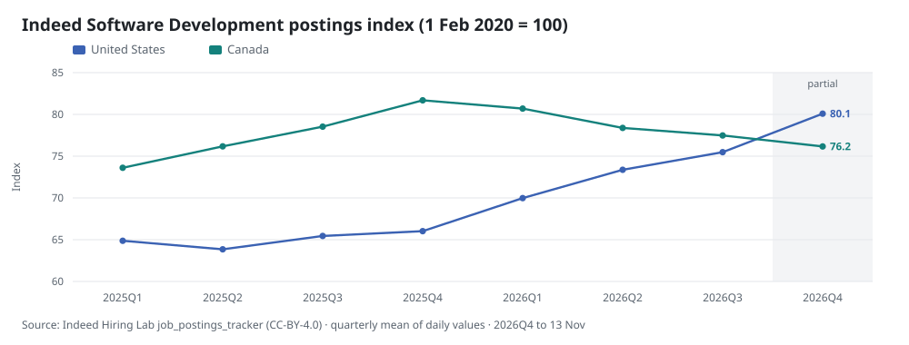
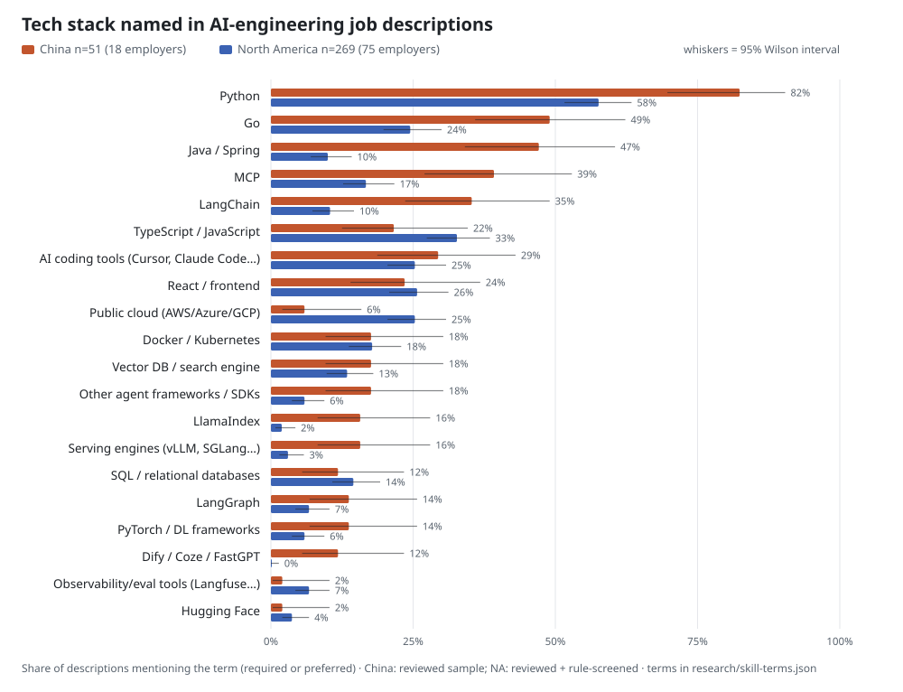

# AI Engineer: the market, the work and a learning path

This roadmap helps aspiring **application and systems AI Engineers** build the knowledge, skills and project experience needed for hiring, technical interviews and independent work. Its practical goal is end-to-end AI product delivery.

An AI Engineer combines models, data, tools and business systems into a usable product. The work starts with a user problem and acceptance criteria, then continues through architecture, implementation, evaluation, deployment and improvement. Employers need outcomes such as faster processing, more reliable knowledge access and less repetitive work, with manageable errors, latency, cost and data risk.

## 1. Understand the work behind the title

AI Engineer, LLM/agent engineer, Applied AI Engineer and some Forward Deployed Engineer roles can share this responsibility. Read the responsibilities and expected deliverables alongside the title.

| Direction | Typical deliverables | Main capabilities |
|---|---|---|
| AI products and applications | Knowledge assistants, document processing, workflow automation, voice/multimodal products | Backend/product engineering, model integration, retrieval/agents, evaluation, user feedback |
| Agent platforms and tooling | Harnesses, tool platforms, MCP services, evaluation/observability infrastructure | State and durable execution, protocols, authorization, isolation, reliability, developer experience |
| Customer-facing delivery | Discovery, enterprise integration, pilots, rollout and adoption | Requirements, integration, domain judgment, validation, cross-team collaboration |
| Application quality and performance | Data/model experiments, adaptation, small-model services, cost reduction | Experimental design, training data, post-training, inference and capacity measurement |

Software engineering provides the implementation foundation. MLE contributes data and model experimentation; SRE contributes reliability and operations. The roadmap covers the parts needed to deliver AI products. Large-scale pretraining, GPU kernel development and research roles require additional specialization.

## 2. Hiring market: which data matter for SDE and AIE decisions?

Updated **23 November 2026**. All indicators below are defined by occupation or job title.

### North American software development: recovering, concentrated in senior and AI roles

<picture>
  <source media="(prefers-color-scheme: dark)" srcset="../../assets/research/market-software-postings-en-dark.svg">
  
</picture>

Indeed's Software Development postings index uses 1 February 2020 = 100. The US rose from 64.9 in 2025Q1 to 75.5 in 2026Q3 and 80.1 in 2026Q4 (to 13 November); Canada fell from 81.7 in 2025Q4 to 76.2 in 2026Q4. [Quarterly data](../../research/market/indeed-quarterly.csv), [Indeed data](https://github.com/hiring-lab/job_postings_tracker)

Hiring Lab reports that US software-development postings have risen about 15% since February 2025 but remain about 27.5% below pre-pandemic levels. Of the increase from May 2025 to May 2026, 71% came from senior roles and 37% from jobs with AI in the title (the groups overlap). The author calls the evidence preliminary. [Hiring Lab, 8 July 2026](https://hiringlab.indeed.com/2026/07/08/ai-and-job-postings-from-destruction-to-creation/)

For learners, the recovering roles expect independent delivery and AI-system skills; newcomers need verifiable projects that show both.

### Signals specific to AI Engineers

| Signal | Latest value | How to read it |
|---|---|---|
| LinkedIn "AI Engineer" hiring growth (US) | +64% YoY; +62% at entry level (August 2026 report) | A new standardized title with a small base, and some people re-title themselves; shows direction, not volume. [LinkedIn AI Labor Market Update](https://delivery-p143253-e1476319.adobeaemcloud.com/adobe/assets/urn:aaid:aem:ef153078-1061-4817-82e7-a1c027d7a7d7/original/as/AI-Labor-Market-Update-August-2026-v2.pdf) |
| CompTIA: active postings requiring AI skills (US) | 366,322 (October 2026, +6.2% m/m); AI-titled roles +9.8% m/m | Lightcast data, subject to revision; the AI-title measure is closer to AIE demand. [CompTIA](https://www.comptia.org/en/about-us/news/press-releases/Tech-employment-gains-momentum-in-October-CompTIA-analysis-finds/) |
| Share of US software-development postings mentioning AI | 20% or more (December 2025) | A mention is not an AI-engineering requirement; it shows AI becoming a common SDE expectation. [Hiring Lab, 22 January 2026](https://hiringlab.indeed.com/2026/01/22/january-labor-market-update-jobs-mentioning-ai-are-growing-amid-broader-hiring-weakness/) |

### China: platform growth signals, no skill shares

- Maimai, *Agent 重置职场* (January–July 2026): new AI postings +789.47% YoY; AI application development was 60.97% of new AI postings, and agent developers were the most demanded application role; FDE / on-site deployment roles grew 1,522.73%. [National Business Daily](https://www.nbd.com.cn/articles/2026-09-16/4583369.html)
- Zhaopin, H1 2026: demand for agent-related technical talent +244% YoY. [CCTV Finance](https://finance.cctv.cn/2026/08/28/ARTIxnofbL409vkM6skY5WRh260828.shtml)
- On 9 September 2026 the Ministry of Human Resources and Social Security added an "agent developer" (智能体开发员) specialty under the generative-AI system application occupation. [Beijing News](https://m.bjnews.com.cn/detail/1788949841129475.html)

These are platform growth rates without published samples, methods or skill shares. The China skill profile below relies on the JD sample.

### Precise data not yet available

| Question | Available here | Still missing |
|---|---|---|
| Active AIE/SDE/MLE/SRE vacancies in three countries since 2025Q1 | US/Canada software-development index; JD samples | A deduplicated national vacancy history with a shared role taxonomy and closure dates |
| Large- versus mid-size-employer AIE counts | No AIE-specific data | AIE-specific historical postings stratified by employer size |
| Entry/mid/senior/staff market shares | Explicit title levels in the JD samples | A representative population and a stable level mapping |

These gaps remain empty in the [requested national quarterly table](../../research/market/requested-national-active-counts.csv).

## 3. 320 job descriptions: what do employers keep asking for?

### Sample

- **China, 51 descriptions** collected 18–19 November 2026 from employer APIs and pages, university-hosted employer postings and traceable reposts; duties and qualifications were reviewed by hand.
- **North America, 269 descriptions.** 53 were reviewed by hand in the same window. Another 216 were collected on 23 November 2026 through the documented public job-board APIs of Greenhouse, Ashby and Lever, covering 67 employers (AI-native companies, enterprise software, fintech, internet, health tech and others). Titles must contain engineering-role markers such as AI, LLM, agent, applied AI or forward deployed, and the role text must repeatedly mention AI-application terms. Each distinct title counts once per employer, with at most six per employer. These 216 use rule-based role-text bounds and were not reviewed one by one.
- North America covers 75 employers: 236 US and 33 Canadian descriptions. The China sample stays at 51 because major Chinese job sites offer no documented public posting API; expanding it needs another compliant source.

The unit is "the description mentions the item", including requirements, alternatives, duties and preferences; each description counts once per item. Terms use [stricter patterns](../../research/skill-terms.json); for example, "cost" counts only next to inference, token or model costs. Whiskers are 95% Wilson intervals. North America also reports an employer-balanced share so that one employer's many postings cannot dominate. [Records](../../research/jds.json), [full statistics](../../research/skill-distribution.csv), [China analysis](jd-china.md), [North America analysis](jd-north-america.md)

<picture>
  <source media="(prefers-color-scheme: dark)" srcset="../../assets/research/jd-role-expectations-en-dark.svg">
  
</picture>

<picture>
  <source media="(prefers-color-scheme: dark)" srcset="../../assets/research/jd-tech-stack-en-dark.svg">
  
</picture>

<!-- SKILL-TABLE:START -->

Expand exact shares and 95% intervals

| Group | Skill or expectation | China n=51 | North America n=269 | NA employer-balanced |
|---|---|---:|---:|---:|
| Tech stack | Python | 82% [70–90] | 58% [52–63] | 59% |
| Tech stack | Go | 49% [36–62] | 24% [20–30] | 24% |
| Tech stack | Java / Spring | 47% [34–60] | 10% [7–14] | 11% |
| Tech stack | MCP | 39% [27–53] | 17% [13–22] | 19% |
| Tech stack | LangChain | 35% [24–49] | 10% [7–15] | 13% |
| Tech stack | TypeScript / JavaScript | 22% [12–35] | 33% [27–38] | 30% |
| Tech stack | AI coding tools (Cursor, Claude Code…) | 29% [19–43] | 25% [20–31] | 24% |
| Tech stack | React / frontend | 24% [14–37] | 26% [21–31] | 25% |
| Tech stack | Public cloud (AWS/Azure/GCP) | 6% [2–16] | 25% [20–31] | 26% |
| Tech stack | Docker / Kubernetes | 18% [10–30] | 18% [14–23] | 15% |
| Tech stack | Vector DB / search engine | 18% [10–30] | 13% [10–18] | 13% |
| Tech stack | Other agent frameworks / SDKs | 18% [10–30] | 6% [4–9] | 6% |
| Tech stack | LlamaIndex | 16% [8–28] | 2% [1–4] | 3% |
| Tech stack | Serving engines (vLLM, SGLang…) | 16% [8–28] | 3% [2–6] | 3% |
| Tech stack | SQL / relational databases | 12% [6–23] | 14% [11–19] | 14% |
| Tech stack | LangGraph | 14% [7–26] | 7% [4–10] | 7% |
| Tech stack | PyTorch / DL frameworks | 14% [7–26] | 6% [4–9] | 10% |
| Tech stack | Dify / Coze / FastGPT | 12% [6–23] | 0% [0–1] | 0% |
| Tech stack | Observability/eval tools (Langfuse…) | 2% [0–10] | 7% [4–10] | 5% |
| Tech stack | Hugging Face | 2% [0–10] | 4% [2–7] | 4% |
| Role expectations | Agents | 96% [87–99] | 78% [73–83] | 80% |
| Role expectations | Shipping to production | 86% [74–93] | 90% [86–93] | 91% |
| Role expectations | Prompt and context engineering | 76% [63–86] | 35% [30–41] | 35% |
| Role expectations | Tool calling and integrations | 69% [55–80] | 22% [18–28] | 24% |
| Role expectations | Evaluation and experiments | 53% [40–66] | 67% [61–72] | 64% |
| Role expectations | RAG / retrieval | 63% [49–75] | 32% [26–37] | 32% |
| Role expectations | Reliability | 55% [41–68] | 61% [55–66] | 58% |
| Role expectations | Distributed and large-scale systems | 57% [43–70] | 59% [53–64] | 55% |
| Role expectations | Security, access and compliance | 29% [19–43] | 54% [48–60] | 51% |
| Role expectations | Observability and monitoring | 35% [24–49] | 49% [43–55] | 51% |
| Role expectations | Customer and stakeholder work | 45% [32–59] | 49% [43–55] | 52% |
| Role expectations | Latency, cost and performance | 39% [27–53] | 34% [29–40] | 32% |
| Role expectations | Multi-agent systems | 39% [27–53] | 9% [6–13] | 8% |
| Role expectations | Agent memory | 37% [25–51] | 4% [2–7] | 3% |
| Role expectations | Fine-tuning / post-training | 31% [20–45] | 18% [14–23] | 18% |
| Role expectations | Multimodal / voice | 22% [12–35] | 18% [14–23] | 15% |
| Role expectations | RL / preference alignment | 16% [8–28] | 10% [7–14] | 9% |
| Role expectations | Data pipelines | 14% [7–26] | 10% [7–15] | 8% |
| Role expectations | Model internals (transformers…) | 14% [7–26] | 3% [2–6] | 5% |

<!-- SKILL-TABLE:END -->

### Shared: turn model capability into systems that ship, are evaluated and keep running

- **Production delivery** appears in almost every role (China 86%, North America 90%).
- **Evaluation and experiments** (53% / 67%), **reliability** (55% / 61%) and **distributed, large-scale systems** (57% / 59%) exceed half in both markets.
- **Agents** have the highest share (96% / 78%), but the samples were selected for agent and AI-application titles, so this share does not describe all engineering roles.
- **Fine-tuning / post-training** (31% / 18%) and **reinforcement learning** (16% / 10%) appear in a minority of roles. **AI coding tools** (Cursor, Claude Code and others) appear in about a quarter (29% / 25%).

### Differences: different writing styles and different emphasis

- **Chinese descriptions name concrete components more often:** prompt and context engineering (76% / 35%), tool calling (69% / 22%), RAG (63% / 32%), agent memory (37% / 4%), multi-agent systems (39% / 9%), LangChain (35% / 10%) and MCP (39% / 17%).
- **North American descriptions state duties and constraints more often:** security, access and compliance (29% / 54%), observability (35% / 49%), public cloud (6% / 25%) and TypeScript (22% / 33%).
- **Languages:** Chinese postings often say "at least one of Python, Go or Java", so Go (49%) and Java/Spring (47%) are both high; North America centres on Python (58%), followed by TypeScript. Many North American postings name no language; of the 190 that do, 82% name Python (93% of the 45 Chinese postings that name one).
- **Inference:** North American postings name RAG and tool calling less often, probably because they describe outcomes and responsibilities rather than components, not because these skills are unnecessary. They remain common interview topics.

The two North American subsamples also differ. The 53 hand-reviewed postings lean toward agent platforms and AI-native companies, with higher RAG (45% / 28%), MCP (34% / 12%) and multi-agent (23% / 6%) shares than the 216 rule-screened postings. The broader sample is closer to typical AIE roles.

### Cross-checks against external data

| Source | Sample | Main results | Compared with this sample |
|---|---|---|---|
| InterviewStack job board, Nov 2026 | 3,835 global AI Engineer postings (about 35% US) | Python 75%, agents ≥61%, RAG 50%, evaluation ≥41%, LangChain 23%, MCP 21%, LangGraph 19%, TypeScript 17%, fine-tuning 17% | Same direction: Python is the majority, agents and evaluation are high, fine-tuning is below 20% and named frameworks are a minority. [Source](https://interviewstack.io/blog/how-ai-is-changing-ai-engineer-2026) |
| Juejin, May 2026 | Application-development postings; 23 listed | Python ~100%, LangChain ~80%, RAG ~60%, Dify ~35%, fine-tuning ~35%, LangGraph ~25%, MCP ~10% | Smaller Chinese employers name LangChain and Dify more often; this sample is large-employer-heavy, with Dify/Coze at 12%. [Source](https://juejin.cn/post/7644822313692692518) |
| CSDN, Mar 2026 | 200 "large model" postings paying ¥30k+ per month | C++ 61.5%, RAG 37%, multimodal 33.5%, Python 33%, agents 31.5% | Includes algorithm and inference-optimization roles, hence high C++ and lower Python. [Source](https://gitcode.csdn.net/69b3835a54b52172bc60e19d.html) |
| LangChain practitioner survey, Nov–Dec 2025 | 1,340 respondents | 57% have agents in production; 52% run offline evaluation, 30% none; 57% do not fine-tune | Supports "evaluate first, fine-tune rarely". [Source](https://langchain.com/state-of-agent-engineering) |

External sources are mostly job-board or blog tallies with limited method disclosure; this page uses them as directional checks and does not pool them.

### Job-search strategy

- **China:** Python plus one backend language (Go or Java); implementation-level command of RAG, tool calling, context and memory, and multi-agent systems; at least one mainstream framework (LangChain/LangGraph); MCP. Roles at smaller and traditional-industry employers also value quick prototyping on platforms such as Dify.
- **North America:** Python plus TypeScript; emphasize evaluation, observability, security and permissions, cloud deployment, and experience working with customers and stakeholders, especially for FDE and applied-AI roles.
- **Both:** one complete project with evaluation data, a deployment record and a failure postmortem. Go deeper into fine-tuning, RL or inference optimization only for target roles. The Canadian sample has 33 postings; read each target description before setting priorities.

## 4. From job requirements to a knowledge structure: weights and priorities

### Nine enterprise job descriptions: what they actually value

Public job-board APIs miss many large employers. To fill that gap, here are nine AI-engineering postings from large and mid-size North American employers (November 2026): Microsoft, Workday, RBC, BMO, Vanguard, Canada Life, Stripe, Databricks and American Express. A reader supplied the BMO and Canada Life texts. These are qualitative cases and are not counted in the statistics above.

<!-- ENTERPRISE-MATRIX:START -->
| Capability | Microsoft | Workday | RBC | BMO | Vanguard | Canada Life | Stripe | Databricks | AmEx | Required / mentioned |
|---|---|---|---|---|---|---|---|---|---|---:|
| Production software experience | 2+ yrs | 5+ yrs | 2+ yrs | 6 yrs | 6+ yrs | 3+ yrs | 4+ yrs | 2-8 yrs | Master's graduate (2027) | — |
| Backend, APIs and system design | ✓ | ✓ | ✓ | ✓ | ✓ | ✓ | ✓ | ✓ | ✓ | 9 / 9 |
| Testing, CI/CD, containers and cloud deployment | ✓ | ✓ | ✓ | ✓ | ✓ | ✓ | ✓ | ✓ | ✓ | 9 / 9 |
| Business partnership and product mindset | ✓ | ✓ | ✓ | ✓ | ✓ | ✓ | ✓ | ○ | ✓ | 8 / 9 |
| LLM applications and agents | ✓ | ✓ |  | ✓ | ✓ | ✓ | ✓ | ✓ | ○ | 7 / 8 |
| Production monitoring and observability | ✓ | ✓ | ✓ | ✓ | ✓ | ✓ | ✓ | ○ |  | 7 / 8 |
| Security, Responsible AI and model risk | ✓ | ✓ | ✓ | ✓ | ✓ | ✓ |  |  | ✓ | 7 / 7 |
| RAG, retrieval and documents | ✓ | ○ |  | ✓ | ✓ | ✓ |  |  | ○ | 4 / 6 |
| Evaluation and experiments | ○ | ✓ |  | ✓ |  | ✓ | ○ |  | ✓ | 4 / 6 |
| Technical leadership and mentoring |  | ✓ | ✓ | ✓ | ✓ | ✓ |  |  |  | 5 / 5 |
| Full stack / frontend | ○ | ○ | ✓ |  |  | ✓ | ✓ |  |  | 3 / 5 |
| Classical ML, training and MLOps | ○ |  |  | ○ | ✓ |  |  | ○ | ○ | 1 / 5 |
| AI-assisted development | ✓ |  | ○ |  |  |  | ✓ |  |  | 2 / 3 |
| Fine-tuning |  |  |  |  | ○ |  |  |  |  | 0 / 1 |

✓ = requirement or core duty; ○ = preference or alternative; blank = not mentioned. Coding and links are in [enterprise-cases.json](../../research/enterprise-cases.json).
<!-- ENTERPRISE-MATRIX:END -->

Five things stand out:

1. **Software engineering is the first filter, required by all nine.** Workday says the role is "first and foremost a software engineering role", with system design, scalability and performance "non-negotiable". Databricks explicitly welcomes infrastructure and systems engineers without an ML background. RBC's "Senior AI Engineer" is a full-stack role in Vue/Nuxt, Node.js and SQL; AI appears only as a preference for AI coding assistants, so read the duties, not just the title.
2. **Production delivery and business partnership are also universal.** Testing, CI/CD, containers and cloud deployment: 9/9. Defining problems with the business and owning outcomes: mentioned in all nine, required in eight. Production monitoring and observability: 8/9.
3. **LLMs and agents are central but not everything.** 8/9 involve LLM applications or agents, 6/9 RAG and document processing, and 6/9 evaluation. Financial and insurance employers especially value document processing (claims, contracts, audit) together with evaluation and guardrails.
4. **Security, Responsible AI and model risk separate enterprise roles.** 7/9 require them, including every bank, insurer and asset manager here (RBC, BMO, Vanguard, Canada Life, American Express).
5. **Fine-tuning and training are rarely required.** Fine-tuning appears only as a Vanguard preference; only Vanguard requires classical ML and MLOps. Experience ranges from a new master's graduate (American Express, which asks for data structures, algorithms, projects, hackathons or open source) to six years or more, and senior roles expect technical leadership and mentoring.

### Established employers versus AI-native companies

Splitting the 269 North American descriptions by employer type: established employers cover enterprise software, fintech, internet, health and industrial companies; AI-native companies cover model labs, AI application companies and developer-tool companies. The table lists the largest differences and three items that are nearly identical.

<!-- EMPLOYER-SPLIT:START -->
| Skill or expectation | Established employers n=133 (48) | AI-native companies n=136 (27) |
|---|---:|---:|
| Security, access and compliance | 63% [55–71] | 45% [37–53] |
| Observability and monitoring | 58% [49–66] | 40% [33–49] |
| Java / Spring | 17% [12–25] | 3% [1–7] |
| Reliability | 66% [58–74] | 55% [47–63] |
| Public cloud (AWS/Azure/GCP) | 31% [24–39] | 20% [14–27] |
| LangChain | 15% [10–22] | 6% [3–11] |
| LangGraph | 11% [7–18] | 2% [1–6] |
| Evaluation and experiments | 66% [58–74] | 68% [59–75] |
| Agents | 77% [69–83] | 79% [72–85] |
| Shipping to production | 87% [80–92] | 93% [88–96] |
| TypeScript / JavaScript | 25% [18–33] | 40% [33–49] |
| Multimodal / voice | 11% [6–17] | 25% [18–33] |
| RL / preference alignment | 4% [2–8] | 15% [10–22] |
| Docker / Kubernetes | 12% [8–19] | 24% [17–31] |
| Customer and stakeholder work | 44% [35–52] | 54% [46–63] |
<!-- EMPLOYER-SPLIT:END -->

Established employers more often require security and compliance, observability, reliability, public cloud and Java, and more often name LangChain or LangGraph. AI-native companies more often mention TypeScript, multimodal and voice work, reinforcement learning and customer-facing work. Evaluation, agents and production delivery are equally high in both. When applying to large and mid-size companies, put evidence of **security, monitoring and stable operation** first in your résumé and projects, not only model quality.

### What screening looks at first

Combining the 320-description statistics with the enterprise cases above, application and systems AIE screening roughly follows this order:

| Priority | Capability | Evidence (China / North America) | Modules | Target depth |
|---|---|---|---|---|
| 1 | Software engineering and production delivery: backend services, APIs, databases, testing, containers, CI/CD, cloud deployment, debugging | Production delivery 86% / 90%; distributed and large-scale systems 57% / 59%; reliability 55% / 61%; enterprise roles ask for 2–4+ years of production experience | 01, 02, 14 | Build and debug independently |
| 2 | LLM applications and agents: structured output, tool calling, context, RAG, agent loops, human approval | Agents 96% / 78%; prompt and context 76% / 35%; tool calling 69% / 22%; RAG 63% / 32% | 05–10 | Implement once without a framework, then master one framework |
| 3 | Evaluation, testing and observability | Evaluation 53% / 67%; observability 35% / 49% | 11 | Design evaluation sets, run regressions and attribute failures |
| 4 | Security, access and governance | Security, access and compliance 29% / 54% | 10, 14 | Design permissions, audit trails and guardrails in |
| 5 | Business understanding and communication | Customer and stakeholder work 45% / 49% | 00, 14, 15 | Turn ambiguous needs into deliverables with acceptance criteria |
| 6 | Model internals and math | Mentioned in 14% / 3% of postings, yet theory questions and hand-written implementations are common interview rounds, especially in China | 03, 04, 15.5 | Explain and hand-write core components |
| 7 | Specializations: fine-tuning and RL, inference optimization, multimodality | Fine-tuning 31% / 18%; RL 16% / 10%; serving engines 16% / 3% | 12, 13, 05.6–05.7 | Choose by target role |

### Weight of each area

Evaluation gets more time than its unit share: about 20% of Chip Huyen's *AI Engineering* covers evaluation, and evaluation plus data take about a third of CS329Z sessions. "Suggested time" is for the application-AIE main line; skip what the [entry diagnostic](entry-diagnostic.md) shows you already know. Unit counts reflect breadth, not study time: the agent modules contain many advanced units, while the backend modules have fewer units but more practice.

| Area | Suggested time | Units (share) | Share of core units |
|---|---:|---:|---:|
| 00–02 Role, Python and backend | 20% | 17 (13%) | 18% |
| 03–04 Math, ML and transformers | 8% | 12 (10%) | 12% |
| 05 Model applications and context | 10% | 10 (8%) | 10% |
| 06 Data and RAG | 10% | 9 (7%) | 7% |
| 07–09 Agents, orchestration and multi-agent | 15% | 22 (17%) | 12% |
| 10 Tools, MCP and safe execution | 8% | 7 (6%) | 6% |
| 11 Evaluation and observability | 15% | 12 (10%) | 13% |
| 14 Product delivery | 8% | 9 (7%) | 8% |
| 15 Portfolio and job search | 6% | 7 (6%) | 8% |
| 12–13 Post-training and inference optimization | Specialization: add 20–30% | 17 (13%) | 6% |
| 16 World models and embodied AI | Elective | 4 (3%) | 0% |

### Compared with CS329Z, CS336 and widely used roadmaps

| Reference | Structure and emphasis | How this roadmap responds |
|---|---|---|
| [CS329Z Engineering AI Agents](https://cs329z.stanford.edu/) (Fall 2026) | From LLM pipelines to compound AI systems to autonomous agents. HW1 builds a harness without frameworks: BM25 and multi-hop RAG, a tool-call protocol, the agent loop, a sandboxed terminal, compaction, memory, approval, guardrails and injection, and a simulated-user evaluation. HW2 authors a Harbor evaluation task with a verifier and an oracle. Evaluation is about 21% of sessions, evaluation plus data about 32%; the project is 40% of the grade | Units 07.3, 07.5–07.6, 10.4–10.7, 11.1 and 11.8 follow these two assignments. CS329Z has no dedicated RL or test-time-compute session; this roadmap covers them in 05.8 and 12.6–12.7 |
| [CS336 Language Modeling from Scratch](https://cs336.stanford.edu/) | Tokenizer and transformer from scratch, GPUs and parallelism, scaling laws, inference, evaluation, data, SFT/RLHF/RLVR; five assignments; the 2026 edition bans coding agents for implementation | For application AIEs: tokenization, resource accounting, inference (KV cache, quantization, speculative decoding, continuous batching), evaluation validity, data deduplication and filtering, SFT/DPO/GRPO (04.1, 13.2–13.7, 11.9, 12.10, 12.5–12.6). Triton kernels, FSDP/tensor-parallel implementation and fitting scaling laws are awareness-level |
| Chip Huyen, *AI Engineering* (O'Reilly, 2025) | By page count: evaluation about 20% (two chapters, before prompting), fine-tuning and dataset engineering about 20%, model internals 13%, RAG/agents/memory 11%, inference 9% | Evaluation also comes early here; training-heavy material is a specialization |
| [roadmap.sh AI Engineer](https://roadmap.sh/ai-engineer) | Of 193 topics: RAG/vector stores about 20%, model APIs about 16%, prompting and context about 15%, agents about 10%, evaluation about 10%, MCP about 7%, fine-tuning about one topic | Similar application coverage; this roadmap adds the software engineering, production delivery, permissions and sandboxes it covers lightly |
| [mlabonne/llm-course](https://github.com/mlabonne/llm-course) | Fundamentals 19% (optional), scientist/training track 46%, engineer track 36% | Training content sits in modules 12–13 |
| Datawhale [hello-agents](https://github.com/datawhalechina/hello-agents), [happy-llm](https://github.com/datawhalechina/happy-llm), [self-llm](https://github.com/datawhalechina/self-llm) | Chinese-language agent practice (including Coze, Dify and n8n), LLMs from scratch, deploying and fine-tuning Chinese models | Added as Chinese-language companions in the relevant units |

Most roadmaps cover prompting, RAG, tools and agents, and their 2025–2026 updates add MCP, context engineering, memory and harnesses. They rarely cover backend and software-engineering fundamentals, production delivery, sandboxes and permissions, or interviews (common only in Chinese repositories). Those are exactly what enterprise roles screen for, which is why this roadmap gives them their own modules.

### A stack route aimed at passing screening

**Tier 1: required in both markets**

- Languages: Python first, plus one more: Go or Java for China, TypeScript for North America.
- Services and data: FastAPI, PostgreSQL (with pgvector), Redis, Docker, GitHub Actions and one cloud platform.
- Model access: one commercial API and one open or Chinese model; structured output, tool calling, streaming, retries and budgets.
- RAG: parsing, chunking, hybrid retrieval, reranking and citations, with permission filtering.
- Agents: implement the loop and human approval without a framework first, then use LangGraph for persistence and recovery; write one MCP server.
- Evaluation and observability: pytest plus promptfoo or Ragas for regression; calibrate an LLM judge against human labels; record traces, quality, latency and cost with Langfuse or OpenTelemetry.
- Security: permissions, secrets management, injection defenses and audit logs.

**Tier 2: by target market**

- China: deeper LangChain/LangGraph; use Dify to prototype, write plugins and self-host, and know when to move to code; agent memory and multi-agent systems; Qwen or DeepSeek through APIs and local vLLM deployment; Spring AI or Spring AI Alibaba for Java roles.
- North America: React/Next.js full stack; one of Azure AI Foundry, Azure OpenAI and AI Search, or AWS Bedrock; Copilot Studio and Power Automate in Microsoft-ecosystem roles; customer communication, demos and rapid prototyping for FDE roles.

**Tier 3: by role**: fine-tuning (LoRA/QLoRA, SFT, DPO), inference optimization (vLLM, quantization, KV cache), multimodality and voice, agentic RL.

### Projects that pass screening

| Project | Matching job scenario | Evidence to show |
|---|---|---|
| [P1 Enterprise knowledge service](capstones.md#p1-enterprise-knowledge-service) | Canada Life's document ingestion, retrieval and citations; enterprise knowledge bases and support assistants in China | Parser comparison, retrieval metrics, citation accuracy, permission tests, traces and cost per successful task |
| [P2 Business workflow agent](capstones.md#p2-business-workflow-agent) | Microsoft's tool calling, multi-agent routing, hand-offs, retries and human escalation; Stripe's internal tools and workflow automation | Tool contracts, approval and idempotency, failure-recovery drills, trajectory evaluation, deployment and usage records |
| [P3 Document processing with human review](capstones.md#p3-document-processing-with-human-review) | Insurance claims, financial document review, contract review | Field-extraction accuracy, uncertainty display and human confirmation, regression tests |
| [P4 Small-model serving and adaptation](capstones.md#p4-small-model-serving-and-adaptation) | Inference-optimization and post-training roles | Memory and throughput benchmarks, quality before and after quantization, evaluation before and after fine-tuning |

Make P1 or P2 your main project and build a smaller version of the other. For China, also prototype the same scenario in Dify and explain why and how you moved it to code. Write résumé bullets as problem, method and measured result, aligned with the target description's keywords. [Project requirements](capstones.md), [résumé and interviews](modules/15.md)

## 5. How courses and open-source projects fit

[Stanford CS329Z](https://cs329z.stanford.edu/) provides the agent-systems spine and [CS336](https://cs336.stanford.edu/) covers model internals, inference and post-training; official documentation and open courses fill in Python, backend and deployment. Core readings are free; commercial APIs and GPUs cost what you use.

Open-source projects enter the roadmap in three tiers: use and read the source, deploy and operate, or recognize (GitHub data as of 23 November 2026):

| Tier | Project | What to learn | 2025–2026 changes |
|---|---|---|---|
| Use and read the source | [Dify](https://github.com/langgenius/dify) (about 162k stars) | Build workflow and knowledge apps, write plugins and tools, self-host; read the workflow engine and plugin daemon | Two-way MCP since v1.6; OpenTelemetry export and human-approval forms in v1.20; one-click deployment on Alibaba, Huawei and Tencent clouds. Modified Apache 2.0 licence: running a multi-tenant service or removing the frontend logo needs a commercial licence. One practitioner test saturated at about 10 QPS on a single 4-core/8 GB instance, and complex flows often move to code |
| Use and read the source | [LangChain](https://github.com/langchain-ai/langchain) + [LangGraph](https://github.com/langchain-ai/langgraph) | State graphs, checkpointers, interrupts and resume; `create_agent` and middleware in 1.0 | 1.0 released October 2025; `create_react_agent` deprecated |
| Use and read the source | [vLLM](https://github.com/vllm-project/vllm), [SGLang](https://github.com/sgl-project/sglang) | Continuous batching, KV cache, prefix caching, speculative decoding | Mainstream serving engines for inference roles |
| Use and read the source | [RAGFlow](https://github.com/infiniflow/ragflow) or LightRAG | Document parsing, retrieval pipelines, citations | RAGFlow 1.0 (November 2026) is a Go rewrite |
| Deploy and operate | [Coze Studio](https://github.com/coze-dev/coze-studio) / Coze Loop, FastGPT, MaxKB, n8n, Open WebUI, Ollama | Platform deployment, model integration, permissions and data boundaries | Coze Studio has had no commits since July 2026 while Coze Loop stays active; FastGPT's licence terms resemble Dify's |
| Deploy and operate | [Langfuse](https://github.com/langfuse/langfuse), [promptfoo](https://github.com/promptfoo/promptfoo), Ragas | Traces, dataset evaluation, regression and red-team tests | ClickHouse acquired Langfuse (January 2026); OpenAI announced it will acquire Promptfoo (March 2026); both open-source projects continue |
| Pick one framework to go deep | OpenAI Agents SDK, Google ADK, PydanticAI, AgentScope (Alibaba), Spring AI Alibaba (Java), Microsoft Agent Framework | Compare state, tools, deployment and evaluation | AutoGen is archived and succeeded by Microsoft Agent Framework; AgentScope 2.0 was a breaking rewrite |
| No longer worth investing in | Flowise, Langchain-Chatchat, MetaGPT, Qwen-Agent | — | Flowise was archived and reached end of life in August 2026; the others show no commits in 90 days |

LangGraph appears in 14% of Chinese and 7% of North American postings. It is the main teaching framework because it suits learning state, persistence and recovery. Dify appears in 12% of the Chinese sample and more often in roles at smaller employers. See [open-source research](open-source.md) and [stack decisions](stack-decisions.md) for repository snapshots and selection reasons.

## 6. What demonstrates readiness?

A hiring portfolio should include a business task and acceptance criteria, a runnable deployed system, versioned data/evaluations, baseline and ablation results, quality/latency/cost measurements, authorization and recovery exercises, and a reproducible design explanation.

Choose an enterprise knowledge service, a tool-enabled workflow, a document-processing product or a model-service optimization task. Build it incrementally through the curriculum, then demonstrate one measured area of depth. Assessment examines independent implementation, diagnosis, design judgment and business acceptance. [Projects](capstones.md), [assessment](assessment.md)
