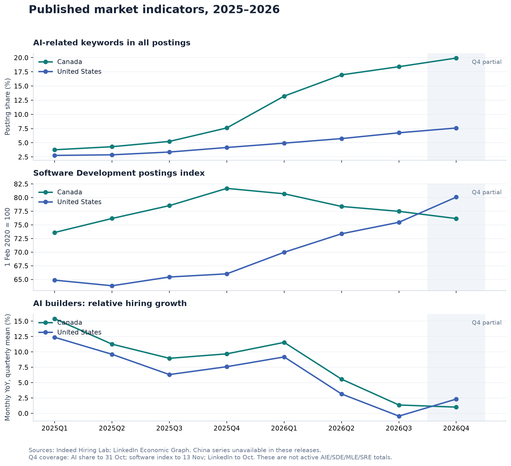
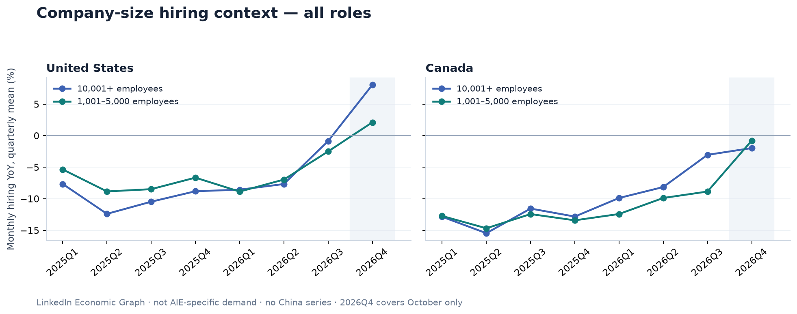
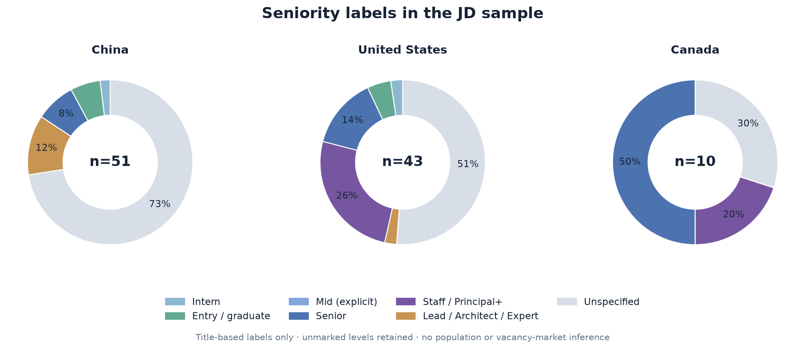
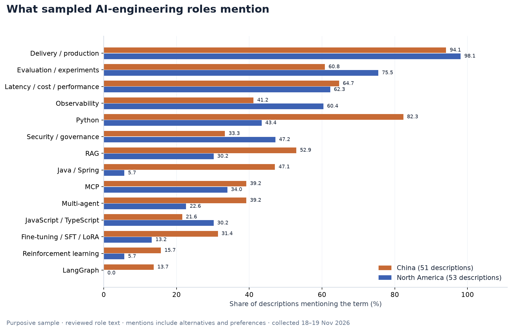

# AI Engineer: the market, the work and a learning path

This roadmap helps aspiring **application and systems AI Engineers** build the knowledge, skills and project experience needed for hiring, technical interviews and independent work. Its practical goal is end-to-end AI product delivery.

An AI Engineer combines models, data, tools and business systems into a usable product. The work starts with a user problem and acceptance criteria, then continues through architecture, implementation, evaluation, deployment and improvement. Employers need outcomes such as faster processing, more reliable knowledge access and less repetitive work, with manageable errors, latency, cost and data risk.

## 1. Understand the work behind the title

AI Engineer, LLM/agent engineer, Applied AI Engineer and some Forward Deployed Engineer roles can share this responsibility. Read the responsibilities and expected deliverables alongside the title.

| Direction | Typical deliverables | Main capabilities |
|---|---|---|
| AI products and applications | Knowledge assistants, document processing, workflow automation, voice/multimodal products | Backend/product engineering, model integration, retrieval/agents, evaluation, user feedback |
| Agent platforms and tooling | Harnesses, tool platforms, MCP services, evaluation/observability infrastructure | State and durable execution, protocols, authorization, isolation, reliability, developer experience |
| Customer-facing delivery | Discovery, enterprise integration, pilots, rollout and adoption | Requirements, integration, domain judgment, validation, cross-team collaboration |
| Application quality and performance | Data/model experiments, adaptation, small-model services, cost reduction | Experimental design, training data, post-training, inference and capacity measurement |

Software engineering provides the implementation foundation. MLE contributes data and model experimentation; SRE contributes reliability and operations. The roadmap covers the parts needed to deliver AI products. Large-scale pretraining, GPU kernel development and research roles require additional specialization.

## 2. What does hiring data actually show?

Research updated **19 November 2026**. The following sources measure advertisements, posting indices and hiring trends separately.

### United States and Canada

Indeed Hiring Lab publishes the share of advertisements mentioning AI-related keywords and a Software Development posting index. The table averages published daily observations within each quarter. [AI data](https://github.com/hiring-lab/ai-tracker), [posting indices](https://github.com/hiring-lab/job_postings_tracker)

| Indicator | US: 2025Q1 → 2026Q3 | Canada: 2025Q1 → 2026Q3 | Interpretation |
|---|---|---|---|
| AI keywords across all advertisements | 2.77% → 6.75% | 3.76% → 18.41% | Includes other occupations using AI |
| Software Development posting index | 64.87 → 75.47 | 73.61 → 77.48 | Broad category; 1 February 2020 = 100 |
| LinkedIn AI builders relative hiring growth | +12.37% → −0.45% | +15.39% → +1.36% | Quarterly mean of published monthly year-on-year measures |

LinkedIn's AI builders category covers a wider population of AI-building talent. Hiring and advertising measures have different denominators. [LinkedIn dashboard](https://pulse.linkedin.com/reporting-ai)

2026Q4 is partial: AI keyword share ends on 31 October, software posting indices on 13 November and LinkedIn observations in October. Complete-quarter comparisons use Q1–Q3; retain actual coverage dates when interpreting Q4. [Quarterly data and provenance](../../research/market/)

These observations indicate wider demand for AI skills alongside software posting indices that remain below their 2020 baseline. Measuring vacancies for a specific occupation requires a separate dataset.

### China

An August 2026 CCTV report describes **244% year-on-year growth** in AI Agent job demand during the first half of 2026, using a recruiting-platform measure. This is a useful signal of demand within that platform and period. Its population differs from the North American series. [CCTV report](https://finance.cctv.cn/2026/08/28/ARTIxnofbL409vkM6skY5WRh260828.shtml)

The Chinese JD cohort includes internet companies, enterprise software, manufacturing, automotive, finance and consumer hardware. Descriptions concern knowledge retrieval, office/customer-service workflows, analytics and industry applications. Chinese skill findings are analyzed separately below.

### Employer size and seniority

LinkedIn's public size series supports comparison of **overall hiring** at employers with 10,001+ and 1,001–5,000 employees, separately for the US and Canada. These are source-defined bins and cover only part of the employer-size spectrum.

This provides context for job seekers. AIE-specific size trends require historical advertisements with role classifications.

The next chart labels seniority explicitly stated in JD titles. The country cohorts contain China 51, US 43 and Canada 10 descriptions. Unmarked levels stay unspecified; a title is assigned to mid-level only when it explicitly says so.

This is a description of the sample. National entry/senior vacancy shares require a representative vacancy population. Learners should compare target roles against evidence of independent delivery, design and operational ownership.

### Data still needed for the requested comparisons

| Research question | Available here | Missing input |
|---|---|---|
| National active AIE/SDE/MLE/SRE vacancies, each quarter since 2025Q1 | US/Canada public indicators and three-country JD cohorts | A comparable historical vacancy database with stable classification, deduplication and closure dates |
| AIE demand at large/mid-sized employers | US/Canada overall hiring by size | AIE-specific historical postings by employer size in all three countries |
| National entry/mid/senior/staff shares | Explicit title labels in the JD sample | A representative vacancy population and consistent level mapping |

The [national quarterly table](../../research/market/requested-national-active-counts.csv) retains empty values for missing observations. Current search-result counts and hiring growth rates cannot reconstruct historical active vacancy totals.

## 3. What 104 descriptions say employers value

The application/systems cohort contains **51 descriptions from China and 53 from North America**, across 43 employers. North America comprises 43 US and 10 Canadian roles. Sources include employer APIs/pages, employer descriptions hosted by universities and traceable syndicated descriptions. Sixty-six were listed on employer boards at collection; 38 descriptions were accessible with opening status unverified. This cohort studies job content.

The unit below is a description **mentioning** a term. Responsibilities, requirements, alternatives and preferences all qualify. Each keyword counts at most once per reviewed role text. [Sources](../../research/jds.json), [matching rules](../../research/keyword-codebook.json), [full results](../../research/keyword-counts.csv), [China cohort](jd-china.md), [North America cohort](jd-north-america.md)

| Skill or responsibility | China, n=51 | North America, n=53 | Curriculum implication |
|---|---:|---:|---|
| Product/production delivery | 48 · 94.1% | 52 · 98.1% | Carry a project through implementation, validation and operation |
| Evaluation/experiments | 31 · 60.8% | 40 · 75.5% | Establish baselines, datasets and failure analysis from the first project |
| Latency/cost/performance | 33 · 64.7% | 33 · 62.3% | Report quality, latency, resources and cost together |
| Observability | 21 · 41.2% | 32 · 60.4% | Diagnose retrieval, tools and generation from traces |
| Security/governance | 17 · 33.3% | 25 · 47.2% | Design authorization, data boundaries and auditability |
| Python | 42 · 82.4% | 23 · 43.4% | Use a common implementation language |
| Java/Spring | 24 · 47.1% | 3 · 5.7% | Optional enterprise-integration depth for relevant Chinese roles |
| JavaScript/TypeScript | 11 · 21.6% | 16 · 30.2% | Build product interfaces and streaming interactions |
| RAG | 27 · 52.9% | 16 · 30.2% | Learn ingestion, retrieval, citations and layered diagnosis |
| MCP | 20 · 39.2% | 18 · 34.0% | Learn protocol, tool contracts and authorized integration |
| Multi-agent | 20 · 39.2% | 12 · 22.6% | Understand coordination and measure its added complexity |
| Fine-tuning/SFT/LoRA | 16 · 31.4% | 7 · 13.2% | Select post-training depth after establishing data and evaluation |
| Reinforcement learning | 8 · 15.7% | 3 · 5.7% | Understand foundations; specialize for relevant roles |

### Shared work: make model capability useful in a business system

Both cohorts emphasize delivery, experiments and performance. A recurring work cycle is:

1. **Define the task:** users, workflow, error costs and business outcomes.
2. **Prepare data and interfaces:** documents, databases, APIs, freshness and permissions.
3. **Build the solution:** model choice, context, retrieval, tools, control flow and product integration.
4. **Establish evidence:** fixed evaluations, real failures, baseline comparisons, safety and recovery checks.
5. **Deploy and improve:** quality/latency/cost monitoring and feedback-driven changes to data, code or models.

A learner should explain the choices at each step, diagnose failures and assess whether an improvement justifies its additional cost.

### Differences: adjust depth to the target role

Python, Java, RAG and post-training terms appear more often in the Chinese cohort. API/system integration, observability, security, cloud and customer delivery appear more often in the North American cohort. The Chinese cohort contains more internet roles, while North America contains more AI-native/customer-delivery roles. Sector composition and selection methods affect these differences. The CSV also includes employer-balanced rates for checking the influence of multiple postings from one employer.

For Chinese roles, strengthen Python/backend work, retrieval and business agents, then add Java or model optimization as relevant. For North America, strengthen software design, integration, evaluation, reliability and requirements communication. Canada's ten descriptions are a small cohort; inspect target descriptions individually.

## 4. Turn job requirements into a complete knowledge structure

The curriculum combines JD-derived delivery capabilities with the foundations needed to perform them. Each unit specifies topic scope, expected depth, a selected resource and a build task. The [full knowledge tree](knowledge-tree.md) has **17 modules, 126 units and 693 topic branches**.

| Layer | Scope | Work enabled |
|---|---|---|
| 00–02 Careers, Python and backend | Types, testing, async, HTTP, databases, transactions, queues, caching, collaboration | Maintainable services, enterprise integration and failure handling |
| 03–04 Math, ML and Transformers | Statistics, gradients/tensors, PyTorch, attention, tokenization, training/generation | Model understanding and credible experimentation |
| 05 Model applications and context | APIs, structured outputs, tool calling, prompting, multimodal/voice interaction | Interactive products with explicit I/O contracts |
| 06 Data and RAG | Parsing, incremental indexing, sparse/dense/hybrid retrieval, reranking, citations, permissions | Traceable use of enterprise data |
| 07–09 Agents and orchestration | Harnesses, memory, recovery, LangGraph/peers, durable workflows, multi-agent | Recoverable, bounded and measurable task execution |
| 10 Tools and execution | MCP, identity/authorization, business tools, sandboxes, resource limits, audit | External integration and controlled code execution |
| 11 Evaluation and observability | Datasets, metrics, human/model graders, experiments, traces, regression, feedback | Failure localization and verified improvements |
| 12 Post-training | SFT, LoRA/QLoRA, preferences, RLHF/DPO, PPO/GRPO, agentic RL, distillation | Task-specific adaptation with measured gains and costs |
| 13 Inference and practical infrastructure | Local models, vLLM/SGLang, quantization, KV cache, scheduling, profiling, distributed concepts | Model deployment, capacity and latency/memory tradeoffs |
| 14–15 Delivery and employment | Requirements, containers/CI/CD, reliability, security, operations, portfolio, interviews | Demonstrable delivery and defensible engineering decisions |
| 16 Electives | World models, simulation, embodied data, robotics policies/deployment | An entry point for adjacent specialized roles |

Study and project work progress together: build an API service and small evaluation set, add retrieval/tools, then address durable state, authorization and deployment. Choose post-training or inference depth after measuring a relevant bottleneck. [Dependency order](dependency-order.md)

## 5. How courses and open-source projects fit

[Stanford CS329Z](https://cs329z.stanford.edu/) supplies the agent-systems spine: tasks, tools, harnesses, memory, collaboration, evaluation and optimization. Use the published lectures and assignments while the course is in progress. Official documentation and open courses supply software, model, training and deployment foundations. Core reading is freely accessible; commercial API/GPU execution can cost money.

The research records public metadata for 61 repositories. Selection considers responsibility, maintenance, documentation and learning value; stars help discover candidates. The following mechanisms receive priority:

| Projects | Curriculum additions | Employer problem |
|---|---|---|
| LangGraph, PydanticAI, ADK | Explicit state, typed tools, persistence, human intervention, portability | Fragile long tasks and difficult debugging |
| Temporal, DSPy | Durable workflows; data-driven program/prompt optimization | External-operation retries and unmeasured tuning |
| RAGFlow, Haystack, LlamaIndex | Ingestion, retrieval components, index lifecycle, layered evaluation | Inaccessible enterprise information and retrieval failures |
| MCP, OpenHands, Langfuse | Tool protocols, execution environments, permissions, traces and feedback | Integration effort, code execution and diagnosis |
| Transformers, PEFT, TRL, LlamaFactory | Model/data formats, adapter training, preference optimization, experiment records | Behavioral errors and unclear training value |
| vLLM, SGLang, llama.cpp | Scheduling, caching, quantization, benchmarking | Resource cost, concurrency and interaction latency |

For example, LangGraph is mentioned in seven Chinese descriptions and zero North American descriptions in this sample. It is the main teaching framework because it exposes state and recovery well. The learning goal includes recognizing equivalent mechanisms in other frameworks. [Repository study](open-source.md), [stack decisions](stack-decisions.md)

## 6. What demonstrates readiness?

A hiring portfolio should include a business task and acceptance criteria, a runnable deployed system, versioned data/evaluations, baseline and ablation results, quality/latency/cost measurements, authorization and recovery exercises, and a reproducible design explanation.

Choose an enterprise knowledge service, a tool-enabled workflow, a document-processing product or a model-service optimization task. Build it incrementally through the curriculum, then demonstrate one measured area of depth. Assessment examines independent implementation, diagnosis, design judgment and business acceptance. [Projects](capstones.md), [assessment](assessment.md)
