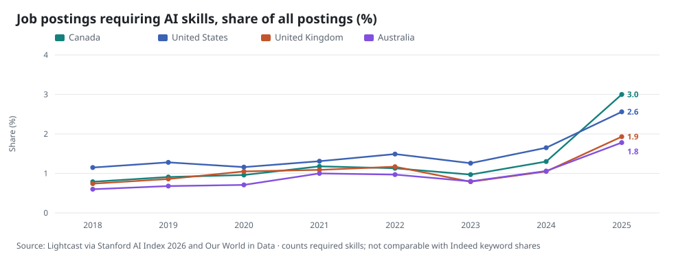
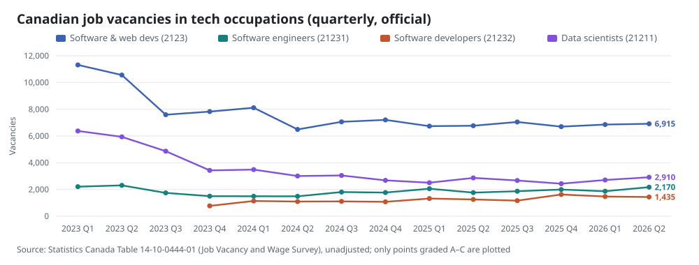
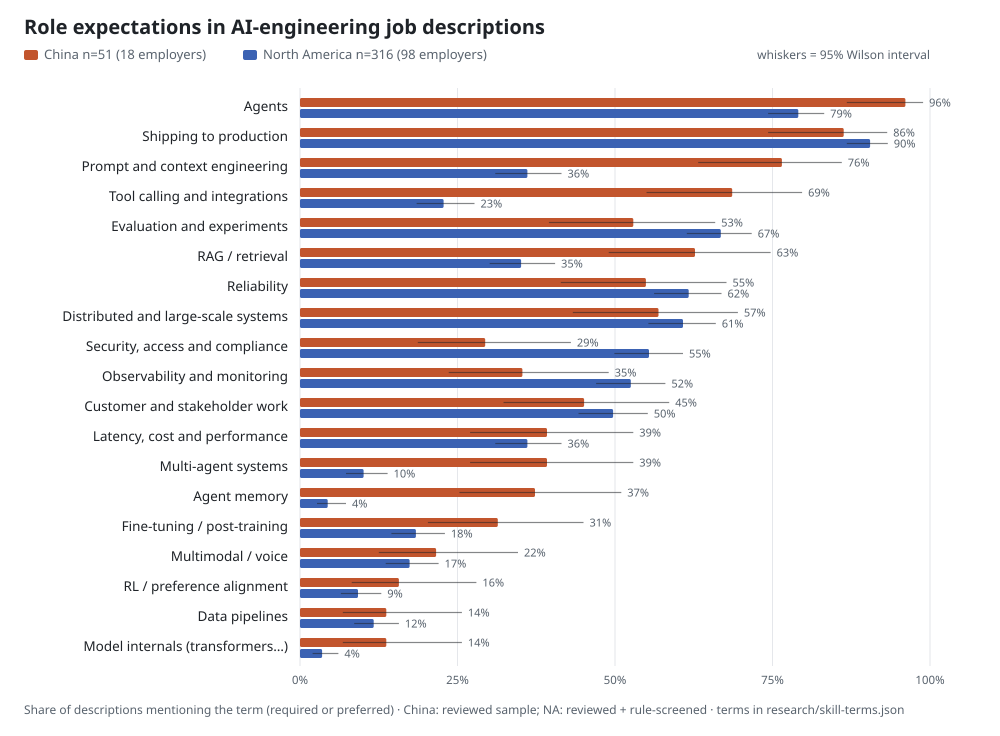

# AI Engineer: the market, the work and a learning path

This roadmap is for application and systems AI Engineer roles. This page covers what the job involves, what the hiring market asks for, and how the roadmap maps to it.

An AI Engineer turns models, data, tools and business systems into a product people can use: understand the problem, agree on what success looks like, then choose an approach, write the code, evaluate it, deploy it and keep improving it. Employers want business results, such as faster processing, staff finding the right information sooner and less repetitive work, while errors, latency, cost and data risk stay under control.

## 1. Understand the work behind the title

AI Engineer, LLM/agent engineer, Applied AI Engineer and some Forward Deployed Engineer roles can share this responsibility. To tell whether a role is this kind of work, read the responsibilities and deliverables; the title is only a hint.

| Direction | Typical deliverables | Main capabilities |
|---|---|---|
| AI products and applications | Knowledge assistants, document processing, workflow automation, voice/multimodal products | Backend/product engineering, model integration, retrieval/agents, evaluation, user feedback |
| Agent platforms and tooling | Harnesses, tool platforms, MCP services, evaluation/observability infrastructure | State and durable execution, protocols, authorization, isolation, reliability, developer experience |
| Customer-facing delivery | Discovery, enterprise integration, pilots, rollout and adoption | Requirements, integration, domain judgment, validation, cross-team collaboration |
| Application quality and performance | Data/model experiments, adaptation, small-model services, cost reduction | Experimental design, training data, post-training, inference and capacity measurement |

The role takes software engineering from SDE, data and experimentation methods from MLE, and reliability and operations from SRE. The roadmap covers the parts that matter for delivering AI products; large-scale pretraining, GPU kernel development and research roles are out of scope.

## 2. Hiring market: which data matter for SDE and AIE decisions?

Data updated 27 November 2026.

### The short version

| Market | Software development overall | AI-related roles |
|---|---|---|
| United States | Indeed's Software Development postings index rose from 64.9 in 2025Q1 to 80.1 in 2026Q4, still about 20% below February 2020; BLS projects 10% growth for software developers, QA analysts and testers in 2025–2035, against 3.5% for all occupations | LinkedIn "AI Engineer" hiring +64% YoY, +62% at entry level; active postings in the AI/ML title group are about three times May 2024 |
| Canada | Indeed's Software Development index fell from 81.7 in 2025Q4 to 76.2 in 2026Q4; the federal COPS projections rate software engineers, software developers and data scientists as "balance" | Postings that require AI skills rose from 1.3% of all postings in 2024 to 3.0% in 2025; businesses using AI to produce goods or services rose from 6.1% in 2024 to 19.2% in 2026; AI Engineer tops LinkedIn's 2026 list of Canada's fastest-growing jobs |
| China | In Beijing's public employment-service data, job seekers outnumber openings for computer software engineers; software-industry revenue growth slowed from 13.0% (first three quarters of 2025) to 8.4% (same period of 2026), and profit growth from 8.7% to 1.6% | Maimai: new AI postings +789% YoY; Zhaopin: agent-related technical talent demand +244% YoY; the labour ministry added an "agent developer" specialty |

In all three markets the growth is in AI-related and senior roles. Official occupation-level data show software jobs overall in balance, with stiff competition for entry-level general development roles; employers compete for engineers who can ship AI systems and show that they work.

### United States: software postings recovering, growth in senior and AI roles

<picture>
  <source media="(prefers-color-scheme: dark)" srcset="../../assets/research/market-software-postings-en-dark.svg">
  
</picture>

Indeed's Software Development postings index uses 1 February 2020 = 100. The US rose from 64.9 in 2025Q1 to 75.5 in 2026Q3 and 80.1 in 2026Q4 (to 13 November); Canada fell from 81.7 in 2025Q4 to 76.2 in 2026Q4. [Quarterly data](../../research/market/indeed-quarterly.csv), [Indeed data](https://github.com/hiring-lab/job_postings_tracker)

- **Where the growth comes from:** Hiring Lab reports that US software-development postings have risen about 15% since February 2025 but remain about 27.5% below pre-pandemic levels. Of the increase from May 2025 to May 2026, 71% came from senior roles and 37% from jobs with AI in the title (the groups overlap). The author calls the evidence preliminary. [Hiring Lab, 8 July 2026](https://hiringlab.indeed.com/2026/07/08/ai-and-job-postings-from-destruction-to-creation/)
- **Long-run projection:** in BLS's 2025–2035 projections, software developers, QA analysts and testers held 1,905,400 jobs in 2025 and are projected to grow 10% (+185,400), with about 106,100 openings a year; all occupations grow 3.5%. The previous projection (2024–2034) was 15%. [BLS Occupational Outlook](https://www.bls.gov/ooh/computer-and-information-technology/software-developers.htm), [BLS 2025–2035 summary](https://www.bls.gov/news.release/ecopro.nr0.htm)
- **New graduates:** the New York Fed's 2024 ACS figures for bachelor's graduates aged 22–27 put unemployment at 7.8% for computer engineering and 7.0% for computer science, the 2nd and 4th highest of 73 majors (4.2% overall). Their underemployment rates are only 15.8% and 19.1% (39.4% overall), and their early-career median wages, $90,000 and $87,000, are the two highest. Landing a job is harder; the jobs graduates land are good ones. [New York Fed, released February 2026](https://www.newyorkfed.org/research/college-labor-market)

For job seekers, the recovery is mostly in senior and AI-related roles; newcomers need projects that show they can deliver an AI system on their own.

### United States: signals specific to AI Engineers

| Signal | Latest value | How to read it |
|---|---|---|
| LinkedIn "AI Engineer" hiring growth (US) | +64% YoY; +62% at entry level (August 2026 report) | A new standardized title with a small base, and some people re-title themselves; shows direction, not volume. [LinkedIn AI Labor Market Update](https://delivery-p143253-e1476319.adobeaemcloud.com/adobe/assets/urn:aaid:aem:ef153078-1061-4817-82e7-a1c027d7a7d7/original/as/AI-Labor-Market-Update-August-2026-v2.pdf) |
| CompTIA: active postings requiring AI skills (US) | 366,322 (October 2026, +6.2% m/m); AI-titled roles +9.8% m/m | Lightcast data, subject to revision; the AI-title measure is closer to AIE demand. [CompTIA](https://www.comptia.org/en/about-us/news/press-releases/Tech-employment-gains-momentum-in-October-CompTIA-analysis-finds/) |
| US active postings for IT occupations | 625,633 (September 2026, +22.4% YoY); 47,598 new postings for software developers and engineers | Lightcast posting data, subject to revision. [CompTIA, September 2026 data](https://www.comptia.org/en/about-us/news/press-releases/employer-demand-for-tech-talent-reaches-three-year-high-comptia-analysis-finds/) |
| US active postings in the AI/ML job-title group | 13,636 (September 2026), nearly triple May 2024 | The closest public figure to total AI-engineer plus ML-engineer demand. [CompTIA](https://www.comptia.org/en/about-us/news/press-releases/employer-demand-for-tech-talent-reaches-three-year-high-comptia-analysis-finds/) |
| Share of US software-development postings mentioning AI | 20% or more (December 2025) | A posting that mentions AI may not require AI engineering, but the share shows AI becoming a common SDE expectation. [Hiring Lab, 22 January 2026](https://hiringlab.indeed.com/2026/01/22/january-labor-market-update-jobs-mentioning-ai-are-growing-amid-broader-hiring-weakness/) |

### Canada: AI demand is growing

<picture>
  <source media="(prefers-color-scheme: dark)" srcset="../../assets/research/market-ai-skill-share-en-dark.svg">
  
</picture>

- **Job postings:** Lightcast's share of postings that require at least one AI skill rose in Canada from 1.30% in 2024 to 3.00% in 2025, more than doubling in a year and rising faster than the US (1.65% → 2.56%), the UK and Australia. Posting coverage differs by country, so changes within a country are more reliable than cross-country levels. [Data](../../research/market/ai-skill-postings-share.csv), [Our World in Data](https://ourworldindata.org/grapher/share-artificial-intelligence-job-postings), [Stanford AI Index 2026, chapter 4](https://hai.stanford.edu/assets/files/ai_index_report_2026_chapter_4_economy.pdf)
- **Business adoption:** in Statistics Canada's Survey on Business Conditions, the share of businesses that used AI to produce goods or deliver services in the past 12 months was 6.1% in 2024Q2, 12.2% in 2025 and 19.2% in 2026; 42.3% in information and cultural industries and 40.4% in finance and insurance. Among businesses using AI, 24.8% use large language models. [Data](../../research/market/statcan-ai-use.csv), [Statistics Canada Table 33-10-1167-01](https://www150.statcan.gc.ca/t1/tbl1/en/tv.action?pid=3310116701)
- **Fastest-growing titles:** LinkedIn's Canadian Jobs on the Rise list (January 2026) ranks AI Engineer as the fastest-growing job of the past three years, AI consultant/strategist second and AI/ML researcher fourth. The most common AI Engineer skills are LangChain, RAG and LLMs; the jobs concentrate in Toronto, Montreal and Vancouver; the median prior experience is 2.8 years; and the most common previous roles are software engineer, data scientist and full-stack engineer. [LinkedIn News](https://www.linkedin.com/pulse/linkedin-jobs-rise-2026-15-fastest-growing-canada-linkedin-news-p93cf/)

Indeed's AI-keyword share does not measure Canadian AI demand: since 2026 Ontario requires postings to say whether AI is used to screen applicants, and that disclosure text pushed Canada's share to about 20% ([Hiring Lab Canada](https://hiringlab.indeed.com/en-ca/2026/07/08/ontario-job-postings-highlight-the-widespread-use-of-ai-in-hiring-processes/)). The three measures above count required skills, survey responses and job titles, a different basis from keyword shares, and Lightcast's 2025 figures predate the rule.

### Canada: software jobs overall, supply and demand

Statistics Canada's Job Vacancy and Wage Survey (JVWS) publishes quarterly vacancies by detailed occupation. It is the only official national series among the three countries that counts vacancies by occupation each quarter. AIE has no occupation code of its own; AI engineers are usually coded as software engineers (21231), software developers and programmers (21232) or data scientists (21211).

<picture>
  <source media="(prefers-color-scheme: dark)" srcset="../../assets/research/market-canada-vacancies-en-dark.svg">
  
</picture>

<!-- CANADA-VACANCIES:START -->
| Occupation (NOC 2021) | 2023Q1 | 2025Q1 | 2025Q2 | 2025Q3 | 2025Q4 | 2026Q1 | 2026Q2 |
|---|---:|---:|---:|---:|---:|---:|---:|
| Computer, software and Web designers and developers (2123) | 11,315 | 6,735 | 6,765 | 7,050 | 6,700 | 6,855 | 6,915 |
| Software engineers and designers (21231) | 2,205 | 2,055 | 1,765 | 1,870 | 1,995 | 1,870 | 2,170 |
| Software developers and programmers (21232) | — | 1,320 | 1,250 | 1,165 | 1,620 | 1,470 | 1,435 |
| Data scientists (21211) | 6,375 | 2,505 | 2,865 | 2,670 | 2,430 | 2,710 | 2,910 |
| Total, all occupations | 781,250 | 490,170 | 545,910 | 514,465 | 469,840 | 473,035 | 548,400 |

"—" marks values graded below C, which are not shown.
<!-- CANADA-VACANCIES:END -->

Since 2023, software and data vacancies have fallen sharply: the 2123 group from 11,315 to about 6,900 and data scientists from 6,375 to about 2,900, while vacancies across all occupations fell by about 30%. From 2025 these occupations held roughly steady with a slight rise; software-engineer vacancies reached 2,170 in 2026Q2, the highest since 2023Q3. A vacancy count is the number of positions open at one point in time, not the number of hires in a year. [Data and quality grades](../../research/market/statcan-tech-vacancies.csv), [Statistics Canada Table 14-10-0444-01](https://www150.statcan.gc.ca/t1/tbl1/en/tv.action?pid=1410044401)

Employment and Social Development Canada's Canadian Occupational Projection System (COPS) released its 2026–2035 projections in November 2026. It compares ten-year job openings with job seekers by occupation and rates each as shortage, balance or surplus:

<!-- COPS-TABLE:START -->
| Occupation (NOC 2021) | Employment 2025 | 10-year employment growth | Job openings 2026–35 | Job seekers 2026–35 | Recent / projected conditions |
|---|---:|---:|---:|---:|---|
| Software engineers and designers (21231) | 122,000 | +15.2% | 37,300 | 41,300 | Balance / Balance |
| Software developers and programmers (21232) | 230,600 | +15.4% | 67,600 | 64,700 | Balance / Balance |
| Data scientists (21211) | 50,800 | +13.4% | 12,000 | 18,100 | Balance / Balance |
| Cybersecurity specialists (21220) | 35,700 | +19.0% | 15,800 | 15,200 | Balance / Balance |
| Web developers and programmers (21234) | 25,100 | +4.8% | 4,700 | 5,400 | Balance / Balance |
| All Occupations | 21,028,700 | +8.3% | 7,446,400 | 7,158,700 | — / — |

Job openings = expansion + retirements + other replacement; job seekers = school leavers + new immigrants + other mobility (may be negative). [Full data](../../research/market/cops-2026-2035-tech.csv)
<!-- COPS-TABLE:END -->

Software and data occupations are projected to grow about 13–15% over ten years, faster than 8.3% for all occupations, but graduates and new immigrants supply about as many job seekers as there are openings, so both 2023–2025 and 2026–2035 are rated "balance". In 2026 only 7.0% of businesses named a lack of skilled workers as a barrier to using AI; among businesses using AI, 11.4% hired employees with AI skills and 32.0% trained existing staff. [COPS open data](https://open.canada.ca/data/en/dataset/e80851b8-de68-43bd-a85c-c72e1b3a3890), [Statistics Canada Tables 33-10-1168-01 and 33-10-1169-01](https://www150.statcan.gc.ca/t1/tbl1/en/tv.action?pid=3310116801)

So in Canada, official occupation statistics do not support claims of an overall "AI talent shortage". The available evidence points one way: AI skill requirements and AI job titles are growing fast, and employers prefer to hire or retrain experienced software engineers and data scientists. For job seekers, the strongest case is solid software engineering plus an AI project that is deployed and evaluated.

### China: platform growth signals, no skill shares

- Maimai, *Agent 重置职场* (January–July 2026): new AI postings +789.47% YoY; AI application development was 60.97% of new AI postings, and agent developers were the most demanded application role; FDE / on-site deployment roles grew 1,522.73%. [National Business Daily](https://www.nbd.com.cn/articles/2026-09-16/4583369.html)
- Zhaopin: in the month after the 2026 Spring Festival, AI-industry postings rose 16.9% YoY and robotics algorithm engineers 57% ([Xinhua, 12 May 2026](https://www.news.cn/fortune/20260512/85b58753df6e4208923a35a44b3d2846/c.html)); in H1 2026, demand for agent-related technical talent rose 244% YoY ([CCTV Finance](https://finance.cctv.cn/2026/08/28/ARTIxnofbL409vkM6skY5WRh260828.shtml)).
- On 9 September 2026 the Ministry of Human Resources and Social Security added an "agent developer" (智能体开发员) specialty under the generative-AI system application occupation. [Beijing News](https://m.bjnews.com.cn/detail/1788949841129475.html)
- Ministry of Industry and Information Technology software-industry data: in the first three quarters of 2025, software revenue grew 13.0% and profit 8.7%; in the same period of 2026, revenue grew 8.4% and profit 1.6%. The industry is still growing, but noticeably more slowly. [Xinhua, 31 October 2025](https://www.news.cn/info/20251031/cdfe79d608564bf6b9f93fe7f6559c00/c.html), [Xinhua, 31 October 2026](https://www.news.cn/fortune/20261031/e8d5045f729f4ec5b0097cb3845b068b/c.html)
- Beijing Municipal Human Resources and Social Security Bureau, quarterly supply-and-demand analysis (public employment service data): in 2025Q3, computer software engineers ranked fourth among occupations where job seekers outnumber openings, with 7,868 more seekers than openings; software testers (2,111 more) and data-analysis engineers (1,000 more) also ranked high. The data come from public employment services and exclude large employers' own hiring channels, but they show ample supply for general software roles in Beijing. [Beijing HRSS Bureau, 2025Q3](https://rsj.beijing.gov.cn/xxgk/sjfbsj/gqfx/202511/P020251103356760469762.pdf)

These platforms publish growth rates without samples, methods or skill shares, and China has no national quarterly vacancy count by occupation. Widely shared figures such as a "5 million AI talent gap" could not be traced to a checkable official source and are not used here. For the skills Chinese roles ask for, see the job-description sample in the next section.

AIE and SRE have no official occupation codes, and neither the US nor China publishes national quarterly vacancies by occupation, so the overall size of the AIE market can only be estimated from the indirect figures above.

## 3. 367 job descriptions: what do employers keep asking for?

### Sample

- **China, 51 descriptions** collected 18–19 November 2026 from employer APIs and pages, university-hosted employer postings and traceable reposts; duties and qualifications were reviewed by hand.
- **North America, 316 descriptions.** 53 were reviewed by hand in the same window. Another 216 were collected on 23 November 2026 through the documented public job-board APIs of Greenhouse, Ashby and Lever, covering 67 employers (AI-native companies, enterprise software, fintech, internet, health tech and others). Titles must contain engineering-role markers such as AI, LLM, agent, applied AI or forward deployed, and the role text must repeatedly mention AI-application terms. Each distinct title counts once per employer, with at most six per employer. These 216 use rule-based role-text bounds and were not reviewed one by one.
- **Canada expansion, 47 descriptions**, added the same day under the same rules: 38 from public job-board APIs, 7 from employer career pages and 2 from job-board reposts (one closed at collection), with at most six Canadian postings per employer.
- North America covers 98 employers: 236 US and 80 Canadian descriptions (43 employers). The China sample stays at 51 because the major Chinese job sites have no public posting API.

The unit is "the description mentions the item", including requirements, alternatives, duties and preferences; each description counts once per item. Terms use [stricter patterns](../../research/skill-terms.json); for example, "cost" counts only next to inference, token or model costs. Whiskers are 95% Wilson intervals. North America also reports an employer-balanced share so that one employer's many postings cannot dominate. [Records](../../research/jds.json), [full statistics](../../research/skill-distribution.csv), [China analysis](jd-china.md), [North America analysis](jd-north-america.md)

<picture>
  <source media="(prefers-color-scheme: dark)" srcset="../../assets/research/jd-role-expectations-en-dark.svg">
  
</picture>

<picture>
  <source media="(prefers-color-scheme: dark)" srcset="../../assets/research/jd-tech-stack-en-dark.svg">
  
</picture>

<!-- SKILL-TABLE:START -->

Expand exact shares and 95% intervals

| Group | Skill or expectation | China n=51 | North America n=316 | NA employer-balanced |
|---|---|---:|---:|---:|
| Tech stack | Python | 82% [70–90] | 58% [52–63] | 58% |
| Tech stack | Go | 49% [36–62] | 24% [19–29] | 22% |
| Tech stack | Java / Spring | 47% [34–60] | 10% [7–14] | 11% |
| Tech stack | MCP | 39% [27–53] | 16% [12–20] | 17% |
| Tech stack | LangChain | 35% [24–49] | 12% [9–16] | 14% |
| Tech stack | TypeScript / JavaScript | 22% [12–35] | 32% [27–38] | 30% |
| Tech stack | AI coding tools (Cursor, Claude Code…) | 29% [19–43] | 26% [21–31] | 26% |
| Tech stack | Public cloud (AWS/Azure/GCP) | 6% [2–16] | 28% [24–34] | 32% |
| Tech stack | React / frontend | 24% [14–37] | 25% [21–30] | 24% |
| Tech stack | Docker / Kubernetes | 18% [10–30] | 21% [17–26] | 21% |
| Tech stack | Vector DB / search engine | 18% [10–30] | 15% [11–19] | 16% |
| Tech stack | Other agent frameworks / SDKs | 18% [10–30] | 6% [4–10] | 8% |
| Tech stack | SQL / relational databases | 12% [6–23] | 16% [13–21] | 18% |
| Tech stack | LlamaIndex | 16% [8–28] | 4% [2–6] | 5% |
| Tech stack | Serving engines (vLLM, SGLang…) | 16% [8–28] | 4% [2–6] | 3% |
| Tech stack | LangGraph | 14% [7–26] | 8% [5–11] | 9% |
| Tech stack | PyTorch / DL frameworks | 14% [7–26] | 8% [5–11] | 10% |
| Tech stack | Dify / Coze / FastGPT | 12% [6–23] | 0% [0–1] | 0% |
| Tech stack | Observability/eval tools (Langfuse…) | 2% [0–10] | 8% [5–11] | 8% |
| Tech stack | Hugging Face | 2% [0–10] | 4% [2–6] | 3% |
| Role expectations | Agents | 96% [87–99] | 79% [74–83] | 82% |
| Role expectations | Shipping to production | 86% [74–93] | 90% [87–93] | 92% |
| Role expectations | Prompt and context engineering | 76% [63–86] | 36% [31–42] | 38% |
| Role expectations | Tool calling and integrations | 69% [55–80] | 23% [18–28] | 26% |
| Role expectations | Evaluation and experiments | 53% [40–66] | 67% [61–72] | 65% |
| Role expectations | RAG / retrieval | 63% [49–75] | 35% [30–40] | 40% |
| Role expectations | Reliability | 55% [41–68] | 62% [56–67] | 60% |
| Role expectations | Distributed and large-scale systems | 57% [43–70] | 61% [55–66] | 59% |
| Role expectations | Security, access and compliance | 29% [19–43] | 55% [50–61] | 57% |
| Role expectations | Observability and monitoring | 35% [24–49] | 52% [47–58] | 58% |
| Role expectations | Customer and stakeholder work | 45% [32–59] | 50% [44–55] | 54% |
| Role expectations | Latency, cost and performance | 39% [27–53] | 36% [31–42] | 34% |
| Role expectations | Multi-agent systems | 39% [27–53] | 10% [7–14] | 10% |
| Role expectations | Agent memory | 37% [25–51] | 4% [3–7] | 4% |
| Role expectations | Fine-tuning / post-training | 31% [20–45] | 18% [14–23] | 18% |
| Role expectations | Multimodal / voice | 22% [12–35] | 17% [14–22] | 12% |
| Role expectations | RL / preference alignment | 16% [8–28] | 9% [6–13] | 9% |
| Role expectations | Data pipelines | 14% [7–26] | 12% [9–16] | 14% |
| Role expectations | Model internals (transformers…) | 14% [7–26] | 4% [2–6] | 5% |

<!-- SKILL-TABLE:END -->

### Shared: turn model capability into systems that ship, are evaluated and keep running

- **Production delivery** appears in almost every role (China 86%, North America 90%).
- **Evaluation and experiments** (53% / 67%), **reliability** (55% / 62%) and **distributed, large-scale systems** (57% / 61%) exceed half in both markets.
- **Agents** have the highest share (96% / 79%); the samples were selected for agent and AI-application titles, which pushes this share up.
- **Fine-tuning / post-training** (31% / 18%) and **reinforcement learning** (16% / 9%) appear in a minority of roles. **AI coding tools** (Cursor, Claude Code and others) appear in about a quarter (29% / 26%).

### Differences: different writing styles and different emphasis

- **Chinese descriptions name concrete components more often:** prompt and context engineering (76% / 36%), tool calling (69% / 23%), RAG (63% / 35%), agent memory (37% / 4%), multi-agent systems (39% / 10%), LangChain (35% / 12%) and MCP (39% / 16%).
- **North American descriptions state duties and constraints more often:** security, access and compliance (29% / 55%), observability (35% / 52%), public cloud (6% / 28%) and TypeScript (22% / 32%).
- **Languages:** Chinese postings often say "at least one of Python, Go or Java", so Go (49%) and Java/Spring (47%) are both high; North America centres on Python (58%), followed by TypeScript. Many North American postings name no language; of the 220 that do, 83% name Python (93% of the 45 Chinese postings that name one).
- North American postings name RAG and tool calling less often, probably because they tend to describe duties and outcomes. Both remain common interview topics.

The two North American subsamples also differ. The 53 hand-reviewed postings lean toward agent platforms and AI-native companies, with higher RAG (45% / 28%), MCP (34% / 12%) and multi-agent (23% / 6%) shares than the 216 rule-screened postings. The broader sample is closer to typical AIE roles.

### Cross-checks against external data

| Source | Sample | Main results | Compared with this sample |
|---|---|---|---|
| InterviewStack job board, Nov 2026 | 3,835 global AI Engineer postings (about 35% US) | Python 75%, agents ≥61%, RAG 50%, evaluation ≥41%, LangChain 23%, MCP 21%, LangGraph 19%, TypeScript 17%, fine-tuning 17% | Same direction: Python is the majority, agents and evaluation are high, fine-tuning is below 20% and named frameworks are a minority. [Source](https://interviewstack.io/blog/how-ai-is-changing-ai-engineer-2026) |
| Juejin, May 2026 | Application-development postings; 23 listed | Python ~100%, LangChain ~80%, RAG ~60%, Dify ~35%, fine-tuning ~35%, LangGraph ~25%, MCP ~10% | Smaller Chinese employers name LangChain and Dify more often; this sample is large-employer-heavy, with Dify/Coze at 12%. [Source](https://juejin.cn/post/7644822313692692518) |
| CSDN, Mar 2026 | 200 "large model" postings paying ¥30k+ per month | C++ 61.5%, RAG 37%, multimodal 33.5%, Python 33%, agents 31.5% | Includes algorithm and inference-optimization roles, hence high C++ and lower Python. [Source](https://gitcode.csdn.net/69b3835a54b52172bc60e19d.html) |
| LangChain practitioner survey, Nov–Dec 2025 | 1,340 respondents | 57% have agents in production; 52% run offline evaluation, 30% none; 57% do not fine-tune | Supports "evaluate first, fine-tune rarely". [Source](https://langchain.com/state-of-agent-engineering) |

These outside tallies mostly come from job boards and blogs with little method detail, so they are used here only to check direction and are not pooled with this sample.

### Canada in focus: 80 descriptions

The 80 Canadian descriptions come from 43 employers: 27 each from enterprise software and AI-native companies, the rest from fintech, internet, banking and asset management, telecom and others. Compared with the 236 US descriptions, the largest differences are below; the last three items are similar in both countries.

<!-- CANADA-SPLIT:START -->
| Skill or expectation | Canada n=80 (43 employers) | United States n=236 |
|---|---:|---:|
| Latency, cost and performance | 49% [38–60] | 32% [26–38] |
| PyTorch / DL frameworks | 18% [11–27] | 4% [2–8] |
| Observability and monitoring | 62% [52–72] | 49% [43–56] |
| RAG / retrieval | 45% [35–56] | 32% [26–38] |
| Distributed and large-scale systems | 70% [59–79] | 58% [51–64] |
| Security, access and compliance | 64% [53–73] | 52% [46–59] |
| Docker / Kubernetes | 29% [20–40] | 18% [14–24] |
| Public cloud (AWS/Azure/GCP) | 36% [27–47] | 26% [21–32] |
| LlamaIndex | 10% [5–18] | 1% [0–4] |
| Evaluation and experiments | 64% [53–73] | 68% [62–73] |
| Shipping to production | 89% [80–94] | 91% [87–94] |
| Fine-tuning / post-training | 18% [11–27] | 19% [14–24] |
<!-- CANADA-SPLIT:END -->

Canadian descriptions more often require latency and cost optimization, observability, RAG, distributed and large-scale systems, and security and compliance, and they more often name PyTorch, LangChain and public cloud. Evaluation, production delivery and fine-tuning are similar to the US. One reason is that enterprise software, banks and insurers make up more of the Canadian sample, and these employers stress stable operation and governance. Large Canadian employers such as banks mostly use their own applicant systems, which public APIs reach only partly, so read each target description before applying.

### Job-search strategy

- **China:** Python plus one backend language (Go or Java); implementation-level command of RAG, tool calling, context and memory, and multi-agent systems; at least one mainstream framework (LangChain/LangGraph); MCP. Roles at smaller and traditional-industry employers also value quick prototyping on platforms such as Dify.
- **North America:** Python plus TypeScript; emphasize evaluation, observability, security and permissions, cloud deployment, and experience working with customers and stakeholders, especially for FDE and applied-AI roles.
- **Both:** one complete project with evaluation data, a deployment record and a failure postmortem. Go deeper into fine-tuning, RL or inference optimization only for target roles. For Canada, also emphasize RAG, observability, cost and latency optimization, and security and compliance, mostly on Azure or AWS.

## 4. From job requirements to a knowledge structure: weights and priorities

### What nine enterprise job descriptions value

Many large employers don’t post through public job-board APIs, so here are nine AI-engineering postings from large and mid-size North American employers (November 2026): Microsoft, Workday, RBC, BMO, Vanguard, Canada Life, Stripe, Databricks and American Express. A reader supplied the BMO and Canada Life texts. These are qualitative cases and are not counted in the statistics above.

<!-- ENTERPRISE-MATRIX:START -->
| Capability | Microsoft | Workday | RBC | BMO | Vanguard | Canada Life | Stripe | Databricks | AmEx | Required / mentioned |
|---|---|---|---|---|---|---|---|---|---|---:|
| Production software experience | 2+ yrs | 5+ yrs | 2+ yrs | 6 yrs | 6+ yrs | 3+ yrs | 4+ yrs | 2-8 yrs | Master's graduate (2027) | — |
| Backend, APIs and system design | ✓ | ✓ | ✓ | ✓ | ✓ | ✓ | ✓ | ✓ | ✓ | 9 / 9 |
| Testing, CI/CD, containers and cloud deployment | ✓ | ✓ | ✓ | ✓ | ✓ | ✓ | ✓ | ✓ | ✓ | 9 / 9 |
| Business partnership and product mindset | ✓ | ✓ | ✓ | ✓ | ✓ | ✓ | ✓ | ○ | ✓ | 8 / 9 |
| LLM applications and agents | ✓ | ✓ |  | ✓ | ✓ | ✓ | ✓ | ✓ | ○ | 7 / 8 |
| Production monitoring and observability | ✓ | ✓ | ✓ | ✓ | ✓ | ✓ | ✓ | ○ |  | 7 / 8 |
| Security, Responsible AI and model risk | ✓ | ✓ | ✓ | ✓ | ✓ | ✓ |  |  | ✓ | 7 / 7 |
| RAG, retrieval and documents | ✓ | ○ |  | ✓ | ✓ | ✓ |  |  | ○ | 4 / 6 |
| Evaluation and experiments | ○ | ✓ |  | ✓ |  | ✓ | ○ |  | ✓ | 4 / 6 |
| Technical leadership and mentoring |  | ✓ | ✓ | ✓ | ✓ | ✓ |  |  |  | 5 / 5 |
| Full stack / frontend | ○ | ○ | ✓ |  |  | ✓ | ✓ |  |  | 3 / 5 |
| Classical ML, training and MLOps | ○ |  |  | ○ | ✓ |  |  | ○ | ○ | 1 / 5 |
| AI-assisted development | ✓ |  | ○ |  |  |  | ✓ |  |  | 2 / 3 |
| Fine-tuning |  |  |  |  | ○ |  |  |  |  | 0 / 1 |

✓ = requirement or core duty; ○ = preference or alternative; blank = not mentioned. Coding and links are in [enterprise-cases.json](../../research/enterprise-cases.json).
<!-- ENTERPRISE-MATRIX:END -->

Five things stand out:

1. **Software engineering is the first filter, required by all nine.** Workday says the role is "first and foremost a software engineering role", with system design, scalability and performance "non-negotiable". Databricks explicitly welcomes infrastructure and systems engineers without an ML background. RBC's "Senior AI Engineer" is a full-stack role in Vue/Nuxt, Node.js and SQL; AI appears only as a preference for AI coding assistants, so read the duties, not just the title.
2. **Production delivery and business partnership are also universal.** Testing, CI/CD, containers and cloud deployment: 9/9. Defining problems with the business and owning outcomes: mentioned in all nine, required in eight. Production monitoring and observability: 8/9.
3. **LLMs and agents are central but not everything.** 8/9 involve LLM applications or agents, 6/9 RAG and document processing, and 6/9 evaluation. Financial and insurance employers especially value document processing (claims, contracts, audit) together with evaluation and guardrails.
4. **Security, Responsible AI and model risk separate enterprise roles.** 7/9 require them, including every bank, insurer and asset manager here (RBC, BMO, Vanguard, Canada Life, American Express).
5. **Fine-tuning and training are rarely required.** Fine-tuning appears only as a Vanguard preference; only Vanguard requires classical ML and MLOps. Experience ranges from a new master's graduate (American Express, which asks for data structures, algorithms, projects, hackathons or open source) to six years or more, and senior roles expect technical leadership and mentoring.

### Established employers versus AI-native companies

Splitting the 316 North American descriptions by employer type: established employers cover enterprise software, fintech, internet, health and industrial companies; AI-native companies cover model labs, AI application companies and developer-tool companies. The table lists the largest differences and three items that are nearly identical.

<!-- EMPLOYER-SPLIT:START -->
| Skill or expectation | Established employers n=168 (69) | AI-native companies n=148 (29) |
|---|---:|---:|
| Security, access and compliance | 67% [59–73] | 43% [35–51] |
| Observability and monitoring | 63% [56–70] | 41% [33–49] |
| Public cloud (AWS/Azure/GCP) | 37% [30–44] | 19% [13–26] |
| RAG / retrieval | 42% [34–49] | 28% [21–35] |
| Java / Spring | 16% [11–22] | 3% [1–8] |
| LangChain | 17% [12–23] | 6% [3–11] |
| SQL / relational databases | 21% [15–28] | 11% [7–18] |
| Evaluation and experiments | 67% [60–74] | 66% [58–73] |
| Agents | 80% [73–85] | 78% [71–84] |
| Shipping to production | 89% [84–93] | 92% [86–95] |
| Multimodal / voice | 10% [6–16] | 26% [19–33] |
| TypeScript / JavaScript | 27% [21–34] | 39% [31–47] |
| RL / preference alignment | 5% [2–9] | 14% [9–21] |
<!-- EMPLOYER-SPLIT:END -->

Established employers more often require security and compliance, observability, reliability, public cloud and Java, and more often name LangChain or LangGraph. AI-native companies more often mention TypeScript, multimodal and voice work, reinforcement learning and customer-facing work. Evaluation, agents and production delivery are equally high in both. When applying to large and mid-size companies, lead your résumé and projects with evidence of security, monitoring and stable operation, then model quality.

### AIE versus SDE: shared and distinctive capabilities

**Shared base.** Programming, data structures and algorithms, system design, APIs and databases, testing and debugging, CI/CD and cloud deployment, monitoring and incident handling, security and permissions, code review and collaboration are the core of SDE work, and AIE roles require them too. All nine enterprise descriptions above require backend and system design plus testing and deployment; Workday calls its AI role "first and foremost a software engineering role".

**Distinctive part.** On the same base, AIEs handle the engineering problems that come from non-deterministic model output:

| Dimension | SDE | What AIE adds |
|---|---|---|
| Judging correctness | Deterministic logic; passing tests means correct | Non-deterministic output needs evaluation sets, metrics, human or model review and statistical comparison |
| System components | Services, databases, caches, queues | Plus model APIs, context and retrieval, tool calling, agent loops and memory |
| Data | Storing and keeping business data consistent | Document parsing, chunking, indexing, labeling and evaluation data; data quality drives output quality |
| Cost and performance | CPU, memory, latency | Plus token cost, inference latency, caching and model routing |
| Security | Authentication, authorization, input validation, dependency security | Plus prompt injection, agent over-reach, content safety, model risk and Responsible AI |
| Release and operations | Versioned releases and rollback | Plus model, prompt and index versions, quality-drift monitoring, human review and feedback loops |
| Interviews | Coding, system design, behavioral | The same, plus LLM fundamentals, RAG/agent design and evaluation methods |

The data agree: on one job board in May 2026, only 9.7% of 45,318 SWE postings mentioned agents, 3.5% RAG and 4.4% AI coding tools, while 39% of AI Engineer postings mentioned RAG ([SWE](https://interviewstack.io/blog/how-ai-is-changing-software-engineering-2026), [AI Engineer](https://interviewstack.io/blog/ai-engineer-vs-machine-learning-engineer-2026)). In this study's North American sample, evaluation appears in 67% of AIE descriptions.

For job seekers: an SDE moving into AIE already has most of the base and mainly needs evaluation, retrieval and context, agent and tool safety, and cost and model selection. A candidate who can call model APIs but lacks the software-engineering base will struggle to pass screening at large and mid-size employers.

### What screening looks at first

Combining the 367-description statistics with the enterprise cases above, application and systems AIE screening roughly follows this order:

| Priority | Capability | Evidence (China / North America) | Modules | Target depth |
|---|---|---|---|---|
| 1 | Software engineering and production delivery: backend services, APIs, databases, testing, containers, CI/CD, cloud deployment, debugging | Production delivery 86% / 90%; distributed and large-scale systems 57% / 61%; reliability 55% / 62%; enterprise roles ask for 2–4+ years of production experience | 01, 02, 14 | Build and debug independently |
| 2 | LLM applications and agents: structured output, tool calling, context, RAG, agent loops, human approval | Agents 96% / 79%; prompt and context 76% / 36%; tool calling 69% / 23%; RAG 63% / 35% | 05–10 | Implement once without a framework, then master one framework |
| 3 | Evaluation, testing and observability | Evaluation 53% / 67%; observability 35% / 52% | 11 | Design evaluation sets, run regressions and attribute failures |
| 4 | Security, access and governance | Security, access and compliance 29% / 55% | 10, 14 | Design permissions, audit trails and guardrails in |
| 5 | Business understanding and communication | Customer and stakeholder work 45% / 50% | 00, 14, 15 | Turn ambiguous needs into deliverables with acceptance criteria |
| 6 | Model internals and math | Mentioned in 14% / 4% of postings, yet theory questions and hand-written implementations are common interview rounds, especially in China | 03, 04, 15.5 | Explain and hand-write core components |
| 7 | Specializations: fine-tuning and RL, inference optimization, multimodality | Fine-tuning 31% / 18%; RL 16% / 9%; serving engines 16% / 4% | 12, 13, 05.6–05.7 | Choose by target role |

### Weight of each area

Evaluation gets more time than its unit share: about 20% of Chip Huyen's *AI Engineering* covers evaluation, and evaluation plus data take about a third of CS329Z sessions. "Suggested time" is for the application-AIE main line; skip what the [entry diagnostic](entry-diagnostic.md) shows you already know. Unit counts show breadth and don’t track study time: the agent modules contain many advanced units, while the backend modules have fewer units but more practice.

| Area | Suggested time | Units (share) | Share of core units |
|---|---:|---:|---:|
| 00–02 Role, Python and backend | 20% | 17 (13%) | 18% |
| 03–04 Math, ML and transformers | 8% | 13 (10%) | 12% |
| 05 Model applications and context | 10% | 10 (8%) | 10% |
| 06 Data and RAG | 10% | 9 (7%) | 7% |
| 07–09 Agents, orchestration and multi-agent | 15% | 22 (17%) | 12% |
| 10 Tools, MCP and safe execution | 8% | 7 (6%) | 6% |
| 11 Evaluation and observability | 15% | 12 (9%) | 13% |
| 14 Product delivery | 8% | 9 (7%) | 8% |
| 15 Portfolio and job search | 6% | 7 (6%) | 8% |
| 12–13 Post-training and inference optimization | Specialization: add 20–30% | 17 (13%) | 6% |
| 16 World models and embodied AI | Elective | 4 (3%) | 0% |

### Compared with CS329Z, CS336 and widely used roadmaps

| Reference | Structure and emphasis | How this roadmap responds |
|---|---|---|
| [CS329Z Engineering AI Agents](https://cs329z.stanford.edu/) (Fall 2026) | From LLM pipelines to compound AI systems to autonomous agents. HW1 builds a harness without frameworks: BM25 and multi-hop RAG, a tool-call protocol, the agent loop, a sandboxed terminal, compaction, memory, approval, guardrails and injection, and a simulated-user evaluation. HW2 authors a Harbor evaluation task with a verifier and an oracle. Evaluation is about 21% of sessions, evaluation plus data about 32%; the project is 40% of the grade | Units 07.3, 07.5–07.6, 10.4–10.7, 11.1 and 11.8 follow these two assignments. CS329Z has no dedicated RL or test-time-compute session; this roadmap covers them in 05.8 and 12.6–12.7 |
| [CS336 Language Modeling from Scratch](https://cs336.stanford.edu/) | Tokenizer and transformer from scratch, GPUs and parallelism, scaling laws, inference, evaluation, data, SFT/RLHF/RLVR; five assignments; the 2026 edition bans coding agents for implementation | For application AIEs: tokenization, resource accounting, inference (KV cache, quantization, speculative decoding, continuous batching), evaluation validity, data deduplication and filtering, SFT/DPO/GRPO (04.1, 13.2–13.7, 11.9, 12.10, 12.5–12.6). Triton kernels, FSDP/tensor-parallel implementation and fitting scaling laws are awareness-level |
| Chip Huyen, *AI Engineering* (O'Reilly, 2025) | By page count: evaluation about 20% (two chapters, before prompting), fine-tuning and dataset engineering about 20%, model internals 13%, RAG/agents/memory 11%, inference 9% | Evaluation also comes early here; training-heavy material is a specialization |
| [roadmap.sh AI Engineer](https://roadmap.sh/ai-engineer) | Of 193 topics: RAG/vector stores about 20%, model APIs about 16%, prompting and context about 15%, agents about 10%, evaluation about 10%, MCP about 7%, fine-tuning about one topic | Similar application coverage; this roadmap adds the software engineering, production delivery, permissions and sandboxes it covers lightly |
| [mlabonne/llm-course](https://github.com/mlabonne/llm-course) | Fundamentals 19% (optional), scientist/training track 46%, engineer track 36% | Training content sits in modules 12–13 |
| Datawhale [hello-agents](https://github.com/datawhalechina/hello-agents), [happy-llm](https://github.com/datawhalechina/happy-llm), [self-llm](https://github.com/datawhalechina/self-llm) | Chinese-language agent practice (including Coze, Dify and n8n), LLMs from scratch, deploying and fine-tuning Chinese models | Added as Chinese-language companions in the relevant units |

Most roadmaps cover prompting, RAG, tools and agents, and their 2025–2026 updates add MCP, context engineering, memory and harnesses. They rarely cover backend and software-engineering fundamentals, production delivery, sandboxes and permissions, or interviews (common only in Chinese repositories). Enterprise roles screen hardest on those, so this roadmap gives them their own modules.

### Which stack to learn first

**Tier 1: required in both markets**

- Languages: Python first, plus one more: Go or Java for China, TypeScript for North America.
- Services and data: FastAPI, PostgreSQL (with pgvector), Redis, Docker, GitHub Actions and one cloud platform.
- Model access: one commercial API and one open or Chinese model; structured output, tool calling, streaming, retries and budgets.
- RAG: parsing, chunking, hybrid retrieval, reranking and citations, with permission filtering.
- Agents: implement the loop and human approval without a framework first, then use LangGraph for persistence and recovery; write one MCP server.
- Evaluation and observability: pytest plus promptfoo or Ragas for regression; calibrate an LLM judge against human labels; record traces, quality, latency and cost with Langfuse or OpenTelemetry.
- Security: permissions, secrets management, injection defenses and audit logs.

**Tier 2: by target market**

- China: deeper LangChain/LangGraph; use Dify to prototype, write plugins and self-host, and know when to move to code; agent memory and multi-agent systems; Qwen or DeepSeek through APIs and local vLLM deployment; Spring AI or Spring AI Alibaba for Java roles.
- North America: React/Next.js full stack; one of Azure AI Foundry, Azure OpenAI and AI Search, or AWS Bedrock; Copilot Studio and Power Automate in Microsoft-ecosystem roles; customer communication, demos and rapid prototyping for FDE roles.

**Tier 3: by role**: fine-tuning (LoRA/QLoRA, SFT, DPO), inference optimization (vLLM, quantization, KV cache), multimodality and voice, agentic RL.

### Projects to apply with

| Project | Matching job scenario | Evidence to show |
|---|---|---|
| [P1 Enterprise knowledge service](capstones.md#p1-enterprise-knowledge-service) | Canada Life's document ingestion, retrieval and citations; enterprise knowledge bases and support assistants in China | Parser comparison, retrieval metrics, citation accuracy, permission tests, traces and cost per successful task |
| [P2 Business workflow agent](capstones.md#p2-business-workflow-agent) | Microsoft's tool calling, multi-agent routing, hand-offs, retries and human escalation; Stripe's internal tools and workflow automation | Tool contracts, approval and idempotency, failure-recovery drills, trajectory evaluation, deployment and usage records |
| [P3 Document processing with human review](capstones.md#p3-document-processing-with-human-review) | Insurance claims, financial document review, contract review | Field-extraction accuracy, uncertainty display and human confirmation, regression tests |
| [P4 Small-model serving and adaptation](capstones.md#p4-small-model-serving-and-adaptation) | Inference-optimization and post-training roles | Memory and throughput benchmarks, quality before and after quantization, evaluation before and after fine-tuning |

Make P1 or P2 your main project and build a smaller version of the other. For China, also prototype the same scenario in Dify and explain why and how you moved it to code. Write résumé bullets as problem, method and measured result, aligned with the target description's keywords. [Project requirements](capstones.md), [résumé and interviews](modules/15.md)

## 5. How courses and open-source projects fit

[Stanford CS329Z](https://cs329z.stanford.edu/) provides the agent-systems spine and [CS336](https://cs336.stanford.edu/) covers model internals, inference and post-training; official documentation and open courses fill in Python, backend and deployment.

Open-source projects enter the roadmap in three tiers: use and read the source, deploy and operate, or recognize (GitHub data as of 23 November 2026):

| Tier | Project | What to learn | 2025–2026 changes |
|---|---|---|---|
| Use and read the source | [Dify](https://github.com/langgenius/dify) (about 162k stars) | Build workflow and knowledge apps, write plugins and tools, self-host; read the workflow engine and plugin daemon | Two-way MCP since v1.6; OpenTelemetry export and human-approval forms in v1.20; one-click deployment on Alibaba, Huawei and Tencent clouds. Modified Apache 2.0 licence: running a multi-tenant service or removing the frontend logo needs a commercial licence. One practitioner test saturated at about 10 QPS on a single 4-core/8 GB instance, and complex flows often move to code |
| Use and read the source | [LangChain](https://github.com/langchain-ai/langchain) + [LangGraph](https://github.com/langchain-ai/langgraph) | State graphs, checkpointers, interrupts and resume; `create_agent` and middleware in 1.0 | 1.0 released October 2025; `create_react_agent` deprecated |
| Use and read the source | [vLLM](https://github.com/vllm-project/vllm), [SGLang](https://github.com/sgl-project/sglang) | Continuous batching, KV cache, prefix caching, speculative decoding | Mainstream serving engines for inference roles |
| Use and read the source | [RAGFlow](https://github.com/infiniflow/ragflow) or LightRAG | Document parsing, retrieval pipelines, citations | RAGFlow 1.0 (November 2026) is a Go rewrite |
| Deploy and operate | [Coze Studio](https://github.com/coze-dev/coze-studio) / Coze Loop, FastGPT, MaxKB, n8n, Open WebUI, Ollama | Platform deployment, model integration, permissions and data boundaries | Coze Studio has had no commits since July 2026 while Coze Loop stays active; FastGPT's licence terms resemble Dify's |
| Deploy and operate | [Langfuse](https://github.com/langfuse/langfuse), [promptfoo](https://github.com/promptfoo/promptfoo), Ragas | Traces, dataset evaluation, regression and red-team tests | ClickHouse acquired Langfuse (January 2026); OpenAI announced it will acquire Promptfoo (March 2026); both open-source projects continue |
| Pick one framework to go deep | OpenAI Agents SDK, Google ADK, PydanticAI, AgentScope (Alibaba), Spring AI Alibaba (Java), Microsoft Agent Framework | Compare state, tools, deployment and evaluation | AutoGen is archived and succeeded by Microsoft Agent Framework; AgentScope 2.0 was a breaking rewrite |
| No longer worth investing in | Flowise, Langchain-Chatchat, MetaGPT, Qwen-Agent | — | Flowise was archived and reached end of life in August 2026; the others show no commits in 90 days |

LangGraph appears in 14% of Chinese and 8% of North American postings. It is the main teaching framework because it suits learning state, persistence and recovery. Dify appears in 12% of the Chinese sample and more often in roles at smaller employers. See [open-source research](open-source.md) and [stack decisions](stack-decisions.md) for repository snapshots and selection reasons.

### Dify and LangGraph: how they relate and differ

Both organize LLM workflows as graphs (nodes, edges, shared state) and both support tool calling, RAG, human approval and MCP, but they sit at different levels:

| | Dify | LangGraph |
|---|---|---|
| What it is | A ready-made LLM application platform: visual workflows, knowledge bases, model access, a plugin marketplace, app publishing and logs | A Python/JavaScript library: a low-level orchestration runtime (StateGraph, checkpointers, interrupts, durable execution) |
| Who uses it | Business users and engineers building together in a UI | Engineers writing it inside their own service code |
| State and recovery | Managed by the platform, within the platform's limits | Explicit state; checkpointers in Postgres and similar stores enable resume and replay |
| Testing and versions | DSL export and app-package versions; regression tests usually need external tools | Unit tests, CI and code review like any code, versioned in Git |
| Deployment | Self-hosted (Docker/Kubernetes) or cloud; mind the licence limits on multi-tenant use and the logo | Packaged into your own service (containers or serverless) or deployed on LangGraph Platform |
| Best for | Fast prototypes, business-maintained flows, internal tools | Complex control flow, long tasks, strict testing and audit, embedding into existing systems |

They also work together: validate a scenario in Dify, write the complex or high-risk part as a LangGraph service and call it back from Dify over HTTP or MCP; a Dify app can also be published as an MCP server for a LangGraph agent to call.

On AWS, a common LangGraph setup calls models through Amazon Bedrock (`langchain-aws`), stores state in a checkpointer on Postgres (RDS/Aurora) or DynamoDB, deploys the service on ECS/EKS or Lambda, and sends traces to LangSmith, Langfuse or CloudWatch through OpenTelemetry. AWS Bedrock AgentCore also offers a managed agent runtime that can run agents written with LangGraph. Banks and other regulated environments tend to choose code-based options like LangGraph because testing, versioning and audit fit existing engineering processes.

## 6. How to show you can do the job

A project you apply with should include the business task and acceptance criteria, a running system with deployment notes, versioned data and evaluation sets, before-and-after comparisons, measured quality, latency and cost, permission and recovery drills, and a design write-up someone else can reproduce. The [capstones page](capstones.md) covers project levels and the questions interviewers ask; the [assessment](assessment.md) has the rubric.
