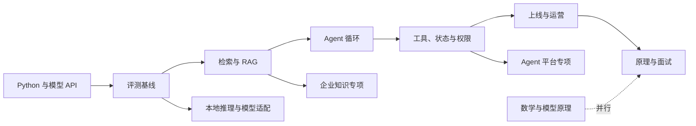

# 学习顺序与路线

每条路线按阶段列出要学的单元，先修单元已经展开，从上往下学即可。主线用托管模型 API 构建应用，不需要 GPU；微调、GPU 推理和多 Agent 工程放在专项路线。模块编号只用于分类，不代表学习顺序。

## 主线：AI 应用工程

用托管模型 API 做出能上线的 AI 应用，覆盖 RAG、Agent、工具调用、评测和运维，不需要 GPU。模型原理和应用并行学。

| 阶段 | 单元（含先修） | 实验 |
|---|---|---|
| 需求、Python 与模型 API | [00.1](modules/00.md#unit-00-1), [00.2](modules/00.md#unit-00-2), [01.1](modules/01.md#unit-01-1), [01.2](modules/01.md#unit-01-2), [01.5](modules/01.md#unit-01-5), [01.6](modules/01.md#unit-01-6), [01.3](modules/01.md#unit-01-3), [02.1](modules/02.md#unit-02-1), [05.1](modules/05.md#unit-05-1), [05.3](modules/05.md#unit-05-3), [01.7](modules/01.md#unit-01-7), [05.10](modules/05.md#unit-05-10) | [L01](labs.md#l01) |
| 评测基线 | [03.1](modules/03.md#unit-03-1), [03.2](modules/03.md#unit-03-2), [11.1](modules/11.md#unit-11-1), [11.2](modules/11.md#unit-11-2), [11.3](modules/11.md#unit-11-3), [11.4](modules/11.md#unit-11-4), [05.9](modules/05.md#unit-05-9) | — |
| 检索与 RAG | [02.2](modules/02.md#unit-02-2), [06.1](modules/06.md#unit-06-1), [04.1](modules/04.md#unit-04-1), [06.2](modules/06.md#unit-06-2), [01.4](modules/01.md#unit-01-4), [06.3](modules/06.md#unit-06-3), [06.4](modules/06.md#unit-06-4), [06.6](modules/06.md#unit-06-6) | [L02](labs.md#l02) |
| 不用框架写一个 Agent 循环 | [05.4](modules/05.md#unit-05-4), [07.1](modules/07.md#unit-07-1), [07.2](modules/07.md#unit-07-2), [07.3](modules/07.md#unit-07-3), [07.5](modules/07.md#unit-07-5) | [L13](labs.md#l13) |
| 工具、状态与权限 | [02.3](modules/02.md#unit-02-3), [02.4](modules/02.md#unit-02-4), [07.4](modules/07.md#unit-07-4), [10.2](modules/10.md#unit-10-2), [02.5](modules/02.md#unit-02-5), [10.3](modules/10.md#unit-10-3), [10.1](modules/10.md#unit-10-1), [10.4](modules/10.md#unit-10-4), [08.1](modules/08.md#unit-08-1), [08.3](modules/08.md#unit-08-3), [10.7](modules/10.md#unit-10-7) | [L03](labs.md#l03), [L05](labs.md#l05) |
| 上线与运营 | [02.6](modules/02.md#unit-02-6), [11.8](modules/11.md#unit-11-8), [11.5](modules/11.md#unit-11-5), [11.6](modules/11.md#unit-11-6), [11.10](modules/11.md#unit-11-10), [11.11](modules/11.md#unit-11-11), [14.1](modules/14.md#unit-14-1), [14.2](modules/14.md#unit-14-2), [02.7](modules/02.md#unit-02-7), [14.3](modules/14.md#unit-14-3), [14.4](modules/14.md#unit-14-4), [05.5](modules/05.md#unit-05-5), [14.6](modules/14.md#unit-14-6), [14.5](modules/14.md#unit-14-5), [14.7](modules/14.md#unit-14-7), [11.12](modules/11.md#unit-11-12) | [L14](labs.md#l14), [L06](labs.md#l06), [L16](labs.md#l16), [L17](labs.md#l17) |
| 模型原理与面试准备 | [03.3](modules/03.md#unit-03-3), [03.4](modules/03.md#unit-03-4), [03.5](modules/03.md#unit-03-5), [04.2](modules/04.md#unit-04-2), [04.5](modules/04.md#unit-04-5), [11.9](modules/11.md#unit-11-9), [05.8](modules/05.md#unit-05-8), [15.2](modules/15.md#unit-15-2), [15.3](modules/15.md#unit-15-3), [15.4](modules/15.md#unit-15-4), [04.4](modules/04.md#unit-04-4), [15.5](modules/15.md#unit-15-5), [15.6](modules/15.md#unit-15-6), [15.1](modules/15.md#unit-15-1), [15.7](modules/15.md#unit-15-7) | [L09](labs.md#l09) |

## 企业知识与 RAG 方向

主线加上更深的知识库工作：进阶检索、结构化数据与 Text-to-SQL、权限，以及索引的更新和删除。

| 阶段 | 单元（含先修） | 实验 |
|---|---|---|
| 需求、Python 与模型 API | [00.1](modules/00.md#unit-00-1), [00.2](modules/00.md#unit-00-2), [01.1](modules/01.md#unit-01-1), [01.2](modules/01.md#unit-01-2), [01.5](modules/01.md#unit-01-5), [01.6](modules/01.md#unit-01-6), [01.3](modules/01.md#unit-01-3), [02.1](modules/02.md#unit-02-1), [05.1](modules/05.md#unit-05-1), [05.3](modules/05.md#unit-05-3), [01.7](modules/01.md#unit-01-7), [05.10](modules/05.md#unit-05-10) | [L01](labs.md#l01) |
| 评测基线 | [03.1](modules/03.md#unit-03-1), [03.2](modules/03.md#unit-03-2), [11.1](modules/11.md#unit-11-1), [11.2](modules/11.md#unit-11-2), [11.3](modules/11.md#unit-11-3), [11.4](modules/11.md#unit-11-4), [05.9](modules/05.md#unit-05-9) | — |
| 检索、RAG 与知识库运维 | [02.2](modules/02.md#unit-02-2), [06.1](modules/06.md#unit-06-1), [04.1](modules/04.md#unit-04-1), [06.2](modules/06.md#unit-06-2), [01.4](modules/01.md#unit-01-4), [06.3](modules/06.md#unit-06-3), [06.4](modules/06.md#unit-06-4), [06.6](modules/06.md#unit-06-6), [05.4](modules/05.md#unit-05-4), [06.5](modules/06.md#unit-06-5), [02.5](modules/02.md#unit-02-5), [06.7](modules/06.md#unit-06-7), [06.8](modules/06.md#unit-06-8), [11.10](modules/11.md#unit-11-10), [11.11](modules/11.md#unit-11-11), [05.2](modules/05.md#unit-05-2), [12.1](modules/12.md#unit-12-1), [12.10](modules/12.md#unit-12-10) | [L02](labs.md#l02), [L15](labs.md#l15), [L16](labs.md#l16) |
| 不用框架写一个 Agent 循环 | [07.1](modules/07.md#unit-07-1), [07.2](modules/07.md#unit-07-2), [07.3](modules/07.md#unit-07-3), [07.5](modules/07.md#unit-07-5) | [L13](labs.md#l13) |
| 工具、状态与权限 | [02.3](modules/02.md#unit-02-3), [02.4](modules/02.md#unit-02-4), [07.4](modules/07.md#unit-07-4), [10.2](modules/10.md#unit-10-2), [10.3](modules/10.md#unit-10-3), [10.1](modules/10.md#unit-10-1), [10.4](modules/10.md#unit-10-4), [08.1](modules/08.md#unit-08-1), [08.3](modules/08.md#unit-08-3), [10.7](modules/10.md#unit-10-7) | [L03](labs.md#l03), [L05](labs.md#l05) |
| 上线与运营 | [02.6](modules/02.md#unit-02-6), [11.8](modules/11.md#unit-11-8), [11.5](modules/11.md#unit-11-5), [11.6](modules/11.md#unit-11-6), [14.1](modules/14.md#unit-14-1), [14.2](modules/14.md#unit-14-2), [02.7](modules/02.md#unit-02-7), [14.3](modules/14.md#unit-14-3), [14.4](modules/14.md#unit-14-4), [05.5](modules/05.md#unit-05-5), [14.6](modules/14.md#unit-14-6), [14.5](modules/14.md#unit-14-5), [14.7](modules/14.md#unit-14-7), [11.12](modules/11.md#unit-11-12) | [L14](labs.md#l14), [L06](labs.md#l06), [L17](labs.md#l17) |
| 模型原理与面试准备 | [03.3](modules/03.md#unit-03-3), [03.4](modules/03.md#unit-03-4), [03.5](modules/03.md#unit-03-5), [04.2](modules/04.md#unit-04-2), [04.5](modules/04.md#unit-04-5), [11.9](modules/11.md#unit-11-9), [05.8](modules/05.md#unit-05-8), [15.2](modules/15.md#unit-15-2), [15.3](modules/15.md#unit-15-3), [15.4](modules/15.md#unit-15-4), [04.4](modules/04.md#unit-04-4), [15.5](modules/15.md#unit-15-5), [15.6](modules/15.md#unit-15-6), [15.1](modules/15.md#unit-15-1), [15.7](modules/15.md#unit-15-7) | [L09](labs.md#l09) |

## 本地推理与模型适配方向

从小模型的计算和训练出发，做到本地推理、LoRA 微调和可回滚的模型服务。

| 阶段 | 单元（含先修） | 实验 |
|---|---|---|
| 软件、数据与模型计算 | [00.1](modules/00.md#unit-00-1), [00.2](modules/00.md#unit-00-2), [01.1](modules/01.md#unit-01-1), [01.2](modules/01.md#unit-01-2), [01.3](modules/01.md#unit-01-3), [02.1](modules/02.md#unit-02-1), [01.6](modules/01.md#unit-01-6), [02.6](modules/02.md#unit-02-6), [03.1](modules/03.md#unit-03-1), [03.2](modules/03.md#unit-03-2), [03.3](modules/03.md#unit-03-3), [03.4](modules/03.md#unit-03-4), [01.5](modules/01.md#unit-01-5), [03.5](modules/03.md#unit-03-5), [04.1](modules/04.md#unit-04-1), [04.2](modules/04.md#unit-04-2), [04.6](modules/04.md#unit-04-6), [11.1](modules/11.md#unit-11-1), [11.4](modules/11.md#unit-11-4) | [L01](labs.md#l01), [L09](labs.md#l09) |
| 资源核算与本地服务 | [13.7](modules/13.md#unit-13-7), [13.1](modules/13.md#unit-13-1), [13.2](modules/13.md#unit-13-2), [02.2](modules/02.md#unit-02-2), [02.3](modules/02.md#unit-02-3), [02.4](modules/02.md#unit-02-4), [13.3](modules/13.md#unit-13-3), [13.4](modules/13.md#unit-13-4), [13.5](modules/13.md#unit-13-5) | [L07](labs.md#l07) |
| 数据策展与 SFT/LoRA | [05.1](modules/05.md#unit-05-1), [05.2](modules/05.md#unit-05-2), [12.1](modules/12.md#unit-12-1), [06.1](modules/06.md#unit-06-1), [12.10](modules/12.md#unit-12-10), [12.2](modules/12.md#unit-12-2), [12.3](modules/12.md#unit-12-3), [12.4](modules/12.md#unit-12-4) | [L15](labs.md#l15), [L08](labs.md#l08) |
| 模型评测与服务交付 | [04.5](modules/04.md#unit-04-5), [11.9](modules/11.md#unit-11-9), [05.3](modules/05.md#unit-05-3), [11.2](modules/11.md#unit-11-2), [11.3](modules/11.md#unit-11-3), [11.5](modules/11.md#unit-11-5), [11.6](modules/11.md#unit-11-6), [05.9](modules/05.md#unit-05-9), [14.1](modules/14.md#unit-14-1), [02.5](modules/02.md#unit-02-5), [14.2](modules/14.md#unit-14-2), [14.4](modules/14.md#unit-14-4), [05.5](modules/05.md#unit-05-5), [14.6](modules/14.md#unit-14-6), [15.2](modules/15.md#unit-15-2), [11.10](modules/11.md#unit-11-10), [11.12](modules/11.md#unit-11-12), [04.4](modules/04.md#unit-04-4), [01.4](modules/01.md#unit-01-4), [15.5](modules/15.md#unit-15-5), [15.1](modules/15.md#unit-15-1), [15.7](modules/15.md#unit-15-7) | [L06](labs.md#l06), [L17](labs.md#l17) |

## Agent 平台方向

主线加上 Agent 平台的深度：框架语义、耐久工作流、沙箱、多 Agent 协作和程序优化；强化学习可选。

| 阶段 | 单元（含先修） | 实验 |
|---|---|---|
| 需求、Python 与模型 API | [00.1](modules/00.md#unit-00-1), [00.2](modules/00.md#unit-00-2), [01.1](modules/01.md#unit-01-1), [01.2](modules/01.md#unit-01-2), [01.5](modules/01.md#unit-01-5), [01.6](modules/01.md#unit-01-6), [01.3](modules/01.md#unit-01-3), [02.1](modules/02.md#unit-02-1), [05.1](modules/05.md#unit-05-1), [05.3](modules/05.md#unit-05-3), [01.7](modules/01.md#unit-01-7), [05.10](modules/05.md#unit-05-10) | [L01](labs.md#l01) |
| 评测基线 | [03.1](modules/03.md#unit-03-1), [03.2](modules/03.md#unit-03-2), [11.1](modules/11.md#unit-11-1), [11.2](modules/11.md#unit-11-2), [11.3](modules/11.md#unit-11-3), [11.4](modules/11.md#unit-11-4), [05.9](modules/05.md#unit-05-9) | — |
| 检索与 RAG | [02.2](modules/02.md#unit-02-2), [06.1](modules/06.md#unit-06-1), [04.1](modules/04.md#unit-04-1), [06.2](modules/06.md#unit-06-2), [01.4](modules/01.md#unit-01-4), [06.3](modules/06.md#unit-06-3), [06.4](modules/06.md#unit-06-4), [06.6](modules/06.md#unit-06-6) | [L02](labs.md#l02) |
| 不用框架写一个 Agent 循环 | [05.4](modules/05.md#unit-05-4), [07.1](modules/07.md#unit-07-1), [07.2](modules/07.md#unit-07-2), [07.3](modules/07.md#unit-07-3), [07.5](modules/07.md#unit-07-5) | [L13](labs.md#l13) |
| 工具、状态与权限 | [02.3](modules/02.md#unit-02-3), [02.4](modules/02.md#unit-02-4), [07.4](modules/07.md#unit-07-4), [10.2](modules/10.md#unit-10-2), [02.5](modules/02.md#unit-02-5), [10.3](modules/10.md#unit-10-3), [10.1](modules/10.md#unit-10-1), [10.4](modules/10.md#unit-10-4), [08.1](modules/08.md#unit-08-1), [08.3](modules/08.md#unit-08-3), [10.7](modules/10.md#unit-10-7) | [L03](labs.md#l03), [L05](labs.md#l05) |
| 上线与运营 | [02.6](modules/02.md#unit-02-6), [11.8](modules/11.md#unit-11-8), [11.5](modules/11.md#unit-11-5), [11.6](modules/11.md#unit-11-6), [11.10](modules/11.md#unit-11-10), [11.11](modules/11.md#unit-11-11), [14.1](modules/14.md#unit-14-1), [14.2](modules/14.md#unit-14-2), [02.7](modules/02.md#unit-02-7), [14.3](modules/14.md#unit-14-3), [14.4](modules/14.md#unit-14-4), [05.5](modules/05.md#unit-05-5), [14.6](modules/14.md#unit-14-6), [14.5](modules/14.md#unit-14-5), [14.7](modules/14.md#unit-14-7), [11.12](modules/11.md#unit-11-12) | [L14](labs.md#l14), [L06](labs.md#l06), [L16](labs.md#l16), [L17](labs.md#l17) |
| 模型原理与面试准备 | [03.3](modules/03.md#unit-03-3), [03.4](modules/03.md#unit-03-4), [03.5](modules/03.md#unit-03-5), [04.2](modules/04.md#unit-04-2), [04.5](modules/04.md#unit-04-5), [11.9](modules/11.md#unit-11-9), [05.8](modules/05.md#unit-05-8), [15.2](modules/15.md#unit-15-2), [15.3](modules/15.md#unit-15-3), [15.4](modules/15.md#unit-15-4), [04.4](modules/04.md#unit-04-4), [15.5](modules/15.md#unit-15-5), [15.6](modules/15.md#unit-15-6), [15.1](modules/15.md#unit-15-1), [15.7](modules/15.md#unit-15-7) | [L09](labs.md#l09) |
| 框架、耐久工作流与沙箱 | [08.2](modules/08.md#unit-08-2), [08.5](modules/08.md#unit-08-5), [08.6](modules/08.md#unit-08-6), [10.5](modules/10.md#unit-10-5), [10.6](modules/10.md#unit-10-6), [07.9](modules/07.md#unit-07-9), [08.8](modules/08.md#unit-08-8) | — |
| 记忆、多 Agent 协作与程序优化 | [07.6](modules/07.md#unit-07-6), [07.8](modules/07.md#unit-07-8), [09.1](modules/09.md#unit-09-1), [09.2](modules/09.md#unit-09-2), [09.3](modules/09.md#unit-09-3), [09.5](modules/09.md#unit-09-5), [05.2](modules/05.md#unit-05-2), [12.1](modules/12.md#unit-12-1), [12.10](modules/12.md#unit-12-10), [08.7](modules/08.md#unit-08-7) | [L04](labs.md#l04), [L10](labs.md#l10) |
| 强化学习（可选） | [12.6](modules/12.md#unit-12-6), [12.7](modules/12.md#unit-12-7) | [L12](labs.md#l12) |

## 全部单元的先修

下表是全部单元的一种可行顺序，互不依赖的单元可以同时学。已经掌握的内容，用[入门诊断](entry-diagnostic.md)确认后跳过。

| Unit | Track | Prerequisites |
|---|---|---|
| [00.1 岗位地图与市场读法](modules/00.md#unit-00-1) | core | — |
| [00.2 从业务问题到 AI 系统](modules/00.md#unit-00-2) | core | [00.1 岗位地图与市场读法](modules/00.md#unit-00-1) |
| [01.1 Python 语言与数据模型](modules/01.md#unit-01-1) | core | [00.2 从业务问题到 AI 系统](modules/00.md#unit-00-2) |
| [15.1 JD 映射与作品规划](modules/15.md#unit-15-1) | core | [00.1 岗位地图与市场读法](modules/00.md#unit-00-1), [00.2 从业务问题到 AI 系统](modules/00.md#unit-00-2) |
| [01.2 类型、Schema 与配置](modules/01.md#unit-01-2) | core | [01.1 Python 语言与数据模型](modules/01.md#unit-01-1) |
| [01.3 异步、并发与取消](modules/01.md#unit-01-3) | core | [01.1 Python 语言与数据模型](modules/01.md#unit-01-1) |
| [01.4 算法与数据结构的工程用法](modules/01.md#unit-01-4) | core | [01.1 Python 语言与数据模型](modules/01.md#unit-01-1) |
| [01.6 开发环境、Linux 与协作](modules/01.md#unit-01-6) | core | [01.1 Python 语言与数据模型](modules/01.md#unit-01-1) |
| [02.2 SQL、数据建模与索引](modules/02.md#unit-02-2) | core | [01.1 Python 语言与数据模型](modules/01.md#unit-01-1) |
| [03.1 线性代数与数值基础](modules/03.md#unit-03-1) | core | [01.1 Python 语言与数据模型](modules/01.md#unit-01-1) |
| [15.7 简历、投递节奏与行为面试](modules/15.md#unit-15-7) | core | [15.1 JD 映射与作品规划](modules/15.md#unit-15-1) |
| [01.5 测试、调试与性能分析](modules/01.md#unit-01-5) | core | [01.1 Python 语言与数据模型](modules/01.md#unit-01-1), [01.2 类型、Schema 与配置](modules/01.md#unit-01-2) |
| [02.1 HTTP、API 与流式交互](modules/02.md#unit-02-1) | core | [01.2 类型、Schema 与配置](modules/01.md#unit-01-2), [01.3 异步、并发与取消](modules/01.md#unit-01-3) |
| [02.3 事务、幂等与一致性](modules/02.md#unit-02-3) | core | [02.2 SQL、数据建模与索引](modules/02.md#unit-02-2) |
| [03.2 概率统计与实验判断](modules/03.md#unit-03-2) | core | [03.1 线性代数与数值基础](modules/03.md#unit-03-1) |
| [06.1 文档入库与数据质量](modules/06.md#unit-06-1) | core | [02.2 SQL、数据建模与索引](modules/02.md#unit-02-2) |
| [16.3 机器人软件与仿真](modules/16.md#unit-16-3) | elective | [01.6 开发环境、Linux 与协作](modules/01.md#unit-01-6), [03.1 线性代数与数值基础](modules/03.md#unit-03-1) |
| [01.7 AI 辅助编程与 Coding Agent 工作流](modules/01.md#unit-01-7) | core | [01.5 测试、调试与性能分析](modules/01.md#unit-01-5), [01.6 开发环境、Linux 与协作](modules/01.md#unit-01-6) |
| [02.4 缓存、队列与后台任务](modules/02.md#unit-02-4) | core | [01.3 异步、并发与取消](modules/01.md#unit-01-3), [02.3 事务、幂等与一致性](modules/02.md#unit-02-3) |
| [02.5 身份认证、授权与租户隔离](modules/02.md#unit-02-5) | core | [02.1 HTTP、API 与流式交互](modules/02.md#unit-02-1), [02.2 SQL、数据建模与索引](modules/02.md#unit-02-2) |
| [02.6 云、容器与发布基础](modules/02.md#unit-02-6) | core | [01.6 开发环境、Linux 与协作](modules/01.md#unit-01-6), [02.1 HTTP、API 与流式交互](modules/02.md#unit-02-1) |
| [02.7 TypeScript 与 AI 前端交互](modules/02.md#unit-02-7) | core | [02.1 HTTP、API 与流式交互](modules/02.md#unit-02-1) |
| [03.3 机器学习任务与泛化](modules/03.md#unit-03-3) | core | [03.2 概率统计与实验判断](modules/03.md#unit-03-2) |
| [04.1 Tokenizer、语料与训练目标](modules/04.md#unit-04-1) | core | [01.1 Python 语言与数据模型](modules/01.md#unit-01-1), [03.2 概率统计与实验判断](modules/03.md#unit-03-2) |
| [05.1 模型 API 与 Provider 适配](modules/05.md#unit-05-1) | core | [02.1 HTTP、API 与流式交互](modules/02.md#unit-02-1), [01.5 测试、调试与性能分析](modules/01.md#unit-01-5) |
| [10.2 MCP 协议与生命周期](modules/10.md#unit-10-2) | core | [02.1 HTTP、API 与流式交互](modules/02.md#unit-02-1), [01.2 类型、Schema 与配置](modules/01.md#unit-01-2) |
| [11.1 任务、标签与 Benchmark 设计](modules/11.md#unit-11-1) | core | [00.2 从业务问题到 AI 系统](modules/00.md#unit-00-2), [03.2 概率统计与实验判断](modules/03.md#unit-03-2) |
| [02.8 Java/Spring AI 与企业系统集成](modules/02.md#unit-02-8) | advanced | [02.1 HTTP、API 与流式交互](modules/02.md#unit-02-1), [02.5 身份认证、授权与租户隔离](modules/02.md#unit-02-5) |
| [03.4 神经网络与优化过程](modules/03.md#unit-03-4) | core | [03.1 线性代数与数值基础](modules/03.md#unit-03-1), [03.3 机器学习任务与泛化](modules/03.md#unit-03-3) |
| [03.6 传统 ML 上线与 MLOps](modules/03.md#unit-03-6) | advanced | [03.3 机器学习任务与泛化](modules/03.md#unit-03-3), [02.6 云、容器与发布基础](modules/02.md#unit-02-6) |
| [04.4 解码与结构化生成](modules/04.md#unit-04-4) | core | [04.1 Tokenizer、语料与训练目标](modules/04.md#unit-04-1), [03.2 概率统计与实验判断](modules/03.md#unit-03-2) |
| [04.5 预训练、后训练与模型能力](modules/04.md#unit-04-5) | core | [03.3 机器学习任务与泛化](modules/03.md#unit-03-3), [04.1 Tokenizer、语料与训练目标](modules/04.md#unit-04-1) |
| [05.2 Prompt 工程与任务分解](modules/05.md#unit-05-2) | core | [05.1 模型 API 与 Provider 适配](modules/05.md#unit-05-1) |
| [05.3 结构化输出与工具执行](modules/05.md#unit-05-3) | core | [05.1 模型 API 与 Provider 适配](modules/05.md#unit-05-1), [01.2 类型、Schema 与配置](modules/01.md#unit-01-2) |
| [05.4 上下文工程与压缩](modules/05.md#unit-05-4) | core | [05.1 模型 API 与 Provider 适配](modules/05.md#unit-05-1) |
| [05.10 模型平台、网关与云 AI 服务](modules/05.md#unit-05-10) | core | [05.1 模型 API 与 Provider 适配](modules/05.md#unit-05-1) |
| [06.2 Embedding 与相似度](modules/06.md#unit-06-2) | core | [03.1 线性代数与数值基础](modules/03.md#unit-03-1), [04.1 Tokenizer、语料与训练目标](modules/04.md#unit-04-1) |
| [10.3 SDK 开发、认证与远程部署](modules/10.md#unit-10-3) | core | [10.2 MCP 协议与生命周期](modules/10.md#unit-10-2), [02.5 身份认证、授权与租户隔离](modules/02.md#unit-02-5) |
| [11.3 规则、人类与 LLM-as-Judge](modules/11.md#unit-11-3) | core | [11.1 任务、标签与 Benchmark 设计](modules/11.md#unit-11-1), [05.1 模型 API 与 Provider 适配](modules/05.md#unit-05-1) |
| [11.4 实验、A/B 与不确定性](modules/11.md#unit-11-4) | core | [11.1 任务、标签与 Benchmark 设计](modules/11.md#unit-11-1), [03.2 概率统计与实验判断](modules/03.md#unit-03-2) |
| [11.5 Tracing、日志与生产诊断](modules/11.md#unit-11-5) | core | [02.1 HTTP、API 与流式交互](modules/02.md#unit-02-1), [05.1 模型 API 与 Provider 适配](modules/05.md#unit-05-1) |
| [13.1 本地小模型部署](modules/13.md#unit-13-1) | core | [02.1 HTTP、API 与流式交互](modules/02.md#unit-02-1), [04.1 Tokenizer、语料与训练目标](modules/04.md#unit-04-1) |
| [14.1 需求发现、业务指标与技术方案](modules/14.md#unit-14-1) | core | [00.2 从业务问题到 AI 系统](modules/00.md#unit-00-2), [11.1 任务、标签与 Benchmark 设计](modules/11.md#unit-11-1) |
| [14.3 人机交互与可用性](modules/14.md#unit-14-3) | core | [02.7 TypeScript 与 AI 前端交互](modules/02.md#unit-02-7), [05.1 模型 API 与 Provider 适配](modules/05.md#unit-05-1) |
| [03.5 PyTorch 训练工程](modules/03.md#unit-03-5) | core | [03.4 神经网络与优化过程](modules/03.md#unit-03-4), [01.5 测试、调试与性能分析](modules/01.md#unit-01-5) |
| [05.5 模型路由、缓存与成本](modules/05.md#unit-05-5) | core | [05.1 模型 API 与 Provider 适配](modules/05.md#unit-05-1), [11.4 实验、A/B 与不确定性](modules/11.md#unit-11-4) |
| [05.6 视觉、文档与多模态输入](modules/05.md#unit-05-6) | core | [05.3 结构化输出与工具执行](modules/05.md#unit-05-3) |
| [05.7 语音与实时 Agent](modules/05.md#unit-05-7) | advanced | [05.3 结构化输出与工具执行](modules/05.md#unit-05-3), [01.3 异步、并发与取消](modules/01.md#unit-01-3) |
| [05.8 推理时计算与验证器](modules/05.md#unit-05-8) | core | [05.3 结构化输出与工具执行](modules/05.md#unit-05-3), [11.4 实验、A/B 与不确定性](modules/11.md#unit-11-4) |
| [05.9 模型选型、适配与升级决策](modules/05.md#unit-05-9) | core | [05.1 模型 API 与 Provider 适配](modules/05.md#unit-05-1), [11.1 任务、标签与 Benchmark 设计](modules/11.md#unit-11-1), [11.4 实验、A/B 与不确定性](modules/11.md#unit-11-4) |
| [06.3 词法、向量与 ANN 索引](modules/06.md#unit-06-3) | core | [06.1 文档入库与数据质量](modules/06.md#unit-06-1), [06.2 Embedding 与相似度](modules/06.md#unit-06-2), [01.4 算法与数据结构的工程用法](modules/01.md#unit-01-4) |
| [07.1 Workflow 与 Agent 的选型](modules/07.md#unit-07-1) | core | [05.3 结构化输出与工具执行](modules/05.md#unit-05-3) |
| [10.1 工具与连接器产品设计](modules/10.md#unit-10-1) | core | [02.1 HTTP、API 与流式交互](modules/02.md#unit-02-1), [05.3 结构化输出与工具执行](modules/05.md#unit-05-3) |
| [11.2 分层指标与 Agent 轨迹评测](modules/11.md#unit-11-2) | core | [11.1 任务、标签与 Benchmark 设计](modules/11.md#unit-11-1), [05.3 结构化输出与工具执行](modules/05.md#unit-05-3) |
| [11.7 优化路径与数据飞轮](modules/11.md#unit-11-7) | core | [11.4 实验、A/B 与不确定性](modules/11.md#unit-11-4), [11.5 Tracing、日志与生产诊断](modules/11.md#unit-11-5) |
| [11.9 模型级评测、污染与业务迁移](modules/11.md#unit-11-9) | core | [04.1 Tokenizer、语料与训练目标](modules/04.md#unit-04-1), [04.5 预训练、后训练与模型能力](modules/04.md#unit-04-5), [11.4 实验、A/B 与不确定性](modules/11.md#unit-11-4) |
| [11.10 评测框架选型与运行契约](modules/11.md#unit-11-10) | core | [11.1 任务、标签与 Benchmark 设计](modules/11.md#unit-11-1), [11.3 规则、人类与 LLM-as-Judge](modules/11.md#unit-11-3), [01.5 测试、调试与性能分析](modules/01.md#unit-01-5) |
| [12.1 训练目标与数据工程](modules/12.md#unit-12-1) | core | [05.2 Prompt 工程与任务分解](modules/05.md#unit-05-2), [11.1 任务、标签与 Benchmark 设计](modules/11.md#unit-11-1) |
| [14.2 系统架构与多租户产品](modules/14.md#unit-14-2) | core | [02.5 身份认证、授权与租户隔离](modules/02.md#unit-02-5), [05.3 结构化输出与工具执行](modules/05.md#unit-05-3), [11.5 Tracing、日志与生产诊断](modules/11.md#unit-11-5) |
| [14.4 可靠性、SLO 与事故响应](modules/14.md#unit-14-4) | core | [02.6 云、容器与发布基础](modules/02.md#unit-02-6), [11.5 Tracing、日志与生产诊断](modules/11.md#unit-11-5) |
| [16.1 强化学习与动态环境基础](modules/16.md#unit-16-1) | elective | [03.3 机器学习任务与泛化](modules/03.md#unit-03-3), [03.4 神经网络与优化过程](modules/03.md#unit-03-4) |
| [04.2 Transformer 完整计算链](modules/04.md#unit-04-2) | core | [03.5 PyTorch 训练工程](modules/03.md#unit-03-5), [04.1 Tokenizer、语料与训练目标](modules/04.md#unit-04-1) |
| [06.4 混合召回与重排](modules/06.md#unit-06-4) | core | [06.3 词法、向量与 ANN 索引](modules/06.md#unit-06-3) |
| [06.6 有依据的生成与引用](modules/06.md#unit-06-6) | core | [06.3 词法、向量与 ANN 索引](modules/06.md#unit-06-3), [05.3 结构化输出与工具执行](modules/05.md#unit-05-3), [11.1 任务、标签与 Benchmark 设计](modules/11.md#unit-11-1) |
| [06.7 GraphRAG、SQL 与结构化知识](modules/06.md#unit-06-7) | advanced | [06.3 词法、向量与 ANN 索引](modules/06.md#unit-06-3), [02.5 身份认证、授权与租户隔离](modules/02.md#unit-02-5), [05.3 结构化输出与工具执行](modules/05.md#unit-05-3) |
| [07.2 推理—行动循环与规划](modules/07.md#unit-07-2) | core | [07.1 Workflow 与 Agent 的选型](modules/07.md#unit-07-1) |
| [08.8 低代码 Agent 平台与平台/代码取舍](modules/08.md#unit-08-8) | advanced | [07.1 Workflow 与 Agent 的选型](modules/07.md#unit-07-1), [05.3 结构化输出与工具执行](modules/05.md#unit-05-3) |
| [10.4 不可信数据与工具安全](modules/10.md#unit-10-4) | core | [10.1 工具与连接器产品设计](modules/10.md#unit-10-1), [02.5 身份认证、授权与租户隔离](modules/02.md#unit-02-5) |
| [10.6 大规模工具目录与能力检索](modules/10.md#unit-10-6) | advanced | [10.1 工具与连接器产品设计](modules/10.md#unit-10-1), [06.3 词法、向量与 ANN 索引](modules/06.md#unit-06-3) |
| [11.6 回归、版本与发布控制](modules/11.md#unit-11-6) | core | [11.2 分层指标与 Agent 轨迹评测](modules/11.md#unit-11-2), [11.3 规则、人类与 LLM-as-Judge](modules/11.md#unit-11-3), [11.5 Tracing、日志与生产诊断](modules/11.md#unit-11-5), [01.5 测试、调试与性能分析](modules/01.md#unit-01-5) |
| [12.9 Bandit、反馈学习与 OPE](modules/12.md#unit-12-9) | advanced | [03.2 概率统计与实验判断](modules/03.md#unit-03-2), [11.4 实验、A/B 与不确定性](modules/11.md#unit-11-4), [05.5 模型路由、缓存与成本](modules/05.md#unit-05-5) |
| [12.10 数据策展、合成数据与轨迹流水线](modules/12.md#unit-12-10) | core | [12.1 训练目标与数据工程](modules/12.md#unit-12-1), [11.1 任务、标签与 Benchmark 设计](modules/11.md#unit-11-1), [06.1 文档入库与数据质量](modules/06.md#unit-06-1) |
| [15.3 编程与 AI 应用面试](modules/15.md#unit-15-3) | core | [01.4 算法与数据结构的工程用法](modules/01.md#unit-01-4), [11.2 分层指标与 Agent 轨迹评测](modules/11.md#unit-11-2), [14.2 系统架构与多租户产品](modules/14.md#unit-14-2) |
| [15.6 生成式 AI 系统设计面试](modules/15.md#unit-15-6) | core | [14.2 系统架构与多租户产品](modules/14.md#unit-14-2), [11.2 分层指标与 Agent 轨迹评测](modules/11.md#unit-11-2), [05.5 模型路由、缓存与成本](modules/05.md#unit-05-5) |
| [16.4 模仿学习、VLA 与机器人数据](modules/16.md#unit-16-4) | elective | [16.3 机器人软件与仿真](modules/16.md#unit-16-3), [03.5 PyTorch 训练工程](modules/03.md#unit-03-5), [05.6 视觉、文档与多模态输入](modules/05.md#unit-05-6) |
| [04.3 位置、注意力变体与模型架构](modules/04.md#unit-04-3) | advanced | [04.2 Transformer 完整计算链](modules/04.md#unit-04-2) |
| [04.6 从原理到小模型实现](modules/04.md#unit-04-6) | core | [04.2 Transformer 完整计算链](modules/04.md#unit-04-2), [03.5 PyTorch 训练工程](modules/03.md#unit-03-5) |
| [04.7 视觉编码器与对比学习](modules/04.md#unit-04-7) | core | [04.2 Transformer 完整计算链](modules/04.md#unit-04-2) |
| [06.5 查询理解与高级 RAG](modules/06.md#unit-06-5) | advanced | [06.4 混合召回与重排](modules/06.md#unit-06-4), [05.4 上下文工程与压缩](modules/05.md#unit-05-4) |
| [06.8 RAG 上线与持续维护](modules/06.md#unit-06-8) | core | [06.6 有依据的生成与引用](modules/06.md#unit-06-6), [11.2 分层指标与 Agent 轨迹评测](modules/11.md#unit-11-2), [02.5 身份认证、授权与租户隔离](modules/02.md#unit-02-5) |
| [06.9 视觉文档检索与长上下文取舍](modules/06.md#unit-06-9) | advanced | [06.4 混合召回与重排](modules/06.md#unit-06-4), [05.6 视觉、文档与多模态输入](modules/05.md#unit-05-6) |
| [07.3 Harness 职责与 Agent—环境接口](modules/07.md#unit-07-3) | core | [07.2 推理—行动循环与规划](modules/07.md#unit-07-2) |
| [08.1 LangGraph 状态图基础](modules/08.md#unit-08-1) | core | [07.2 推理—行动循环与规划](modules/07.md#unit-07-2), [01.2 类型、Schema 与配置](modules/01.md#unit-01-2) |
| [08.7 DSPy 与程序化优化](modules/08.md#unit-08-7) | advanced | [05.2 Prompt 工程与任务分解](modules/05.md#unit-05-2), [11.1 任务、标签与 Benchmark 设计](modules/11.md#unit-11-1), [11.4 实验、A/B 与不确定性](modules/11.md#unit-11-4), [12.10 数据策展、合成数据与轨迹流水线](modules/12.md#unit-12-10) |
| [10.5 代码、浏览器与沙盒](modules/10.md#unit-10-5) | advanced | [02.6 云、容器与发布基础](modules/02.md#unit-02-6), [10.4 不可信数据与工具安全](modules/10.md#unit-10-4) |
| [10.7 Guardrails、内容安全与注入防御模式](modules/10.md#unit-10-7) | core | [10.4 不可信数据与工具安全](modules/10.md#unit-10-4) |
| [11.11 Ragas 分层测评与指标操作](modules/11.md#unit-11-11) | core | [11.10 评测框架选型与运行契约](modules/11.md#unit-11-10), [06.6 有依据的生成与引用](modules/06.md#unit-06-6) |
| [11.12 pytest 与 promptfoo 质量回归](modules/11.md#unit-11-12) | core | [11.10 评测框架选型与运行契约](modules/11.md#unit-11-10), [11.6 回归、版本与发布控制](modules/11.md#unit-11-6), [11.4 实验、A/B 与不确定性](modules/11.md#unit-11-4) |
| [12.2 SFT 与训练正确性](modules/12.md#unit-12-2) | advanced | [12.1 训练目标与数据工程](modules/12.md#unit-12-1), [03.5 PyTorch 训练工程](modules/03.md#unit-03-5), [04.2 Transformer 完整计算链](modules/04.md#unit-04-2) |
| [13.2 Prefill、Decode 与 KV Cache](modules/13.md#unit-13-2) | core | [04.2 Transformer 完整计算链](modules/04.md#unit-04-2), [13.1 本地小模型部署](modules/13.md#unit-13-1) |
| [13.7 资源核算、Roofline 与优化判断](modules/13.md#unit-13-7) | core | [03.1 线性代数与数值基础](modules/03.md#unit-03-1), [04.2 Transformer 完整计算链](modules/04.md#unit-04-2) |
| [14.5 安全、隐私与领域治理](modules/14.md#unit-14-5) | core | [10.4 不可信数据与工具安全](modules/10.md#unit-10-4), [02.5 身份认证、授权与租户隔离](modules/02.md#unit-02-5) |
| [14.6 发布、成本与持续运营](modules/14.md#unit-14-6) | core | [14.4 可靠性、SLO 与事故响应](modules/14.md#unit-14-4), [11.6 回归、版本与发布控制](modules/11.md#unit-11-6), [05.5 模型路由、缓存与成本](modules/05.md#unit-05-5) |
| [15.5 LLM 原理面试与手写实现](modules/15.md#unit-15-5) | core | [04.2 Transformer 完整计算链](modules/04.md#unit-04-2), [04.4 解码与结构化生成](modules/04.md#unit-04-4), [01.4 算法与数据结构的工程用法](modules/01.md#unit-01-4) |
| [16.2 世界模型与规划](modules/16.md#unit-16-2) | elective | [16.1 强化学习与动态环境基础](modules/16.md#unit-16-1), [04.2 Transformer 完整计算链](modules/04.md#unit-04-2) |
| [07.4 状态、持久化与故障恢复](modules/07.md#unit-07-4) | core | [07.3 Harness 职责与 Agent—环境接口](modules/07.md#unit-07-3), [02.3 事务、幂等与一致性](modules/02.md#unit-02-3), [02.4 缓存、队列与后台任务](modules/02.md#unit-02-4) |
| [07.5 工作记忆与上下文运行时](modules/07.md#unit-07-5) | core | [05.4 上下文工程与压缩](modules/05.md#unit-05-4), [07.3 Harness 职责与 Agent—环境接口](modules/07.md#unit-07-3) |
| [08.2 并行、子图与动态控制](modules/08.md#unit-08-2) | advanced | [08.1 LangGraph 状态图基础](modules/08.md#unit-08-1), [01.3 异步、并发与取消](modules/01.md#unit-01-3) |
| [08.5 同层框架与企业语言生态](modules/08.md#unit-08-5) | advanced | [08.1 LangGraph 状态图基础](modules/08.md#unit-08-1), [05.3 结构化输出与工具执行](modules/05.md#unit-05-3) |
| [09.1 任务分解与组织结构](modules/09.md#unit-09-1) | core | [07.3 Harness 职责与 Agent—环境接口](modules/07.md#unit-07-3), [11.2 分层指标与 Agent 轨迹评测](modules/11.md#unit-11-2) |
| [11.8 环境型 Benchmark 与评测器验证](modules/11.md#unit-11-8) | core | [07.3 Harness 职责与 Agent—环境接口](modules/07.md#unit-07-3), [11.2 分层指标与 Agent 轨迹评测](modules/11.md#unit-11-2), [10.4 不可信数据与工具安全](modules/10.md#unit-10-4), [02.6 云、容器与发布基础](modules/02.md#unit-02-6) |
| [12.3 LoRA、QLoRA 与参数高效微调](modules/12.md#unit-12-3) | advanced | [12.2 SFT 与训练正确性](modules/12.md#unit-12-2) |
| [12.5 偏好数据、Reward Model 与 DPO](modules/12.md#unit-12-5) | advanced | [12.2 SFT 与训练正确性](modules/12.md#unit-12-2), [03.2 概率统计与实验判断](modules/03.md#unit-03-2) |
| [12.6 RLHF、PPO、GRPO 与可验证奖励](modules/12.md#unit-12-6) | advanced | [12.2 SFT 与训练正确性](modules/12.md#unit-12-2), [03.2 概率统计与实验判断](modules/03.md#unit-03-2), [03.4 神经网络与优化过程](modules/03.md#unit-03-4) |
| [12.8 知识蒸馏与小模型适配](modules/12.md#unit-12-8) | advanced | [12.2 SFT 与训练正确性](modules/12.md#unit-12-2), [13.1 本地小模型部署](modules/13.md#unit-13-1) |
| [13.3 批处理、调度与服务框架](modules/13.md#unit-13-3) | advanced | [13.2 Prefill、Decode 与 KV Cache](modules/13.md#unit-13-2), [02.4 缓存、队列与后台任务](modules/02.md#unit-02-4) |
| [13.4 量化、压缩与精度取舍](modules/13.md#unit-13-4) | advanced | [13.1 本地小模型部署](modules/13.md#unit-13-1), [13.7 资源核算、Roofline 与优化判断](modules/13.md#unit-13-7) |
| [13.5 推理 Benchmark 与容量规划](modules/13.md#unit-13-5) | advanced | [13.2 Prefill、Decode 与 KV Cache](modules/13.md#unit-13-2), [11.4 实验、A/B 与不确定性](modules/11.md#unit-11-4) |
| [13.6 GPU 与分布式推理概览](modules/13.md#unit-13-6) | advanced | [13.2 Prefill、Decode 与 KV Cache](modules/13.md#unit-13-2), [13.7 资源核算、Roofline 与优化判断](modules/13.md#unit-13-7) |
| [14.9 AI 监管、备案与合规](modules/14.md#unit-14-9) | advanced | [14.5 安全、隐私与领域治理](modules/14.md#unit-14-5) |
| [15.2 完整项目包与开源呈现](modules/15.md#unit-15-2) | core | [14.2 系统架构与多租户产品](modules/14.md#unit-14-2), [14.6 发布、成本与持续运营](modules/14.md#unit-14-6) |
| [07.6 长期记忆与事实生命周期](modules/07.md#unit-07-6) | core | [07.5 工作记忆与上下文运行时](modules/07.md#unit-07-5), [02.2 SQL、数据建模与索引](modules/02.md#unit-02-2) |
| [07.7 Skills、可复用能力与长任务](modules/07.md#unit-07-7) | core | [07.3 Harness 职责与 Agent—环境接口](modules/07.md#unit-07-3), [07.4 状态、持久化与故障恢复](modules/07.md#unit-07-4) |
| [07.9 代码 Agent 与 Agent—Computer Interface](modules/07.md#unit-07-9) | advanced | [07.3 Harness 职责与 Agent—环境接口](modules/07.md#unit-07-3), [10.5 代码、浏览器与沙盒](modules/10.md#unit-10-5), [11.8 环境型 Benchmark 与评测器验证](modules/11.md#unit-11-8) |
| [08.3 Checkpointer、Store 与人工中断](modules/08.md#unit-08-3) | core | [08.1 LangGraph 状态图基础](modules/08.md#unit-08-1), [07.4 状态、持久化与故障恢复](modules/07.md#unit-07-4) |
| [08.6 Temporal 与耐久业务流程](modules/08.md#unit-08-6) | advanced | [02.4 缓存、队列与后台任务](modules/02.md#unit-02-4), [07.4 状态、持久化与故障恢复](modules/07.md#unit-07-4) |
| [09.2 通信、交接与任务账本](modules/09.md#unit-09-2) | advanced | [09.1 任务分解与组织结构](modules/09.md#unit-09-1), [01.3 异步、并发与取消](modules/01.md#unit-01-3) |
| [12.4 训练配置与浅层 AI Infra](modules/12.md#unit-12-4) | advanced | [12.3 LoRA、QLoRA 与参数高效微调](modules/12.md#unit-12-3), [13.7 资源核算、Roofline 与优化判断](modules/13.md#unit-13-7) |
| [12.7 Agentic RL 与工具轨迹训练](modules/12.md#unit-12-7) | advanced | [12.6 RLHF、PPO、GRPO 与可验证奖励](modules/12.md#unit-12-6), [07.3 Harness 职责与 Agent—环境接口](modules/07.md#unit-07-3), [11.8 环境型 Benchmark 与评测器验证](modules/11.md#unit-11-8) |
| [14.7 风险分层、隐私边界与安全评测](modules/14.md#unit-14-7) | core | [14.5 安全、隐私与领域治理](modules/14.md#unit-14-5), [11.3 规则、人类与 LLM-as-Judge](modules/11.md#unit-11-3), [11.8 环境型 Benchmark 与评测器验证](modules/11.md#unit-11-8) |
| [14.8 事件驱动与主动交互](modules/14.md#unit-14-8) | advanced | [14.5 安全、隐私与领域治理](modules/14.md#unit-14-5), [07.4 状态、持久化与故障恢复](modules/07.md#unit-07-4), [02.4 缓存、队列与后台任务](modules/02.md#unit-02-4) |
| [15.4 项目答辩与入职交付](modules/15.md#unit-15-4) | core | [15.2 完整项目包与开源呈现](modules/15.md#unit-15-2), [15.3 编程与 AI 应用面试](modules/15.md#unit-15-3) |
| [07.8 分层记忆、经验巩固与技能学习](modules/07.md#unit-07-8) | advanced | [07.6 长期记忆与事实生命周期](modules/07.md#unit-07-6), [11.1 任务、标签与 Benchmark 设计](modules/11.md#unit-11-1) |
| [08.4 运行、部署与框架可观测性](modules/08.md#unit-08-4) | core | [08.3 Checkpointer、Store 与人工中断](modules/08.md#unit-08-3), [11.5 Tracing、日志与生产诊断](modules/11.md#unit-11-5), [02.6 云、容器与发布基础](modules/02.md#unit-02-6) |
| [09.3 并行隔离与共享状态](modules/09.md#unit-09-3) | advanced | [09.2 通信、交接与任务账本](modules/09.md#unit-09-2), [02.3 事务、幂等与一致性](modules/02.md#unit-02-3), [10.4 不可信数据与工具安全](modules/10.md#unit-10-4) |
| [09.4 A2A 与跨服务 Agent 协作](modules/09.md#unit-09-4) | advanced | [09.2 通信、交接与任务账本](modules/09.md#unit-09-2), [10.3 SDK 开发、认证与远程部署](modules/10.md#unit-10-3) |
| [09.5 协作评测与失败诊断](modules/09.md#unit-09-5) | advanced | [09.3 并行隔离与共享状态](modules/09.md#unit-09-3), [11.4 实验、A/B 与不确定性](modules/11.md#unit-11-4) |
