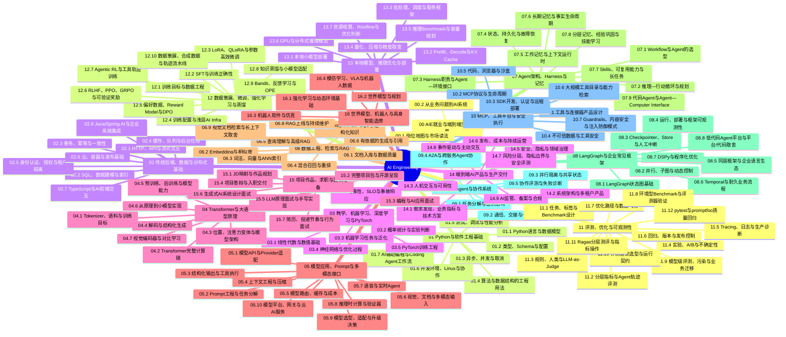

# AIE知识树

从模块进入单元，再看机制、失败、资源和实践产物。分类图用于总览；[学习顺序](dependency-order.md)按单元先修与项目路线展开；[课程审阅](course-audit.md)说明CS329Z/CS336对照与取舍。

## [00 AIE就业与端到端交付全景](modules/00.md)

把一个业务需求拆成产品、数据、模型、系统和验收工作。

- **[00.1 岗位地图与市场读法](modules/00.md#unit-00-1)** · `core` · [Latent Space: The Rise of the AI Engineer](https://latent.space/p/ai-engineer/)
  - 应用/系统AIE：AI Engineer、LLM工程师、Agent工程师、Applied AI与FDE
  - 相邻岗位：SDE、MLE、SRE、算法研究、模型训练与GPU平台
  - 招聘存量、新增职位、入职人数、招聘指数、技能提及率的区别
  - 中国与北美的岗位名称、行业、年资和交付模式
  - 岗位JD→能力→学习单元→作品证据→面试问题的映射
- **[00.2 从业务问题到AI系统](modules/00.md#unit-00-2)** · `core` · [Full Stack LLM Bootcamp](https://fullstackdeeplearning.com/llm-bootcamp/)
  - 用户、任务、输入输出、场景约束和业务错误成本
  - 规则/传统ML/模型API/RAG/Agent的选型
  - 数据流、控制流、权限流、反馈流
  - 质量、延迟、成本、可靠性与用户体验
  - 发现需求→试点→基线→实现→评测→部署→运营

## [01 Python与软件工程基础](modules/01.md)

独立编写、测试、调试和维护可交付的Python服务代码。

- **[01.1 Python语言与数据模型](modules/01.md#unit-01-1)** · `core` · [Python Tutorial](https://docs.python.org/3/tutorial/)
  - 变量、对象、可变性、引用与复制；list/dict/set/tuple
  - 函数参数、作用域、闭包、装饰器与上下文管理器
  - 类、dataclass、协议与组合；抽象接口
  - 异常层次、资源释放、日志与错误传播
  - 迭代器、生成器、文件流与内存占用
- **[01.2 类型、Schema与配置](modules/01.md#unit-01-2)** · `core` · [FastAPI Tutorial](https://fastapi.tiangolo.com/tutorial/)
  - 类型提示、泛型、Union、Optional与Protocol
  - Pydantic验证、严格模式、未知字段和业务不变量
  - JSON Schema、序列化、版本兼容与错误响应
  - 环境配置、配置校验、secret引用和依赖注入
  - 类型检查、运行时校验和业务验证的职责
- **[01.3 异步、并发与取消](modules/01.md#unit-01-3)** · `core` · [Python asyncio: Coroutines and Tasks](https://docs.python.org/3/library/asyncio-task.html)
  - event loop、协程、task、await与阻塞I/O
  - 线程/进程/协程的选择；GIL与CPU密集任务
  - 并发上限、信号量、连接池、队列与背压
  - deadline、超时、取消传播、任务清理
  - 竞态、共享状态、锁与异步错误聚合
- **[01.4 算法与数据结构的工程用法](modules/01.md#unit-01-4)** · `core` · [Problem Solving with Algorithms and Data Structures using Python](https://runestone.academy/ns/books/published/pythonds3/index.html)
  - 时间/空间复杂度、排序、二分和哈希
  - 堆、优先队列、LRU、去重与流式top-k
  - 树、图、BFS/DFS、拓扑排序与环检测
  - 字符串处理、Unicode、正则和边界测试
  - 工具结果合并、依赖调度与有限缓存
- **[01.5 测试、调试与性能分析](modules/01.md#unit-01-5)** · `core` · [The Missing Semester](https://missing.csail.mit.edu/)
  - unit/integration/contract/end-to-end测试的层次
  - fixture、依赖替身、可复现seed与故障注入
  - 断点、堆栈、日志、CPU/内存profile
  - 静态检查、格式、类型检查与CI质量控制
  - AI辅助代码审查、测试有效性和依赖升级回归
- **[01.6 开发环境、Linux与协作](modules/01.md#unit-01-6)** · `core` · [The Missing Semester](https://missing.csail.mit.edu/)
  - venv/uv、依赖锁定、pyproject与包结构
  - Linux文件、权限、进程、信号和网络诊断
  - Git分支、diff、rebase、冲突与code review
  - 命令行、脚本、Make/task runner与环境复现
  - README、API文档、ADR与小步交付
- **[01.7 AI辅助编程与Coding Agent工作流](modules/01.md#unit-01-7)** · `core` · [Claude Code: Best Practices](https://code.claude.com/docs/en/best-practices)
  - Claude Code、Codex、Cursor等工具的能力边界、权限模式与费用
  - 先探索/计划再编码：任务拆分、验收标准与小步提交
  - AGENTS.md/CLAUDE.md、Skills与MCP配置：把仓库约定变成可复用上下文
  - 验证生成代码：测试先行、diff审阅、依赖与安全检查、虚构API
  - 沙箱、密钥与生产权限；不可逆操作的人工确认
  - 效率度量与可用AI的面试：讲清自己的判断而非复述助手输出

## [02 传统后端、数据与分布式基础](modules/02.md)

把模型功能接入有身份、数据与运行边界的业务服务。

- **[02.1 HTTP、API与流式交互](modules/02.md#unit-02-1)** · `core` · [FastAPI Tutorial](https://fastapi.tiangolo.com/tutorial/)
  - HTTP语义、状态码、REST、分页、OpenAPI和API版本
  - DNS/TCP/TLS、代理、连接复用与连接超时
  - SSE/WebSocket、流中断、心跳和客户端重连
  - request ID、幂等键、错误分类与deadline
  - 上传/下载、对象存储引用和大文件限制
- **[02.2 SQL、数据建模与索引](modules/02.md#unit-02-2)** · `core` · [PostgreSQL Tutorial](https://www.postgresql.org/docs/current/tutorial.html)
  - 实体关系、主外键、唯一约束、规范化与JSON字段
  - JOIN、窗口函数、聚合、分页和批量写入
  - B-tree/复合索引、查询计划与慢查询
  - 连接池、迁移、备份恢复与schema演进
  - 关系库/对象存储/搜索索引的职责
- **[02.3 事务、幂等与一致性](modules/02.md#unit-02-3)** · `core` · [AWS Builders Library: Idempotent APIs](https://aws.amazon.com/builders-library/making-retries-safe-with-idempotent-APIs/)
  - 隔离级别、丢失更新、乐观锁与悲观锁
  - 唯一约束、CAS、请求payload与幂等键绑定
  - at-least-once、重复消息、顺序与去重
  - transactional outbox、补偿和外部提交结果未知
  - 事件时间、处理时间、版本与审计
- **[02.4 缓存、队列与后台任务](modules/02.md#unit-02-4)** · `core` · [System Design Primer](https://github.com/donnemartin/system-design-primer)
  - Redis缓存模式、TTL、失效、击穿与一致性
  - 消息队列、ack、重试、DLQ和延迟任务
  - worker池、lease、心跳与fencing token
  - 限流、熔断、隔离、背压与公平调度
  - 任务状态机、进度、取消与可重放事件
- **[02.5 身份认证、授权与租户隔离](modules/02.md#unit-02-5)** · `core` · [OWASP Cheat Sheet Series](https://cheatsheetseries.owasp.org/)
  - session、JWT、OAuth2/OIDC、service identity
  - 认证与授权、RBAC/ABAC、最小权限
  - tenant/user/project级过滤与服务端身份上下文
  - secret manager、凭证轮换、审计与脱敏
  - SSRF、出站访问、输入校验与依赖安全
- **[02.6 云、容器与发布基础](modules/02.md#unit-02-6)** · `core` · [Docker Get Started](https://docs.docker.com/get-started/)
  - 镜像、容器、网络、volume、healthcheck和资源限制
  - 云计算、对象存储、托管数据库、队列与IAM
  - 配置注入、secret、环境分层和依赖启动顺序
  - CI/CD、数据库迁移、灰度和回滚
  - 服务发现、负载均衡、Kubernetes核心对象概览
- **[02.7 TypeScript与AI前端交互](modules/02.md#unit-02-7)** · `core` · [TypeScript Handbook](https://www.typescriptlang.org/docs/handbook/intro.html)
  - TS类型、接口、async/await、包管理和API client
  - React状态、表单、流式渲染、错误与任务恢复
  - 文件上传、引用展示、审批界面和会话历史
  - 流式协议与生成式UI：SSE/token流、工具调用卡片、Vercel AI SDK与AG-UI事件
  - MCP Apps/ChatGPT Apps等嵌入式应用UI，以及schema共享的前后端契约
- **[02.8 Java/Spring AI与企业系统集成](modules/02.md#unit-02-8)** · `advanced` · [Spring AI Reference](https://docs.spring.io/spring-ai/reference/)
  - Spring Boot服务结构、依赖注入、配置与可观测性基础
  - Spring AI的ChatClient、结构化输出、工具调用与Advisor
  - Spring AI/LangChain4j的RAG、向量库与MCP客户端/服务端
  - Python模型服务与Java业务系统的边界：HTTP/gRPC、消息队列与schema契约
  - 企业接入：SSO/权限、事务、审计与既有微服务治理
  - C#/.NET、Go生态的同类能力与选型

## [03 数学、机器学习、深度学习与PyTorch](modules/03.md)

理解模型学习、实验与优化，能运行和诊断小规模训练。

- **[03.1 线性代数与数值基础](modules/03.md#unit-03-1)** · `core` · [Dive into Deep Learning](https://d2l.ai/)
  - NumPy向量/矩阵/张量、维度、广播与矩阵乘法
  - 点积、范数、余弦、正交和相似度
  - 导数、链式法则、梯度与Jacobian概念
  - 浮点数、溢出、log-sum-exp和数值稳定
  - 参数规模、激活与计算量的数量级估算
- **[03.2 概率统计与实验判断](modules/03.md#unit-03-2)** · `core` · [OpenIntro Statistics](https://www.openintro.org/book/os/)
  - 条件概率、Bayes、期望、方差与常见分布
  - 抽样单位、相关性、偏差/方差和置信区间
  - 假设检验、效应大小、功效和多重比较概览
  - 配对实验、cluster bootstrap、时间与群组切分
  - 校准、覆盖率、选择偏差与相关/因果
  - 熵、交叉熵、KL散度与互信息；MLE/MAP与常见损失函数的关系
- **[03.3 机器学习任务与泛化](modules/03.md#unit-03-3)** · `core` · [Dive into Deep Learning](https://d2l.ai/)
  - 分类/回归/排序/聚类与任务建模
  - pandas数据检查、特征/损失、训练/验证/测试集
  - 过拟合、正则化、交叉验证和数据泄漏
  - precision/recall/F1、ROC/PR与不均衡类别
  - 分布迁移、基线和业务错误成本
- **[03.4 神经网络与优化过程](modules/03.md#unit-03-4)** · `core` · [Dive into Deep Learning](https://d2l.ai/)
  - 线性层、激活、MLP、参数初始化与归一化
  - 反向传播、自动微分与梯度检查
  - SGD/AdamW、学习率、warmup、schedule和weight decay
  - batch、epoch、梯度累积、clip和随机种子
  - 梯度消失/爆炸、train/eval模式与学习曲线
- **[03.5 PyTorch训练工程](modules/03.md#unit-03-5)** · `core` · [PyTorch: Learn the Basics](https://docs.pytorch.org/tutorials/beginner/basics/intro.html)
  - Tensor/device/dtype、Module与参数注册
  - Dataset/DataLoader、collate、padding和采样
  - forward/backward/optimizer、mask与loss reduction
  - AMP、checkpoint、恢复、日志与实验配置
  - 显存profile、OOM定位和最小可复现实验
  - stride、view/reshape、contiguous、广播和einsum/einops；复制与内存开销

## [04 Transformer与大语言模型原理](modules/04.md)

沿token到logits讲清模型数据流，并实现一个小型decoder。

- **[04.1 Tokenizer、语料与训练目标](modules/04.md#unit-04-1)** · `core` · [Hugging Face LLM Course](https://huggingface.co/learn/llm-course/en/chapter1/1)
  - BPE/WordPiece/Unigram、词表与special tokens
  - Unicode、多语言、padding/truncation和attention mask
  - chat template、role delimiter和终止token
  - next-token prediction、交叉熵与perplexity
  - 训练语料清洗、去重、污染与数据配比
  - 从字节/Unicode到BPE训练与encode/decode的最小练习；特殊token与多语言边界
- **[04.2 Transformer完整计算链](modules/04.md#unit-04-2)** · `core` · [Dive into Deep Learning](https://d2l.ai/)
  - Embedding→位置表示→Attention→FFN→logits
  - Q/K/V、scaled dot-product、softmax和causal mask
  - 多头注意力的拆分、拼接与输出投影
  - 残差、LayerNorm/RMSNorm、Pre/Post-LN
  - FFN、激活、SwiGLU与参数/张量形状
- **[04.3 位置、注意力变体与模型架构](modules/04.md#unit-04-3)** · `advanced` · [Stanford CS336 Spring 2025: Language Modeling from Scratch](https://stanford-cs336.github.io/spring2025/)
  - 绝对/相对位置、RoPE与长上下文扩展
  - MHA/MQA/GQA、KV数量与计算/内存取舍
  - 稠密模型、MoE、router与专家负载
  - 线性/混合attention、SSM的基本动机
  - decoder-only、encoder与encoder-decoder适用任务
  - MLA、滑动窗口/稀疏注意力、多token预测与MoE负载均衡（含无辅助损失方案）
- **[04.4 解码与结构化生成](modules/04.md#unit-04-4)** · `core` · [Hugging Face LLM Course](https://huggingface.co/learn/llm-course/en/chapter1/1)
  - greedy、sampling、temperature、top-k/top-p
  - beam search、停止条件、重复惩罚和长度偏差
  - logits processors、grammar/schema约束和JSON有效性
  - 随机性、seed、确定性与模型服务差异
  - 事实性、任务正确率与采样参数的关系
- **[04.5 预训练、后训练与模型能力](modules/04.md#unit-04-5)** · `core` · [Hugging Face LLM Course](https://huggingface.co/learn/llm-course/en/chapter1/1)
  - 预训练→SFT→偏好/强化学习→领域适配
  - base/instruct/reasoning/embedding/reranker模型
  - 知识、推理、工具使用与长上下文能力
  - 幻觉、知识截止、OOD、prompt敏感和遗忘
  - 开源权重、模型卡、许可证与评测选择
  - Scaling laws与compute-optimal训练（Kaplan/Chinchilla）：参数、数据与算力的取舍
  - 推理模型：长思维链、RLVR训练与推理预算
- **[04.6 从原理到小模型实现](modules/04.md#unit-04-6)** · `core` · [Neural Networks: Zero to Hero](https://github.com/karpathy/nn-zero-to-hero)
  - token batch与causal language-model labels
  - 最小decoder block、forward与loss
  - 训练/验证、checkpoint与sampling
  - 参数量、上下文长度、batch与内存估算
  - 读取真实开源模型配置和权重结构
- **[04.7 视觉编码器与对比学习](modules/04.md#unit-04-7)** · `core` · [Hugging Face: Vision Language Models Explained](https://huggingface.co/blog/vlms)
  - ViT：patch切分、位置编码与图像token数量
  - CLIP/SigLIP对比学习目标、温度与零样本分类
  - 视觉编码器→projector/connector→LLM的VLM结构与训练阶段
  - 动态分辨率、图像切块、视频帧采样与显存/延迟
  - 对比学习与文本embedding、多模态检索的关系

## [05 模型应用、Prompt与多模态接口](modules/05.md)

交付具有严格接口、预算和交互边界的模型应用。

- **[05.1 模型API与Provider适配](modules/05.md#unit-05-1)** · `core` · [LiteLLM Documentation](https://docs.litellm.ai/docs/)
  - 消息、请求参数、模型能力发现与版本固定
  - 同步/异步、streaming、usage和结构化事件
  - 超时、取消、429、重试退避和总预算
  - provider adapter、依赖注入、fallback和可测试替身
  - 缓存键、模型/提示版本和敏感数据处理
- **[05.2 Prompt工程与任务分解](modules/05.md#unit-05-2)** · `core` · [Anthropic: Interactive Prompt Engineering Tutorial](https://github.com/anthropics/prompt-eng-interactive-tutorial)
  - 任务目标、约束、示例、格式和上下文边界
  - zero/few-shot、示例选择、顺序和提示版本
  - 分解、ReAct、计划、验证和有限修复
  - system/user/tool信息来源与注入面
  - prompt实验、业务指标、成本和回归
- **[05.3 结构化输出与工具执行](modules/05.md#unit-05-3)** · `core` · [OpenAI Structured Outputs](https://developers.openai.com/api/docs/guides/structured-outputs)
  - JSON Schema、Pydantic、严格字段与业务校验
  - 模型提出tool call→应用验证→授权→执行→回传
  - 工具ID、参数、枚举、分页和输出大小
  - 并行调用、部分失败、超时和幂等副作用
  - schema迁移、错误契约和有限重试
- **[05.4 上下文工程与压缩](modules/05.md#unit-05-4)** · `core` · [Anthropic: Effective Context Engineering](https://www.anthropic.com/research/effective-context-engineering-for-ai-agents)
  - 上下文窗口、token预算、relevance和position bias
  - 对话窗口、rolling summary、实体/事实记录
  - 检索注入、工具结果裁剪与artifact offload
  - 摘要信息损失、来源、时间与冲突
  - context isolation、缓存和失败回放
- **[05.5 模型路由、缓存与成本](modules/05.md#unit-05-5)** · `core` · [RouteLLM](https://github.com/lm-sys/RouteLLM)
  - 模型能力与任务难度路由
  - prompt/result/semantic cache和失效条件
  - fast/slow path、级联、early exit和fallback
  - token计费、缓存命中、重试和每成功任务成本
  - 质量约束、延迟分布、线上反馈与回滚
- **[05.6 视觉、文档与多模态输入](modules/05.md#unit-05-6)** · `core` · [Transformers: Image-text-to-text](https://huggingface.co/docs/transformers/tasks/image_text_to_text)
  - VLM输入、image processor、分辨率与视觉token
  - OCR、版面、表格、图表与文档理解
  - 图像→候选字段→校验/确认→确定性业务计算
  - 多图片/视频采样、吞吐与内存预算
  - 字段真值、分组评测、不确定性与选择性确认
- **[05.7 语音与实时Agent](modules/05.md#unit-05-7)** · `advanced` · [Hugging Face Audio Course](https://huggingface.co/learn/audio-course/en/chapter0/introduction)
  - ASR/TTS、端到端语音模型与级联链路
  - VAD、turn detection、barge-in和会话状态
  - 流式音频编码、延迟预算和网络抖动
  - 工具执行中断、取消与重复播报
  - 转写/任务/交互指标、口音和噪声切片
- **[05.8 推理时计算与验证器](modules/05.md#unit-05-8)** · `core` · [Stanford CS329Z: Engineering AI Agents](https://cs329z.stanford.edu/)
  - 单次调用、分解、重试、自一致性、best-of-N与搜索的计算分配
  - 生成候选与验证候选的分工；验证器错误、选择偏差和失败放大
  - 推理深度、候选数量、并行度、工具调用与总token/时间预算
  - 同预算比较、质量—延迟—成本前沿、失败后的停止/转人工
  - 固定配置与独立试次；缓存重复回复不当作独立采样
  - 从可观测输出、工具动作与环境结果检验改进
  - 推理模型的思考预算/effort参数、工具调用中的交错思考，以及推理内容的保留与展示边界
- **[05.9 模型选型、适配与升级决策](modules/05.md#unit-05-9)** · `core` · [CS336 Lecture 12: Evaluation](https://github.com/stanford-cs336/lectures/blob/main/lecture_12.py)
  - 任务能力矩阵：知识、推理、工具、结构化、多模态、语言与长上下文
  - base/instruct/reasoning及API/开放权重模型的适用边界
  - 通用榜单到业务分布的迁移；模型、prompt、harness和预算同时影响结果
  - 质量阈值、成本、延迟、数据使用条款、部署条件与可获得性
  - 能力探测、prompt/chat template适配、版本固定、迁移与回归
  - 候选淘汰、灰度验证、fallback和可回滚升级记录
- **[05.10 模型平台、网关与云AI服务](modules/05.md#unit-05-10)** · `core` · [OpenAI: Prompt Caching](https://developers.openai.com/api/docs/guides/prompt-caching)
  - provider端prompt caching：前缀稳定、缓存命中、TTL与计费
  - Batch API与异步任务：折扣、完成时限、失败重试与结果对账
  - 速率限制档位、配额、并发与多key/多区域容量规划
  - reasoning/thinking参数、推理token计费与输出长度控制
  - OpenAI兼容接口与模型网关（LiteLLM、OpenRouter）：统一鉴权、路由、审计与降级
  - 云平台（Bedrock、Vertex AI、Azure AI Foundry、阿里云百炼、火山方舟）：数据驻留、VPC、合规与模型目录
  - 国产模型（Qwen、DeepSeek、GLM、Kimi等）与海外模型的能力、价格、许可和可获得性

## [06 数据工程、检索与RAG](modules/06.md)

构建可评测、可更新、有权限边界的企业知识应用。

- **[06.1 文档入库与数据质量](modules/06.md#unit-06-1)** · `core` · [Docling Documentation](https://docling-project.github.io/docling/)
  - 数据源连接、增量同步、来源许可与数据卡
  - PDF/HTML/Office/OCR、布局、表格和编码
  - 清洗、去重、内容hash、文档/段落ID与版本
  - 按标题/语义/结构切分、overlap与metadata
  - 批处理、失败重跑、幂等索引和删除传播
  - 解析工具选型（Docling、MinerU、PaddleOCR、Unstructured）与按文档类型的解析质量评测
- **[06.2 Embedding与相似度](modules/06.md#unit-06-2)** · `core` · [Sentence Transformers: Retrieve and Rerank](https://www.sbert.net/examples/sentence_transformer/applications/retrieve_rerank/README.html)
  - bi-encoder、query/document表示与训练目标
  - cosine/dot/L2、归一化、维度和分布
  - 多语言、领域适配、query前缀和max length
  - embedding batch、缓存、版本迁移与重建
  - 正负样本、hard negatives和相似/相关的差异
  - 按MTEB/C-MTEB与自有数据选embedding模型（BGE、Qwen3-Embedding等）；Matryoshka维度与量化
  - 用hard negatives微调embedding/reranker及其评测
- **[06.3 词法、向量与ANN索引](modules/06.md#unit-06-3)** · `core` · [Introduction to Information Retrieval](https://nlp.stanford.edu/IR-book/)
  - 倒排索引、TF-IDF、BM25和字段检索
  - 精确向量搜索、HNSW、IVF、PQ的直觉
  - recall/latency/memory、建索引和更新成本
  - metadata过滤、tenant ACL、分区和权限一致性
  - Postgres+pgvector、搜索引擎、独立向量库的选型
  - Milvus、Elasticsearch/OpenSearch与pgvector在规模、混合检索和运维上的对比
- **[06.4 混合召回与重排](modules/06.md#unit-06-4)** · `core` · [Sentence Transformers: Retrieve and Rerank](https://www.sbert.net/examples/sentence_transformer/applications/retrieve_rerank/README.html)
  - 稀疏/稠密融合、score normalization和RRF
  - 候选预算、去重、多路召回与排序
  - cross-encoder、late interaction/ColBERT
  - 业务过滤、时间、来源与多样性
  - 逐阶段召回损失、重排增益和额外费用
  - reranker模型选择（bge-reranker、Cohere、Jina等）、截断长度与延迟预算
- **[06.5 查询理解与高级RAG](modules/06.md#unit-06-5)** · `advanced` · [LangChain: RAG From Scratch](https://github.com/langchain-ai/rag-from-scratch)
  - query rewrite、multi-query、HyDE和查询分解
  - 多轮问题指代、过滤条件提取和检索路由
  - multi-hop、recursive/hierarchical retrieval和RAPTOR概念
  - agentic RAG、自检、迭代检索与预算
  - 检索增强带来的收益、循环和无答案处理
  - contextual retrieval、parent-child/small-to-big切块与上下文补全
- **[06.6 有依据的生成与引用](modules/06.md#unit-06-6)** · `core` · [ALCE: Enabling LLMs to Generate Text with Citations](https://arxiv.org/abs/2305.14627)
  - context assembly、证据顺序、重复和token预算
  - claim级引用、source span与文档版本
  - 支持/反驳/信息不足；否定、数字、单位和条件
  - 答案正确、证据充分、引用正确的独立指标
  - 拒答、澄清、过期/冲突知识与用户可解释性
- **[06.7 GraphRAG、SQL与结构化知识](modules/06.md#unit-06-7)** · `advanced` · [Microsoft GraphRAG](https://microsoft.github.io/graphrag/)
  - 实体/关系、消歧、schema、来源和时间
  - 图遍历、社区摘要与普通关系查询的取舍
  - Text-to-SQL：schema linking、生成、验证与只读执行
  - SQL权限、查询预算、注入、方言与结果解释
  - 图/SQL/文档路由、跨源join和评测
- **[06.8 RAG上线与持续维护](modules/06.md#unit-06-8)** · `core` · [Jason Liu: Systematically Improving Your RAG](https://jxnl.co/writing/2024/05/22/systematically-improving-your-rag/)
  - 离线qrels、Recall/nDCG/MRR与生成指标
  - 权限canary、版本时间切片与数据泄漏
  - 索引刷新、删除、缓存失效和迁移
  - 失败样本闭环、embedding/reranker升级
  - 质量、p95、资源与每成功问题成本
- **[06.9 视觉文档检索与长上下文取舍](modules/06.md#unit-06-9)** · `advanced` · [ColPali: Efficient Document Retrieval with Vision Language Models](https://arxiv.org/abs/2407.01449)
  - 页面图像直接检索：ColPali/多向量late interaction与OCR管线对照
  - 表格、图表、扫描件与版面信息的检索与回答
  - 长上下文窗口与RAG：成本、延迟、position bias和context rot
  - 混合策略：检索后整文阅读、长文档prompt caching与分层摘要
  - 多向量索引的存储/延迟成本与评测方法

## [07 Agent架构、Harness与记忆](modules/07.md)

构建能规划、调用工具、验证结果并从故障中恢复的执行系统。

- **[07.1 Workflow与Agent的选型](modules/07.md#unit-07-1)** · `core` · [Anthropic: Building Effective Agents](https://www.anthropic.com/research/building-effective-agents)
  - 确定流程、动态决策和混合架构
  - routing、parallelization、orchestrator-workers和evaluator loop
  - 自主性、可控性、任务复杂度和可验证性
  - 模型/上下文/工具/runtime的数据与控制边界
  - 单次调用、长任务、用户等待和成本
  - prompt chaining、routing、parallelization、orchestrator-workers、evaluator-optimizer逐一映射任务
- **[07.2 推理—行动循环与规划](modules/07.md#unit-07-2)** · `core` · [Hugging Face Agents Course](https://huggingface.co/learn/agents-course/en/unit0/introduction)
  - ReAct、Plan-and-Execute、ReWOO和CodeAct
  - 目标拆分、计划修订、观察和环境状态
  - 工具选择、参数生成、执行与结果验证
  - 终止、最大步数、循环检测与预算
  - 反思/修复的触发条件与额外开销
- **[07.3 Harness职责与Agent—环境接口](modules/07.md#unit-07-3)** · `core` · [LangChain Academy: Introduction to Deep Agents](https://academy.langchain.com/courses/foundation-introduction-to-deepagents)
  - 模型策略与控制器、环境、工具registry的分工
  - Action/Observation、schema、错误和超时契约
  - 工作目录、artifact、shell/browser/computer工具接口
  - 预算、权限、事件日志和运行生命周期
  - 可重放环境、任务reset与版本manifest
- **[07.4 状态、持久化与故障恢复](modules/07.md#unit-07-4)** · `core` · [LangGraph Overview and Guides](https://docs.langchain.com/oss/python/langgraph/overview)
  - 状态schema、事件日志、checkpoint和运行ID
  - 持久化与外部副作用的提交边界
  - 幂等、outbox、lease/fencing和重投递
  - 暂停、审批、恢复、重放与版本变化
  - 超时、部分失败、补偿和结果未知时的对账
- **[07.5 工作记忆与上下文运行时](modules/07.md#unit-07-5)** · `core` · [Anthropic: Effective Context Engineering](https://www.anthropic.com/research/effective-context-engineering-for-ai-agents)
  - messages、任务计划、scratchpad和工具观察
  - token预算、summary、observation masking和裁剪
  - artifact offload、按需读取与文件权限
  - subagent上下文隔离和信息丢失
  - 日志回放、上下文快照和失败归因
- **[07.6 长期记忆与事实生命周期](modules/07.md#unit-07-6)** · `core` · [Mem0](https://github.com/mem0ai/mem0)
  - episodic/semantic/procedural与用户声明/推断/外部来源
  - 提取、合并、冲突、版本和来源证据
  - 有效时间/记录时间、未来生效与纠正
  - 检索、context compiler、TTL和遗忘
  - 授权、撤回、索引/缓存传播与长期评测
- **[07.7 Skills、可复用能力与长任务](modules/07.md#unit-07-7)** · `core` · [Anthropic: Equipping Agents with Agent Skills](https://www.anthropic.com/research/equipping-agents-for-the-real-world-with-agent-skills)
  - 工具、提示模板、操作说明、技能包和子流程
  - 能力发现、按需加载、接口版本与依赖
  - 长任务分段、阶段验收和artifact传递
  - 任务计划/进度/中间证据与用户介入
  - 复用边界、测试夹具和维护成本
  - SKILL.md开放格式、渐进加载与AGENTS.md等仓库级指令文件
- **[07.8 分层记忆、经验巩固与技能学习](modules/07.md#unit-07-8)** · `advanced` · [Stanford CS329Z: Engineering AI Agents](https://cs329z.stanford.edu/)
  - working/episodic/semantic/procedural四类记忆的写入、读取和更新责任
  - 热/冷层、容量管理、检索与分页；分层存储和上下文窗口的关系
  - 轨迹→反思/摘要→可复用经验或技能；抽取置信度与来源
  - 巩固触发、重复经验合并、冲突、遗忘和回滚
  - 长时序任务、跨会话泛化、失败记忆污染与过度个性化
  - 同token预算的历史/向量/分层记忆对照，分别测写入、检索和任务结果
  - 参数记忆与上下文记忆：权重适配和检索/写入在更新、撤回、费用上的不同边界
- **[07.9 代码Agent与Agent—Computer Interface](modules/07.md#unit-07-9)** · `advanced` · [CS329Z: Evaluation Task Assignment](https://github.com/cs329z/assignment2-evals)
  - 任务描述→仓库/工作区→定位→编辑→执行测试→提交artifact的闭环
  - shell、文件编辑、搜索与浏览器接口的可用性和可观察性
  - 状态化工具、输出截断、工作目录、长命令、错误与恢复
  - repo revision、依赖、测试环境和干净reset；无网络的安全小任务
  - patch是否正确、测试是否充分、环境是否被修改或绕过
  - 接口消融、工具反馈质量与模型能力的区分

## [08 LangGraph与企业常见框架](modules/08.md)

深入掌握一套有状态编排框架，并能解释同层替代与跨层组合。

- **[08.1 LangGraph状态图基础](modules/08.md#unit-08-1)** · `core` · [LangChain Academy: Introduction to LangGraph](https://academy.langchain.com/courses/intro-to-langgraph)
  - StateGraph、state schema、节点与边
  - TypedDict/Pydantic、reducer和消息累积
  - 条件路由、循环、终止与图调试
  - 模型/检索/工具节点与依赖注入
  - 从固定workflow到动态agent graph
- **[08.2 并行、子图与动态控制](modules/08.md#unit-08-2)** · `advanced` · [LangGraph Overview and Guides](https://docs.langchain.com/oss/python/langgraph/overview)
  - fan-out/fan-in、Send、Command和动态路由
  - 并行状态合并、reducer冲突与确定性
  - subgraph边界、复用和上下文隔离
  - async节点、stream mode、取消与异常
  - 并行预算、慢分支和部分失败
- **[08.3 Checkpointer、Store与人工中断](modules/08.md#unit-08-3)** · `core` · [LangChain Academy: Introduction to LangGraph](https://academy.langchain.com/courses/intro-to-langgraph)
  - thread/run/checkpoint ID与后端存储
  - 短期状态、长期Store和业务数据库
  - interrupt/resume、审批动作和版本绑定
  - 重放、time travel、图代码升级与旧状态
  - 故障恢复、外部幂等与保存点保证
- **[08.4 运行、部署与框架可观测性](modules/08.md#unit-08-4)** · `core` · [LangGraph Overview and Guides](https://docs.langchain.com/oss/python/langgraph/overview)
  - 入口API、worker、运行存储与配置
  - 图状态、模型/工具trace、流事件和错误
  - 评测集、图版本与回归
  - 容器、自建服务和托管服务的取舍
  - 限流、租户、升级、回滚与生产支持
- **[08.5 同层框架与企业语言生态](modules/08.md#unit-08-5)** · `advanced` · [Google Agent Development Kit](https://google.github.io/adk-docs/)
  - LangChain与LangGraph的职责差异
  - Google ADK、PydanticAI、Microsoft Agent Framework（AutoGen后继）与CrewAI
  - OpenAI Agents SDK、Claude Agent SDK等provider agent SDK与框架中立的typed action contract
  - TypeScript（Vercel AI SDK、Mastra）、Java（Spring AI/LangChain4j，见02.8）与.NET生态
  - session、state、重试、工具、部署和评测语义对照
- **[08.6 Temporal与耐久业务流程](modules/08.md#unit-08-6)** · `advanced` · [Temporal: Developer Guide](https://docs.temporal.io/develop)
  - 业务workflow与模型决策循环
  - workflow history、determinism与replay
  - activity重试、幂等、补偿与外部系统
  - 跨天等待、人工事件、超时和版本迁移
  - 与Agent graph组合时的状态/重试权威层
- **[08.7 DSPy与程序化优化](modules/08.md#unit-08-7)** · `advanced` · [DSPy](https://dspy.ai/)
  - 声明输入输出和模型程序模块
  - 目标函数、训练示例、dev/test与优化预算
  - few-shot、指令、演示和程序结构优化
  - GEPA/MIPRO等优化器的使用前提
  - 误差分析、成本、过拟合和可复现实验
  - BootstrapFewShot/MIPROv2/GEPA的示例、指令、反馈与搜索预算；训练/开发/测试分离
- **[08.8 低代码Agent平台与平台/代码取舍](modules/08.md#unit-08-8)** · `advanced` · [Dify Documentation](https://docs.dify.ai/en/home)
  - Dify/扣子/n8n的工作流画布、知识库、插件/工具和应用发布
  - 平台与代码的取舍：迭代速度、可控性、测试、版本与成本
  - 扩展方式：自定义工具、HTTP节点、MCP接入与插件开发
  - 私有化部署、许可证、多租户与数据边界
  - DSL导出、版本控制，以及评测与观测缺口的补法
  - 从平台原型迁移到代码服务的触发条件与步骤

## [09 Multi-Agent与协作系统](modules/09.md)

按可分解任务设计协作，并测量相对单Agent的收益和成本。

- **[09.1 任务分解与组织结构](modules/09.md#unit-09-1)** · `core` · [Stanford CS329Z: Engineering AI Agents](https://cs329z.stanford.edu/)
  - 单Agent、固定并行、multi-agent的选择
  - supervisor、hierarchical、peer/swarm和blackboard
  - 角色专长、工具范围、上下文和责任分配
  - 独立子任务、依赖链、共享约束与终止
  - 协调开销、错误传播和收益假设
- **[09.2 通信、交接与任务账本](modules/09.md#unit-09-2)** · `advanced` · [Google Agent Development Kit](https://google.github.io/adk-docs/)
  - 消息schema、任务/结果契约与路由
  - handoff、subagent-as-tool和共享消息板
  - 任务ID、负责人、lease、状态和artifact ledger
  - 消息丢失、重复、乱序、超时与死锁
  - 通信token、信息压缩与上下文污染
- **[09.3 并行隔离与共享状态](modules/09.md#unit-09-3)** · `advanced` · [Deep Agents](https://docs.langchain.com/oss/python/deepagents/overview)
  - 任务上下文与共享事实的边界
  - 数据库事务、版本和并发合并
  - 文件/工作目录、Git worktree和artifact ownership
  - 工具身份、权限、凭证与跨Agent泄漏
  - 失败分支恢复、取消和资源回收
- **[09.4 A2A与跨服务Agent协作](modules/09.md#unit-09-4)** · `advanced` · [A2A Protocol](https://a2a-protocol.org/latest/)
  - 能力发现、Agent Card与协作契约
  - 消息、task生命周期、进度和artifact
  - 同步/异步、streaming、重连与取消
  - 跨服务身份、授权和信任边界
  - A2A与MCP分别连接Agent与工具
- **[09.5 协作评测与失败诊断](modules/09.md#unit-09-5)** · `advanced` · [Inspect AI](https://inspect.aisi.org.uk/)
  - 相同模型、数据、工具与token/时间预算
  - 任务成功、子任务质量、协调/通信开销
  - 重复劳动、角色漂移、错误共识和循环
  - 单agent、固定workflow、协作与逐组件消融
  - 长任务稳定性、可复现trace和负结果

## [10 MCP、工具平台与安全执行](modules/10.md)

开发能被不同客户端调用、权限清晰、执行受控的工具服务。

- **[10.1 工具与连接器产品设计](modules/10.md#unit-10-1)** · `core` · [Anthropic: Writing Effective Tools for Agents](https://www.anthropic.com/research/writing-tools-for-agents)
  - 业务能力→窄工具API；读写分离和副作用
  - 名称、描述、参数、错误、分页和结果大小
  - 工具注册、发现、版本与兼容
  - 鉴权上下文、审批、审计和幂等
  - 工具成功、业务成功与模型调用正确性的指标
- **[10.2 MCP协议与生命周期](modules/10.md#unit-10-2)** · `core` · [MCP: Build a Server](https://modelcontextprotocol.io/docs/develop/build-server)
  - host/client/server、JSON-RPC和初始化协商
  - tools/resources/prompts及能力边界
  - stdio、Streamable HTTP、session和连接状态
  - 分页、notification、progress、cancel与错误
  - 协议版本、客户端能力与兼容测试
  - 客户端能力：sampling、elicitation、roots；MCP Apps等UI扩展
- **[10.3 SDK开发、认证与远程部署](modules/10.md#unit-10-3)** · `core` · [MCP Python SDK](https://github.com/modelcontextprotocol/python-sdk)
  - 官方SDK、typed schema、工具handler和依赖注入
  - 远程身份、OAuth、audience、scope与用户授权
  - principal注入、租户过滤、token passthrough风险
  - 反向代理、TLS、会话、超时、限流与部署
  - 本地客户端、外部客户端与契约测试
- **[10.4 不可信数据与工具安全](modules/10.md#unit-10-4)** · `core` · [MCP Security Best Practices](https://modelcontextprotocol.io/specification/latest/basic/security_best_practices)
  - 直接/间接prompt injection与数据/指令边界
  - least privilege、tool allowlist和动作摘要
  - 敏感字段、secret、来源和日志脱敏
  - 审批与动作版本、重放和越权
  - 攻击夹具、红队、恢复和审计
- **[10.5 代码、浏览器与沙盒](modules/10.md#unit-10-5)** · `advanced` · [gVisor Documentation](https://gvisor.dev/docs/)
  - 进程/容器/gVisor/microVM的隔离与信任模型
  - CPU、内存、PID、磁盘、网络与时限
  - 文件挂载、只读输入、artifact输出和销毁
  - 代码执行、浏览器会话、凭证与数据出口
  - 逃逸风险、资源滥用、kill/cleanup和故障演练
- **[10.6 大规模工具目录与能力检索](modules/10.md#unit-10-6)** · `advanced` · [Stanford CS329Z: Engineering AI Agents](https://cs329z.stanford.edu/)
  - 全量工具注入与按任务检索/分层路由的上下文成本
  - 工具描述、参数schema、版本、别名与检索索引
  - 先按用户授权范围过滤，再检索候选和选择动作
  - 相关工具召回、参数正确性、执行成功与业务结果分层指标
  - 目录变更、缓存、失效、错误工具与同名歧义
  - 工具来源、恶意描述和动态能力发现的信任边界
- **[10.7 Guardrails、内容安全与注入防御模式](modules/10.md#unit-10-7)** · `core` · [Design Patterns for Securing LLM Agents against Prompt Injections](https://arxiv.org/abs/2506.08837)
  - 输入/输出护栏：moderation API、Llama Guard、Qwen3Guard等分类器与规则
  - PII识别与脱敏（Presidio等），覆盖日志与训练数据
  - 越狱与注入攻击分类、红队数据集和自动化攻击测试
  - lethal trifecta：私有数据、不可信内容与对外通信不同时开放
  - 设计模式：plan-then-execute、dual-LLM隔离、CaMeL式能力控制与动作白名单
  - 护栏误拦/漏拦、延迟与成本的评测和上线阈值

## [11 评测、优化与可观测性](modules/11.md)

用可信评测驱动迭代，并把线上失败定位到具体组件。

- **[11.1 任务、标签与Benchmark设计](modules/11.md#unit-11-1)** · `core` · [Inspect AI](https://inspect.aisi.org.uk/)
  - request、environment、stopping criteria、scorer四元组
  - golden set、真实任务、合成任务与数据许可
  - 标注规则、分歧处理、数据卡和来源/时间切分
  - 开发集、调参集、盲测试与污染检查
  - 错误taxonomy、任务难度、覆盖和代表性
  - 先做错误分析：读trace、开放编码→归类成失败taxonomy，按频率×影响排序
- **[11.2 分层指标与Agent轨迹评测](modules/11.md#unit-11-2)** · `core` · [Ragas Documentation](https://docs.ragas.io/en/stable/)
  - 检索Recall/nDCG/MRR、上下文和引用
  - 答案正确、faithfulness、拒答/覆盖和字段准确率
  - 工具选择/参数/顺序/权限与环境状态变化
  - 任务成功、轨迹效率、恢复和循环
  - pass@k、pass^k、重复运行与质量/成本/延迟
  - 至少一次成功与连续全部成功的不同问题；pass@k估计、pass^k语义、任务内/任务间方差与相关试次
- **[11.3 规则、人类与LLM-as-Judge](modules/11.md#unit-11-3)** · `core` · [Inspect AI](https://inspect.aisi.org.uk/)
  - 确定性检查、参考答案、rubric与开放任务
  - pointwise/pairwise、位置/长度/风格偏差
  - judge与生成模型的相关误差
  - 人工校准、一致性、误奖/漏奖和分歧复核
  - 版本、成本、评分器攻击与reward hacking
  - 先挑战评分器：已知正负例、替代正确解、解析边界、投机解与grader版本回归
  - 用人工标签校准judge：留出集上的TPR/TNR、迭代judge prompt并修正总体估计
- **[11.4 实验、A/B与不确定性](modules/11.md#unit-11-4)** · `core` · [Adding Error Bars to Evals](https://arxiv.org/abs/2411.00640)
  - 强基线、单变量改动、消融与固定预算
  - 配对问题、用户/会话聚类和随机化单位
  - 置信区间、效应大小、多seed和方差
  - 线上A/B、shadow/canary与安全指标
  - 离线—线上相关、选择偏差和多次试验
- **[11.5 Tracing、日志与生产诊断](modules/11.md#unit-11-5)** · `core` · [OpenTelemetry GenAI Semantic Conventions](https://opentelemetry.io/docs/specs/semconv/gen-ai/)
  - request→检索→模型→工具→结果的span链
  - prompt/model/tool/index/data版本与关联ID
  - token、TTFT、端到端延迟、错误与队列
  - 脱敏、采样、访问权限、保留和导出
  - Langfuse/OTel接入、告警、dashboards和RCA
- **[11.6 回归、版本与发布控制](modules/11.md#unit-11-6)** · `core` · [promptfoo Documentation](https://www.promptfoo.dev/docs/intro/)
  - prompt/schema/模型/工具/索引/数据版本矩阵
  - 确定性契约、非确定质量回归与重复运行
  - 风险分层、回归子集、预算和flaky结果
  - CI、评审、变更说明、灰度与回滚
  - 失败样本→可复现测试→修复→跟踪
- **[11.7 优化路径与数据飞轮](modules/11.md#unit-11-7)** · `core` · [DSPy](https://dspy.ai/)
  - 失败归因：数据、检索、上下文、模型、工具与runtime
  - 数据修复、提示、检索、路由、训练的成本收益
  - 线上trace、纠正、专家反馈与轨迹数据
  - 采样、去标识、许可、标注与数据选择
  - 优化回归、长尾场景和收益归因
- **[11.8 环境型Benchmark与评测器验证](modules/11.md#unit-11-8)** · `core` · [CS329Z: Evaluation Task Assignment](https://github.com/cs329z/assignment2-evals)
  - request/environment/stopping/scorer落实到可版本化任务包
  - 容器/依赖/数据/状态快照、任务隔离、reset与artifact收集
  - oracle或已知正确方案验证环境和完整评分路径
  - 空操作、近似正确、错误结果、替代正确解和投机解挑战评分器
  - 代码、模型与人工grader的组合；环境状态与自述成功分别核验
  - 多次运行、失败重放、资源/时间限制和模型/Agent版本矩阵
  - Terminal-Bench/SWE-bench/Harbor的任务结构、覆盖和迁移限制
  - τ-bench/τ²-bench式工具—Agent—用户模拟与BFCL函数调用评测
- **[11.9 模型级评测、污染与业务迁移](modules/11.md#unit-11-9)** · `core` · [CS336 Lecture 12: Evaluation](https://github.com/stanford-cs336/lectures/blob/main/lecture_12.py)
  - 模型概率指标、静态能力题、交互偏好与系统任务结果的不同测量对象
  - perplexity与tokenizer、语料、长度归一化和跨模型可比性
  - 多项选择/loglikelihood与生成评分；格式和prompt敏感性
  - 训练污染、近重复、公开测试集过拟合与新鲜任务的边界
  - 模型、harness、工具、测试时计算与环境版本共同构成评测对象
  - 公开benchmark表现与企业任务分布、业务损失和采购决策的关系
- **[11.10 评测框架选型与运行契约](modules/11.md#unit-11-10)** · `core` · [pytest: assertions, fixtures and test execution](https://docs.pytest.org/en/stable/how-to/usage.html)
  - unit/integration/contract/E2E测试与统计质量评测各自的对象和反馈速度
  - pytest、Ragas、DeepEval、promptfoo、Inspect和观测平台的角色与组合
  - golden case→SUT运行→trace/上下文/动作采集→scorer→逐题结果→门禁
  - dataset/case/run/model/prompt/tool/index/judge/metric版本与字段映射
  - 规则、ID/qrels、参考答案、rubric、LLM judge与embedding指标的输入/费用
  - 确定性PR检查、抽样语义评测、完整发布回归与线上反馈的分层
- **[11.11 Ragas分层测评与指标操作](modules/11.md#unit-11-11)** · `core` · [Ragas Documentation](https://docs.ragas.io/en/stable/)
  - SingleTurn数据映射：user_input、response、retrieved_contexts、reference与context IDs
  - ID precision/recall与Recall@k/MRR/nDCG；文档/段落标签、排序和分母区别
  - Context Precision的排序敏感口径、Context Recall的参考claim覆盖与所需标签
  - Faithfulness、Factual Correctness、Answer Relevancy的独立含义与judge/embedding依赖
  - 无答案、空检索、空claim、缺失标签、NaN、超时与评分覆盖率的显式处理
  - 新collections API与仍有兼容API的ID指标；固定包、模型、提示与数据版本
  - 逐题/切片诊断、人工校准、重复judge、费用和失败样本回流
- **[11.12 pytest与promptfoo质量回归](modules/11.md#unit-11-12)** · `core` · [promptfoo: CI/CD evaluation](https://www.promptfoo.dev/docs/integrations/ci-cd/)
  - fixtures/参数化/markers、输入schema、工具契约、权限与副作用的确定性断言
  - 冻结baseline与candidate，核对case集合、数据/评分器版本和逐题配对
  - 绝对业务底线、相对退化幅度、关键切片与零容忍安全项分别设门槛
  - 置信区间、重复试次、相关数据、flaky judge、人工复核和基线晋升
  - pytest退出码、promptfoo配置/Python provider/assertions、JSON/JUnit报告与CI artifacts
  - 未测项、缺失分数、基础设施错误和分母变化单独报告，不用零填充
  - PR小集、受控完整评测、线上失败入库与灰度/回滚闭环

## [12 数据策展、微调、强化学习与蒸馏](modules/12.md)

理解主要训练路线，并完成小规模领域适配与独立评测。

- **[12.1 训练目标与数据工程](modules/12.md#unit-12-1)** · `core` · [Hugging Face LLM Course](https://huggingface.co/learn/llm-course/en/chapter1/1)
  - prompt/RAG/SFT/偏好优化/RL的适用问题
  - 领域数据、示范、偏好对、工具轨迹和奖励
  - 许可、PII、去重、污染与质量筛选
  - entity/template/user/time分组切分
  - 数据格式、chat template、special tokens与mask
- **[12.2 SFT与训练正确性](modules/12.md#unit-12-2)** · `advanced` · [Hugging Face TRL](https://huggingface.co/docs/trl/index)
  - causal LM目标、label shift、padding和loss masking
  - completion-only/assistant-only loss和多轮数据
  - packing、截断、长序列和工具消息
  - 训练/验证曲线、过拟合、早停和能力回归
  - adapter/全量权重、tokenizer、配置与推理一致性
- **[12.3 LoRA、QLoRA与参数高效微调](modules/12.md#unit-12-3)** · `advanced` · [Hugging Face PEFT](https://huggingface.co/docs/peft/index)
  - 低秩更新、rank/alpha/dropout和target module
  - 全量微调、LoRA、QLoRA、prefix/prompt tuning
  - 量化base、可训练adapter与优化器状态
  - 训练内存、性能、合并和精度验证
  - 多adapter管理、版本和回滚
  - 实用微调栈：Unsloth、LlamaFactory、ms-swift（ModelScope）、torchtune；领域继续预训练
- **[12.4 训练配置与浅层AI Infra](modules/12.md#unit-12-4)** · `advanced` · [PyTorch Profiler Tutorial](https://docs.pytorch.org/tutorials/recipes/recipes/profiler_recipe.html)
  - AdamW、scheduler、warmup、batch与梯度累积
  - FP32/BF16/FP16、AMP、梯度缩放和稳定性
  - 激活重算、checkpoint、数据加载和显存分解
  - DDP/FSDP/ZeRO的基本分工与通信成本
  - 吞吐、GPU利用率、OOM、seed和可恢复训练
  - 实验追踪与模型注册（W&B、MLflow）；用Ray做分布式数据处理与批量推理
- **[12.5 偏好数据、Reward Model与DPO](modules/12.md#unit-12-5)** · `advanced` · [RLHF Book (Nathan Lambert)](https://rlhfbook.com/)
  - 同一完整上下文下的chosen/rejected与标注一致性
  - Bradley–Terry、reward model和偏好学习直觉
  - DPO的策略/参考模型、beta与长度偏差
  - KTO/ORPO等方法的定位和选型
  - 数据噪声、偏好泛化、遗忘和reward exploitation
- **[12.6 RLHF、PPO、GRPO与可验证奖励](modules/12.md#unit-12-6)** · `advanced` · [RLHF Book (Nathan Lambert)](https://rlhfbook.com/)
  - MDP、policy、trajectory、return与advantage
  - RLHF：SFT→reward model→策略优化
  - PPO clipping、value、KL与reference policy
  - GRPO组内相对优势、采样和奖励归一化
  - RLVR、稀疏奖励、reward hacking与稳定性
  - GRPO奖励归一化、token/序列loss reduction、长度偏差与零方差组
  - on-policy/off-policy、重要性比率、clipping与采样策略版本一致性
- **[12.7 Agentic RL与工具轨迹训练](modules/12.md#unit-12-7)** · `advanced` · [verl](https://verl.readthedocs.io/en/latest/)
  - 环境reset/step、动作/观察、终止与任务真值
  - 多步rollout、工具失败、预算和轨迹数据
  - SFT轨迹、策略初始化、在线/离线数据
  - 奖励分解、credit assignment、verifier和安全约束
  - prompt/workflow/SFT/RL同预算基线与未见任务
  - rollout与训练分离、权重同步、轨迹policy版本、失效/截断轨迹和工具执行成本
- **[12.8 知识蒸馏与小模型适配](modules/12.md#unit-12-8)** · `advanced` · [TRL: Knowledge Distillation](https://huggingface.co/docs/trl/gkd_trainer)
  - response/sequence/logit蒸馏与temperature/KL
  - 教师示范、student on-policy数据和数据选择
  - 工具调用、领域格式、推理行为与能力边界
  - 教师错误、偏差继承、许可证与污染
  - 质量、数据生成成本、推理成本和小模型部署
  - 模型合并（线性、TIES、DARE）的适用条件与评测
- **[12.9 Bandit、反馈学习与OPE](modules/12.md#unit-12-9)** · `advanced` · [Open Bandit Pipeline](https://github.com/st-tech/zr-obp)
  - 上下文、arm、行为策略与目标策略
  - 真实抽样概率、探索、反馈延迟与奖励版本
  - IPS/SNIPS/DR、cross-fitting、overlap与ESS
  - 权重裁剪、用户级bootstrap和多次策略选择
  - 路由策略与多步LLM训练的区别
- **[12.10 数据策展、合成数据与轨迹流水线](modules/12.md#unit-12-10)** · `core` · [CS336 Lecture 14: Data pipelines](https://github.com/stanford-cs336/lectures/blob/main/lecture_14.py)
  - 业务失败→目标分布→数据来源→标注/验证→版本化产物的闭环
  - 文档、示范、偏好、轨迹与反馈各自的schema、用途和权限
  - 规则/质量评分筛选、精确/近重复、MinHash/LSH与去污染
  - 来源、语言、难度、长尾与token配比；按来源/实体/近重复组切分，处理规则仅用训练/开发数据选择
  - 合成任务/回答/轨迹、teacher选择、验证过滤、错误继承与生成成本
  - 人工分歧处理、覆盖审计、主动选样和tiny-but-targeted评测集
  - prompt优化、训练与评测数据隔离；数据血缘、可删除性与dataset revision
  - 通过测试的轨迹也可能作弊或低效；保留带失败标签的数据，区分终局成功与过程示范质量

## [13 本地模型、推理优化与部署](modules/13.md)

本地运行模型，定位推理瓶颈，并选择适合负载的部署方式。

- **[13.1 本地小模型部署](modules/13.md#unit-13-1)** · `core` · [MLX LM](https://github.com/ml-explore/mlx-lm)
  - 硬件/内存、模型大小、许可证和权重revision
  - Mac MLX-LM/llama.cpp与Linux/GPU路径
  - GGUF、safetensors、tokenizer与chat template
  - 本地HTTP服务、流式、并发和真实任务评测
  - 权重下载、缓存、离线运行与资源记录
- **[13.2 Prefill、Decode与KV Cache](modules/13.md#unit-13-2)** · `core` · [vLLM Documentation](https://docs.vllm.ai/en/latest/)
  - 自回归生成、prefill与decode的数据流
  - compute-bound/memory-bound与带宽
  - KV大小、上下文、batch和并发
  - PagedAttention、prefix cache和cache eviction
  - 长上下文、缓存命中和服务公平性
- **[13.3 批处理、调度与服务框架](modules/13.md#unit-13-3)** · `advanced` · [vLLM Documentation](https://docs.vllm.ai/en/latest/)
  - static/dynamic/continuous batching
  - vLLM/SGLang的服务入口、模型适配和配置
  - 请求队列、admission、prefill/decode调度
  - streaming、取消、超时和故障隔离
  - prefix cache、speculative decoding和收益条件
  - speculative sampling的draft/verify/accept校正条件；区分有损近似和分布保持加速
  - chunked prefill与prefill/decode分离（DistServe、Mooncake）；KV cache卸载与跨请求共享
- **[13.4 量化、压缩与精度取舍](modules/13.md#unit-13-4)** · `advanced` · [llama.cpp](https://github.com/ggml-org/llama.cpp)
  - weight-only与activation量化、INT8/INT4/FP8
  - PTQ/QAT、GPTQ/AWQ和校准数据
  - 量化误差、任务敏感度和硬件支持
  - 权重/KV/激活/后端开销分解
  - 速度、内存、能耗和任务质量的联合测量
- **[13.5 推理Benchmark与容量规划](modules/13.md#unit-13-5)** · `advanced` · [SGLang Documentation](https://docs.sglang.ai/)
  - TTFT、TPOT/ITL、tokens/s、goodput和端到端延迟
  - 输入/输出长度、并发、缓存、warm/cold与重复次数
  - 开环/闭环负载、饱和、排队与超时
  - GPU/CPU/内存profile、成本与每成功任务费用
  - 容量、限流、autoscale和降级
- **[13.6 GPU与分布式推理概览](modules/13.md#unit-13-6)** · `advanced` · [Stanford CS336 Spring 2025: Language Modeling from Scratch](https://stanford-cs336.github.io/spring2025/)
  - GPU层级、带宽、算子、kernel与fusion概念
  - DP/TP/PP/EP、NCCL和通信/计算重叠
  - 模型分片、加载、checkpoint和拓扑
  - 多卡/多机故障、利用率和扩展边界
  - 推理服务与训练集群的不同瓶颈
  - TensorRT-LLM/Triton Inference Server与国产加速卡（如昇腾）部署的差异
- **[13.7 资源核算、Roofline与优化判断](modules/13.md#unit-13-7)** · `core` · [CS336 Lecture 2: PyTorch and resource accounting](https://github.com/stanford-cs336/lectures/blob/main/lecture_02.py)
  - 参数、精度、梯度、优化器、激活、KV与运行时开销分账
  - prefill/decode、训练forward/backward与batch/序列长度的计算量
  - FLOP/s、带宽、算术强度、roofline与compute/memory-bound
  - 内存上界、实际可用容量、缓存/碎片和并发预算
  - 理论估算→profiler/服务指标→误差解释→一次针对性优化
  - 训练scaling law、推理计算和业务收益的关系与外推限制

## [14 端到端AI产品与生产交付](modules/14.md)

从需求发现到上线运营，承担完整AI产品的交付责任。

- **[14.1 需求发现、业务指标与技术方案](modules/14.md#unit-14-1)** · `core` · [Full Stack LLM Bootcamp](https://fullstackdeeplearning.com/llm-bootcamp/)
  - stakeholder访谈、流程观察、用户任务与非目标
  - baseline、人力成本、采用率、错误损失和ROI假设
  - 数据可得性、领域约束与build/buy
  - 任务拆分、技术路线、里程碑和验收
  - 产品/工程/算法/安全/业务协作
- **[14.2 系统架构与多租户产品](modules/14.md#unit-14-2)** · `core` · [Google SRE Books](https://sre.google/books/)
  - 前端/API/worker/模型gateway/检索/存储分层
  - 租户数据、身份、权限和配额
  - 任务、会话、文件、反馈与评测的数据模型
  - 队列、数据库、对象、索引与cache的一致性
  - 依赖、版本、故障边界与扩容路径
- **[14.3 人机交互与可用性](modules/14.md#unit-14-3)** · `core` · [Google PAIR: People + AI Guidebook](https://pair.withgoogle.com/guidebook/)
  - 流式输出、任务状态、等待、取消和恢复
  - 证据展示、引用跳转、编辑与纠正
  - 审批摘要、差异、权限和动作可见性
  - 不确定性、澄清、失败解释与人工交接
  - 可访问性、时区/语言和用户采用反馈
- **[14.4 可靠性、SLO与事故响应](modules/14.md#unit-14-4)** · `core` · [Google SRE Books](https://sre.google/books/)
  - SLI/SLO、error budget与业务关键路径
  - 限流、预算、超时、重试、熔断和fallback
  - 重复请求、worker崩溃、队列积压和依赖故障
  - 备份恢复、schema/模型/索引回滚
  - 告警、on-call、runbook、RCA和改进
- **[14.5 安全、隐私与领域治理](modules/14.md#unit-14-5)** · `core` · [OWASP GenAI Security Project](https://genai.owasp.org/llm-top-10/)
  - 威胁建模、注入、工具滥用和数据外泄
  - 租户隔离、授权、密钥、加密与审计
  - 数据最小化、保留、纠正/删除和供应商边界
  - 领域审核、人工责任、审批和风险升级
  - 安全测试、发布记录和用户可解释性
- **[14.6 发布、成本与持续运营](modules/14.md#unit-14-6)** · `core` · [What We’ve Learned From A Year of Building with LLMs](https://applied-llms.org/)
  - 模型/prompt/工具/索引/数据的可追溯发布包
  - 自动评测、人工评审、shadow/canary与回滚
  - 调用费用、训练费用、存储/观测费用和预算
  - 采用率、任务成功、人工节省和投诉/纠正
  - 维护节奏、依赖升级、交接和文档
- **[14.7 风险分层、隐私边界与安全评测](modules/14.md#unit-14-7)** · `core` · [Stanford CS329Z: Engineering AI Agents](https://cs329z.stanford.edu/)
  - 资产、主体、数据来源、工具动作、攻击者与数据出口的威胁建模
  - 直接/间接注入、检索投毒、跨租户泄漏与工具链组合风险
  - 授权访问与合适披露的区别；隐私上下文、推断信息和最小输出
  - 输入/输出guardrail、运行权限、人工接管与独立隔离层的职责
  - 场景化攻击集、攻击成功/误拦截/任务可用性和长轨迹风险
  - 升级响应、证据保留、撤销、恢复与上线风险验收
- **[14.8 事件驱动与主动交互](modules/14.md#unit-14-8)** · `advanced` · [Creating General User Models from Computer Use](https://arxiv.org/abs/2505.10831)
  - 请求触发、事件触发、定时后台任务与持续观察的产品边界
  - 用户声明、行为推断、置信度、来源与可纠正偏好
  - 何时建议、通知、询问或执行；频率、打扰成本和授权
  - 去重、过期事件、竞态、任务取消与资源/费用预算
  - 用户控制、撤回、静默模式、隐私与可解释动作记录
  - 接受率、任务价值、误触发、打扰和长期信任的评测
- **[14.9 AI监管、备案与合规](modules/14.md#unit-14-9)** · `advanced` · [Interim Measures for Generative AI Services (生成式人工智能服务管理暂行办法)](https://www.cac.gov.cn/2023-07/13/c_1690898327029107.htm)
  - 中国：《生成式人工智能服务管理暂行办法》适用范围与服务提供者义务
  - 算法备案、生成式AI服务（大模型）备案与安全评估所需的工程材料
  - 《人工智能生成合成内容标识办法》：显式/隐式标识与元数据实现
  - 个人信息保护法、数据安全法与数据出境：最小化、同意与跨境调用模型
  - 欧盟AI Act风险分级、GPAI义务与透明度要求；NIST AI RMF与ISO/IEC 42001
  - 模型/数据许可证、供应商数据条款、输出版权与留痕审计

## [15 项目作品、求职与面试准备](modules/15.md)

把学习产物整理成可复现、可面试深挖的工程证据。

- **[15.1 JD映射与作品规划](modules/15.md#unit-15-1)** · `core` · [Tech Interview Handbook](https://www.techinterviewhandbook.org/)
  - 目标国家、岗位族、行业和level
  - 共同要求、专项要求与能力缺口
  - 能力→实现→测试→结果→设计判断的证据链
  - 项目范围、数据与用户可得性
  - 个人贡献、团队协作和可验证结果
- **[15.2 完整项目包与开源呈现](modules/15.md#unit-15-2)** · `core` · [Full Stack LLM Bootcamp](https://fullstackdeeplearning.com/llm-bootcamp/)
  - README、demo、架构、API、任务卡与数据卡
  - 干净安装、配置、依赖锁定与一键评测
  - baseline/消融/逐题结果和失败分析
  - CI、issue、发布、许可证和贡献指南
  - 结果口径、成本、边界与下一步
  - proposal→基线→中期demo/review→最终评测与复现的里程碑
- **[15.3 编程与AI应用面试](modules/15.md#unit-15-3)** · `core` · [Chip Huyen: Introduction to Machine Learning Interviews](https://huyenchip.com/ml-interviews-book/)
  - Python/SQL/API/并发/数据库基础题
  - LeetCode高频题型（哈希、双指针、堆、图/拓扑、DP）与限时解题
  - RAG/Agent/Multi-Agent/MCP的设计取舍
  - 数据与指标、实验、成本、延迟和规模估算
  - 故障定位、权限、回滚和线上反馈
- **[15.4 项目答辩与入职交付](modules/15.md#unit-15-4)** · `core` · [Design Docs at Google](https://www.industrialempathy.com/posts/design-docs-at-google/)
  - 问题、约束、方案、取舍、结果和个人贡献
  - 解释失败、负结果、复现和后续假设
  - 需求澄清、估算、PR/code review和文档
  - 跨团队沟通、演示、交接和维护
  - 面对未见需求的修改与现场诊断
  - 解释一篇相关论文/系统的证据、假设和适用边界，用同伴review发现评测或实现缺口
- **[15.5 LLM原理面试与手写实现](modules/15.md#unit-15-5)** · `core` · [Build a Large Language Model (From Scratch): Code](https://github.com/rasbt/LLMs-from-scratch)
  - 高频原理题：attention复杂度、KV cache、RoPE、MHA/GQA/MLA、Pre-Norm与RMSNorm
  - 训练与对齐题：交叉熵/困惑度、LoRA原理与参数量、SFT/DPO/PPO/GRPO差异
  - 手写：多头因果注意力、LayerNorm/RMSNorm、数值稳定的softmax
  - 手写：top-k/top-p/temperature采样、BPE merge、LoRA线性层
  - 参数量、显存与FLOPs的口算估计
  - 中国“手撕”与北美live coding的形式差异；边写边讲与边界测试
- **[15.6 生成式AI系统设计面试](modules/15.md#unit-15-6)** · `core` · [Chip Huyen: Building a Generative AI Platform](https://huyenchip.com/2024/07/25/genai-platform.html)
  - 答题框架：澄清需求与指标→基线→架构→数据/检索→模型→评测→上线→迭代
  - 平台组件：上下文增强、护栏、路由/网关、缓存、Agent编排与观测
  - 经典题：企业知识助手、客服工单Agent、代码Agent、文档抽取流水线、LLM网关
  - 容量与成本估算：QPS、token量、缓存命中、GPU/API费用
  - 失败模式与追问：幻觉、越权、延迟尖峰、模型升级回归
  - 取舍表达：先给可行方案，再讲替代方案、代价与验证方式
- **[15.7 简历、投递节奏与行为面试](modules/15.md#unit-15-7)** · `core` · [Tech Interview Handbook](https://www.techinterviewhandbook.org/)
  - 中国校招节奏：暑期实习、秋招提前批/正式批、春招与内推
  - 北美流程：recruiter screen、OA、电话面、onsite loop与内推
  - 一页简历：项目要点写成“问题—方法—量化结果”，与目标JD关键词对齐
  - GitHub、作品集与技术文章：让面试官5分钟内看到证据
  - 行为面试：STAR故事库（冲突、失败、影响力、模糊需求）
  - 投递追踪、复盘、offer比较与谈薪基础

## [16 世界模型、机器人与具身智能选修](modules/16.md)

理解应用AIE与物理智能的连接，按兴趣进入机器人专项。

- **[16.1 强化学习与动态环境基础](modules/16.md#unit-16-1)** · `elective` · [Hugging Face Deep RL Course](https://huggingface.co/learn/deep-rl-course/unit0/introduction)
  - 状态、动作、转移、奖励和partial observation
  - Bellman、value-based、policy-based与actor-critic
  - online/offline、model-free/model-based和imitation
  - 探索、credit assignment、分布迁移和安全
  - 仿真指标、任务成功与真实环境评估
- **[16.2 世界模型与规划](modules/16.md#unit-16-2)** · `elective` · [DreamerV3](https://github.com/danijar/dreamerv3)
  - 潜在状态、动力学预测、观测模型和action conditioning
  - 视频生成、可交互模拟与决策模型的不同任务
  - 模型学习→想象rollout→规划/策略改进
  - 不确定性、长期误差、分布外行为和可控性
  - Dreamer/JEPA等方向的研究问题与应用边界
- **[16.3 机器人软件与仿真](modules/16.md#unit-16-3)** · `elective` · [MuJoCo Documentation](https://mujoco.readthedocs.io/en/stable/overview.html)
  - 机器人坐标、运动学、传感器和控制闭环概览
  - ROS2节点、topic/service/action和数据记录
  - MuJoCo/Isaac Lab、环境reset和任务定义
  - domain randomization、sim-to-real与安全限制
  - 可重复仿真、数据版本和任务成功指标
- **[16.4 模仿学习、VLA与机器人数据](modules/16.md#unit-16-4)** · `elective` · [LeRobot Documentation](https://huggingface.co/docs/lerobot/index)
  - teleoperation、demonstration和多模态动作数据
  - behavior cloning、ACT、diffusion policy与action chunking
  - VLM到VLA、语言条件策略与动作表示
  - 数据质量、task/robot分布、泛化与失败恢复
  - 离线评估、仿真与硬件试验的证据差别

