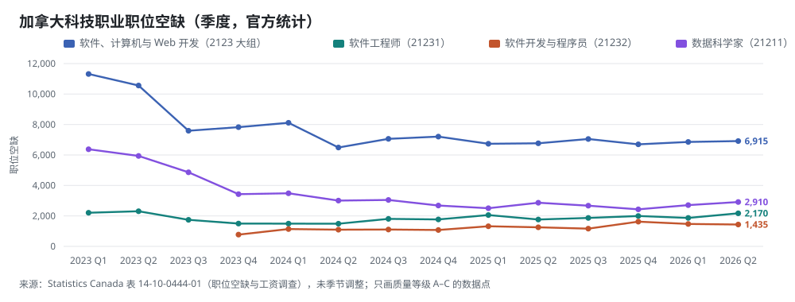
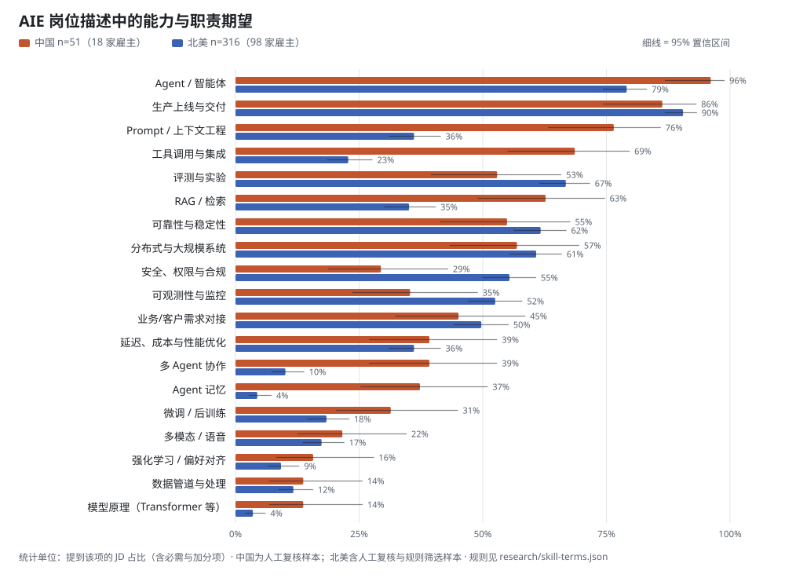

# AI Engineer 岗位总述：市场、能力与学习路线

这份路线面向应用与系统方向的 AI Engineer 岗位。这一页讲三件事：这个岗位做什么、招聘市场要什么能力、路线怎样对应这些要求。

AI Engineer 把模型、数据、工具和业务系统做成能用的产品：先理解需求、定下怎样算成功，再选方案、写代码、做评测、部署上线并持续改进。企业要的是业务结果，比如缩短处理时间、让员工更快找到准确的资料、减少重复操作，同时把错误率、延迟、成本和数据风险控制住。

## 1. 先看岗位，再看技术名词

招聘标题并不统一。AI Engineer、LLM 应用工程师、Agent 工程师、Applied AI Engineer，以及部分 Forward Deployed Engineer，都可能承担上述工作。判断一个岗位是不是这类工作，要看职责和交付物，标题只能参考。

| 工作方向 | 常见交付物 | 需要形成的主要能力 |
|---|---|---|
| AI 产品与应用 | 知识助手、文档处理、业务自动化、语音或多模态产品 | 后端与产品工程、模型集成、RAG/Agent、评测、用户反馈 |
| Agent 平台与工具 | 执行内核、工具平台、MCP 服务、评测与观测平台 | 状态与持久执行、协议、权限、沙箱、可靠性、开发者体验 |
| 客户场景交付 | 场景调研、企业系统接入、试点、上线与推广 | 需求发现、集成、领域理解、效果验证、跨团队协作 |
| 应用效果与性能优化 | 数据与模型实验、微调、小模型服务、成本优化 | 实验设计、训练数据、后训练、推理性能与容量测量 |

这个岗位从 SDE 继承软件工程，从 MLE 借来数据和实验方法，从 SRE 借来可靠性和运维。路线只取其中和 AI 产品交付直接相关的部分；大规模预训练、GPU 内核开发和研究型算法岗位不在范围内。

## 2. 招聘市场：哪些数据对 SDE / AIE 有参考价值？

数据更新于 2026-11-23。

### 北美软件开发岗位：回升，但集中在资深和 AI 相关岗位

<picture>
  <source media="(prefers-color-scheme: dark)" srcset="../../assets/research/market-software-postings-zh-dark.svg">
  
</picture>

Indeed 软件开发广告指数以 2020-02-01 为 100：美国从 2025Q1 的 64.9 升到 2026Q3 的 75.5，2026Q4（截至 11 月 13 日）为 80.1；加拿大从 2025Q4 的 81.7 回落到 2026Q4 的 76.2。[季度数据](../../research/market/indeed-quarterly.csv)、[Indeed 数据](https://github.com/hiring-lab/job_postings_tracker)

Hiring Lab 的分析显示，美国软件开发广告自 2025 年 2 月起回升约 15%，但仍比疫情前低约 27.5%；2025-05 至 2026-05 的增量中，71% 来自 senior 岗位，37% 来自标题含 AI 的岗位（两类有重叠）。作者称这些证据仍是初步的。[Hiring Lab，2026-07-08](https://hiringlab.indeed.com/2026/07/08/ai-and-job-postings-from-destruction-to-creation/)

对求职者来说，回升的主要是资深岗位和 AI 相关岗位；入门者要拿出作品，证明自己能独立交付 AI 系统。

### AI Engineer 专属信号

| 信号 | 最新数值 | 读法 |
|---|---|---|
| LinkedIn “AI Engineer” 职位招聘增速（美国） | 同比 +64%，入门级 +62%（2026 年 8 月版报告） | 新的标准化职位，基数小，也有人改用这个头衔；表示方向，不表示规模。[LinkedIn AI Labor Market Update](https://delivery-p143253-e1476319.adobeaemcloud.com/adobe/assets/urn:aaid:aem:ef153078-1061-4817-82e7-a1c027d7a7d7/original/as/AI-Labor-Market-Update-August-2026-v2.pdf) |
| CompTIA：要求 AI 技能的在招岗位（美国） | 366,322 个（2026 年 10 月，环比 +6.2%）；AI 专门职位环比 +9.8% | 基于 Lightcast 数据，可能修订；AI 专门职位更接近 AIE 需求。[CompTIA](https://www.comptia.org/en/about-us/news/press-releases/Tech-employment-gains-momentum-in-October-CompTIA-analysis-finds/) |
| 美国 IT 职位在招广告 | 625,633 个（2026 年 9 月，同比 +22.4%）；软件开发与工程师新发 47,598 个 | 基于 Lightcast 广告数据，可能回溯修订。[CompTIA，2026 年 9 月数据](https://www.comptia.org/en/about-us/news/press-releases/employer-demand-for-tech-talent-reaches-three-year-high-comptia-analysis-finds/) |
| 美国 AI/ML 职位标题组在招岗位 | 13,636 个（2026 年 9 月），约为 2024 年 5 月的 3 倍 | 目前最接近“AI 工程师 + ML 工程师”需求总量的公开数字。[CompTIA](https://www.comptia.org/en/about-us/news/press-releases/employer-demand-for-tech-talent-reaches-three-year-high-comptia-analysis-finds/) |
| 美国软件开发广告中提到 AI 的比例 | 20% 以上（2025 年 12 月） | 提到 AI 的广告未必要求 AI 工程能力，但说明 AI 正在成为 SDE 的常见要求。[Hiring Lab，2026-01-22](https://hiringlab.indeed.com/2026/01/22/january-labor-market-update-jobs-mentioning-ai-are-growing-amid-broader-hiring-weakness/) |

### 加拿大：官方季度职位空缺

加拿大统计局的职位空缺与工资调查（JVWS）按职业细类发布季度空缺数，这是三国中唯一按职业统计、能按季度追踪的官方全国数据。AIE 没有单独的职业代码，通常归入软件工程师（21231）、软件开发与程序员（21232）或数据科学家（21211）。

<picture>
  <source media="(prefers-color-scheme: dark)" srcset="../../assets/research/market-canada-vacancies-zh-dark.svg">
  
</picture>

<!-- CANADA-VACANCIES:START -->
| 职业（NOC 2021） | 2023Q1 | 2025Q1 | 2025Q2 | 2025Q3 | 2025Q4 | 2026Q1 | 2026Q2 |
|---|---:|---:|---:|---:|---:|---:|---:|
| 软件、计算机与 Web 开发（2123 大组） | 11,315 | 6,735 | 6,765 | 7,050 | 6,700 | 6,855 | 6,915 |
| 软件工程师（21231） | 2,205 | 2,055 | 1,765 | 1,870 | 1,995 | 1,870 | 2,170 |
| 软件开发与程序员（21232） | — | 1,320 | 1,250 | 1,165 | 1,620 | 1,470 | 1,435 |
| 数据科学家（21211） | 6,375 | 2,505 | 2,865 | 2,670 | 2,430 | 2,710 | 2,910 |
| 全部职业 | 781,250 | 490,170 | 545,910 | 514,465 | 469,840 | 473,035 | 548,400 |

“—”表示数据质量低于 C 级，未列出。
<!-- CANADA-VACANCIES:END -->

2023 年以来，软件与数据类空缺大幅回落：2123 大组从 11,315 降到 6,900 左右，数据科学家从 6,375 降到 2,900 左右；同期全部职业空缺也下降约三成。2025 年起这些职业基本持平、略有回升，2026Q2 软件工程师空缺 2,170，是 2023 年第三季度以来的最高值。空缺数是某个时点还在招的职位数，不是全年招聘人数。[数据与质量等级](../../research/market/statcan-tech-vacancies.csv)、[Statistics Canada 表 14-10-0444-01](https://www150.statcan.gc.ca/t1/tbl1/en/tv.action?pid=1410044401)

### 中国：平台数据给出增长信号，但没有技能比例

- 脉脉《Agent 重置职场》（2026 年 1—7 月）：新发 AI 岗位同比增长 789.47%；其中 AI 应用开发占 60.97%，Agent 开发工程师是需求最高的应用岗位；FDE / 现场部署工程师增长 1522.73%。[每日经济新闻](https://www.nbd.com.cn/articles/2026-09-16/4583369.html)
- 智联招聘 2026 年上半年：智能体相关技术人才需求同比增长 244%。[央视财经报道](https://finance.cctv.cn/2026/08/28/ARTIxnofbL409vkM6skY5WRh260828.shtml)
- 2026-09-09，人社部等部门在“生成式人工智能系统应用员”职业下新增“智能体开发员”工种。[新京报](https://m.bjnews.com.cn/detail/1788949841129475.html)

- 北京市人社局的季度供求分析（公共就业服务机构数据）：2025 年第三季度，计算机软件工程技术人员在“求职大于招聘”的职业中排第 4，求职人数比招聘岗位多 7,868 人；计算机软件测试员（多 2,111 人）和数据分析处理工程技术人员（多 1,000 人）也排在前列。这类数据来自公共就业服务平台，不含大型企业自有招聘渠道，但说明通用软件岗位在北京供给充足。[北京市人社局，2025 年第三季度](https://rsj.beijing.gov.cn/xxgk/sjfbsj/gqfx/202511/P020251103356760469762.pdf)

这些平台只发布增长率，不公开样本、方法和技能占比；中国也没有按职业统计的全国季度空缺数。中国岗位的技能要求看下一节的 JD 样本。

AIE 和 SRE 都没有官方职业代码，美国和中国也没有按职业统计的全国季度空缺数，所以 AIE 的总体规模目前只能用上面这些间接数据来估计。

## 3. 367 份 JD：企业反复要求什么？

### 样本

- **中国 51 份**：2026-11-18/19 收集，来自企业招聘接口、企业页面、高校承载的招聘原文和可追溯的转载，每份的职责与要求段落经人工复核。
- **北美 316 份**：其中 53 份同期人工复核；另 216 份于 2026-11-23 通过 Greenhouse、Ashby、Lever 公开文档化的职位接口采集，覆盖 67 家雇主（AI 原生公司、企业软件、金融科技、互联网、医疗科技等）。标题须含 AI、LLM、Agent、Applied AI 或 Forward Deployed 等工程职位特征，职责文本须多次提到 AI 应用相关术语；同一雇主相同职位只计一次，每家雇主最多 6 份。这 216 份按规则自动划定职责文本范围，未逐条人工复核。
- **加拿大扩充 47 份**：同日按同样规则补充，来自公开职位接口 38 份、雇主招聘页 7 份、招聘平台转载 2 份（其中 1 份采集时已关闭）；每家雇主在加拿大最多 6 份。
- 北美合计 98 家雇主，美国 236 份、加拿大 80 份（43 家雇主）。国内主要招聘网站没有公开的职位接口，所以中国样本还是 51 份。

统计单位是“描述中提到该项”，包括必需条件、备选技术、职责和加分项；每份描述每项计一次。术语按[更严格的规则](../../research/skill-terms.json)匹配，例如“cost”只在与推理、token、模型成本相关时计入。细线是 95% Wilson 置信区间；北美另给出雇主等权比例，避免一家雇主的多个岗位主导结果。[逐条来源](../../research/jds.json)、[完整统计](../../research/skill-distribution.csv)、[中国逐条分析](jd-china.md)、[北美逐条分析](jd-north-america.md)

<picture>
  <source media="(prefers-color-scheme: dark)" srcset="../../assets/research/jd-role-expectations-zh-dark.svg">
  
</picture>

<picture>
  <source media="(prefers-color-scheme: dark)" srcset="../../assets/research/jd-tech-stack-zh-dark.svg">
  
</picture>

<!-- SKILL-TABLE:START -->

展开全部数值与 95% 置信区间

| 类别 | 技能或期望 | 中国 n=51 | 北美 n=316 | 北美雇主等权 |
|---|---|---:|---:|---:|
| 技术栈 | Python | 82% [70–90] | 58% [52–63] | 58% |
| 技术栈 | Go | 49% [36–62] | 24% [19–29] | 22% |
| 技术栈 | Java / Spring | 47% [34–60] | 10% [7–14] | 11% |
| 技术栈 | MCP | 39% [27–53] | 16% [12–20] | 17% |
| 技术栈 | LangChain | 35% [24–49] | 12% [9–16] | 14% |
| 技术栈 | TypeScript / JavaScript | 22% [12–35] | 32% [27–38] | 30% |
| 技术栈 | AI 编程工具（Cursor/Claude Code 等） | 29% [19–43] | 26% [21–31] | 26% |
| 技术栈 | 公有云（AWS/Azure/GCP 等） | 6% [2–16] | 28% [24–34] | 32% |
| 技术栈 | React / 前端 | 24% [14–37] | 25% [21–30] | 24% |
| 技术栈 | Docker / Kubernetes | 18% [10–30] | 21% [17–26] | 21% |
| 技术栈 | 向量库 / 搜索引擎 | 18% [10–30] | 15% [11–19] | 16% |
| 技术栈 | 其他 Agent 框架 / SDK | 18% [10–30] | 6% [4–10] | 8% |
| 技术栈 | SQL / 关系数据库 | 12% [6–23] | 16% [13–21] | 18% |
| 技术栈 | LlamaIndex | 16% [8–28] | 4% [2–6] | 5% |
| 技术栈 | 推理框架（vLLM/SGLang 等） | 16% [8–28] | 4% [2–6] | 3% |
| 技术栈 | LangGraph | 14% [7–26] | 8% [5–11] | 9% |
| 技术栈 | PyTorch / 深度学习框架 | 14% [7–26] | 8% [5–11] | 10% |
| 技术栈 | Dify / Coze / FastGPT | 12% [6–23] | 0% [0–1] | 0% |
| 技术栈 | 观测/评测工具（Langfuse 等） | 2% [0–10] | 8% [5–11] | 8% |
| 技术栈 | Hugging Face | 2% [0–10] | 4% [2–6] | 3% |
| 岗位期望 | Agent / 智能体 | 96% [87–99] | 79% [74–83] | 82% |
| 岗位期望 | 生产上线与交付 | 86% [74–93] | 90% [87–93] | 92% |
| 岗位期望 | Prompt / 上下文工程 | 76% [63–86] | 36% [31–42] | 38% |
| 岗位期望 | 工具调用与集成 | 69% [55–80] | 23% [18–28] | 26% |
| 岗位期望 | 评测与实验 | 53% [40–66] | 67% [61–72] | 65% |
| 岗位期望 | RAG / 检索 | 63% [49–75] | 35% [30–40] | 40% |
| 岗位期望 | 可靠性与稳定性 | 55% [41–68] | 62% [56–67] | 60% |
| 岗位期望 | 分布式与大规模系统 | 57% [43–70] | 61% [55–66] | 59% |
| 岗位期望 | 安全、权限与合规 | 29% [19–43] | 55% [50–61] | 57% |
| 岗位期望 | 可观测性与监控 | 35% [24–49] | 52% [47–58] | 58% |
| 岗位期望 | 业务/客户需求对接 | 45% [32–59] | 50% [44–55] | 54% |
| 岗位期望 | 延迟、成本与性能优化 | 39% [27–53] | 36% [31–42] | 34% |
| 岗位期望 | 多 Agent 协作 | 39% [27–53] | 10% [7–14] | 10% |
| 岗位期望 | Agent 记忆 | 37% [25–51] | 4% [3–7] | 4% |
| 岗位期望 | 微调 / 后训练 | 31% [20–45] | 18% [14–23] | 18% |
| 岗位期望 | 多模态 / 语音 | 22% [12–35] | 17% [14–22] | 12% |
| 岗位期望 | 强化学习 / 偏好对齐 | 16% [8–28] | 9% [6–13] | 9% |
| 岗位期望 | 数据管道与处理 | 14% [7–26] | 12% [9–16] | 14% |
| 岗位期望 | 模型原理（Transformer 等） | 14% [7–26] | 4% [2–6] | 5% |

<!-- SKILL-TABLE:END -->

### 两地共同：把模型能力做成能上线、能评测、能运行的系统

- **生产交付**几乎是所有岗位的要求（中国 86%，北美 90%）。
- **评测与实验**（53% / 67%）、**可靠性**（55% / 62%）、**分布式与大规模系统**（57% / 61%）在两地都过半。
- **Agent** 提及率最高（96% / 79%）；样本本来就是按 Agent 和 AI 应用职位筛选的，所以这个比例偏高。
- **微调 / 后训练**（31% / 18%）和**强化学习**（16% / 9%）只在少数岗位出现；**AI 编程工具**（Cursor、Claude Code 等）在约四分之一的岗位中被提到（29% / 26%）。

### 两地差异：写法不同，侧重也不同

- **中国 JD 更常列出具体技术组件**：Prompt / 上下文工程（76% / 36%）、工具调用（69% / 23%）、RAG（63% / 35%）、Agent 记忆（37% / 4%）、多 Agent（39% / 10%）、LangChain（35% / 12%）、MCP（39% / 16%）。
- **北美 JD 更常写职责和约束**：安全、权限与合规（29% / 55%）、可观测性（35% / 52%）、公有云（6% / 28%）、TypeScript（22% / 32%）。
- **语言**：中国常写“Python、Go、Java 至少一种”，因此 Go（49%）和 Java/Spring（47%）都很高；北美以 Python（58%）为主，TypeScript 其次。不少北美 JD 不写语言；在写明语言的 220 份中，83% 提到 Python（中国 45 份中为 93%）。
- 北美 JD 较少点名 RAG 和工具调用，多半是因为它们习惯写职责和结果。面试里这些仍是常考题。

两个北美子样本也不同：人工复核的 53 份偏 Agent 平台与 AI 原生公司，RAG（45% / 28%）、MCP（34% / 12%）、多 Agent（23% / 6%）明显高于规则筛选的 216 份。范围更广的样本更接近一般 AIE 岗位。

### 与外部数据交叉核对

| 来源 | 样本 | 主要结果 | 与本样本对照 |
|---|---|---|---|
| InterviewStack 职位板，2026-11 | 全球 3,835 份 AI Engineer 广告（美国约 35%） | Python 75%、Agent ≥61%、RAG 50%、评测 ≥41%、LangChain 23%、MCP 21%、LangGraph 19%、TypeScript 17%、微调 17% | 方向一致：Python 占多数，Agent 与评测高，微调低于 20%，具体框架只占少数。[来源](https://interviewstack.io/blog/how-ai-is-changing-ai-engineer-2026) |
| 掘金，2026-05 | 应用开发 JD，文中列出 23 份 | Python ~100%、LangChain ~80%、RAG ~60%、Dify ~35%、微调 ~35%、LangGraph ~25%、MCP ~10% | 中小企业应用岗位更常点名 LangChain 和 Dify；本样本以大厂为主，Dify/Coze 为 12%。[来源](https://juejin.cn/post/7644822313692692518) |
| CSDN，2026-03 | 200 份月薪 3 万以上的“大模型”岗位 | C++ 61.5%、RAG 37%、多模态 33.5%、Python 33%、Agent 31.5% | 该样本包含算法与推理优化岗，因此 C++ 高、Python 低。[来源](https://gitcode.csdn.net/69b3835a54b52172bc60e19d.html) |
| LangChain 从业者调查，2025-11/12 | 1,340 位受访者 | 57% 已有 Agent 在生产环境；52% 做离线评测，30% 不做评测；57% 不做微调 | 印证“先评测、少微调”的优先级。[来源](https://langchain.com/state-of-agent-engineering) |

这些外部统计大多来自职位板或博客，方法公开得不多，这里只用来核对方向，没有和本样本合并计算。

### 加拿大专项：80 份 JD

加拿大 80 份来自 43 家雇主，其中企业软件和 AI 原生公司各 27 份，其余是金融科技、互联网、银行与资管、电信等。和美国 236 份相比，差异最大的几项如下，最后三项两地接近：

<!-- CANADA-SPLIT:START -->
| 技能或期望 | 加拿大 n=80（43 家雇主） | 美国 n=236 |
|---|---:|---:|
| 延迟、成本与性能优化 | 49% [38–60] | 32% [26–38] |
| PyTorch / 深度学习框架 | 18% [11–27] | 4% [2–8] |
| 可观测性与监控 | 62% [52–72] | 49% [43–56] |
| RAG / 检索 | 45% [35–56] | 32% [26–38] |
| 分布式与大规模系统 | 70% [59–79] | 58% [51–64] |
| 安全、权限与合规 | 64% [53–73] | 52% [46–59] |
| Docker / Kubernetes | 29% [20–40] | 18% [14–24] |
| 公有云（AWS/Azure/GCP 等） | 36% [27–47] | 26% [21–32] |
| LlamaIndex | 10% [5–18] | 1% [0–4] |
| 评测与实验 | 64% [53–73] | 68% [62–73] |
| 生产上线与交付 | 89% [80–94] | 91% [87–94] |
| 微调 / 后训练 | 18% [11–27] | 19% [14–24] |
<!-- CANADA-SPLIT:END -->

加拿大 JD 更常要求延迟与成本优化、可观测性、RAG、分布式与大规模系统、安全与合规，也更常写到 PyTorch、LangChain 和公有云；评测、生产交付和微调与美国接近。原因之一是加拿大样本里企业软件、银行和保险等雇主占比较高，这些雇主更强调稳定运行与治理。银行等大型雇主多使用自有招聘系统，公开接口覆盖有限，投递时仍应逐条阅读目标 JD。

### 求职策略

- **中国方向**：Python + 一门后端语言（Go 或 Java），熟练掌握 RAG、工具调用、上下文与记忆、多 Agent 的实现细节，至少熟悉一个主流框架（LangChain/LangGraph），了解 MCP；中小企业和传统行业岗位还应会用 Dify 等平台快速搭原型。
- **北美方向**：Python + TypeScript，突出评测、可观测性、安全与权限、云上部署，以及与客户和业务方沟通的经验；FDE / Applied AI 岗位尤其看重后者。
- **两地都要**：一个有评测数据、上线记录和故障复盘的完整项目。微调、强化学习和推理优化按目标岗位深入。加拿大方向在此基础上突出 RAG、可观测性、成本与延迟优化和安全合规，云平台以 Azure 或 AWS 为主。

## 4. 从岗位要求到知识体系：比重与能力优先级

### 九份大中型企业 JD 看重什么

很多大企业的职位不在公开接口里，所以这里单独拆解 9 份北美大中型雇主的 AI 工程类职位（2026-11）：Microsoft、Workday、RBC、BMO、Vanguard、Canada Life、Stripe、Databricks 和 American Express，其中 BMO 和 Canada Life 由读者提供原文。这些是定性案例，不计入上面的统计。

<!-- ENTERPRISE-MATRIX:START -->
| 能力 | Microsoft | Workday | RBC | BMO | Vanguard | Canada Life | Stripe | Databricks | AmEx | 必需 / 提及 |
|---|---|---|---|---|---|---|---|---|---|---:|
| 生产软件经验要求 | 2+ 年 | 5+ 年 | 2+ 年 | 6 年 | 6+ 年 | 3+ 年 | 4+ 年 | 2–8 年 | 2027 届硕士 | — |
| 后端、API 与系统设计 | ✓ | ✓ | ✓ | ✓ | ✓ | ✓ | ✓ | ✓ | ✓ | 9 / 9 |
| 测试、CI/CD、容器与云部署 | ✓ | ✓ | ✓ | ✓ | ✓ | ✓ | ✓ | ✓ | ✓ | 9 / 9 |
| 业务协作与产品思维 | ✓ | ✓ | ✓ | ✓ | ✓ | ✓ | ✓ | ○ | ✓ | 8 / 9 |
| LLM 应用与 Agent | ✓ | ✓ |  | ✓ | ✓ | ✓ | ✓ | ✓ | ○ | 7 / 8 |
| 线上监控与可观测性 | ✓ | ✓ | ✓ | ✓ | ✓ | ✓ | ✓ | ○ |  | 7 / 8 |
| 安全、Responsible AI 与模型风险 | ✓ | ✓ | ✓ | ✓ | ✓ | ✓ |  |  | ✓ | 7 / 7 |
| RAG、检索与文档处理 | ✓ | ○ |  | ✓ | ✓ | ✓ |  |  | ○ | 4 / 6 |
| 评测与实验 | ○ | ✓ |  | ✓ |  | ✓ | ○ |  | ✓ | 4 / 6 |
| 技术领导与带人 |  | ✓ | ✓ | ✓ | ✓ | ✓ |  |  |  | 5 / 5 |
| 全栈 / 前端 | ○ | ○ | ✓ |  |  | ✓ | ✓ |  |  | 3 / 5 |
| 传统 ML、训练与 MLOps | ○ |  |  | ○ | ✓ |  |  | ○ | ○ | 1 / 5 |
| AI 辅助开发 | ✓ |  | ○ |  |  |  | ✓ |  |  | 2 / 3 |
| 微调 |  |  |  |  | ○ |  |  |  |  | 0 / 1 |

✓ = 必需条件或核心职责；○ = 加分项或备选；空白 = 未提及。编码与链接见 [enterprise-cases.json](../../research/enterprise-cases.json)。
<!-- ENTERPRISE-MATRIX:END -->

从这 9 份 JD 可以读出五点：

1. **软件工程是第一道门槛，9 份全部要求。** Workday 直说这“首先是一个软件工程岗位”，系统设计、可扩展性和性能“不可妥协”。Databricks 明确欢迎没有 ML 背景的基础设施和系统工程师。RBC 的“Senior AI Engineer”实际是 Vue/Nuxt + Node.js + SQL 的全栈岗位，AI 只出现在“用过 AI 编程助手”的加分项里，所以要读职责，不要只看标题。
2. **生产交付和业务协作也是全员要求。** 测试、CI/CD、容器与云部署 9/9；与业务方一起定义问题、对上线结果负责在 9 份中都有提到（8 份列为必需）；线上监控与可观测性 8/9。
3. **LLM 与 Agent 是核心，但不是全部。** 8/9 涉及 LLM 应用或 Agent，RAG 与文档处理 6/9，评测 6/9。金融和保险雇主尤其看重文档处理（理赔、合同、审计）以及评测与护栏。
4. **安全、Responsible AI 与模型风险是大企业的分水岭。** 7/9 要求，银行、保险和资管公司（RBC、BMO、Vanguard、Canada Life、American Express）全部涉及。
5. **微调和训练很少是硬要求。** 微调只在 Vanguard 作为加分项出现；传统 ML 与 MLOps 只有 Vanguard 列为必需。经验门槛从应届硕士（American Express，要求数据结构与算法、项目、黑客松或开源经历）到 6 年以上不等，资深岗位普遍要求技术领导和带人。

### 成熟企业与 AI 原生公司的差异

把北美 316 份 JD 按雇主类型拆开：成熟企业包括企业软件、金融科技、互联网、医疗与工业，AI 原生公司包括模型公司、AI 应用公司和开发者工具公司。下表列出差异最大的几项，以及两类雇主几乎相同的三项。

<!-- EMPLOYER-SPLIT:START -->
| 技能或期望 | 成熟企业 n=168（69 家） | AI 原生公司 n=148（29 家） |
|---|---:|---:|
| 安全、权限与合规 | 67% [59–73] | 43% [35–51] |
| 可观测性与监控 | 63% [56–70] | 41% [33–49] |
| 公有云（AWS/Azure/GCP 等） | 37% [30–44] | 19% [13–26] |
| RAG / 检索 | 42% [34–49] | 28% [21–35] |
| Java / Spring | 16% [11–22] | 3% [1–8] |
| LangChain | 17% [12–23] | 6% [3–11] |
| SQL / 关系数据库 | 21% [15–28] | 11% [7–18] |
| 评测与实验 | 67% [60–74] | 66% [58–73] |
| Agent / 智能体 | 80% [73–85] | 78% [71–84] |
| 生产上线与交付 | 89% [84–93] | 92% [86–95] |
| 多模态 / 语音 | 10% [6–16] | 26% [19–33] |
| TypeScript / JavaScript | 27% [21–34] | 39% [31–47] |
| 强化学习 / 偏好对齐 | 5% [2–9] | 14% [9–21] |
<!-- EMPLOYER-SPLIT:END -->

成熟企业更常要求安全与合规、可观测性、可靠性、公有云和 Java，也更常点名 LangChain/LangGraph；AI 原生公司更常出现 TypeScript、多模态与语音、强化学习和客户对接。评测、Agent 和生产交付在两类雇主中一样高。投大中型企业时，简历和作品里先放安全、监控和稳定运行的证据，再讲模型效果。

### AIE 与 SDE：哪些能力共同，哪些是差异

**共同底座。** 编程与数据结构算法、系统设计、API 与数据库、测试与调试、CI/CD 与云部署、监控与故障处理、安全与权限、代码评审与协作，这些是 SDE 的核心能力，AIE 同样要求。上面 9 份企业 JD 全部要求后端与系统设计、测试与部署；Workday 直说 AI 岗位“首先是软件工程岗位”。

**差异化部分。** AIE 在同一底座上，多处理“模型输出不确定”带来的工程问题：

| 维度 | SDE | AIE 额外要求 |
|---|---|---|
| 怎样判断正确 | 确定性逻辑，测试通过即正确 | 输出不确定，需要评测集、指标、人工或模型评审和统计比较 |
| 系统构件 | 服务、数据库、缓存、队列 | 再加上模型 API、上下文与检索、工具调用、Agent 循环与记忆 |
| 数据 | 业务数据的存取与一致性 | 文档解析、切块、索引、标注与评测数据，数据质量直接决定输出质量 |
| 成本与性能 | CPU、内存、延迟 | 再加上 token 成本、推理延迟、缓存与模型路由 |
| 安全 | 认证授权、输入校验、依赖安全 | 再加上提示注入、Agent 越权、内容安全、模型风险与 Responsible AI |
| 上线与运维 | 版本发布与回滚 | 再加上模型、Prompt 和索引的版本，质量漂移监控，人工审核与反馈闭环 |
| 面试 | 算法题、系统设计、行为面试 | 同样要考，再加上 LLM 原理、RAG/Agent 设计和评测方法 |

数据也印证这一点：同一职位板 2026 年 5 月的 45,318 份 SWE 广告中，提到 Agent 的只有 9.7%、RAG 3.5%、AI 编程工具 4.4%；AI Engineer 广告中 RAG 为 39%（[SWE](https://interviewstack.io/blog/how-ai-is-changing-software-engineering-2026)、[AI Engineer](https://interviewstack.io/blog/ai-engineer-vs-machine-learning-engineer-2026)）。本研究北美样本中，评测出现在 67% 的 AIE JD 里。

对求职者的含义：有 SDE 经验的人转 AIE，已经具备大半底座，主要补评测、检索与上下文、Agent 与工具安全、成本与模型选型；只会调用模型 API、缺少软件工程底座的候选人，很难通过大中型企业的筛选。

### 筛选时先看哪些能力

结合 367 份 JD 统计和上述企业案例，应用/系统 AIE 的筛选大致按以下顺序看：

| 优先级 | 能力 | 证据（中国 / 北美提及率） | 对应模块 | 目标深度 |
|---|---|---|---|---|
| 1 | 软件工程与生产交付：后端服务、API、数据库、测试、容器、CI/CD、云部署、排障 | 生产交付 86% / 90%；分布式与大规模系统 57% / 61%；可靠性 55% / 62%；企业 JD 要求 2–4 年以上生产经验 | 01、02、14 | 独立实现并排障 |
| 2 | LLM 应用与 Agent：结构化输出、工具调用、上下文、RAG、Agent 循环、人工审批 | Agent 96% / 79%；Prompt/上下文 76% / 36%；工具调用 69% / 23%；RAG 63% / 35% | 05–10 | 先不用框架实现一遍，再掌握一个主流框架 |
| 3 | 评测、测试与可观测性 | 评测 53% / 67%；可观测性 35% / 52% | 11 | 能设计评测集、做回归和失败归因 |
| 4 | 安全、权限与治理 | 安全/权限/合规 29% / 55% | 10、14 | 能把权限、审计和护栏放进设计 |
| 5 | 业务理解与沟通 | 业务/客户对接 45% / 50% | 00、14、15 | 能把模糊需求拆成可验收的交付 |
| 6 | 模型原理与数学 | JD 提及 14% / 4%，但原理问答和手写实现是常见面试环节，中国尤其常见 | 03、04、15.5 | 能讲清并手写核心模块 |
| 7 | 专项：微调与强化学习、推理优化、多模态 | 微调 31% / 18%；强化学习 16% / 9%；推理框架 16% / 4% | 12、13、05.6–05.7 | 按目标岗位选择 |

### 各部分的比重

评测的时间比重高于它的单元占比：Chip Huyen《AI Engineering》约 20% 篇幅讲评测，CS329Z 评测与数据约占三分之一课次。“建议时间”针对应用 AIE 主线，已掌握的部分可通过[入门诊断](entry-diagnostic.md)跳过。单元数反映的是知识面，和学习时间不成正比：Agent 部分包含较多进阶单元，后端部分单元少但练习量大。

| 知识层 | 建议时间占比 | 单元数（占全部） | 核心单元占比 |
|---|---:|---:|---:|
| 00–02 岗位、Python 与后端 | 20% | 17（13%） | 18% |
| 03–04 数学、ML 与 Transformer | 8% | 13（10%） | 12% |
| 05 模型应用与上下文 | 10% | 10（8%） | 10% |
| 06 数据与 RAG | 10% | 9（7%） | 7% |
| 07–09 Agent、编排与多 Agent | 15% | 22（17%） | 12% |
| 10 工具、MCP 与安全执行 | 8% | 7（6%） | 6% |
| 11 评测与观测 | 15% | 12（9%） | 13% |
| 14 产品交付 | 8% | 9（7%） | 8% |
| 15 作品与求职 | 6% | 7（6%） | 8% |
| 12–13 后训练与推理优化 | 专项：另加 20–30% | 17（13%） | 6% |
| 16 世界模型与具身智能 | 选修 | 4（3%） | 0% |

### 与 CS329Z、CS336 和高流量路线对照

| 参照 | 结构与侧重 | 本路线的取舍 |
|---|---|---|
| [CS329Z Engineering AI Agents](https://cs329z.stanford.edu/)（2026 秋） | 从 LLM 流水线到复合 AI 系统再到自主 Agent。HW1 不用框架实现 harness：BM25 与多跳 RAG、工具调用协议、Agent 循环、沙箱终端、上下文压缩、记忆、审批、护栏与注入、模拟用户评测；HW2 编写带 verifier 和 oracle 的 Harbor 评测任务。评测约占 21% 课次，评测与数据合计约 32%；项目占成绩 40% | 07.3、07.5–07.6、10.4–10.7、11.1、11.8 按这两份作业设计实践。CS329Z 没有单独讲 RL 和推理时计算，本路线放在 05.8 与 12.6–12.7 |
| [CS336 Language Modeling from Scratch](https://cs336.stanford.edu/) | 从零实现 tokenizer 与 Transformer，GPU 与并行，scaling laws，推理，评测，数据，SFT/RLHF/RLVR；5 个作业，2026 版禁止用 Coding Agent 完成实现 | 应用 AIE 重点学 tokenizer、资源核算、推理（KV cache、量化、投机解码、连续批处理）、评测有效性、数据去重与过滤、SFT/DPO/GRPO（04.1、13.2–13.7、11.9、12.10、12.5–12.6）。Triton 内核、FSDP/张量并行实现和拟合 scaling law 只需了解 |
| Chip Huyen《AI Engineering》（O'Reilly，2025） | 按页数，评测约 20%（两章，放在提示工程之前），微调与数据工程约 20%，模型原理 13%，RAG/Agent/记忆 11%，推理 9% | 同样把评测前置；微调与数据工程中的训练部分作为专项 |
| [roadmap.sh AI Engineer](https://roadmap.sh/ai-engineer) | 193 个主题中 RAG/向量库约 20%、模型 API 约 16%、提示与上下文约 15%、Agent 约 10%、评测约 10%、MCP 约 7%，微调约 1 个主题 | 应用层覆盖相近；本路线补上它较少涉及的软件工程、生产交付、权限与沙箱 |
| [mlabonne/llm-course](https://github.com/mlabonne/llm-course) | 基础 19%（可选），训练/科学家方向 46%，工程师方向 36% | 训练内容放在 12–13 专项 |
| Datawhale [hello-agents](https://github.com/datawhalechina/hello-agents)、[happy-llm](https://github.com/datawhalechina/happy-llm)、[self-llm](https://github.com/datawhalechina/self-llm) | 中文 Agent 实战（含扣子、Dify、n8n）、从零理解大模型、国产模型部署与微调 | 作为中文补充资源进入相关单元 |

多数路线都覆盖提示、RAG、工具与 Agent，并在 2025–2026 年加入 MCP、上下文工程、记忆和 harness。它们较少覆盖的是：后端与软件工程基础、生产交付、沙箱与权限、求职面试（只有中文仓库常见）。而这些恰好是企业筛选时最看重的，所以本路线把它们单独列成模块。

### 技术栈：先学什么

**第一层：两地共同的必备栈**

- 语言：Python 为主，再加一门：中国方向选 Go 或 Java，北美方向选 TypeScript。
- 服务与数据：FastAPI、PostgreSQL（含 pgvector）、Redis、Docker、GitHub Actions，以及一个云平台。
- 模型接入：一个商业 API 加一个开源或国产模型；结构化输出、工具调用、流式输出、重试与预算控制。
- RAG：解析、切块、混合检索、重排、引用，带权限过滤。
- Agent：先不用框架实现 Agent 循环和人工审批，再用 LangGraph 实现持久化与恢复；写一个 MCP 服务。
- 评测与观测：pytest 加 promptfoo 或 Ragas 做回归；用人工标注校准 LLM judge；用 Langfuse 或 OpenTelemetry 记录 trace、质量、延迟和成本。
- 安全：权限、密钥管理、注入防御、审计日志。

**第二层：按目标市场加强**

- 中国：深入 LangChain/LangGraph；会用 Dify 搭原型、写插件、私有化部署，并能判断何时迁到代码；Agent 记忆与多 Agent；接入 Qwen、DeepSeek 等国产模型并用 vLLM 本地部署；Java 方向补 Spring AI 或 Spring AI Alibaba。
- 北美：React/Next.js 全栈；Azure AI Foundry、Azure OpenAI、AI Search 或 AWS Bedrock 之一；微软生态岗位常要求 Copilot Studio 与 Power Automate；FDE 岗位重视客户沟通、演示和快速原型。

**第三层：按岗位深入**：微调（LoRA/QLoRA、SFT、DPO）、推理优化（vLLM、量化、KV cache）、多模态与语音、Agentic RL。

### 用哪些作品去投

| 作品 | 对应的 JD 场景 | 必须展示的证据 |
|---|---|---|
| [P1 企业知识服务](capstones.md#p1-企业知识服务) | Canada Life 的文档接入、检索与引用；中国企业知识库与智能客服 | 解析质量对比、检索指标、引用正确率、权限测试、trace 与单次成功成本 |
| [P2 带业务操作的流程 Agent](capstones.md#p2-带业务操作的流程-agent) | Microsoft 的工具调用、多 Agent 路由、交接与重试、人工升级；Stripe 的内部工具与流程自动化 | 工具契约、审批与幂等、故障恢复演练、轨迹评测、上线与使用记录 |
| [P3 文档处理与人工复核](capstones.md#p3-文档处理与人工复核) | 保险理赔、金融审单、合同审查等智能文档处理 | 字段抽取准确率、不确定性提示与人工确认、回归测试 |
| [P4 小模型服务与行为优化](capstones.md#p4-小模型服务与行为优化) | 推理优化与后训练岗位 | 显存与吞吐基准、量化前后质量对比、微调前后评测 |

建议把 P1 或 P2 做成主作品，另一个做精简版；中国方向可再用 Dify 搭同一场景的原型，并写明为什么以及如何迁移到代码。简历条目按“问题—方法—可测量结果”写，并对齐目标 JD 的关键词。[完整项目要求](capstones.md)、[简历与面试](modules/15.md)

## 5. 课程与开源项目怎样进入路线？

[Stanford CS329Z](https://cs329z.stanford.edu/) 承担 Agent 系统主线，[CS336](https://cs336.stanford.edu/) 补模型原理、推理与后训练；Python、后端、部署由官方文档和开放课程补齐。

开源项目按“必须会用并读源码、会部署运维、了解即可”三档进入路线（GitHub 数据截至 2026-11-23）：

| 档位 | 项目 | 学什么 | 2025–2026 动态 |
|---|---|---|---|
| 会用并读源码 | [Dify](https://github.com/langgenius/dify)（约 16.2 万星） | 搭建工作流与知识库应用、写插件和工具、私有化部署；读工作流引擎与插件守护进程 | v1.6 起支持双向 MCP，v1.20 加入 OpenTelemetry 导出和人工审批表单；阿里云、华为云、腾讯云提供一键部署。许可证为修改版 Apache 2.0：运营多租户服务或去掉前端 Logo 需要商业授权。有实测显示单机 4 核 8G 约 10 QPS 即饱和，复杂流程常迁到代码 |
| 会用并读源码 | [LangChain](https://github.com/langchain-ai/langchain) + [LangGraph](https://github.com/langchain-ai/langgraph) | 状态图、checkpointer、人工中断与恢复；1.0 的 `create_agent` 与中间件 | 2025-10 发布 1.0，`create_react_agent` 已弃用 |
| 会用并读源码 | [vLLM](https://github.com/vllm-project/vllm)、[SGLang](https://github.com/sgl-project/sglang) | 连续批处理、KV cache、前缀缓存、投机解码 | 推理岗位的主流服务框架 |
| 会用并读源码 | [RAGFlow](https://github.com/infiniflow/ragflow) 或 LightRAG | 文档解析、检索流水线、引用 | RAGFlow 1.0（2026-11）用 Go 重写 |
| 会部署运维 | 扣子开源版 [Coze Studio](https://github.com/coze-dev/coze-studio) / Coze Loop、FastGPT、MaxKB、n8n、Open WebUI、Ollama | 平台部署、模型接入、权限与数据边界 | Coze Studio 自 2026-07 起无新提交，Coze Loop 仍活跃；FastGPT 许可证条款与 Dify 相近 |
| 会部署运维 | [Langfuse](https://github.com/langfuse/langfuse)、[promptfoo](https://github.com/promptfoo/promptfoo)、Ragas | trace、数据集评测、回归与红队测试 | Langfuse 2026-01 被 ClickHouse 收购；OpenAI 2026-03 宣布收购 Promptfoo；两者开源版本继续维护 |
| 选一个框架深入 | OpenAI Agents SDK、Google ADK、PydanticAI、AgentScope（阿里）、Spring AI Alibaba（Java）、Microsoft Agent Framework | 对比状态、工具、部署和评测方式 | AutoGen 已归档，由 Microsoft Agent Framework 接替；AgentScope 2.0 为不兼容重构 |
| 不再推荐投入 | Flowise、Langchain-Chatchat、MetaGPT、Qwen-Agent | — | Flowise 2026-08 归档并停止维护；其余近 90 天无提交 |

LangGraph 在中国样本中出现 14%、北美 8%，选择它作为主要教学框架，是因为它适合学习状态、持久化与恢复；Dify 出现在中国样本 12% 的 JD 中，中小企业应用岗位中更常见。具体仓库、快照与选型依据见[开源项目研究](open-source.md)和[技术选择](stack-decisions.md)。

### Dify 与 LangGraph：联系和区别

两者都用“图”（节点、边、共享状态）组织 LLM 工作流，都支持工具调用、RAG、人工审批和 MCP，但定位不同：

| | Dify | LangGraph |
|---|---|---|
| 是什么 | 开箱即用的 LLM 应用平台：可视化工作流、知识库、模型接入、插件市场、应用发布与日志 | Python/JavaScript 代码库：底层编排运行时（StateGraph、checkpointer、interrupt、持久执行） |
| 谁来用 | 业务人员和工程师在界面上一起搭建 | 工程师在自己的服务代码里编写 |
| 状态与恢复 | 由平台管理，能力边界取决于平台 | 显式定义状态，checkpointer 存到 Postgres 等，可断点恢复和回放 |
| 测试与版本 | DSL 导出和应用包版本；回归测试通常要接外部工具 | 和普通代码一样做单元测试、CI 和代码评审，用 Git 管理版本 |
| 部署 | 自托管（Docker/Kubernetes）或云服务；注意许可证对多租户和 Logo 的限制 | 打包进自己的服务（容器或 Serverless），也可用 LangGraph Platform 部署 |
| 适合 | 快速原型、业务方可维护的流程、内部工具 | 复杂控制流、长任务、严格测试与审计、需要嵌入现有系统 |

二者可以配合：先用 Dify 验证场景，把复杂或高风险的部分用 LangGraph 写成服务，再通过 HTTP 或 MCP 接回 Dify；Dify 应用也可以发布为 MCP 服务，供 LangGraph Agent 调用。

在 AWS 上用 LangGraph 时，常见组合是：通过 Amazon Bedrock 调用模型（`langchain-aws`），把状态存到 Postgres（RDS/Aurora）或 DynamoDB 上的 checkpointer，服务部署在 ECS/EKS 或 Lambda，trace 接入 LangSmith、Langfuse 或基于 OpenTelemetry 的 CloudWatch。AWS 的 Bedrock AgentCore 也提供托管的 Agent 运行环境，可以运行 LangGraph 编写的 Agent。银行等受监管环境更常选 LangGraph 这类代码方案，因为测试、版本和审计都能放进现有工程流程。

## 6. 用什么证明你能做这份工作

拿去求职的作品应该包括：业务任务和验收标准、能运行的系统和部署说明、带版本的数据和评测集、优化前后的对比、质量/延迟/成本的实测结果、权限和故障恢复演练，以及别人能照着复现的设计说明。作品分级和面试常问的问题见[综合项目](capstones.md)，评审标准见[能力评审](assessment.md)。
