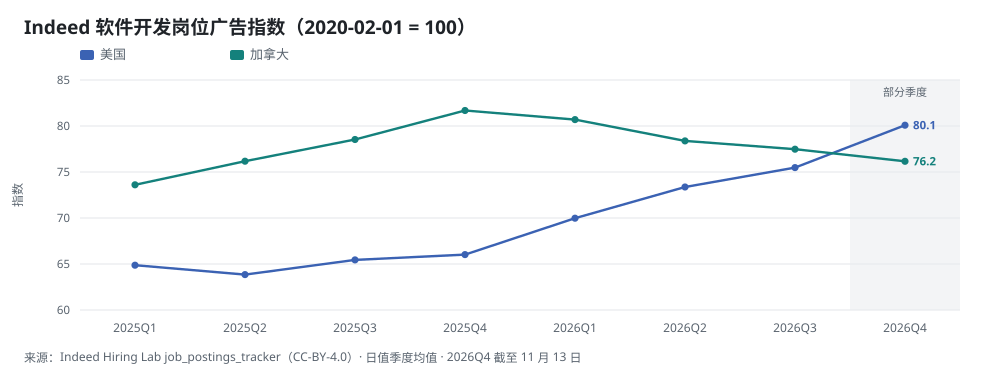
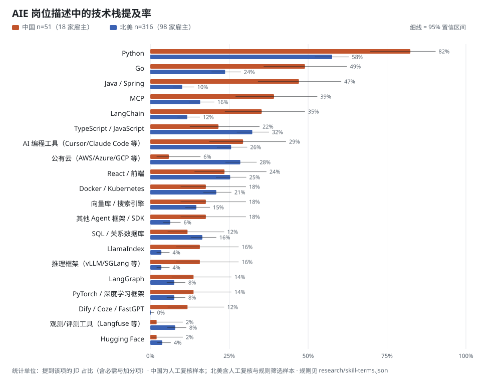

# AI Engineer 岗位总述：市场、能力与学习路线

本路线面向希望进入 **应用与系统 AI Engineering** 岗位的学习者。目标是逐步建立企业需要的知识、技术与项目经验，能用作品说明能力、应对技术面试，并在入职后承担端到端 AI 产品交付。

这里的 AI Engineer 把模型、数据、工具和业务系统组织成可用的产品：从理解需求、定义成功标准开始，完成方案选择、软件实现、质量评测、部署上线和持续改进。企业购买的是业务结果，例如缩短处理时间、提高知识查找准确率、减少重复操作，同时控制错误、延迟、成本和数据风险。

## 1. 先看岗位，再看技术名词

招聘标题并不统一。AI Engineer、LLM 应用工程师、Agent 工程师、Applied AI Engineer，以及部分 Forward Deployed Engineer，都可能承担上述工作。判断岗位时，应读职责和交付物。

| 工作方向 | 常见交付物 | 需要形成的主要能力 |
|---|---|---|
| AI 产品与应用 | 知识助手、文档处理、业务自动化、语音或多模态产品 | 后端与产品工程、模型集成、RAG/Agent、评测、用户反馈 |
| Agent 平台与工具 | 执行内核、工具平台、MCP 服务、评测与观测平台 | 状态与持久执行、协议、权限、沙箱、可靠性、开发者体验 |
| 客户场景交付 | 场景调研、企业系统接入、试点、上线与推广 | 需求发现、集成、领域理解、效果验证、跨团队协作 |
| 应用效果与性能优化 | 数据与模型实验、微调、小模型服务、成本优化 | 实验设计、训练数据、后训练、推理性能与容量测量 |

SDE 的软件工程是共同底座；MLE 提供数据与模型实验方法；SRE 提供可靠性和运行方法。本路线选择其中与 AI 产品交付直接相关的内容。大规模预训练、GPU 内核研发和研究型算法岗位需要额外的专业训练。

## 2. 招聘市场：哪些数据对 SDE / AIE 有参考价值？

研究更新于 **2026-11-23**。本节只保留按**职业或职位**定义的指标。覆盖所有职业的笼统指标容易被误读，已从图表中移除，原因见本节末尾。

### 北美软件开发岗位：回升，但集中在资深和 AI 相关岗位

<picture>
  <source media="(prefers-color-scheme: dark)" srcset="../../assets/research/market-software-postings-zh-dark.svg">
  
</picture>

Indeed 软件开发广告指数以 2020-02-01 为 100：美国从 2025Q1 的 64.9 升到 2026Q3 的 75.5，2026Q4（截至 11 月 13 日）为 80.1；加拿大从 2025Q4 的 81.7 回落到 2026Q4 的 76.2。[季度数据](../../research/market/indeed-quarterly.csv)、[Indeed 数据](https://github.com/hiring-lab/job_postings_tracker)

Hiring Lab 的分析显示，美国软件开发广告自 2025 年 2 月起回升约 15%，但仍比疫情前低约 27.5%；2025-05 至 2026-05 的增量中，71% 来自 senior 岗位，37% 来自标题含 AI 的岗位（两类有重叠）。作者称这些证据仍是初步的。[Hiring Lab，2026-07-08](https://hiringlab.indeed.com/2026/07/08/ai-and-job-postings-from-destruction-to-creation/)

对学习者的含义：回升的岗位更要求独立交付和 AI 系统能力，入门者需要用可验证的作品证明这两点。

### AI Engineer 专属信号

| 信号 | 最新数值 | 读法 |
|---|---|---|
| LinkedIn “AI Engineer” 职位招聘增速（美国） | 同比 +64%，入门级 +62%（2026 年 8 月版报告） | 新的标准化职位，基数小，也有人改用这个头衔；表示方向，不表示规模。[LinkedIn AI Labor Market Update](https://delivery-p143253-e1476319.adobeaemcloud.com/adobe/assets/urn:aaid:aem:ef153078-1061-4817-82e7-a1c027d7a7d7/original/as/AI-Labor-Market-Update-August-2026-v2.pdf) |
| CompTIA：要求 AI 技能的在招岗位（美国） | 366,322 个（2026 年 10 月，环比 +6.2%）；AI 专门职位环比 +9.8% | 基于 Lightcast 数据，可能修订；AI 专门职位更接近 AIE 需求。[CompTIA](https://www.comptia.org/en/about-us/news/press-releases/Tech-employment-gains-momentum-in-October-CompTIA-analysis-finds/) |
| 美国软件开发广告中提到 AI 的比例 | 20% 以上（2025 年 12 月） | “提到 AI”不等于“要求 AI 工程能力”，反映 AI 正在成为 SDE 的常见要求。[Hiring Lab，2026-01-22](https://hiringlab.indeed.com/2026/01/22/january-labor-market-update-jobs-mentioning-ai-are-growing-amid-broader-hiring-weakness/) |

### 中国：平台数据给出增长信号，但没有技能比例

- 脉脉《Agent 重置职场》（2026 年 1—7 月）：新发 AI 岗位同比增长 789.47%；其中 AI 应用开发占 60.97%，Agent 开发工程师是需求最高的应用岗位；FDE / 现场部署工程师增长 1522.73%。[每日经济新闻](https://www.nbd.com.cn/articles/2026-09-16/4583369.html)
- 智联招聘 2026 年上半年：智能体相关技术人才需求同比增长 244%。[央视财经报道](https://finance.cctv.cn/2026/08/28/ARTIxnofbL409vkM6skY5WRh260828.shtml)
- 2026-09-09，人社部等部门在“生成式人工智能系统应用员”职业下新增“智能体开发员”工种。[新京报](https://m.bjnews.com.cn/detail/1788949841129475.html)

这些是平台发布的增长率，没有公开样本和方法，也没有技能占比。中国方向的技能结构以下一节的 JD 样本为准。

### 为什么移除了“AI 关键词占比”等图表

原页面的第一张图把 Indeed“全部广告中 AI 关键词占比”的美国与加拿大并列，加拿大从 2025 年 10 月的 5.8% 升到 2026 年 10 月的 20.2%，美国同期只有 3.7% → 7.8%。核查结果：**数据本身准确，但加拿大的上升主要不是 AI 技能需求。**

- 安大略省自 2026-01-01 起要求 25 人以上雇主在公开招聘广告中说明是否用 AI 筛选、评估或挑选求职者。这段披露文字含有“artificial intelligence”等关键词，会被计入 AI 广告。
- Hiring Lab 的分析显示：安大略省 AI 广告占比从 9%（2025-10）升到 28%（2026-05），加拿大其他省份从 4% 升到 12%，另外九个经济体平均约 7%；48 个职业全部上升，包括药房和零售。Hiring Lab 认为加拿大的这个指标“现在主要衡量雇主在招聘中使用 AI”。[Hiring Lab Canada，2026-07-08](https://hiringlab.indeed.com/en-ca/2026/07/08/ontario-job-postings-highlight-the-widespread-use-of-ai-in-hiring-processes/)
- 同期加拿大软件开发广告指数在下降，说明加拿大并没有出现 AI 工程岗位的爆发。
- 即使在美国，这个指标也包括非工程职业中的 AI 使用和招聘工具说明。Hiring Lab 对美国广告的文本分析显示，提到 AI 的广告中约 52% 与 AI 开发或使用直接相关。

因此，跨国比较这个指标的水平不成立，它对 SDE/AIE 的参考价值也很低。同样移除的还有：LinkedIn“AI builders”招聘增速（定义未公开、混合了 ML 工程师和数据科学家，来源页面也不再提供加拿大）、按企业规模的整体入职趋势（覆盖所有职业），以及 JD 样本职级饼图（只描述样本构成，已移到[研究方法](market-research.md)）。[市场数据与来源记录](../../research/market/)

### 尚未获得的精确数据

| 研究问题 | 本研究已获得 | 仍缺的数据 |
|---|---|---|
| 三个国家 AIE/SDE/MLE/SRE 活跃空缺总量，2025Q1 至今 | 美国、加拿大的软件开发广告指数；三国 JD 样本 | 按统一分类、去重且含关闭日期的全国历史空缺库 |
| 大厂/中厂 AIE 数量变化 | 无 AIE 专属数据 | 三国 AIE 专属的规模分层历史广告 |
| entry/mid/senior/staff 市场占比 | 三国 JD 样本的明确职级分布 | 有代表性的岗位总体及稳定职级映射 |

这些缺口保存在[待补的全国季度表](../../research/market/requested-national-active-counts.csv)中，数值为空。

## 3. 320 份 JD：企业反复要求什么？

### 样本

- **中国 51 份**：2026-11-18/19 收集，来自企业招聘接口、企业页面、高校承载的招聘原文和可追溯的转载，每份的职责与要求段落经人工复核。
- **北美 269 份**：其中 53 份同期人工复核；另 216 份于 2026-11-23 通过 Greenhouse、Ashby、Lever 公开文档化的职位接口采集，覆盖 67 家雇主（AI 原生公司、企业软件、金融科技、互联网、医疗科技等）。标题须含 AI、LLM、Agent、Applied AI 或 Forward Deployed 等工程职位特征，职责文本须多次提到 AI 应用相关术语；同一雇主相同职位只计一次，每家雇主最多 6 份。这 216 份按规则自动划定职责文本范围，未逐条人工复核。
- 北美合计 75 家雇主，美国 236 份、加拿大 33 份。中国样本仍为 51 份：国内主要招聘站点没有公开文档化的职位接口，扩充需要其他合规来源。

统计单位是“描述中提到该项”，包括必需条件、备选技术、职责和加分项；每份描述每项计一次。术语按[更严格的规则](../../research/skill-terms.json)匹配，例如“cost”只在与推理、token、模型成本相关时计入。细线是 95% Wilson 置信区间；北美另给出雇主等权比例，避免一家雇主的多个岗位主导结果。[逐条来源](../../research/jds.json)、[完整统计](../../research/skill-distribution.csv)、[中国逐条分析](jd-china.md)、[北美逐条分析](jd-north-america.md)

<picture>
  <source media="(prefers-color-scheme: dark)" srcset="../../assets/research/jd-role-expectations-zh-dark.svg">
  
</picture>

<picture>
  <source media="(prefers-color-scheme: dark)" srcset="../../assets/research/jd-tech-stack-zh-dark.svg">
  
</picture>

<!-- SKILL-TABLE:START -->

展开全部数值与 95% 置信区间

| 类别 | 技能或期望 | 中国 n=51 | 北美 n=269 | 北美雇主等权 |
|---|---|---:|---:|---:|
| 技术栈 | Python | 82% [70–90] | 58% [52–63] | 59% |
| 技术栈 | Go | 49% [36–62] | 24% [20–30] | 24% |
| 技术栈 | Java / Spring | 47% [34–60] | 10% [7–14] | 11% |
| 技术栈 | MCP | 39% [27–53] | 17% [13–22] | 19% |
| 技术栈 | LangChain | 35% [24–49] | 10% [7–15] | 13% |
| 技术栈 | TypeScript / JavaScript | 22% [12–35] | 33% [27–38] | 30% |
| 技术栈 | AI 编程工具（Cursor/Claude Code 等） | 29% [19–43] | 25% [20–31] | 24% |
| 技术栈 | React / 前端 | 24% [14–37] | 26% [21–31] | 25% |
| 技术栈 | 公有云（AWS/Azure/GCP 等） | 6% [2–16] | 25% [20–31] | 26% |
| 技术栈 | Docker / Kubernetes | 18% [10–30] | 18% [14–23] | 15% |
| 技术栈 | 向量库 / 搜索引擎 | 18% [10–30] | 13% [10–18] | 13% |
| 技术栈 | 其他 Agent 框架 / SDK | 18% [10–30] | 6% [4–9] | 6% |
| 技术栈 | LlamaIndex | 16% [8–28] | 2% [1–4] | 3% |
| 技术栈 | 推理框架（vLLM/SGLang 等） | 16% [8–28] | 3% [2–6] | 3% |
| 技术栈 | SQL / 关系数据库 | 12% [6–23] | 14% [11–19] | 14% |
| 技术栈 | LangGraph | 14% [7–26] | 7% [4–10] | 7% |
| 技术栈 | PyTorch / 深度学习框架 | 14% [7–26] | 6% [4–9] | 10% |
| 技术栈 | Dify / Coze / FastGPT | 12% [6–23] | 0% [0–1] | 0% |
| 技术栈 | 观测/评测工具（Langfuse 等） | 2% [0–10] | 7% [4–10] | 5% |
| 技术栈 | Hugging Face | 2% [0–10] | 4% [2–7] | 4% |
| 岗位期望 | Agent / 智能体 | 96% [87–99] | 78% [73–83] | 80% |
| 岗位期望 | 生产上线与交付 | 86% [74–93] | 90% [86–93] | 91% |
| 岗位期望 | Prompt / 上下文工程 | 76% [63–86] | 35% [30–41] | 35% |
| 岗位期望 | 工具调用与集成 | 69% [55–80] | 22% [18–28] | 24% |
| 岗位期望 | 评测与实验 | 53% [40–66] | 67% [61–72] | 64% |
| 岗位期望 | RAG / 检索 | 63% [49–75] | 32% [26–37] | 32% |
| 岗位期望 | 可靠性与稳定性 | 55% [41–68] | 61% [55–66] | 58% |
| 岗位期望 | 分布式与大规模系统 | 57% [43–70] | 59% [53–64] | 55% |
| 岗位期望 | 安全、权限与合规 | 29% [19–43] | 54% [48–60] | 51% |
| 岗位期望 | 可观测性与监控 | 35% [24–49] | 49% [43–55] | 51% |
| 岗位期望 | 业务/客户需求对接 | 45% [32–59] | 49% [43–55] | 52% |
| 岗位期望 | 延迟、成本与性能优化 | 39% [27–53] | 34% [29–40] | 32% |
| 岗位期望 | 多 Agent 协作 | 39% [27–53] | 9% [6–13] | 8% |
| 岗位期望 | Agent 记忆 | 37% [25–51] | 4% [2–7] | 3% |
| 岗位期望 | 微调 / 后训练 | 31% [20–45] | 18% [14–23] | 18% |
| 岗位期望 | 多模态 / 语音 | 22% [12–35] | 18% [14–23] | 15% |
| 岗位期望 | 强化学习 / 偏好对齐 | 16% [8–28] | 10% [7–14] | 9% |
| 岗位期望 | 数据管道与处理 | 14% [7–26] | 10% [7–15] | 8% |
| 岗位期望 | 模型原理（Transformer 等） | 14% [7–26] | 3% [2–6] | 5% |

<!-- SKILL-TABLE:END -->

### 两地共同：把模型能力做成能上线、能评测、能运行的系统

- **生产交付**几乎是所有岗位的要求（中国 86%，北美 90%）。
- **评测与实验**（53% / 67%）、**可靠性**（55% / 61%）、**分布式与大规模系统**（57% / 59%）在两地都过半。
- **Agent** 提及率最高（96% / 78%），但样本按 Agent 和 AI 应用职位筛选，这个比例不代表全部工程岗位。
- **微调 / 后训练**（31% / 18%）和**强化学习**（16% / 10%）只在少数岗位出现；**AI 编程工具**（Cursor、Claude Code 等）在约四分之一的岗位中被提到（29% / 25%）。

### 两地差异：写法不同，侧重也不同

- **中国 JD 更常列出具体技术组件**：Prompt / 上下文工程（76% / 35%）、工具调用（69% / 22%）、RAG（63% / 32%）、Agent 记忆（37% / 4%）、多 Agent（39% / 9%）、LangChain（35% / 10%）、MCP（39% / 17%）。
- **北美 JD 更常写职责和约束**：安全、权限与合规（29% / 54%）、可观测性（35% / 49%）、公有云（6% / 25%）、TypeScript（22% / 33%）。
- **语言**：中国常写“Python、Go、Java 至少一种”，因此 Go（49%）和 Java/Spring（47%）都很高；北美以 Python（58%）为主，TypeScript 其次。不少北美 JD 不写语言；在写明语言的 190 份中，82% 提到 Python（中国 45 份中为 93%）。
- **推断**：北美 JD 较少点名 RAG 和工具调用，更可能是写法以结果和职责为主，而不是这些能力不需要。面试中这些仍是常见技术题。

两个北美子样本也不同：人工复核的 53 份偏 Agent 平台与 AI 原生公司，RAG（45% / 28%）、MCP（34% / 12%）、多 Agent（23% / 6%）明显高于规则筛选的 216 份。范围更广的样本更接近一般 AIE 岗位。

### 与外部数据交叉核对

| 来源 | 样本 | 主要结果 | 与本样本对照 |
|---|---|---|---|
| InterviewStack 职位板，2026-11 | 全球 3,835 份 AI Engineer 广告（美国约 35%） | Python 75%、Agent ≥61%、RAG 50%、评测 ≥41%、LangChain 23%、MCP 21%、LangGraph 19%、TypeScript 17%、微调 17% | 方向一致：Python 占多数，Agent 与评测高，微调低于 20%，具体框架只占少数。[来源](https://interviewstack.io/blog/how-ai-is-changing-ai-engineer-2026) |
| 掘金，2026-05 | 应用开发 JD，文中列出 23 份 | Python ~100%、LangChain ~80%、RAG ~60%、Dify ~35%、微调 ~35%、LangGraph ~25%、MCP ~10% | 中小企业应用岗位更常点名 LangChain 和 Dify；本样本以大厂为主，Dify/Coze 为 12%。[来源](https://juejin.cn/post/7644822313692692518) |
| CSDN，2026-03 | 200 份月薪 3 万以上的“大模型”岗位 | C++ 61.5%、RAG 37%、多模态 33.5%、Python 33%、Agent 31.5% | 该样本包含算法与推理优化岗，因此 C++ 高、Python 低。[来源](https://gitcode.csdn.net/69b3835a54b52172bc60e19d.html) |
| LangChain 从业者调查，2025-11/12 | 1,340 位受访者 | 57% 已有 Agent 在生产环境；52% 做离线评测，30% 不做评测；57% 不做微调 | 印证“先评测、少微调”的优先级。[来源](https://langchain.com/state-of-agent-engineering) |

外部数据多为职位板或博客的自行统计，方法披露有限；本页把它们作为方向核对，不合并计算。

### 求职策略

- **中国方向**：Python + 一门后端语言（Go 或 Java），熟练掌握 RAG、工具调用、上下文与记忆、多 Agent 的实现细节，至少熟悉一个主流框架（LangChain/LangGraph），了解 MCP；中小企业和传统行业岗位还应会用 Dify 等平台快速搭原型。
- **北美方向**：Python + TypeScript，突出评测、可观测性、安全与权限、云上部署，以及与客户和业务方沟通的经验；FDE / Applied AI 岗位尤其看重后者。
- **两地都要**：一个有评测数据、上线记录和故障复盘的完整项目。微调、强化学习和推理优化按目标岗位深入。加拿大样本 33 份，仍应逐条阅读目标 JD 后决定优先级。

## 4. 从岗位要求到知识体系：比重与能力优先级

### 九份大中型企业 JD：真正看重什么

公开职位接口覆盖不到很多大型企业。为了补上这一块，下面拆解 9 份北美大中型雇主的 AI 工程类职位（2026-11）：Microsoft、Workday、RBC、BMO、Vanguard、Canada Life、Stripe、Databricks 和 American Express，其中 BMO 和 Canada Life 由读者提供原文。这些是定性案例，不计入上面的统计。

<!-- ENTERPRISE-MATRIX:START -->
| 能力 | Microsoft | Workday | RBC | BMO | Vanguard | Canada Life | Stripe | Databricks | AmEx | 必需 / 提及 |
|---|---|---|---|---|---|---|---|---|---|---:|
| 生产软件经验要求 | 2+ 年 | 5+ 年 | 2+ 年 | 6 年 | 6+ 年 | 3+ 年 | 4+ 年 | 2–8 年 | 2027 届硕士 | — |
| 后端、API 与系统设计 | ✓ | ✓ | ✓ | ✓ | ✓ | ✓ | ✓ | ✓ | ✓ | 9 / 9 |
| 测试、CI/CD、容器与云部署 | ✓ | ✓ | ✓ | ✓ | ✓ | ✓ | ✓ | ✓ | ✓ | 9 / 9 |
| 业务协作与产品思维 | ✓ | ✓ | ✓ | ✓ | ✓ | ✓ | ✓ | ○ | ✓ | 8 / 9 |
| LLM 应用与 Agent | ✓ | ✓ |  | ✓ | ✓ | ✓ | ✓ | ✓ | ○ | 7 / 8 |
| 线上监控与可观测性 | ✓ | ✓ | ✓ | ✓ | ✓ | ✓ | ✓ | ○ |  | 7 / 8 |
| 安全、Responsible AI 与模型风险 | ✓ | ✓ | ✓ | ✓ | ✓ | ✓ |  |  | ✓ | 7 / 7 |
| RAG、检索与文档处理 | ✓ | ○ |  | ✓ | ✓ | ✓ |  |  | ○ | 4 / 6 |
| 评测与实验 | ○ | ✓ |  | ✓ |  | ✓ | ○ |  | ✓ | 4 / 6 |
| 技术领导与带人 |  | ✓ | ✓ | ✓ | ✓ | ✓ |  |  |  | 5 / 5 |
| 全栈 / 前端 | ○ | ○ | ✓ |  |  | ✓ | ✓ |  |  | 3 / 5 |
| 传统 ML、训练与 MLOps | ○ |  |  | ○ | ✓ |  |  | ○ | ○ | 1 / 5 |
| AI 辅助开发 | ✓ |  | ○ |  |  |  | ✓ |  |  | 2 / 3 |
| 微调 |  |  |  |  | ○ |  |  |  |  | 0 / 1 |

✓ = 必需条件或核心职责；○ = 加分项或备选；空白 = 未提及。编码与链接见 [enterprise-cases.json](../../research/enterprise-cases.json)。
<!-- ENTERPRISE-MATRIX:END -->

从这 9 份 JD 可以读出五点：

1. **软件工程是第一道门槛，9 份全部要求。** Workday 直说这“首先是一个软件工程岗位”，系统设计、可扩展性和性能“不可妥协”。Databricks 明确欢迎没有 ML 背景的基础设施和系统工程师。RBC 的“Senior AI Engineer”实际是 Vue/Nuxt + Node.js + SQL 的全栈岗位，AI 只出现在“用过 AI 编程助手”的加分项里，所以要读职责，不要只看标题。
2. **生产交付和业务协作也是全员要求。** 测试、CI/CD、容器与云部署 9/9；与业务方一起定义问题、对上线结果负责在 9 份中都有提到（8 份列为必需）；线上监控与可观测性 8/9。
3. **LLM 与 Agent 是核心，但不是全部。** 8/9 涉及 LLM 应用或 Agent，RAG 与文档处理 6/9，评测 6/9。金融和保险雇主尤其看重文档处理（理赔、合同、审计）以及评测与护栏。
4. **安全、Responsible AI 与模型风险是大企业的分水岭。** 7/9 要求，银行、保险和资管公司（RBC、BMO、Vanguard、Canada Life、American Express）全部涉及。
5. **微调和训练很少是硬要求。** 微调只在 Vanguard 作为加分项出现；传统 ML 与 MLOps 只有 Vanguard 列为必需。经验门槛从应届硕士（American Express，要求数据结构与算法、项目、黑客松或开源经历）到 6 年以上不等，资深岗位普遍要求技术领导和带人。

### 成熟企业与 AI 原生公司的差异

把北美 269 份 JD 按雇主类型拆开：成熟企业包括企业软件、金融科技、互联网、医疗与工业，AI 原生公司包括模型公司、AI 应用公司和开发者工具公司。下表列出差异最大的几项，以及两类雇主几乎相同的三项。

<!-- EMPLOYER-SPLIT:START -->
| 技能或期望 | 成熟企业 n=133（48 家） | AI 原生公司 n=136（27 家） |
|---|---:|---:|
| 安全、权限与合规 | 63% [55–71] | 45% [37–53] |
| 可观测性与监控 | 58% [49–66] | 40% [33–49] |
| Java / Spring | 17% [12–25] | 3% [1–7] |
| 可靠性与稳定性 | 66% [58–74] | 55% [47–63] |
| 公有云（AWS/Azure/GCP 等） | 31% [24–39] | 20% [14–27] |
| LangChain | 15% [10–22] | 6% [3–11] |
| LangGraph | 11% [7–18] | 2% [1–6] |
| 评测与实验 | 66% [58–74] | 68% [59–75] |
| Agent / 智能体 | 77% [69–83] | 79% [72–85] |
| 生产上线与交付 | 87% [80–92] | 93% [88–96] |
| TypeScript / JavaScript | 25% [18–33] | 40% [33–49] |
| 多模态 / 语音 | 11% [6–17] | 25% [18–33] |
| 强化学习 / 偏好对齐 | 4% [2–8] | 15% [10–22] |
| Docker / Kubernetes | 12% [8–19] | 24% [17–31] |
| 业务/客户需求对接 | 44% [35–52] | 54% [46–63] |
<!-- EMPLOYER-SPLIT:END -->

成熟企业更常要求安全与合规、可观测性、可靠性、公有云和 Java，也更常点名 LangChain/LangGraph；AI 原生公司更常出现 TypeScript、多模态与语音、强化学习和客户对接。评测、Agent 和生产交付在两类雇主中一样高。投大中型企业时，简历和作品应把**安全、监控和稳定运行**的证据放在前面，而不只展示模型效果。

### 筛选时先看哪些能力

结合 320 份 JD 统计和上述企业案例，应用/系统 AIE 的筛选大致按以下顺序看：

| 优先级 | 能力 | 证据（中国 / 北美提及率） | 对应模块 | 目标深度 |
|---|---|---|---|---|
| 1 | 软件工程与生产交付：后端服务、API、数据库、测试、容器、CI/CD、云部署、排障 | 生产交付 86% / 90%；分布式与大规模系统 57% / 59%；可靠性 55% / 61%；企业 JD 要求 2–4 年以上生产经验 | 01、02、14 | 独立实现并排障 |
| 2 | LLM 应用与 Agent：结构化输出、工具调用、上下文、RAG、Agent 循环、人工审批 | Agent 96% / 78%；Prompt/上下文 76% / 35%；工具调用 69% / 22%；RAG 63% / 32% | 05–10 | 先不用框架实现一遍，再掌握一个主流框架 |
| 3 | 评测、测试与可观测性 | 评测 53% / 67%；可观测性 35% / 49% | 11 | 能设计评测集、做回归和失败归因 |
| 4 | 安全、权限与治理 | 安全/权限/合规 29% / 54% | 10、14 | 能把权限、审计和护栏放进设计 |
| 5 | 业务理解与沟通 | 业务/客户对接 45% / 49% | 00、14、15 | 能把模糊需求拆成可验收的交付 |
| 6 | 模型原理与数学 | JD 提及 14% / 3%，但原理问答和手写实现是常见面试环节，中国尤其常见 | 03、04、15.5 | 能讲清并手写核心模块 |
| 7 | 专项：微调与强化学习、推理优化、多模态 | 微调 31% / 18%；强化学习 16% / 10%；推理框架 16% / 3% | 12、13、05.6–05.7 | 按目标岗位选择 |

### 各部分的比重

评测的时间比重高于它的单元占比：Chip Huyen《AI Engineering》约 20% 篇幅讲评测，CS329Z 评测与数据约占三分之一课次。“建议时间”针对应用 AIE 主线，已掌握的部分可通过[入门诊断](entry-diagnostic.md)跳过。单元数反映知识面，不等于学习时间：Agent 部分包含较多进阶单元，后端部分单元少但练习量大。

| 知识层 | 建议时间占比 | 单元数（占全部） | 核心单元占比 |
|---|---:|---:|---:|
| 00–02 岗位、Python 与后端 | 20% | 17（13%） | 18% |
| 03–04 数学、ML 与 Transformer | 8% | 12（10%） | 12% |
| 05 模型应用与上下文 | 10% | 10（8%） | 10% |
| 06 数据与 RAG | 10% | 9（7%） | 7% |
| 07–09 Agent、编排与多 Agent | 15% | 22（17%） | 12% |
| 10 工具、MCP 与安全执行 | 8% | 7（6%） | 6% |
| 11 评测与观测 | 15% | 12（10%） | 13% |
| 14 产品交付 | 8% | 9（7%） | 8% |
| 15 作品与求职 | 6% | 7（6%） | 8% |
| 12–13 后训练与推理优化 | 专项：另加 20–30% | 17（13%） | 6% |
| 16 世界模型与具身智能 | 选修 | 4（3%） | 0% |

### 与 CS329Z、CS336 和高流量路线对照

| 参照 | 结构与侧重 | 本路线的取舍 |
|---|---|---|
| [CS329Z Engineering AI Agents](https://cs329z.stanford.edu/)（2026 秋） | 从 LLM 流水线到复合 AI 系统再到自主 Agent。HW1 不用框架实现 harness：BM25 与多跳 RAG、工具调用协议、Agent 循环、沙箱终端、上下文压缩、记忆、审批、护栏与注入、模拟用户评测；HW2 编写带 verifier 和 oracle 的 Harbor 评测任务。评测约占 21% 课次，评测与数据合计约 32%；项目占成绩 40% | 07.3、07.5–07.6、10.4–10.7、11.1、11.8 按这两份作业设计实践。CS329Z 没有单独讲 RL 和推理时计算，本路线放在 05.8 与 12.6–12.7 |
| [CS336 Language Modeling from Scratch](https://cs336.stanford.edu/) | 从零实现 tokenizer 与 Transformer，GPU 与并行，scaling laws，推理，评测，数据，SFT/RLHF/RLVR；5 个作业，2026 版禁止用 Coding Agent 完成实现 | 应用 AIE 重点学 tokenizer、资源核算、推理（KV cache、量化、投机解码、连续批处理）、评测有效性、数据去重与过滤、SFT/DPO/GRPO（04.1、13.2–13.7、11.9、12.10、12.5–12.6）。Triton 内核、FSDP/张量并行实现和拟合 scaling law 只需了解 |
| Chip Huyen《AI Engineering》（O'Reilly，2025） | 按页数，评测约 20%（两章，放在提示工程之前），微调与数据工程约 20%，模型原理 13%，RAG/Agent/记忆 11%，推理 9% | 同样把评测前置；微调与数据工程中的训练部分作为专项 |
| [roadmap.sh AI Engineer](https://roadmap.sh/ai-engineer) | 193 个主题中 RAG/向量库约 20%、模型 API 约 16%、提示与上下文约 15%、Agent 约 10%、评测约 10%、MCP 约 7%，微调约 1 个主题 | 应用层覆盖相近；本路线补上它较少涉及的软件工程、生产交付、权限与沙箱 |
| [mlabonne/llm-course](https://github.com/mlabonne/llm-course) | 基础 19%（可选），训练/科学家方向 46%，工程师方向 36% | 训练内容放在 12–13 专项 |
| Datawhale [hello-agents](https://github.com/datawhalechina/hello-agents)、[happy-llm](https://github.com/datawhalechina/happy-llm)、[self-llm](https://github.com/datawhalechina/self-llm) | 中文 Agent 实战（含扣子、Dify、n8n）、从零理解大模型、国产模型部署与微调 | 作为中文补充资源进入相关单元 |

多数路线都覆盖提示、RAG、工具与 Agent，并在 2025–2026 年加入 MCP、上下文工程、记忆和 harness。它们较少覆盖的是：后端与软件工程基础、生产交付、沙箱与权限、求职面试（只有中文仓库常见）。这些正是企业 JD 的筛选重点，也是本路线单独成模块的原因。

### 技术栈学习路线：以通过筛选为目标

**第一层：两地共同的必备栈**

- 语言：Python 为主，再加一门：中国方向选 Go 或 Java，北美方向选 TypeScript。
- 服务与数据：FastAPI、PostgreSQL（含 pgvector）、Redis、Docker、GitHub Actions，以及一个云平台。
- 模型接入：一个商业 API 加一个开源或国产模型；结构化输出、工具调用、流式输出、重试与预算控制。
- RAG：解析、切块、混合检索、重排、引用，带权限过滤。
- Agent：先不用框架实现 Agent 循环和人工审批，再用 LangGraph 实现持久化与恢复；写一个 MCP 服务。
- 评测与观测：pytest 加 promptfoo 或 Ragas 做回归；用人工标注校准 LLM judge；用 Langfuse 或 OpenTelemetry 记录 trace、质量、延迟和成本。
- 安全：权限、密钥管理、注入防御、审计日志。

**第二层：按目标市场加强**

- 中国：深入 LangChain/LangGraph；会用 Dify 搭原型、写插件、私有化部署，并能判断何时迁到代码；Agent 记忆与多 Agent；接入 Qwen、DeepSeek 等国产模型并用 vLLM 本地部署；Java 方向补 Spring AI 或 Spring AI Alibaba。
- 北美：React/Next.js 全栈；Azure AI Foundry、Azure OpenAI、AI Search 或 AWS Bedrock 之一；微软生态岗位常要求 Copilot Studio 与 Power Automate；FDE 岗位重视客户沟通、演示和快速原型。

**第三层：按岗位深入**：微调（LoRA/QLoRA、SFT、DPO）、推理优化（vLLM、量化、KV cache）、多模态与语音、Agentic RL。

### 项目实战：用作品通过筛选

| 作品 | 对应的 JD 场景 | 必须展示的证据 |
|---|---|---|
| [P1 企业知识服务](capstones.md#p1-企业知识服务) | Canada Life 的文档接入、检索与引用；中国企业知识库与智能客服 | 解析质量对比、检索指标、引用正确率、权限测试、trace 与单次成功成本 |
| [P2 带业务操作的流程 Agent](capstones.md#p2-带业务操作的流程-agent) | Microsoft 的工具调用、多 Agent 路由、交接与重试、人工升级；Stripe 的内部工具与流程自动化 | 工具契约、审批与幂等、故障恢复演练、轨迹评测、上线与使用记录 |
| [P3 文档处理与人工复核](capstones.md#p3-文档处理与人工复核) | 保险理赔、金融审单、合同审查等智能文档处理 | 字段抽取准确率、不确定性提示与人工确认、回归测试 |
| [P4 小模型服务与行为优化](capstones.md#p4-小模型服务与行为优化) | 推理优化与后训练岗位 | 显存与吞吐基准、量化前后质量对比、微调前后评测 |

建议把 P1 或 P2 做成主作品，另一个做精简版；中国方向可再用 Dify 搭同一场景的原型，并写明为什么以及如何迁移到代码。简历条目按“问题—方法—可测量结果”写，并对齐目标 JD 的关键词。[完整项目要求](capstones.md)、[简历与面试](modules/15.md)

## 5. 课程与开源项目怎样进入路线？

[Stanford CS329Z](https://cs329z.stanford.edu/) 承担 Agent 系统主线，[CS336](https://cs336.stanford.edu/) 补模型原理、推理与后训练；Python、后端、部署由官方文档和开放课程补齐。核心阅读材料免费；调用商业 API 或使用 GPU 时按实际用量计费。

开源项目按“必须会用并读源码、会部署运维、了解即可”三档进入路线（GitHub 数据截至 2026-11-23）：

| 档位 | 项目 | 学什么 | 2025–2026 动态 |
|---|---|---|---|
| 会用并读源码 | [Dify](https://github.com/langgenius/dify)（约 16.2 万星） | 搭建工作流与知识库应用、写插件和工具、私有化部署；读工作流引擎与插件守护进程 | v1.6 起支持双向 MCP，v1.20 加入 OpenTelemetry 导出和人工审批表单；阿里云、华为云、腾讯云提供一键部署。许可证为修改版 Apache 2.0：运营多租户服务或去掉前端 Logo 需要商业授权。有实测显示单机 4 核 8G 约 10 QPS 即饱和，复杂流程常迁到代码 |
| 会用并读源码 | [LangChain](https://github.com/langchain-ai/langchain) + [LangGraph](https://github.com/langchain-ai/langgraph) | 状态图、checkpointer、人工中断与恢复；1.0 的 `create_agent` 与中间件 | 2025-10 发布 1.0，`create_react_agent` 已弃用 |
| 会用并读源码 | [vLLM](https://github.com/vllm-project/vllm)、[SGLang](https://github.com/sgl-project/sglang) | 连续批处理、KV cache、前缀缓存、投机解码 | 推理岗位的主流服务框架 |
| 会用并读源码 | [RAGFlow](https://github.com/infiniflow/ragflow) 或 LightRAG | 文档解析、检索流水线、引用 | RAGFlow 1.0（2026-11）用 Go 重写 |
| 会部署运维 | 扣子开源版 [Coze Studio](https://github.com/coze-dev/coze-studio) / Coze Loop、FastGPT、MaxKB、n8n、Open WebUI、Ollama | 平台部署、模型接入、权限与数据边界 | Coze Studio 自 2026-07 起无新提交，Coze Loop 仍活跃；FastGPT 许可证条款与 Dify 相近 |
| 会部署运维 | [Langfuse](https://github.com/langfuse/langfuse)、[promptfoo](https://github.com/promptfoo/promptfoo)、Ragas | trace、数据集评测、回归与红队测试 | Langfuse 2026-01 被 ClickHouse 收购；OpenAI 2026-03 宣布收购 Promptfoo；两者开源版本继续维护 |
| 选一个框架深入 | OpenAI Agents SDK、Google ADK、PydanticAI、AgentScope（阿里）、Spring AI Alibaba（Java）、Microsoft Agent Framework | 对比状态、工具、部署和评测方式 | AutoGen 已归档，由 Microsoft Agent Framework 接替；AgentScope 2.0 为不兼容重构 |
| 不再推荐投入 | Flowise、Langchain-Chatchat、MetaGPT、Qwen-Agent | — | Flowise 2026-08 归档并停止维护；其余近 90 天无提交 |

LangGraph 在中国样本中出现 14%、北美 7%，选择它作为主要教学框架，是因为它适合学习状态、持久化与恢复；Dify 出现在中国样本 12% 的 JD 中，中小企业应用岗位中更常见。具体仓库、快照与选型依据见[开源项目研究](open-source.md)和[技术选择](stack-decisions.md)。

## 6. 学完后，用什么证明可以承担工作？

一个用于求职的完整作品应留下以下材料：业务任务与验收标准、可运行系统与部署说明、带版本的数据和评测集、基线与优化比较、质量/延迟/成本结果、权限与故障恢复演练，以及能被他人复现的设计说明。

项目可选择企业知识系统、带业务操作的流程 Agent、文档处理产品或模型服务优化等场景。学习阶段逐步完成数据、服务、检索、Agent 和上线任务，最后形成一个端到端作品，并深入一个有实测结果的方向。评审重点包括独立实现、问题定位、设计取舍和业务验收。[项目实践](capstones.md)、[能力评审](assessment.md)

这套路线的就业目标贯穿全过程：**对照目标 JD 建立知识体系，用实现和实验积累经验，用清楚可核验的作品参与求职，并形成入职后继续交付和学习的能力。**
