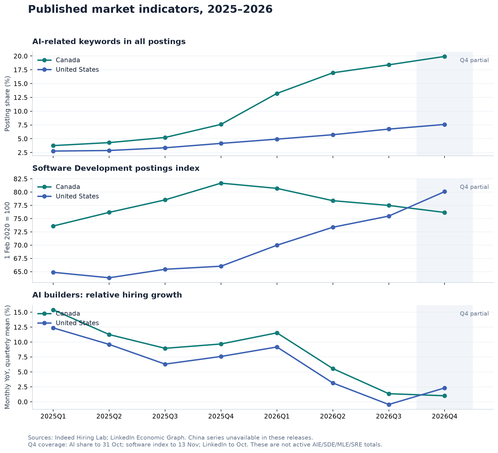
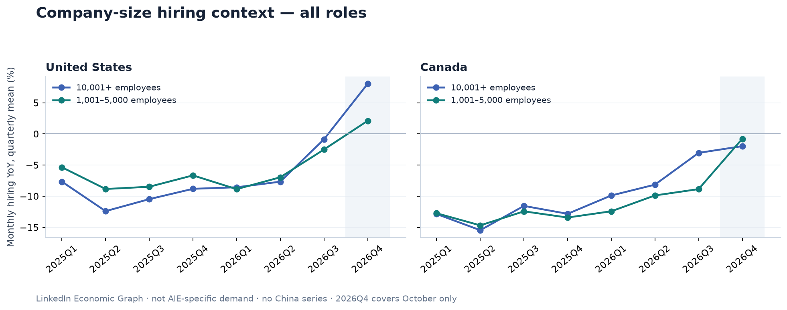
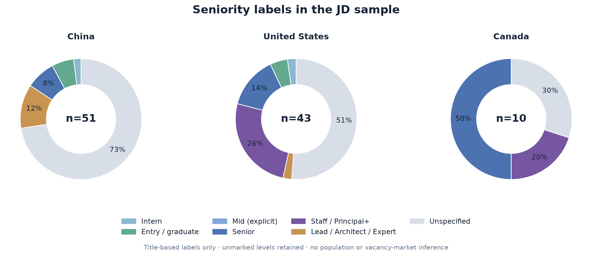
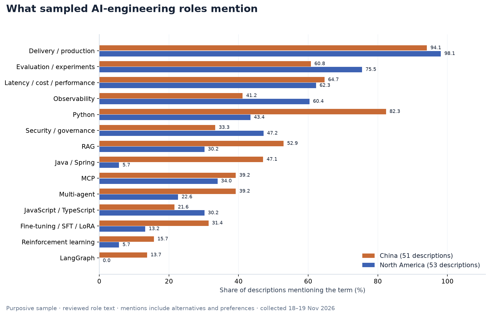

# AI Engineer 岗位总述：市场、能力与学习路线

本路线面向希望进入 **应用与系统 AI Engineering** 岗位的学习者。目标是逐步建立企业需要的知识、技术与项目经验，能用作品说明能力、应对技术面试，并在入职后承担端到端 AI 产品交付。

这里的 AI Engineer 把模型、数据、工具和业务系统组织成可用的产品：从理解需求、定义成功标准开始，完成方案选择、软件实现、质量评测、部署上线和持续改进。企业购买的是业务结果，例如缩短处理时间、提高知识查找准确率、减少重复操作，同时控制错误、延迟、成本和数据风险。

## 1. 先看岗位，再看技术名词

招聘标题并不统一。AI Engineer、LLM 应用工程师、Agent 工程师、Applied AI Engineer，以及部分 Forward Deployed Engineer，都可能承担上述工作。判断岗位时，应读职责和交付物。

| 工作方向 | 常见交付物 | 需要形成的主要能力 |
|---|---|---|
| AI 产品与应用 | 知识助手、文档处理、业务自动化、语音或多模态产品 | 后端与产品工程、模型集成、RAG/Agent、评测、用户反馈 |
| Agent 平台与工具 | 执行内核、工具平台、MCP 服务、评测与观测平台 | 状态与持久执行、协议、权限、沙箱、可靠性、开发者体验 |
| 客户场景交付 | 场景调研、企业系统接入、试点、上线与推广 | 需求发现、集成、领域理解、效果验证、跨团队协作 |
| 应用效果与性能优化 | 数据与模型实验、微调、小模型服务、成本优化 | 实验设计、训练数据、后训练、推理性能与容量测量 |

SDE 的软件工程是共同底座；MLE 提供数据与模型实验方法；SRE 提供可靠性和运行方法。本路线选择其中与 AI 产品交付直接相关的内容。大规模预训练、GPU 内核研发和研究型算法岗位需要额外的专业训练。

## 2. 招聘市场：哪些变化有数据支持？

研究更新于 **2026-11-19**。下面分别使用招聘广告、招聘指数和入职趋势；三种指标各自回答不同问题。

### 美国与加拿大：AI 技能扩散，整体软件招聘仍有压力

Indeed Hiring Lab 的公开数据记录招聘广告中 AI 相关关键词的占比，以及 Software Development 类广告相对 2020-02-01 的指数。按公开日值取季度平均，得到以下结果。[Indeed AI 数据](https://github.com/hiring-lab/ai-tracker)、[招聘指数数据](https://github.com/hiring-lab/job_postings_tracker)

| 指标 | 美国 2025Q1 → 2026Q3 | 加拿大 2025Q1 → 2026Q3 | 阅读方式 |
|---|---|---|---|
| 全部广告中 AI 关键词占比 | 2.77% → 6.75% | 3.76% → 18.41% | 包含在工作中使用 AI 的其他职业 |
| Software Development 广告指数 | 64.87 → 75.47 | 73.61 → 77.48 | 2020-02-01 = 100；属于广义软件类别 |
| LinkedIn AI builders 相对招聘增速 | +12.37% → −0.45% | +15.39% → +1.36% | 月度同比指标的季度均值；衡量入职趋势 |

LinkedIn 的 AI builders 定义覆盖较广的 AI 构建人才，其招聘指标与广告指标不能相加。[LinkedIn 指标面板](https://pulse.linkedin.com/reporting-ai)

图中 2026Q4 为部分季度：AI 广告占比截至 10 月 31 日，软件广告指数截至 11 月 13 日，LinkedIn 截至 10 月。前三季度之间可以比较完整季度均值；Q4 应结合实际覆盖日期阅读。[季度 CSV 与来源记录](../../research/market/)

这些数据支持的判断是：越来越多岗位涉及 AI 技能，而广义软件招聘指数仍低于 2020 年基线。AI 技能需求的增加，与某个职位名称的空缺增长，是两个需要分别测量的问题。

### 中国：Agent 应用需求有增长信号，缺少同口径全国季度序列

央视财经 2026 年 8 月报道的招聘平台口径显示，上半年 AI Agent 相关岗位需求同比增长 **244%**。它说明特定平台上 Agent 应用需求增长较快，覆盖时间、平台和岗位分类均与北美曲线不同。[央视财经报道](https://finance.cctv.cn/2026/08/28/ARTIxnofbL409vkM6skY5WRh260828.shtml)

本研究收集的中国 JD 涉及互联网、企业软件、制造、汽车、金融及消费硬件；企业场景包括知识检索、办公与客服流程、数据分析和行业应用。下一节用独立的中国样本分析技能要求。

### 大厂、中厂与职级应该怎样比较？

LinkedIn 的公开企业规模数据可比较不同规模雇主的**整体入职趋势**。下图采用 10,001 人以上与 1,001–5,000 人两档，分别展示美国和加拿大；规模档位由来源定义，未覆盖全部中小企业。

它提供求职环境背景。**AIE 专属的企业规模需求历史**还需要带职位分类的历史广告数据。

本次 JD 的职级按标题明确标注统计，保留“未注明”。中国、美国、加拿大的样本分别为 51、43、10 份；没有明确 mid 标记的岗位不会被推定为 mid。

这张饼图说明当前样本的构成，不能据此估计全国初级或高级岗位的占比。对转岗或入门学习者，更有用的做法是对照目标职级检查独立交付、系统设计和运行责任。

### 尚未获得的精确数据

| 研究问题 | 本研究已获得 | 仍缺的数据 |
|---|---|---|
| 三个国家 AIE/SDE/MLE/SRE 活跃空缺总量，2025Q1 至今 | 美国、加拿大的上述公开趋势；三国 JD 样本 | 按统一分类、去重且含关闭日期的全国历史空缺库 |
| 大厂/中厂 AIE 数量变化 | 美国、加拿大按企业规模的整体入职趋势 | 三国 AIE 专属的规模分层历史广告 |
| entry/mid/senior/staff 市场占比 | 三国 JD 样本的明确职级分布 | 有代表性的岗位总体及稳定职级映射 |

这些缺口保存在[待补的全国季度表](../../research/market/requested-national-active-counts.csv)中，数值为空。搜索页命中数、当前抓取结果或招聘增速都不足以还原这些历史总量。

## 3. 104 份 JD：企业反复要求什么？

本次按应用/系统 AIE 职责筛选 **中国 51 份、北美 53 份**描述，覆盖 43 家雇主；北美再分美国 43 份、加拿大 10 份。来源包括企业招聘 API、企业页面、高校承载的企业招聘原文和可追溯的转载。66 份采集时仍列在企业职位列表，38 份的描述可访问、开放状态未确认。样本用于研究岗位内容。

以下统计单位是“描述中提到该技术或能力”，包括必需条件、备选技术、职责和加分项。每份描述每个关键词计一次；按已复核的职责与资格文本计算。[逐条来源](../../research/jds.json)、[关键词规则](../../research/keyword-codebook.json)、[完整统计](../../research/keyword-counts.csv)、[中国逐条分析](jd-china.md)、[北美逐条分析](jd-north-america.md)

| 技术或能力 | 中国，n=51 | 北美，n=53 | 对学习路线的含义 |
|---|---:|---:|---|
| 产品落地 / 生产交付 | 48 · 94.1% | 52 · 98.1% | 项目必须贯穿实现、验证和运行 |
| 评测 / 实验 | 31 · 60.8% | 40 · 75.5% | 基线、测试集和失败分析应从首个项目开始 |
| 延迟 / 成本 / 性能 | 33 · 64.7% | 33 · 62.3% | 同时报告质量、延迟、资源和成本 |
| 可观测性 | 21 · 41.2% | 32 · 60.4% | 学会从 trace 定位检索、工具和生成问题 |
| 安全 / 治理 | 17 · 33.3% | 25 · 47.2% | 权限、数据边界和操作审计进入系统设计 |
| Python | 42 · 82.4% | 23 · 43.4% | 选作本路线的共同实现语言 |
| Java / Spring | 24 · 47.1% | 3 · 5.7% | 中国企业系统集成的可选纵深 |
| JavaScript / TypeScript | 11 · 21.6% | 16 · 30.2% | 产品界面、流式交互与全栈交付 |
| RAG | 27 · 52.9% | 16 · 30.2% | 学会数据接入、检索、引用和分层诊断 |
| MCP | 20 · 39.2% | 18 · 34.0% | 学会协议、工具契约与授权集成 |
| Multi-Agent | 20 · 39.2% | 12 · 22.6% | 掌握协作机制并实测额外复杂度 |
| 微调 / SFT / LoRA | 16 · 31.4% | 7 · 13.2% | 在评测与数据基础上选择后训练纵深 |
| 强化学习 | 8 · 15.7% | 3 · 5.7% | 理解原理，面向相关岗位深入实践 |

### 共性：把不稳定的模型能力做成可运行的业务系统

两个样本都强调交付、实验和性能。对应的工作链是：

1. **定义任务。** 明确用户、业务流程、可接受的错误和收益指标。
2. **准备数据与接口。** 接入文档、数据库和业务 API，处理数据质量、更新和访问权限。
3. **构建方案。** 选择模型，设计上下文、检索、工具及控制流程，接入产品界面。
4. **建立证据。** 用固定测试集、真实失败案例和基线比较效果，检查安全与恢复行为。
5. **上线并运营。** 监控质量、延迟、成本和故障，用用户反馈迭代数据、程序或模型。

学习者需要能说明每一步做了什么、为什么这样选、遇到失败如何定位，以及效果改善是否值得增加成本。

### 差异：按目标岗位调整深度

中国样本更经常明确列出 Python、Java、RAG 和后训练技术；北美样本更经常出现 API/系统集成、可观测性、安全、云和客户交付。中国样本中互联网岗位较多，北美样本中 AI 原生与客户交付岗位较多，行业构成和抽样来源都会影响结果。完整 CSV 同时提供雇主等权统计，便于检查单一雇主多岗位的影响。

据此可以制定求职策略：中国方向可加强 Python/后端、检索和业务 Agent，并依据 JD 补 Java 或模型优化；北美方向可加强软件设计、集成、评测、可靠性及需求沟通。加拿大样本仅 10 份，应逐条阅读目标 JD 后决定优先级。

## 4. 怎样从岗位要求走到完整知识体系？

本路线将 JD 中的交付要求拆成以下知识层，并补入支持这些工作的基础知识。每个单元列明知识脉络、学习深度、主读资源和动手产物；[完整知识树](knowledge-tree.md)包含 **17 个模块、126 个单元和 693 条主题分支**。

| 知识层 | 要学到的范围 | 能承担的工作 |
|---|---|---|
| 00–02 岗位、Python 与后端 | 类型、测试、异步、HTTP、数据库、事务、队列、缓存、工程协作 | 写出可维护服务，接入现有系统，处理并发和失败 |
| 03–04 数学、ML 与 Transformer | 概率统计、梯度与张量、PyTorch、注意力、tokenizer、训练与生成 | 理解模型行为，解释常见限制，做可信实验 |
| 05 模型应用与上下文 | 模型 API、结构化输出、工具调用、提示与上下文、多模态和语音 | 做出可交互的模型应用，管理输入输出契约 |
| 06 数据与 RAG | 解析、增量索引、稀疏/向量/混合检索、重排、引用、权限和评测 | 将企业数据转为可追溯的回答与处理结果 |
| 07–09 Agent 与编排 | 单 Agent、harness、记忆、状态恢复、LangGraph/同类框架、持久工作流、Multi-Agent | 实现可恢复、有边界、可测量的任务执行 |
| 10 工具平台与执行环境 | MCP、身份与授权、业务工具、沙箱、资源限制、审计 | 安全集成外部系统和代码执行 |
| 11 评测与观测 | 数据集、指标、人工/模型裁判、实验、trace、回归、线上反馈 | 找到失败来源，验证优化并监控退化 |
| 12 后训练与优化 | SFT、LoRA/QLoRA、偏好学习、RLHF/DPO、PPO/GRPO、Agentic RL、蒸馏 | 为具体问题选择数据和训练方法，测量增益与代价 |
| 13 推理与基础 AI Infra | 本地小模型、vLLM/SGLang、量化、KV cache、调度、profiling、多卡认知 | 部署和测量模型服务，解释吞吐、延迟与显存取舍 |
| 14–15 产品交付与求职 | 需求与验收、容器/CI/CD、可靠性、安全、运营、作品和面试 | 独立展示完整交付，解释系统设计和工程决策 |
| 16 拓展 | 世界模型、仿真、具身数据、机器人策略和部署 | 为相关岗位建立后续学习入口 |

基础学习与项目并行推进：先做一个模型 API 服务和小型评测集，再加入检索与工具，随后处理持久状态、权限和部署，最后选择后训练或推理优化等纵深。[学习顺序](dependency-order.md)

## 5. 课程与高星项目怎样进入路线？

[Stanford CS329Z](https://cs329z.stanford.edu/)承担 Agent 系统主线：从任务、工具与 harness，走到记忆、协作、评测和优化。课程正在进行，使用已公开的讲义和作业；Python、后端、模型原理、训练与部署由对应的官方文档和开放课程补齐。学习者可以免费获取核心阅读材料；调用商业 API 或使用 GPU 时按实际用量计费。

GitHub 项目承担源码与工程实践参考。本次记录 61 个项目的公开元数据；选择时考虑职责、维护状态、文档与学习价值，星数用于发现候选。以下是优先进入路线的机制：

| 项目类别与代表 | 提炼进路线的内容 | 对应企业问题 |
|---|---|---|
| LangGraph、PydanticAI、ADK | 显式状态、类型化工具、持久化、人工介入、框架迁移 | 长任务失败、难调试、工具契约脆弱 |
| Temporal、DSPy | 持久工作流；基于数据的程序与提示优化 | 外部操作重试、长期执行、手工调参缺乏证据 |
| RAGFlow、Haystack、LlamaIndex | 文档接入、检索组件、索引生命周期、分层评测 | 企业资料难用、回答来源不清、检索退化 |
| MCP、OpenHands、Langfuse | 工具协议、执行环境、权限、轨迹与反馈 | 集成成本、代码执行边界、故障定位 |
| Transformers、PEFT、TRL、LlamaFactory | 模型与数据格式、适配训练、偏好优化、实验记录 | 格式/行为问题、数据不足、训练收益难证明 |
| vLLM、SGLang、llama.cpp | 服务调度、缓存、量化、性能基准 | 资源成本、并发容量与交互延迟 |

例如 LangGraph 在本次中国样本中出现 7 次、北美样本中 0 次。选择它作为主要编排教学工具，是因为它适合学习状态与恢复；学习成果还包括理解其他框架的相同机制。具体仓库、快照与选型依据见[开源项目研究](open-source.md)和[技术选择](stack-decisions.md)。

## 6. 学完后，用什么证明可以承担工作？

一个用于求职的完整作品应留下以下材料：业务任务与验收标准、可运行系统与部署说明、带版本的数据和评测集、基线与优化比较、质量/延迟/成本结果、权限与故障恢复演练，以及能被他人复现的设计说明。

项目可选择企业知识系统、带业务操作的流程 Agent、文档处理产品或模型服务优化等场景。学习阶段逐步完成数据、服务、检索、Agent 和上线任务，最后形成一个端到端作品，并深入一个有实测结果的方向。评审重点包括独立实现、问题定位、设计取舍和业务验收。[项目实践](capstones.md)、[能力评审](assessment.md)

这套路线的就业目标贯穿全过程：**对照目标 JD 建立知识体系，用实现和实验积累经验，用清楚可核验的作品参与求职，并形成入职后继续交付和学习的能力。**
